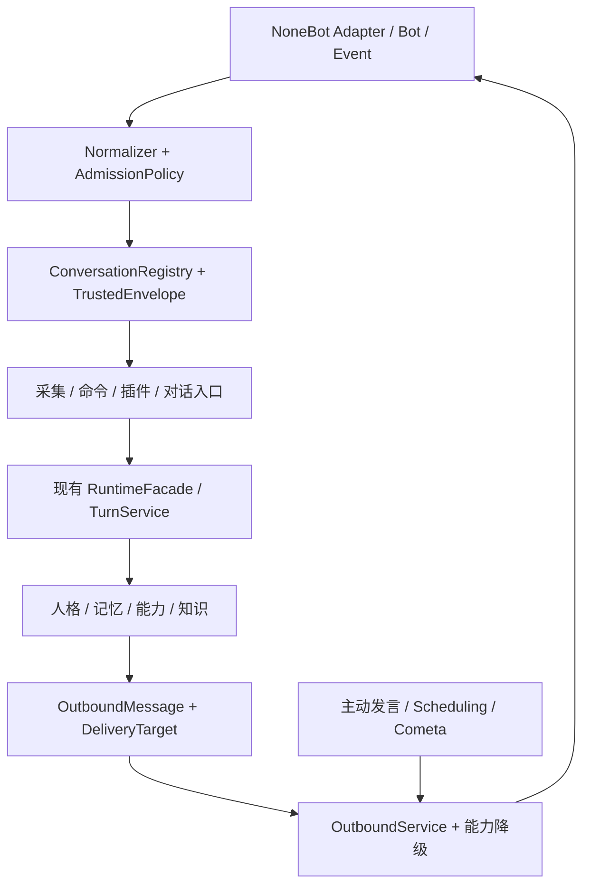

# Stella 跨平台接入工程执行方案（GitNexus 证据版）

- 日期：2026-10-20，Asia/Shanghai。
- 源码基线：`main@ba582a922f4d3379b6397c4c0a8d8ef3e7c3e77d`；工作区 `/home/vegetable/repos/Stella`。
- 规划阶段交付：本地 GitNexus 代码图谱、原始查询证据、改造清单及执行方案；当时未实施业务改造。
- 实施状态：2026-10-21；WP00–WP09 完成，下一阶段 WP10。计划完成不代表平台支持、数据迁移或发布验收完成。
- 证据目录：[cross-platform-20261020](../reports/evidence/cross-platform-20261020/README.md)。逐文件清单、50 个入口、32 个适配器矩阵见[执行附录](2026-10-20-cross-platform-inventory.md)。

## 1. 目标与可验收边界

让 Stella 的对话、记忆、人格、能力调用通过 NoneBot 的各适配器接入；新增平台不复制聊天主流程。用户、会话、机器人、消息与投递目标均有明确身份；后台回复能跨进程恢复至原账号和原会话。

“全部平台”以冻结的官方商店适配器快照为验收分母。本轮取得 32 条注册项，原文件、URL 和 SHA-256 已保存；自定义/私有适配器通过同一扩展合同加入分母。商店收录、包可安装、运行时能加载、真实消息可收发是四种不同事实。失效平台保留记录并标明 blocked，不能当作已支持；不具备聊天事件的平台按事件语义评估，不伪造聊天支持。后续新增适配器是增量认证工作，不承诺未知协议自动拥有所有高级能力。

支持分层：L0=依赖/驱动兼容且成功注册；L1=可靠消息事件的纯文本交互；L2=可信会话、记忆隔离、命令和准确回投；L3=图片、文件、引用、成员信息、主动消息等按能力验证。各行分别记录 fixture 与 live 状态，`not_applicable` 必须有协议证据；`skipped`、`blocked`、零样本均不能算通过。

不在本项目中实现跨平台消息转发、自动账号合并、任意 AstrBot 插件的底层 API 仿真，也不改 LLM 路由/记忆提取的业务目标。跨平台共享空间复用现有机制，跨平台账号绑定另立功能；本方案先保证隔离。

## 2. 已建立的图谱及可信范围

使用仓库 CI 同版 `gitnexus@1.6.11`；运行时 Node `v24.19.0`。命令：

```bash
# 本机 shell 的 PATH 尚未默认包含此运行时；以下只影响当前 shell。
export PATH=/home/vegetable/.cache/codex-runtimes/codex-primary-runtime/dependencies/node/bin:/home/vegetable/.cache/codex-runtimes/codex-primary-runtime/dependencies/bin/fallback:$PATH
pnpm --allow-build=@ladybugdb/core --allow-build=gitnexus --allow-build=tree-sitter dlx gitnexus@1.6.11 analyze --index-only --workers 1 --pdg --name Stella_project --default-branch main
```

图存于 `.gitnexus/lbug`，仓库别名 `Stella_project`，本地 runner `.gitnexus/run.cjs`；为避免其默认latest造成漂移，另提供固定1.6.11的 `.gitnexus/gn`。`--index-only` 保留既有 Agent 指令与技能；未修改 Codex/Claude 全局 MCP 设置、未启动公网服务、未使用模型 API。

基线建库约 80 秒：1,249 文件、95,747 图节点、236,981 关系、829 条推断流程。元数据报告 1,009 clusters；原始图实际有 957 个 Community 节点，两个统计口径都保留，不能混称。节点包括 71,358 个 BasicBlock，不能把 95,747 全称为业务符号。关系包含 16,869 CALLS、78,443 CFG、64,111 REACHING_DEF、38,321 CDG。初始 `status --json` 显示 up-to-date，内容指纹 current；元数据见证据目录；初始状态已在会话中核验，最终复查见本地验证记录。本轮文档落盘后另做最终刷新，初始统计仍是上述源码基线快照。

已执行 repo context/schema/processes/clusters 资源读取、8 类概念 query、关键符号 context/upstream impact、原始 Cypher 全量流程枚举和 PDG 切片。同名函数/属性及 Rust Struct/Impl 用 UID 消歧。具体命令与参数保存在 commands/followup/final-audit 清单。

限制及补证：

- 默认 512KB 阈值跳过 12 个大文件，含生成的 message-flow JSON、历史资料和图标；逐项列于证据，不宣称每个仓库文件都被语义解析。
- GitNexus 流程构建丢弃 2,667 个候选入口，另有深度、分支和遍历预算截断；829 是已生成流程数量，**不是运行流程全集**。resource/processes 只显示摘要页，本轮用 Cypher 导出了全部 829 个 Process。
- callable-value-flow 的 32 候选上限及动态注册、回调、跨语言边界会缺 CALLS；910 个跨语言属性读写站点也被索引器明确标为不能连边。`epistemic=lower-bound` 必须保留。
- repository runtime inventory 独立核验：50 个声明入口，9 个流程族，34 个注册扫描结果；双向差集为空。逐入口处置见附录，避免只从抽样流程规划。
- 同步扫描 599 个已跟踪生产/部署/前端/工具文件，得到 123 文件中 1,112 条字面量命中；包含注释、兼容逻辑和生成 manifest，**不是 1,112 处必改**。每个命中带文件、行号、类别和片段，执行时需判定。
- 部分首次查询歧义、目标名猜测失败、资源误用 ID、一次 impact 中断均保留；已通过 UID、正确文件/名称、resource label 和重试补证。PDG 首轮 depth=3 截断，重跑 depth=64 后覆盖本地 26 个块，最远 7 层，无截断；它仍不是跨函数、跨平台权限正确性证明。

## 3. 图分析对初步方案的修正

下面的风险是 GitNexus 原始风险，不以较低的 `riskSharedAxes` 替代；direct 是图中直接依赖数，包含导入/文档边的项目需另行解释。完整依赖项与受影响流程在对应 impact JSON。

| 锚点 | direct / 影响总量 | 原始风险 | 工程含义 |
| --- | --- | --- | --- |
| `conversation_key`（Function UID） | 6 / 14 | CRITICAL | 私聊工厂、群/私聊/WebChat 注册、身份查找都受影响，须用别名兼容层迁移 |
| `record_message` | 4 / 18 | CRITICAL，lower-bound | 群、私聊、WebChat、BOT_SELF 共同入口；索引另报告 3 个未定型调用站点 |
| `resolve_space` | 13 / 28 | CRITICAL | 牵动检索、Planner、知识权限、WebUI、主动发言，不能仅改群配置 |
| `scope_for_chat_context` | 2 / 5 | HIGH | 改身份必须同时改权限谓词及调用方，不能在失败时扩大可见范围 |
| `assess_candidate` | 1 / 3 | HIGH | 经候选写入→整合→后台 drain；来源审核也要去 QQ 固定身份 |
| `verify_source_snapshot` | 4 / 10 | HIGH | 保留旧证据快照/摘要与验证版本，不全库重算证明 |
| Python `RetrievalRequest` | 10 / 108 | HIGH | 包含导入和文档依赖，涉及 Python/Rust backend、selector、基准与合同文档 |
| `build_event` | 2 / 5 | HIGH | 既供 AstrBot 指令分发，也供 Comes 工具上下文，两个入口都必须迁移 |
| `deliver_lines` | 6 / 10 | HIGH | 覆盖群、私聊、主动路径及外部任务确认，不能分散替换 send API |
| `extract_image_sources` | 5 / 5 | HIGH | 触发条件和视觉处理共用，媒体归一化需前后一致 |
| `Origin` | 19 / 31 | HIGH | 外部任务、恢复与投递协议需要显式版本升级 |
| `parse_platform_message_id`（补查） | 2 / 22 | CRITICAL | 旧规范只接受十进制，通用ID必须另立合同，保留QQ有符号ID兼容 |
| `parse_reply_envelope`（补查） | 2 / 6 | HIGH | 回复目标目前强制数字；需升级模型回复协议而非仅修改消息入口 |

表中数字已从 impact 原件同步并在计划验证阶段核验。Class 的导入影响、函数调用影响与 File 的文档影响不等价。

UNKNOWN 的处置：`record_group_chat`、`handle_chat`、`handle_private_chat` 是 NoneBot 注册入口，零静态调用不是未使用；注册扫描证明其存活。`_scheduling_sender` 被 `_build_scheduling_stack` 作为 `sender=` 回调注入。基线中的 `get_or_register_group` 仅有定义/测试引用；WP05 已将其接入群被动采集和 @ 对话入口。Rust RetrievalRequest 的 Struct 图仅显出测试构造，不足以覆盖 serde/PyO3 JSON 边界，系统风险仍按 HIGH 管理。

## 4. 目标合同与模块边界

`core/transport/` 已包含 `models.py`、`keys.py` 与 `normalizers.py`；`registry.py`、`capabilities.py`、`outbound.py`、`media.py` 和 `adapters/` codec 仍属后续工作包。启动装配可放在 `stella_project/plugins/bot_main/platform_bootstrap.py`，不让 core 反向依赖插件接线。上层 Runtime/记忆消费 Stella 自有 DTO，Alconna/Uninfo 的第三方类型不进入数据库及核心合同。



### 4.1 身份与会话

| 模型 | 必需内容 | 不变式 |
| --- | --- | --- |
| `BotRef` | connection_id、adapter、platform_scope、self_id | self_id 原样保存；同号跨适配器不混用 |
| `UserRef` | identity_domain、raw_user_id、subject_key、可选 display_name | 名字/正文/模型输出不构造身份；未知身份域默认按连接隔离 |
| `SceneRef` | kind、完整 parent_path、scene_id、可选 thread_id | 频道/线程不被压成群号；缺字段时 kind=opaque，不能猜 private |
| `ConversationRef v2` | BotRef、SceneRef、规范 key、内部 storage_session_id、memory_space | 会话、用户、空间三者继续独立 |
| `MessageRef` | conversation_key、平台消息 ID、可选修订/线程信息 | 不转换数字、不拿数据库行号替代平台消息 ID |
| `TrustedEnvelope` | sender、conversation、message、timestamp、text/segments、reply/mentions、source_kind、可选当前事件句柄 | 持久数据来自可信适配器；事件句柄仅进程内使用 |

键采用带版本的规范 JSON 数组编码或等价无歧义编码；WP00 固定唯一实现和测试向量，不再拼冒号再按固定段数 split。对既有 QQ/WebChat 键维持查找与 alias 映射，历史来源串原样有效。用户的 identity_domain 与 adapter 名分离：明确文档证实共享 ID 域时才能共享域；OneBot/Satori 背后的平台未知时按连接隔离。QQ 官方的不同开放 ID 域不得自动与 QQ 客户端账号合并。

外部 ID 统一 str；内部 SQLite 行号、压缩水位、轮次序号、配额计数、storage_session_id 保持整数。`ctx.user_id` 表示原始用户 ID 字符串，新增 `subject_key` 为唯一身份；核心关联、配额和画像必须用 subject_key，不能只把 int 改 str 后继续用裸 ID。新表复合主键使用规范主体/会话键；保留原始 ID 用于显示及协议回投。

模型回复协议也纳入 WP02：`core/dialogue_attribution.py` 的 `SourceEvidence.author_id` 投影会强转整数，`parse_reply_envelope` 与 `reply_envelope_from_projection` 都要求 target_user_id 为数字；`memory/conversation_identity.py` 的纠正目标解析也有数字条件。新协议使用 `target_ref`（如本轮 `U1`），由服务端从可信 UserRef 创建有界映射并绑定 turn_id/identity_revision/generation_epoch；解析后只允许映射中的成员，先还原可信 UserRef 再做归属验证。旧数字目标协议仅在旧QQ上下文兼容读取，不对其他平台启用。模板、尾巴、引用作者、身份capsule、SourceEvidence序列化和最终回复守卫同步；不允许模型用任意原始ID选投递地址。新消息ID规范接受不透明字符串，旧 `parse_platform_message_id` 的QQ十进制校验退到QQ兼容codec，避免把 `abc`、`007` 等其他平台合法ID变成unknown。

### 4.2 接入、消息与能力

`normalize(bot,event) -> NormalizedEvent | UnsupportedEvent`；只对具有消息/作者/会话语义的事件进入聊天。非消息事件走健康/通知专门路径。通用回退使用 NoneBot `get_user_id/get_session_id/get_plaintext/is_tome`，方法不适用则返回明确结果；opaque session 仅保证当前事件的安全交互，不能推断群权限或持久投递地址。

`AdmissionPolicy` 接收 BotRef/SceneRef/触发方式：按连接和规范会话配置启用范围；私聊开关、白名单、管理员命令均保留。把现有命令优先级、互斥词表、插件接管、self echo 过滤及空文本/纯图行为写成共享测试；不为每个平台复制命令 handler。

`OutboundMessage` 是有序消息段；支持 text、image、file、at、reply、native_extension。以 UniMessage 完成受支持适配器的转换；原平台专属段仅在适配器身份一致时传递，不把 OneBot 段发给另一平台。Uninfo 负责结构化会话/成员信息；未覆盖平台通过注册 Normalizer/Exporter/TargetCodec 扩展。现有命令解析器无需整套改成 on_alconna。

能力描述不仅是 supports_image 等 bool：还应包含 passive_receive、private/group/channel/thread、quote/mention、fetch_message/member、role、upload、proactive_send、send_window、length/rate limits。实例权限、当前场景、token 范围或窗口有效性可把能力缩小，不能只按 adapter 名静态放行。

### 4.3 投递目标与回执

`DeliveryTarget v1` 持久化 connection_id、adapter、platform_scope、bot_id、scene_type/path、thread_id、target_codec_version 及允许持久化的平台路由参数；正文/模型不能提供可信目标。凭据仅引用 connection_id，不复制 token。回复窗口令牌等短期字段带 expiry，过期不当永久地址。

`send(target,message,context?) -> DeliveryResult`：明确 accepted / failed / unknown / unsupported / expired，回执包含原始消息 ID 列表和逐段结果。`send` 成功但无 ID 记“API 接受、无引用锚点”，不声称用户已读或可撤回。批量/多气泡结果不压成单一整数。

选择 Bot 使用已注册连接绑定与指定 adapter 的 bots[self_id]，同时复核平台范围；禁止后台无参 get_bot() 或回退到“第一个在线账号”。同一 adapter 无法表示的同号重复 Bot 配置在启动时报错，不承诺框架无法表达的连接隔离。

能力降级顺序按消息意图制定：图片卡片→等价文字，文件/长结果→平台可用附件或分段摘要；不支持 quote/at 时普通发送。未知发送结果不自动重投，不因一次超时再次发送同一份长结果。延续 Scheduling/Cometa 既有 CAS 与 unknown 语义；仅对平台明确未接受的失败按限流信息有界重试。

### 4.4 核心行为和权限

群、频道、线程的短期上下文/压缩/锁/取消/去重/主动冷却按 ConversationRef 隔离；memory_space 只控制明确配置的长期共享。主动群级发言不伪造用户主体；主动定向发言的目标来自可信选取链。

PERSON 私聊事实保持 PRIVATE_ONLY；共享空间不隐含跨平台个人事实授权。`knowledge.Principal`、KB owner/grants、工具上下文及分享/撤回台账都使用有命名空间的主体，迁移不能只改 memory owner。查不到来源/主体时返回不可见或身份未知，不能回落为授权更大的默认空间。

所有入口继续遵守采集就绪门：关闭时内容及派生身份/社交数据不落库、不排队补录；回复和插件路径按原有语义运行。线程缺失引用作者时保留 unknown，不用最近发言者补齐。保持 8192 tokens 预算；规范键不必整段灌入 prompt，可生成轮次内短标签，但服务端映射必须无歧义且禁止模型改写。

## 5. 数据、合同升级与回滚

源码基线实际版本：memory schema=20，backend API=3，ChatContext projection=6，Cometa Origin=2；Scheduling/Cometa/Knowledge SQL schema 各为 1。README 历史 schema19 描述不能作为迁移起点。

| 合同 | 拟升级 | 处理 |
| --- | --- | --- |
| Memory schema | 20→21 | 增加身份/会话结构、alias/主体映射及必要索引；在单一迁移中重建受影响主键 |
| Python/Rust backend API | 3→4 | RetrievalRequest 的字符串 ID/subject_key、来源版本和新 schema 检查同步；随包新 wheel |
| Native memory schema 常量 | 20→21 | Python、Rust、selector、构建清单同版；旧 wheel 显式拒载 |
| ChatContext projection | 6→7 | 新身份字段进白名单；v6 仅按确认的旧语义读入，未知新版本拒绝 |
| 回复协议/包络投影 | `2026-10-08.1` / schema1 → 新协议 / schema2 | 新版本使用target_ref和可信本轮映射；旧数字目标仅按QQ旧版读取 |
| 会话转录格式 | 1→2 | 不透明消息ID、作者标签及引用保持可逆；旧尾巴读取与摘要水位兼容 |
| Cometa Origin JSON | 2→3 | 增加 BotRef/Target；v2 只能绑定原 QQ/WebChat 路由 |
| Scheduling SQL schema | 1→2 | task/run/quota/audit 的目标、主体及作用域字段同步；旧 group_id 不再充当发送目标 |
| Knowledge SQL schema | 1→2 | owner/grant 主体域与旧主体映射，未证实映射保持隔离 |
| Cometa SQL schema | 优先保持 1 | 已有 origin_json/target_json 可容纳新版本；若确需新增路由索引/列再分配 v2，不能随 Origin 版本机械升级 |

以上是此源码基线的目标号；若合入前其他工作已占用版本，重新分配单调版本，不能覆盖已发布合同。

迁移步骤：停止相应写入和后台发送→备份完整 STELLA_HOME 及 WAL 一致快照→临时副本 dry-run→审阅无法绑定的旧数据→事务内迁移→索引/FTS 检验→新旧证据验证与回归→更新版本水位→恢复服务。失败回滚事务并停用对应 worker；进程中断重跑幂等。

历史数据处理：保留旧 QQ 存储号、WebChat -1 及已分配负数；新会话继续注册分配整数代理键。迁移遍历现有占用表，不用 hash、负用户号或整数符号推断类型。来源充分的 legacy QQ subject 映射保持 qq 原键；WebChat 和来源不足数据不能仅凭数字 ID 标成 QQ。历史共享空间、profile 主键碰撞逐项报告，未确定归属进入 legacy 隔离区，不能静默合并。老别名读兼容应覆盖 active task、缓存、trace、去重、压缩和分享撤回。

历史已验证证据的 source_snapshot/digest、lineage 和 fact_key 保留原件。新增 identity-envelope/source-snapshot 版本，按版本选择验证器；不得以身份迁移为由重算摘要并自动把 legacy_unverified 变 accepted。新来源使用规范主体；Python/Rust 对同一候选的批准/拒绝原因及最终写入必须一致。

仅关闭多平台开关不能撤销 schema 升级。应用回滚需恢复升级前完整数据备份与匹配 wheel；保留新数据的降级必须另做反向迁移工具。本方案不安排破坏性降级。

## 6. 可独立评审的工作包

所有工作包按当前图重新跑 upstream impact 后再编辑。高风险修改先报告直接依赖、受影响流程和边界；无论图风险 LOW/HIGH，都不能跳过合同、权限和数据验收。实施按依赖顺序分阶段提交；平台 live 与发布验收单独记录，不由本地代码测试替代。

| 包 | 依赖 | 主要交付与现有文件 | 验收 / 阻断条件 |
| --- | --- | --- | --- |
| WP00 合同冻结与基线 | 无 | transport DTO/版本设计；冻结平台矩阵和 QQ/WebChat 行为；`tests/runtime/`、`tests/observability/` | 迁移前可重复回放；所有待认证适配器都有一行；依赖版本/Python 范围验证并锁定 |
| WP01 身份和注册表 | WP00 | 新 keys/models；`core/conversation.py`、`memory/conversation_registry.py`、`config/spaces.py`、`space_map.py` | opaque/非数字/冒号/Unicode ID、parent/thread、同号多 Bot、并发分配、重启 alias 均通过 |
| WP02 上下文和消息身份 | WP01 | `core/context.py`、`core/runtime/facade.py`、`turn_service.py`、`memory/conversation_projection.py`、`conversation_identity.py`、`summary_packet.py`、`core/dialogue_attribution.py` | projection 6/7 和回复协议转换；本地行号与外部消息 ID 分离；reset/cancel/过期回复保护不串会话 |
| WP03 存储迁移与双后端 | WP01、WP02 | `memory/schema.py`、`migrations.py`、`pre_processors.py`、`memory_manager.py`、`memory_rust/backend.py`、`python_backend.py`、`selector.py`、`native/src/{retrieval,promotion,schema,lib}.rs` | schema20副本升级/中断/重跑；API4 wheel 检验；Python/native 检索和晋升显式 parity，native 缺席不算通过 |
| WP04 记忆/权限/社交作用域 | WP02、WP03 | `memory/ownership.py`、`evidence_contract.py`、`retrieval_v2.py`、`personal_sharing.py`、`addressing.py`、`social_*`、`knowledge/{acl,domain,store,schema}.py`、`capability/providers/knowledge.py` | 同裸 ID 不串画像；私聊→群/频道泄漏为0；旧证据仍有效；分享撤回/KB ACL/主动目标校验均覆盖 |
| WP05 通用入口与命令 | WP02、WP04 | 新 normalizers/admission；`ai_gateway.py`、`webui/chat_ingress.py`、`core/vision.py`、`capability/hooks.py` | 最先采集、插件接管、命令互斥、群/私聊/线程、纯图、self echo 和采集门语义通过；群入口统一登记 |
| WP06 消息、媒体及统一发送 | WP01、WP02 | 新 outbound/media/capabilities；`core/social/{delivery,contracts}.py`、`ai_gateway.py` 发送闭包 | 文本/图片/附件/引用转换；平台限长拆分；逐段回执；无数字 ID 假设；unknown 不重发 |
| WP07 后台目标与任务恢复 | WP03、WP04、WP06 | `memory/proactive*`、`session_context.py`、`ai_gateway.py` 后台 jobs、`scheduling/*`、`cometa/{models,store,policy,delivery,service}.py`、`cometa_bridge.py` | 多 Bot 离线/重启/令牌过期仍不串投；旧任务绑定明确；CAS/租约/unknown 状态机保留 |
| WP08 AstrBot 兼容 | WP05、WP06 | `astrbot_compat/{events,components,context,filters,pipeline,po}.py`、`capability/hooks.py`、`capability/adapters/astrbot.py` | 分发和工具两种事件构造都覆盖；通用链转换；真实平台过滤；QQ API 插件不在其他平台伪运行 |
| WP09 多适配器装配与健康 | WP05、WP06 | `bot.py`、`pyproject.toml`、`requirements.txt`、`.env.example`、新平台装配、`extensions/link_monitor`、`status_api.py` | 注册顺序/driver能力/依赖缺失错误明确；只注册启用项；按 Bot 隔离健康；无心跳平台不误报断线 |
| WP10 控制面和交付 | WP07、WP08、WP09 | `webui/{routers,services}` 平台/会话/群/空间/cron/KB、`dashboard/src/views` 对应页、i18n、`deploy/*`、CLI/Rust桌面/安装器、Docker/release脚本 | 多连接可配置和脱敏；路由先于 SPA mount；非QQ模式不被NapCat检查阻挡；包布局、随包资源和可选依赖有效 |
| WP11 全平台认证与发布 | WP00…WP10 | `tests/platforms/`（拟新增）、现有测试、flow catalog/inventory/manifest、CI、双语文档、版本/发行清单 | 每个矩阵行有最终状态与证据；L0/L1/L2/L3分开；代表平台live、多账号恢复、干净VM和QQ回归分别验收 |

### 实施跟踪

| 包 | 状态 | 结果 |
| --- | --- | --- |
| WP00 合同冻结与基线 | done | 可选平台依赖锁定为 Alconna 0.62.1 / Uninfo 0.11.2；Python 3.10/3.11/3.12 解析及导入烟测通过；QQ/WebChat 定向回归 142 passed。 |
| WP01 身份和注册表 | done | [WP01 实施记录](../reports/2026-10-21-wp01-identity-registry.md)：opaque key/models、独立 V2 注册表与 alias、跨版本负存储号隔离；定向回归 160 passed。 |
| WP02 上下文和消息身份 | done | [WP02 实施记录](../reports/2026-10-21-wp02-context-message-identity.md)：projection v6→v7、transcript v2、opaque message ID / QQ INTEGER codec 分离、bound target_ref；定向回归 310 passed。全量回归 3782 passed / 29 skipped / 4 failed，未关闭项见报告，故集成门禁仍 NOT READY。 |
| WP03 存储迁移与双后端 | done | [WP03 实施记录](../reports/2026-10-21-wp03-storage-backend.md)：schema 20→21、opaque 平台消息 ID 与主体持久化、Python/native API 4；定向回归 77 passed / 1 skipped，Rust 25 passed；wheel fullchain 与 embedding parity 通过。全量 pytest 因 Cometa worker 用例 30 秒无进展而中止，集成门禁仍 NOT READY。 |
| WP04 记忆/权限/社交作用域 | done | [WP04 实施记录](../reports/2026-10-21-wp04-memory-authorization-scope.md)：person owner、分享授权、地址偏好、社交记忆和 KB ACL 均按连接与命名空间主体隔离；memory/native schema 22、social schema 4、KB schema 2。定向 Python/Rust 回归、迁移、Ruff、文档、flow 与 GitNexus 证据见报告。全量 Python、平台 live 与发布验收未完成，整体仍 NOT READY。 |
| WP05 通用入口与命令 | done | [WP05 实施记录](../reports/2026-10-21-wp05-ingress-admission.md)：OneBot/通用 NoneBot normalizer、共享 admission、WebChat 可信身份、群入口注册、vision 与 AstrBot adapter guard；定向回归 214 passed。线程/频道新 adapter、平台 live 与发布验收仍未完成。 |
| WP06 消息、媒体及统一发送 | done | [WP06 实施记录](../reports/2026-10-21-wp06-outbound-delivery.md)：新增版本化出站消息/目标、媒体与能力合同、OneBot v11 UniMessage codec、按能力降级/限长拆分/逐物理段结果；群/私聊、Cometa ack、主动发言和能力清单接入统一服务。social schema 4→5 保存不透明 ID 列表；相关回归 138 passed。平台 live、全量 Python 与发布验收仍未完成。 |
| WP07 后台目标与任务恢复 | done | [WP07 实施记录](../reports/2026-10-21-wp07-background-recovery.md)：后台目标绑定 BotRef/DeliveryTarget，Scheduling SQL 1→2 只为可验证的旧 QQ 任务补目标；旧配额隔离；Cometa Origin JSON 2→3，并保留 CAS、租约和 unknown 不重投。定向回归 401 passed；Cometa 除 worker 挂起用例外 194 passed/7 skipped。worker 用例超 8 分钟无进展后中断，整体和 live/发布验收仍 NOT READY。 |
| WP08 AstrBot 兼容 | done | [WP08 实施记录](../reports/2026-10-21-wp08-astrbot-compat.md)：分发与工具事件构造均验证 OneBot v11 Bot；通用链转换；平台过滤按 adapter 类型名；Context 对多 OneBot Bot 歧义 fail closed。定向回归 373 passed，Ruff、文档与 flow 门禁通过。非 OneBot live、插件底层 API 仿真和发布验收未完成。 |
| WP09 多适配器装配与健康 | done | [WP09 实施记录](../reports/2026-10-21-wp09-adapter-assembly-health.md)：按 `STELLA_ADAPTER_MODULES` 在插件加载前注册适配器；缺包/驱动错误明确；逐 Bot OneBot V11 健康与探活，其他适配器健康未知。定向回归 73 passed，Ruff、文档、flow 与默认 Driver smoke 通过。非 OneBot live、全量 Python、QQ 灰度、clean VM 与发布验收未完成。 |

其他工作包仍为 planned；本表只在阶段实现、回归与提交后更新状态。

具体补充：WP04 不改变 EXTRACT 的语义句型，只让来源主体具有正确平台域；WP05 保留原有开关默认值；WP07 不允许从模型文本恢复路由；WP09 不做自动下载并执行未知第三方适配器；WP10 保留 QQ/NapCat 产品配置为一种连接 profile，不能把现有 QQ 用户的部署入口直接删除。

集成顺序：WP00→WP01→WP02→WP03→WP04→WP05→WP06→WP07→WP08→WP09→WP10→WP11。开发中通过一个明确的多平台启用闸门保持旧 QQ/WebChat 可运行；新平台仅在身份/权限/投递/装配完整后开放，不能在中间提交中默认放行。若拆多个分支，使用依赖串联评审；本方案不要求并行 Agent。

## 7. 逐入口和逐文件处置

附录以 50 个 runtime entry_id 为行，指定迁移/复用责任包；九个流程族全部有覆盖。maintenance、knowledge、memory、social 即使不直接收平台事件，也会消费会话/用户键，不能从改造范围中省略。入口对账在后续实施时每次重生成 manifest 前执行。

123 个字面量命中文件加上图依赖、直接分析目标和运行入口，合计180个候选文件列入附录：核心合同/接线/存储必须审查；工具、构建、CI、桌面和安装器按能力需求适配；QQ 专属驱动/API 封装可留在平台扩展；生成文件只重生成，不手工修改。行数仅用于审查导航，不能据此宣布代码必须改动或未命中文件一定无关。每个实际改动继续使用最新 graph context/impact 检查新增依赖。

## 8. 平台接入和依赖策略

本轮已冻结 32 个官方商店注册项，含新的 Matrix/WXClaw 等；它们不能被“Alconna 支持的大部分适配器”替代成更小分母。每个注册项需要记录 module_name、包版本、Python范围、driver要求、Normalizer/Exporter/TargetCodec、场景支持、权限/发送窗口、限流策略、fixture、live、维护状态。

优先次序：现有 OneBot V11/WebChat回归→Console→Telegram→Discord（频道/线程）→QQ官方（开放ID及窗口）→飞书/KOOK/Satori/OneBotV12→其余矩阵行。GitHub、邮件、直播等事件型平台单列场景/触发约定；不能把任意 webhook 通知直接当群聊天让 LLM主动回复。

依赖使用 Alconna uniseg 和 Uninfo，但业务层自有合同不绑定它们的数据库结构。WP00 在 Python3.10/3.11/3.12 与仓库现有NoneBot版本上验证候选组合后确定上下界/锁文件；本轮没有安装这些插件，不宣称某最新版组合已兼容。适配器按需安装，未启用平台缺依赖不阻止基础 Bot启动；已启用却缺依赖/driver则该连接明确失败，不偷偷回退QQ。

扩展注册支持 `Normalizer + MessageExporter + TargetCodec + CapabilityProvider`；只支持基础文本时可提供最小实现。第三方组件未覆盖的协议必须补薄适配或记录 blocked，不能靠通用fallback伪造频道ID、管理员权限、媒体源或主动发送能力。

## 9. 测试与验收矩阵

| 层 | 必测场景 | 实施时证据 |
| --- | --- | --- |
| 身份/键 | 非数字、负数字字符串、超大数、冒号/斜杠/Unicode、同ID跨域、父频道/线程、同Bot不同adapter | `tests/platforms/test_identity_contract.py`（拟新增）、现有 conversation/registry 测试 |
| 消息/触发 | 私聊、群@、回复、频道/线程、纯图片、通知不入聊天、重复更新、自己的消息 | 每adapter脱敏事件fixture；Normalizer/入口结果及拒绝原因 |
| 权限/记忆 | 同名同号不合并、私聊事实不外泄、未知主体不可见、KB owner/grants、分享撤回、采集关闭 | 现有 isolation/ownership/evidence/knowledge/social 测试 + 跨平台负例 |
| 投递/媒体 | 部分分段成功、非数字消息ID、无回执ID、窗口过期、限流、上传失败、Bot离线、超时后结果未知 | exporter契约、fake transport、平台live回执 |
| 状态/恢复 | 多Bot同号、重启后目标恢复、任务租约CAS、reset后旧回复失效、不同线程取消隔离 | runtime/scheduling/cometa 回归与重启进程测试 |
| 数据/后端 | schema20→21、新旧projection/source snapshot、迁移故障恢复、旧wheel拒绝、双后端一致 | 临时数据库dry-run、native cargo tests、检索/晋升parity |
| 产品/发布 | 非QQ配置不需NapCat、平台页脱敏、只安装所选adapter、driver组合、SPA顺序、Windows/Linux打包 | Dashboard、CLI、desktop/installer、Docker、干净VM报告 |

基础回归命令按工作包选择；到集成发布阶段运行完整门禁：

```bash
python -m pytest tests -q
python -m ruff check .
python scripts/check_docs.py
python scripts/generate_message_flow.py --check
pnpm --dir dashboard test
pnpm --dir dashboard build
cargo test --manifest-path memory_rust/native/Cargo.toml
cargo fmt --manifest-path cli/Cargo.toml --all --check
cargo clippy --manifest-path cli/Cargo.toml --all-targets -- -D warnings
cargo test --manifest-path cli/Cargo.toml
cargo check --locked --manifest-path desktop/src-tauri/Cargo.toml
```

保留 CI 中 runtime inventory 与 discovered-entry reconciliation 两个独立门禁；新增 `tests/platforms/` 不得只测构造DTO的镜像断言，应对真实适配器事件模型和Fake传输输出做端到端契约测试。Python/native parity必须安装匹配wheel后明确执行；fixture测试不能替代真实账号、窗口限制和权限验证。

发布硬条件：现有 QQ/WebChat 无功能回归；跨会话/用户/平台泄漏和错投计数均为0；采集关闭派生写入为0；未知投递不自动重复；所有新格式迁移可重跑；平台分母每一行有明确状态，不漏项。只有完成对应live验收才能标 certified；暂缺账号或平台不可用则保持待认证/blocked，不能笼统宣称“32平台全部已支持”。

## 10. 实施风险、拆分与估算

最高风险依次为来源/权限迁移、会话别名和历史数据、后台目标恢复、Python/native合同、平台发送能力差异。以兼容读、新格式写、严格版本检查及逐连接灰度控制风险。任何错误使其他平台读到旧权限数据、自动选错Bot或重投结果未知消息，均阻断继续放量。

建议12个可评审工作包，其中WP03/04/07为重点审查。粗略人力估算：基础抽象与旧链路迁移10–15工程日，数据/双后端/权限8–12日，后台及插件6–10日，控制面/部署5–8日，首批live及全矩阵认证另需5–15日以上；范围重叠，不能简单当承诺工期。32项中失效/无法取得账号的平台会增加外部等待，不能通过缩小分母宣告全平台完成。

## 11. 规划阶段完成条件与实施开始点

本轮完成条件：索引可查询且绑定当前源码；风险与缺边被记录并补证；执行方案有合同、文件/入口/平台清单、依赖顺序、迁移回滚和验收标准；文档/状态门禁通过；业务源码零改动。本轮不要求执行跨平台业务测试，也不以未执行测试声称运行支持。GitNexus detect_changes(scope=all)只列当前已跟踪的3个状态文件；未跟踪的方案/证据另以完整新文件清单、链接/JSON/指纹/哈希核验覆盖，不能把该命令的3文件当作本轮全部产物数。

实施已获授权；WP00 冻结依赖和 QQ/WebChat 基线，WP01 身份/alias、WP02 上下文和消息身份已完成。下一步刷新 GitNexus 图并从 WP03 schema 20→21 与双后端迁移开始，随后顺序实施。不要直接在 ai_gateway.py 中批量替换 OneBot import、裸群号和 MessageSegment。

## 12. 上游依据

- [NoneBot 跨平台实践](https://nonebot.dev/docs/best-practice/multi-adapter)：通用接口与平台处理分离。
- [NoneBot 适配器及Bot对象](https://nonebot.dev/docs/advanced/adapter)：注册、通用事件与Bot选择。
- [NoneBot 驱动器](https://nonebot.dev/docs/advanced/driver)：HTTP/WS客户端与ASGI能力组合。
- [官方适配器注册数据](https://github.com/nonebot/nonebot2/blob/master/assets/adapters.json5)：本轮32项分母；已保存SHA-256，不能把页面未加载时显示的0项当真实数量。
- [Alconna](https://github.com/nonebot/plugin-alconna)、[Uninfo](https://github.com/RF-Tar-Railt/nonebot-plugin-uninfo)：复用组件及各自支持范围；能力与版本仍需WP00验证。
- [GitNexus](https://github.com/abhigyanpatwari/GitNexus)：本轮实际使用1.6.11，原始工具输出而非上游宣传构成本仓库图分析证据。
