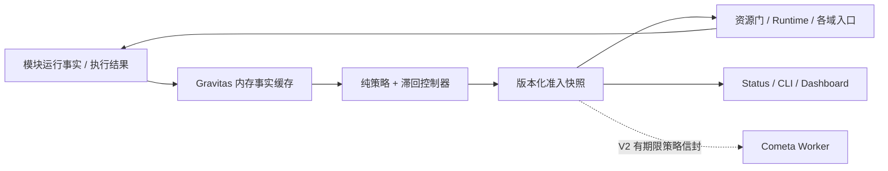

# Gravitas 稳态系统工程方案（GitNexus 研究版）

- 日期：2026-10-21（Asia/Shanghai）；源码基线 `2b694026c4e4fc84ad721c26893ad5c68c7accb5`，工作区 `/home/vegetable/repos/Stella`，分支 `codex/cross-platform-implementation`。
- 状态：**方案交付；业务实施、故障恢复与发布均 NOT READY**。文中新增目录、接口、参数、命令和目标值均为拟议合同，除明确标为“现有”者外尚未实现。
- 依据：[前序讨论](https://chatgpt.com/share/6ad87da7-3768-83e9-9c67-f716c3184c49)、本轮源码核对、GitNexus query/context/upstream impact、隔离探针与定向基线。
- 配套：[研究与验证证据](../reports/evidence/gravitas-20261021/README.md)、[机器可读工作包及源码清单](2026-10-21-gravitas-inventory.json)。证据中的失败、重建前异常和重试记录保留；只使用最终有效结果作图结论。
- 本轮不启动 Bot、模型、Embedding 或平台连接，不访问用户数据库，不承接原 XPLAT-IMPL 的外部验收。`STELLA_HOME` 初始未设置；验证显式使用 `/tmp/stella-gravitas-*`。

## 1. 目标、边界与首个可发布版本

Gravitas 是确定性的运行保障层：观测受控资源和依赖的事实，按作用域限制新操作，在扰动缓解后逐步恢复，并验证策略是否实际生效。Router、Comes、Cometa、记忆、知识库继续拥有业务决策、权限、事务和任务状态。

工程目标：在已定义扰动范围内保持身份与权限正确、状态真实、响应与排队有界、功能损失可解释、恢复有证据。模型不决定放行，不修改生产策略或代码；Gravitas 不自动扩大权限、不切换未配置端点、不默认重启进程、不承诺 exactly-once 外部副作用。

**V1 范围冻结**：G00–G07，只闭合“共享模型资源压力 → 保护交互 → 延后可延后工作 → 有序恢复”这一条反馈回路，同时完成整轮期限、取消、观测和故障夹具。各依赖的完整熔断、Cometa 跨进程策略与自动拉起分别在 G08/G09，属于 V2；不因设计完成而启用。

V1 允许无模型实现与 fake 后端验收；真实模型、QQ/WebChat 灰度与 clean VM 是单独的发布证据。文档完成不改变现有 32 平台 NOT CERTIFIED 的状态。

## 2. 源码研究结论与必须先关闭的问题

完整定位、文件 SHA-256、图风险及原件在配套清单与证据目录。本节区分实测事实、源码推断与计划目标。

| 编号 | 现有事实 / 隔离实测 | 对方案的约束 |
| --- | --- | --- |
| F01 | `ai_gateway._run_turn_via_engine`、`webui.chat_ingress` → `RuntimeFacade.submit_turn` → `_pipeline_provider` → `pipeline._llm.generate`；默认 provider 没经过 `TurnService.generate_reply` 中的 `acquire`。两合成会话实测后端 peak=2，调度器配置 limit=1、snapshot 为空 | G00 首先把生产默认生成纳入资源门；只改单元调度器不能保护这条主路 |
| F02 | `scheduler.acquire` 接受 priority 但仍 FIFO；队列无显式容量或等待截止。等待时取消发生在计数回收的 finally 之外；实测持有者结束后 waiting=1、holding=0 | 先修计数，再以取消安全的显式票据队列实现公平调度；错误指标不能驱动反馈 |
| F03 | Facade 的 wait_for 只围住生成；会话锁、prepare、finalize 和外部发送不在同一个总期限中 | 引入从可信入口创建的 Deadline；旧 `deadline` 参数的生成时限语义保留，新增总期限，不静默改变旧调用合同 |
| F04 | `RoleBackend` 的降级运行在调用者持有的主槽闸门里；后端 HTTP 有最多 3 次尝试；各域还存在额外降级/重试 | 实际端点资源门与总 attempt 预算统一；禁止主门内再等降级门、禁止三层重试相乘 |
| F05 | CaptureGate 有单飞、60s 就绪租约、epoch、退避；默认探针直接调用角色后端，不经过业务域 acquire | 复用已有探针与证据；探针本身也纳入资源门和总探测预算；过载延后不记成端点故障 |
| F06 | `trim_group_messages` 在 protect=true 时以 `if checkpoint and checkpoint < cutoff_id` 收紧边界。合成 5 行、checkpoint=0、keep_count=2，实测删除 4 行 | G00 修复零/缺失/非法水位的保守保留；否则暂停整合会放大丢失风险。此探针只证明该构造场景 |
| F07 | Compact 有完整来源批次、guard 与成功水位；不能以“资源不足”为由扩大 8192 窗口或推进失败水位 | 受压时保留来源、延后压缩；输入继续按既有预算裁剪并标注缺口 |
| F08 | OutboundService 逐物理段记录 accepted/partial/unknown，异常后的结果未知不重发；social deliver_lines 要求封存计划与持久化摘要，发送前复查 guard | 准入应在副作用开始前及每个物理段前检查；超时/取消不能将已发送部分记为失败后整包重投 |
| F09 | Cometa `_tick` 依次续租、期限、恢复扫描、claim、消费控制；watchdog 目前只报错不自动启动 | 未来策略只拦新 claim，不包住整个 tick；租约和取消通道继续运行；自动拉起有独立门禁 |
| F10 | 现有 `core/evaluation.runner._execute_pipeline` 主要驱动 ParticipationManager；VirtualClock 的 monotonic 保持真实时间 | 不宣称已有整轮/租约故障模拟；新增场景驱动和 ControlClock，保留原评测 Clock 合同 |
| F11 | status_api 已聚合 scheduler、usage、fallback、capture 等状态；usage 快照可触发加载/落库，不能把整个 status 收集器当控制器热路径 | 从模块提供的内存事实口取样；WebUI 消费 Gravitas 缓存快照，查询不改变策略 |
| F12 | 发布脚本 `COMMON_DIRS` 和 flow 生成器 `ProjectIndex.PACKAGE_DIRS` 都是显式清单 | 新根包 `gravitas/` 在第一次接线前同步打包和源码闭包，不能拖到发布时才补 |

G00 三项缺口不是本轮修复结果。现有定向测试通过也不反证 F01/F02/F06：原用例没有覆盖这些组合；未来必须将探针转成正式负例回归。

## 3. GitNexus 方法与证据边界

绑定仓库 `Stella_project`，始终显式指定 repo。先 list/status，再对 runtime、scheduler、memory、capability、Cometa、outbound、status、evaluation 做 query；按文件消歧 context 与 upstream impact；用 Cypher 导出流程和调用边，UNKNOWN / 零调用者回到源码、注册表与引用补证。

本轮发现原索引虽内容 current，但若干 Function 节点 id/name/filePath 为空，造成 context 缺失和调用遍历膨胀。先保存诊断，再以当前固定 CLI、`analyze --index-only --force --no-parse-cache --workers 1 --pdg` 重建；未注入 Agent 文件、未开启 embedding。重建后的状态、关键锚点、有效风险见证据 README。

注意：图节点含 BasicBlock/Section，不能称作同等数量的业务符号；Process 是有预算的推断路径，不是运行入口全集。UNKNOWN、lower-bound、候选上限、跨语言缺边与原始风险均保留。HIGH/CRITICAL 接线在实际编辑前仍需针对目标提交重跑 impact 并提示，不能用本计划或低 File 风险豁免。

PDG 在 acquire 第 160 行返回 `pdg-no-block-at-line`：没有该语句级块，不能把其 callgraph bridge 当作取消清理的语句依赖证明；F02 由源码与隔离探针证实。

CLI 大输出存在截断风险：不可解析 JSON、partial、truncated 都判为无效检查，改用 summary-only、分页和逐符号源码补证；原件不删除。最终 detect_changes 同时检查 all 与 compare/main，累计分支风险与本轮文档风险分别解释。

## 4. 模块与责任分配



拟新增根级 `gravitas/`：

| 文件 / 目录 | 职责与依赖 |
| --- | --- |
| `contracts.py` | 不依赖 NoneBot 的作用域、事实、决策、deadline、结果与版本 DTO |
| `clock.py` | ControlClock（可注入单调控制时间）、Timer 接口；真实性能计时单独注入 |
| `config.py` | 严格 TOML 校验、资源组与阈值；路径从 host 传入，不导入 WebUI/插件 |
| `policy.py` | 纯函数 `evaluate(facts, previous_state, config, now)`；无 I/O、无 LLM、可离线重算 |
| `controller.py` | 有界取样、滞回、策略发布、应用确认；一个 Bot 进程一个实例 |
| `admission.py` | 操作决策、票据有效期、每个副作用边界的重新校验；同步热路径 |
| `model_calls.py` | 单次真实模型尝试、资源组、deadline 与降级交接；不负责工具副作用重试 |
| `metrics.py` / `events.py` | 有界滑窗、低基数计数、异步尽力持久化；不持原始聊天/凭据 |
| `integrations/` | scheduler/runtime/memory/transport adapters；V2 加 cometa 策略桥 |

装配：新增 `stella_project/plugins/bot_main/gravitas_bootstrap.py` 显式 start/stop，并由 `bot.py` 完成 host injection；不能依赖 NoneBot 装饰器注册顺序。状态接口只调用提供者，不让 core 反向 import 插件。控制器晚于配置/资源注册、早于新业务准入就绪；启动未完成的新后台工作默认延后。

资源排队仍由 `core/llm/scheduler.py` 唯一持有；Gravitas 下发限额和准入，不能再叠一套独立 semaphore。依赖重试与 breaker 各有唯一 owner：LLM 由 model_calls/RoleBackend，Provider 由其 registry，采集探针由 CaptureGate，worker 生命周期由 Supervisor；Gravitas 不另建平行重试循环。

## 5. 核心合同（v1）

### 5.1 身份、作用域与事实

`ScopeRef` 包含 `kind`、规范 key、可信 source；kind 为 instance/resource/endpoint/provider/storage/connection/conversation/task。使用已有规范身份键，不拼裸 QQ ID，不以群号正负判断类型。控制器不从用户文本、模型输出或插件任意字符串创建受信作用域。

`HealthFact`：`schema_version=1`、scope、维度、枚举值、reason_code、source_id、source_boot_id、source_sequence、observed_control_time、valid_for_seconds、指标值。维度分 pressure / availability / integrity / recovery，互不覆盖。旧序列、旧 boot、重复记录丢弃；过期变 UNKNOWN。只有权威模块可以报告其权限/事务/租约校验事实；“未见错误”不能证明存储一致或 ACL 正确。

`PolicySnapshot`：schema、controller_boot_id、policy_revision、config_digest、issued_at、有效期、受限操作、限额与理由。策略比较用 `(boot_id, revision)`，不拿不同进程的 monotonic 时间戳直接比较。

### 5.2 操作与结果

初始 operation 枚举：`turn.admit`、`model.attempt`、`memory.capture`、`memory.consolidate`、`memory.compact`、`proactive.emit`、`transport.send`、`control.probe`；V2 才支持 `cometa.claim` 与 `cometa.restart`。未知操作不能进入 enforce 白名单。

`OperationRequest`：op_id、operation、scope_refs、work_class、deadline、origin_turn/task、side_effect_class。work_class 为 interactive / background / maintenance；分类由调用入口显式传递，不能只按角色判断（同 CHAT 角色也可承担主动任务）。

`AdmissionDecision`：ALLOW / DEFER / DENY、reason_codes、policy_revision、valid_until、retry_not_before（DEFER 时必有）、受控 resource 与最大 attempt 预算。ALLOW 只表示 Gravitas 这一道门通过。

最终允许 = 用户配置允许 ∧ 身份/权限/预算/采集/封存等本地硬门允许 ∧ Gravitas 允许。多作用域限制取交集；任何拒绝优先于允许，时间和额度取更紧界限。过载延后不算 endpoint_failure、不触发 CaptureGate.note_generation_failure 或 Provider.mark_failure。

`OperationOutcome`：started / deferred / rejected / completed / cancelled_before_effect / partial / effect_unknown / failed_known；带 effect_started、实际 attempt 数、policy_revision、结果码。策略发布与 adapter 应用分开记，`AppliedAck` 标明 adapter、revision、applied/rejected/expired；没有确认不宣称策略生效。

### 5.3 Deadline 与取消

总期限在可信接入完成、进入可能阻塞的预处理前创建；贯通会话锁、prepare、路由/工具等待、资源队列、模型所有 attempt、finalize、发送间隔和物理发送。WebChat 包含 HTTP 返回前的处理；QQ 包含最终发送。接入前的同步适配器代码不在可抢占范围，单独记录耗时/事件循环 lag。

旧 `submit_turn(deadline=...)` 保持生成阶段时限；新增 keyword-only `turn_deadline: Deadline`。实际阶段期限取 total 剩余与原阶段上限的较小值。reserve 用于封存/结果记账，不能授权逾期生成或发送。deadline 到期前未触发副作用则安全取消；副作用已开始则按相应域的 partial/unknown 处理。

`GravitasDeferred` / `AdmissionRejected` / `DeadlineExceeded` 是控制信号：每个现有 broad except 前显式处理，不当作 LLM 请求错误重试、人格兜底或候选失败。asyncio.CancelledError 继续传播；finally 回收队列票据和 holder，不能仅修计数不移除 waiter。

Python 3.10 兼容：不用 3.11 专有 TaskGroup/asyncio.timeout。对合作任务传播取消；限定取消收敛 grace。第三方忽略取消、线程内 SQLite 或已发 HTTP 不能承诺硬截止：保留 holder/操作为 quarantined/unknown，限制新增任务，外部进程隔离留后续。**不能超时后释放名额，却让实际推理继续运行并再放进新任务。**

### 5.4 时钟、重放与进程重启

生产控制冷却、租约观测有效期、队列 deadline 使用 monotonic；UTC 只作审计和跨进程信封时间。现有 `core.evaluation.clock.VirtualClock.monotonic()` 语义不改，新 ControlClock 与可控 Timer 允许离线推进控制时间、唤醒等待者。性能 duration 始终真实计时，重放 digest 排除性能时间、随机 boot ID 与路径。

重启清空短时健康事实，进入 UNKNOWN；不从上次“健康”缓存恢复允许。持久任务仍由各域恢复合同处理，Gravitas 的历史事件只供审计，不成为任务成功依据。

## 6. 资源调度与模型执行边界

### 6.1 资源组

`resource_group_id` 是显式配置的运行资源标识，槽仍保持路由与凭据语义。多个槽可映射同一组；不同服务不因 URL 字面相似自动合并。默认一槽一组，doctor 提示可能共用服务的配置供管理员核实，日志不输出 URL/key。组上限取显式组上限及成员约束的保守值；并发仍不超过配置，控制器只能收紧。

V1 并发上限在启动配置固定，反馈只控制后台入场和恢复额度；不在已有 semaphore 上在线增加容量。V2 若动态收紧 holder 数，采取“停止新准入，等待自然回落”，不强杀 holder。

### 6.2 有界、公平、取消安全的队列

一个组一个有界队列调度器，维护显式 waiter ticket、work_class、enqueue_time、deadline、cancelled、admitted、完成 future。入队/取消/移交名额原子化；超时与授权同时发生时最多一个 owner，失败方不能双释放。每个 ticket 只回收一次，满足 holding≤limit、waiting=有效未授权票据数。

类内 FIFO；interactive/background 使用确定性加权轮转，初始夹具权重 4:1。只有两类都在等且安全条件允许时才保证后台服务份额；没有后台时交互用满容量。maintenance 有独立小预算但共享真实资源上限；健康探针不能越过饱和队列无限插队。每个会话最多一条待处理交互，超额请求显式拒绝；不能悄悄覆盖未完成用户请求。

全局 queue_cap、每组 cap、每会话 cap 同时限制。后台不建立 Gravitas 持久任务队列：整合与 Compact 保留来源/水位，由原单飞机制重触发；主动插话过期即跳过；Cometa 使用已有 task 表。

### 6.3 唯一模型尝试入口与降级交接

G00 最小修复 `_pipeline_provider` 的默认真实后端调用；G03 将 Facade、旧 TurnService、Planner、Comes 兼容 provider、Router fallback、vision、embedding（含知识库 query/ingest）、整合/提取/Compact、CaptureGate probe 全部迁到共享 model_calls adapter。逐调用清单验收，不能只覆盖主聊天。

实现选择：`execute_model_call(backend, payload, call_context)` 是应用编排入口；raw LLMBackend 保持构造和底层 HTTP 抽象。RoleBackend 新增可枚举 attempt 计划/结果反馈协议，executor 对每个真实端点 attempt 取得对应 resource group；role 的直接调用也委托同一 executor，避免旁路。显式未托管的第三方 backend 以已声明资源进入兼容分支，并标 coverage=unknown；不能凭类名猜实际槽。

旧 acquire 调用点在迁移的同一个工作包内移除或改成 executor ticket，禁止双持。兼容 `_LockAlias` 改为调用同一个调度器，若检测到 executor 已持同资源只使用受信内部 ticket；跨资源嵌套直接拒绝并诊断，不能任意重入放行。未使用的外部 raw import 保持接口但不宣称受 Gravitas 保障。

主端点失败：记录事实 → 退出主资源持有窗口 → 重新校验剩余 deadline/预算/用户降级配置 → 排队取得 fallback 的实际资源 → 尝试。主降级槽同组时也遵守同一票据生命周期；不把两个资源同时持在手中。400/错误模型 404 等继续遵守现有不降级分类。

新增显式单次 HTTP attempt 模式（`max_attempts=1` 或等价）；executor 默认每个业务调用最多 3 次真实请求，含主端点重试和一次配置允许的 fallback，预算不足则提前结束。保留 raw 客户端旧默认给未迁移调用者，托管调用强制单次模式；共享参数差异自适应也计入请求尝试数。工具执行的未知副作用不纳入模型重试。调度任务经 AstrBot provider 继承该入口，但其已持久化任务的延后由 Scheduling 保留到原 deadline/发送窗口，不按过时主动插话丢弃；Cometa 的独立 Codex 子进程不属于 V1 本地模型资源保障范围。

## 7. 压力控制律与服务语义

### 7.1 可观测指标

按资源组维护 60s 有界滑窗：有效 waiting/holding、oldest_wait、交互等待分位数、请求失败分类、hold 时长、deadline 拒绝数、取消收敛数；实例维护 event_loop_lag、scope/cache 占用。另观察整合 backlog 条数/最老时间、采集关闭计数、Compact 最老待处理时间。

avg_wait 等累计均值只作兼容展示，不能推导 p95。分位数必须带有效样本数；少于 20 个交互样本时不用 p95 条件，仍可由 oldest_wait/queue_depth 触发。指标缺失与 0 分开。只对有需求的资源计服务恢复，零流量不计“成功率 100%”。

指标标签仅 group/work_class/reason 枚举；会话/任务只进入受权限保护的有界诊断记录，不作为无限指标标签。初始上限：每资源滑窗 512 样本、活跃作用域 256、事件 ring 1024、总体采样批次固定上限；超限驱逐非活跃条目并标 incomplete，不能驱逐当前 holder 的安全票据。

### 7.2 状态迁移

每资源独立运行 pressure NORMAL → CONSTRAINED → RECOVERING → NORMAL。availability 与 integrity 在另一维叠加，面板五种展示模式从向量派生，不能直接驱动全局开关。

初始测试配置（待 G02/G07 校准，**不是生产 SLO**）：tick=1s；连续 3 个有效窗口满足 oldest_wait≥5s 或 queue_depth≥8 进入 CONSTRAINED；持续 15s 满足 oldest_wait≤1s 且 queue_depth≤2 才进入 RECOVERING；每 10s 只开放一项新的后台工作，连续 30s 无再次越界才恢复 NORMAL。恢复任意窗口再越界立即回 CONSTRAINED。高低阈值必须严格分离，参数关系由配置校验器检查。

NORMAL 走正常有界公平调度；CONSTRAINED 暂停新 proactive，后台 token 减为 0，但有安全条件时允许到龄整合使用最低后台份额；RECOVERING 逐步恢复后台 token，不能一次唤醒所有积压。硬完整性拒绝优先，不受 aging 豁免。

### 7.3 不把后台无限饿死，也不让存储无限增长

整合暂停期间来源留在库、成功水位不推进；保护清理边界必须已通过 G00。每会话及实例都有 backlog 高水位（初始夹具 500/5000 行）和年龄高水位（10min），下降到低水位（250/2500）后才恢复采集。高水位只是测试起点，G02 实测后固定 profile；不能声称按行数已控制所有磁盘字节。

达到 cap 时 `memory.capture` 返回明确 `not_captured_pressure`，在写入前拒绝新内容，不建立内存补录队列；CaptureGate 的依赖就绪状态仍为其原状态，压力限制由交集表达。采集缺口只记计数、起止时间和原因，不存未采集正文。采集拒绝不妨碍可安全进行的对话。磁盘余量未知时不放宽既定 cap；磁盘满停止相关写操作并保留控制诊断出口。

清理水位只可来自实际已完成提交；0/缺失/负数/越界水位不得通过对齐“制造已处理”。如用户原配置允许清理未整合数据，压力 enforce 不得宣称无损：该 profile 标为 incompatible，采集施加保守 cap并暴露人工处理项，不能自动改用户配置。

Compact 延后时不扩上下文窗口、不丢来源身份、不提前清尾巴。超过年龄阈值时，只有资源和完整性硬门都允许，才给维护份额；否则继续有界输入并显示上下文截短事实。主动插话没有延期补发，过时机会直接结束。

### 7.4 用户可见行为

被明确请求的交互在受压时使用服务端固定的限频说明，携带可选短 request ID；WebChat 返回结构化 reason/retry_after，QQ 按会话冷却最多一条提示。主动任务静默跳过，但进入管理面统计。发送路径不可用时不反复尝试发送“发送失败提示”。

不绕过现有 `pause_all` 的静默预算合同：预算硬门优先，本轮新增受压说明不改变预算行为。不把压力兜底或诊断语句写成模型生成事实、长期记忆或用户偏好。确定性命令/管理/取消只有其依赖与权限均可信时继续提供。

## 8. V2：依赖故障与跨进程恢复

### 8.1 有范围的依赖控制（G08）

可用性按实际 endpoint/provider/connection 隔离。成功的 fallback 证明该次角色调用成功，不证明 primary 恢复；插件失败不关闭无关 CHAT。非 OneBot 连接没有等价心跳时保持 unknown，不能因为没收到 OneBot 心跳判死。

每依赖统一一名探测 owner，复用 CaptureGate/registry/link monitor 现有路径。半开最多一个有期限的 probe lease，single-flight、指数退避、抖动（注入固定 seed）、最大探测次数/窗口、资源预算同时约束。优先使用正常业务的被动结果，主动 ping 不带聊天。主端点配错、认证或权限配置错误需明确诊断，不能按瞬时错误无限探测。

存储按 memory/social/cometa/scheduling/knowledge/observability 分域。只用模块自身错误与显式维护检查报告健康；不在热路径跑 integrity_check，不遇 locked 就宣称损坏。不可信 ACL 拒绝相应读取；记忆存储故障可阻断记忆但是否能纯对话取决于实际 prepare 依赖，必须由故障夹具证明，不能承诺“关掉记忆一定还能聊”。

### 8.2 Cometa 策略传递（G09，默认不启用）

选择**受管目录中的原子替换策略文件**，避免依赖可能已故障的 Cometa DB 来传递暂停信号；不新增 Redis/队列服务。路径由已解析 STELLA_HOME 与 instance_id 派生，文件不得含 prompt、凭据、完整目标 ID。host 目录权限和已有 Supervisor 进程身份为信任边界，同一 OS 用户的恶意代码不在此机制隔离能力内。

信封：schema=1、instance_id、controller_boot_id、worker_id、process_identity_digest、policy_revision、config_hash、issued_utc、ttl_seconds（初始 10）、claim_allowed、claim_limit。Supervisor 启动参数绑定期望 controller_boot_id；当前实现只是进程内保存 process_identity，G09 必须明确将对应身份绑定传入 worker，不把已有属性误当现成 IPC。

Bot 每 2s 原子更新短命文件；worker 验 schema/instance/启动绑定/config_hash/序列，第一次接受后以本地 monotonic 计算有效期，重复读同 revision 不续命；更高 revision 也必须通过 UTC 偏差和 TTL 检验。跨进程不可直接序列化 monotonic deadline。墙钟跳变、未来时间、未知 boot、坏 JSON、缺失、过期或读取失败均停止新 claim；控制与租约维护继续。worker 回报独立原子 ack（revision、applied、时间、原因）；Bot 未见 ack 不宣称暂停已生效。

策略检查接在 `_tick` 的 claim 步骤前，不能跳过续租、deadline、恢复扫描与取消处理。检查后到事务 claim 的短竞态允许最多一个已取得许可的认领；需要零竞态时由 store 事务校验可消费许可，单独设计与测试。既有在途任务继续受原权限、deadline、租约约束，不因一次策略过期直接杀死。

worker 自动拉起是 G09 的独立可选子门禁：只能启动 Supervisor 自己的实例；确认旧进程状态、旧 owner 租约与在途 attempt，按已有恢复矩阵处理；退避与每窗口重启预算；新进程先自检和恢复扫描再 claim。默认 auto_restart=false。平台结果未知保持 unknown；不把重启成功当任务或投递成功。Bot 整进程/事件循环卡死由外部 supervisor 负责，进程内 Gravitas 不能自证恢复。

## 9. 配置、失效策略与回滚

新增 `GRAVITAS_MODE=off|shadow|enforce`，默认 shadow；详细 profile 位于 `STELLA_HOME/config/gravitas.toml`（出厂 example 随包）。运行期 deadline 只放 ChatContext 的瞬态字段，不直接写入现有 conversation projection/Origin；需要跨进程的 V2 信封使用明确的 UTC+TTL 合同，另做序列化版本检查。

配置 v1 严格校验未知键、有限正数、时间阈值关系、资源映射、容量与版本；V1 重启生效，不做热改 semaphore。

```toml
schema_version = 1
[controller]
tick_seconds = 1.0
fact_ttl_seconds = 5.0
[limits]
turn_timeout_seconds = 120.0
interactive_queue = 16
background_queue = 4
max_pending_per_conversation = 1
[resources.local_inference]
slots = ["CHAT", "MEMORY"]
concurrency = 1
```

以上仅演示结构与测试起点。总交互期限 120s 是拟议初始上限，仍需按既有阶段上限取 min 并在灰度校准；不能用它宣传真实响应延迟。控制阈值与容量在版本化 profile 中，不新增几十个独立 env 键。

off：不发布自适应限制，仍保留 G00 修复、显式静态容量/期限及各域硬门。shadow：与 off 的业务行为一致，只计算 would_decide；不得改变顺序、调用次数、重试、采集或发送。enforce：只启用已验收 operation/adapter 白名单；coverage 未闭合时启动诊断拒绝对应 enforcement，不能把部分覆盖显示成全覆盖。

控制器崩溃/事实过期时停止新主动与可延后后台工作；交互仅在本地静态资源门、期限和所有硬门可信时继续。未知完整性继续拒绝相关操作；观测故障不能放宽 ACL。配置损坏时标 config_error，拒绝新的模型/主动执行，保留鉴权后的诊断与取消；不静默回退宽松配置。

回滚：先将 mode 改 shadow/off 并受控重启，保留在途资源 holder 到实际结束；停止发布新自适应策略；V2 worker 在 off 模式按明确启动配置使用原规则，不把最后一次 enforce 文件永久当真。G00 正确性修复和真实账本保留；任何回滚不复活 unknown 通知、不补录关门期内容、不撤销已发生副作用、不倒退 schema。V1 不改 memory/native/Cometa SQL schema；V2 如需新增持久合同必须另跑迁移与跨版本门禁。

## 10. 分阶段工作包与退出条件

每包一个明确 owner、一个可评审提交序列；同一时间只实施一个包。每包开始绑定目标 HEAD，刷新必要图谱并重跑 upstream impact；HIGH/CRITICAL 先报告，再编辑。fault harness 从 G00 起逐步加入，不拖到最后才测试。

| 包 | 依赖 | 交付与主文件 | 必须通过的退出条件 | 回滚边界 |
| --- | --- | --- | --- | --- |
| G00 基线修复 | 无 | Facade 默认 provider 接入现有门；scheduler waiter 取消安全；db_cleaner 零/缺失水位保护。三个子提交、对应正式回归 | 两会话真实默认 provider peak≤limit；取消/授权竞态后 waiting/holding 精确；清理不删除未处理来源；DIRECT/SILENT 零模型不变 | 可独立评审，不通过 Gravitas 开关关闭正确性保护 |
| G01 核心合同与装载 | G00 | `gravitas/contracts/config/clock/admission`、config example；build_release_package.COMMON_DIRS、flow ProjectIndex.PACKAGE_DIRS | 3.10/3.11/3.12 import；严格配置正反例；DTO roundtrip；时钟/版本失效；Standalone/OneClick staging 含新包且可导入 | 业务接线尚不启用；删除新包前先去除装配引用 |
| G02 事实与 shadow | G01 | metrics/controller/integrations、gravitas_bootstrap、状态快照最小字段 | 同冻结序列 off 与 shadow 的决策/attempt/send/watermark 完全相同；TTL/旧 boot/控制器故障正确；低基数与容量上限 | 停止 shadow，不改变原硬门 |
| G03 资源与模型尝试 | G02 | scheduler 有界公平票据；model_calls；迁移 §6.3 全部生产调用；RoleBackend 交接与 HTTP 单次模式 | 每实际资源 holding≤limit；取消不泄漏；4:1 公平与到龄工作；主降级共享资源且不双持；全调用清单无未解释旁路；无重试乘法 | 保留 G00 门与静态上限；不得临时放回无限队列 |
| G04 总期限与结果语义 | G03 | runtime/context/ingress、hooks/planner、social/outbound、工具取消适配 | 锁/prepare/队列/生成/finalize/发送各阶段注入超时；取消后无新副作用；部分发送与 unknown 不被覆盖；不合作任务隔离限额 | 兼容旧生成 deadline；总期限显式版本化，关闭自适应不关闭硬期限 |
| G05 压力闭环与记忆边界 | G04 | policy 滞回/恢复；整合/Compact/proactive/capture 的交集准入；backlog cap | 压力三窗口进入、低阈值稳定后小批恢复；无抖动/惊群；到龄后台有条件进展；采集缺口明确；水位与清理负例零违例 | shadow/off 只撤自适应限制，来源/配额/水位和采集缺口账本保留 |
| G06 控制面与流程可见性 | G02，enforce 展示依赖 G05 | status_api/status_source、Dashboard 状态页、deploy status；flow catalog/inventory；权限与脱敏 | 显示作用域/事实年龄/判据/版本/applied ack/未评估；查询无探针或策略副作用；Dashboard typecheck/test/build；流程闭包覆盖 | 保留原 status 字段；新块可独立隐藏；不提供“强制健康”按钮 |
| G07 V1 组合验收与灰度包 | G05+G06 | `tests/gravitas` 场景驱动、报告、运行脚本、CI、发布证据 | §11 V1 必选场景全过；同 seed digest 一致；全量 Python/flow/文档与相关构建；分层明确 fake/live/VM | 默认 shadow；小范围 enforce 可关；不触碰用户配置和生产数据作试验 |
| G08 依赖与存储分域恢复 | G07 | endpoint/provider/link/storage adapters；单飞半开 probe owner 与配额 | 依赖隔离、迟到成功围栏、未知与健康区分、存储各域正反例；探测/重试放大受限；V2 场景前半 | 单独 operation 白名单与开关，回到 V1 保障 |
| G09 Cometa 跨进程与受控恢复 | G08 | policy transport、worker claim 接线、Supervisor 绑定/ack；可选自动拉起 | 信封过期/重放/伪身份/墙钟跳变；暂停 claim 仍续租/取消；真实子进程故障恢复；unknown 不重发；auto_restart 的独立验收 | 默认不启用；不改任务 owner/state 证明，不以重启代替业务核对 |

G03 建议拆为三个可单独评审的子提交：a) dormant executor/票据队列与 fake 测试；b) 所有域迁移并删除重复持锁，锁兼容别名仍路由同一调度器；c) 实际 fallback 资源交接与总 attempt 预算。未完成全调用清单前只有 shadow/off 可发布，不能把部分迁移标为 enforce ready。G04 按入口总期限、域内传播、逐段副作用围栏三个子提交推进，每步维持现有零模型 DIRECT/SILENT 合同。

关键路径：`G00 → G01 → G02 → G03 → G04 → G05 → G07`；G06 在 G02 后可顺序插入并于 G07 前完成。V2 为 `G07 → G08 → G09`。不要把 G08/G09 的未完成状态隐藏进 V1 的 done。

建议实施分支从经用户确认的最新目标提交创建 `codex/gravitas-implementation`；当前基线若已被 main 合并，先对比并重跑基线，不能把旧图直接用于新 HEAD。原 XPLAT-IMPL live/VM 缺口仍独立存在，不将其列为 G00 的源码开发阻塞。

## 11. 故障矩阵、指标与可执行验证

### 11.1 不能破坏的不变量

I01 精确身份/权限/目标；I02 holding/queue 有界且票据守恒；I03 过期/取消无新副作用；I04 accepted/partial/unknown 真实且 unknown 不自动重发；I05 成功水位只跟随有效提交、未处理来源保留；I06 控制与诊断通道不被后台暂停切断；I07 冷却/TTL 不被旧结果或重启缓存延长；I08 故障实验零真实网络/模型/平台/生产数据；I09 shadow 行为等价；I10 无权限扩大或未配置端点调用。

### 11.2 场景与判据

所有场景使用合成身份、临时 SQLite、fake HTTP/exporter、可控 ControlClock/Timer；高代价未知与硬拒绝也必须有正例，不能以“全部拒绝”通过。具体事件序列和 invariants 在机器清单中固定。

| 场景 | 版本 | 注入与期望 |
| --- | --- | --- |
| S01 跨会话共享模型 | V1 | 两 Facade+后台共享资源，peak≤配置；交互走真实准入路径 |
| S02 取消/授权同刻 | V1 | enqueue→取消与 release 交错，等待和 holder 精确、无双释放 |
| S03 每阶段超时 | V1 | 锁、prepare、工具、排队、主/降级、finalize、逐段发送；完成/拒绝有界，未知诚实 |
| S04 突发流量 | V1 | 超出组/实例/会话 cap，队列不增长，拒绝有原因、提示限频 |
| S05 持续交互与饥饿 | V1 | 背景任务到龄且安全允许时取得预定份额；硬拒绝不能被 aging 绕过 |
| S06 滞回与二次扰动 | V1 | 阈值附近振荡、恢复中再次升压；转换次数符合固定输入推导，无惊群 |
| S07 切换实际 fallback | V1 | A 主失败转 B，另一请求正在 B；总 B holding≤limit、无 A/B 同持 |
| S08 记忆积压与清理 | V1 | 零/缺失/非法 checkpoint、暂停后清理、高水位采集拒绝、恢复；未处理来源不删，拒采不补录 |
| S09 Compact 压力 | V1 | 延后/取消/length/坏引用，水位不推进、完整来源不切碎、窗口≤8192 |
| S10 发送后回执丢失 | V1 | 已开始物理发送后 timeout/取消，多段部分成功；保留 unknown/partial、不重发 |
| S11 控制器与观测失效 | V1 | collector 异常、TTL 过期、日志盘满、重启；静态门有效，后台保守，诊断可读 |
| S12 shadow 等价 | V1 | 相同 fixture，off/shadow 的顺序、attempt、send、采集、水位及语义摘要零差异 |
| S13 故障隔离与探针 | V2 | 一 Provider/端点/连接坏，不拖无关域；single-flight 与探针上限，过期成功不能开门 |
| S14 存储分域 | V2 | memory/social/cometa 库分别 locked/readonly/disk-full；保护范围正确、不假健康或假成功 |
| S15 跨进程策略 | V2 | 丢文件、旧 boot、乱序 revision、无 ack、TTL/墙钟跳变；只停新 claim，续租与控制继续 |
| S16 worker 中断恢复 | V2 | starting/running/sending 阶段结束子进程；恢复矩阵和 restart budget 生效，无不受控副作用重放 |

增加状态组合：同一 seed 生成 100–1000 步事件序列，对小范围会话/资源执行模型化状态机测试；失败输出 seed、最小事件序列、策略版本、文件指纹。CI 初始固定 10 seeds，夜间扩展不是首版强依赖；若引入 Hypothesis 放入 dev/test 依赖，不能增加默认运行依赖。

### 11.3 指标与退出解释

硬零：越权/错投、unknown 自动重发、超限 holder、负计数、假成功水位、过期副作用、真实外部调用。性能：接入请求/准入请求/完成请求三个分母分别报告；拒绝、延期、依赖失败、采集缺口、部分/未知发送分列。延迟同时报告全部交互（含拒绝）与成功交互，不能只对成功样本计算可用性。

恢复时间从最后一次故障解除到满足规定有效样本/服务级别的时刻；零业务样本标 INSUFFICIENT_SAMPLES。报告允许 PASS/FAIL/INSUFFICIENT_SAMPLES/SKIPPED/INCOMPLETE，复用现有 StabilityReport；未覆盖 operation 必须 INCOMPLETE。资源/事件保留达到上限时报告覆盖缺口。

G02 基准：同机器冻结 fake workload 比较 off/shadow，控制器单 tick p95≤5ms、准入同步判断 p95≤1ms、影子模式 p95 端到端额外开销≤5% 作为候选预算；样本数/平台/后台负载必须记录，噪声环境不直接宣称达标。G07 才以重复测量冻结发布 profile；这些目标不是本轮实测。

### 11.4 命令与验收层次

本轮实际运行的定向基线与探针见证据 README；以下 `tests/gravitas` 与 `run_gravitas_evaluation.py` 是未来交付命令，当前不存在，不应现在执行或宣称通过。

```bash
# G00 起：生产既有合同回归；每次显式隔离用户根
STELLA_HOME=/tmp/stella-gravitas-check .venv/bin/python -m pytest -q \
  tests/test_scheduler_concurrency.py tests/test_memory_capture_gate.py \
  tests/runtime tests/cometa/test_delivery.py tests/cometa/test_worker.py \
  tests/test_transport_outbound.py tests/evaluation
# 新夹具到位后
STELLA_HOME=/tmp/stella-gravitas-check .venv/bin/python -m pytest -q tests/gravitas
# 拟新增脚本：必须要求 dataset / workdir，不可回落用户目录
STELLA_HOME=/tmp/stella-gravitas-check .venv/bin/python scripts/run_gravitas_evaluation.py \
  --suite tests/gravitas/fixtures/v1 --workdir /tmp/stella-gravitas-report --seed 1 --json
# 包级定向通过后跑仓库要求的集成门禁
STELLA_HOME=/tmp/stella-gravitas-all .venv/bin/python -m pytest tests -q
.venv/bin/ruff check .
python3 scripts/check_docs.py
python3 scripts/generate_message_flow.py --check
git diff --check
```

G06 加 Dashboard typecheck/Vitest/build 与浏览器验收；G01/G07 加 Standalone/OneClick 包布局和包内 import；G09 加真实 OS 子进程退出/接任测试。Python CI 3.10/3.11/3.12 分别运行。修改任何 native/schema 合同则追加临时旧库迁移、cargo、wheel 常量与 parity，不能以本方案“V1 无迁移”免除实际变更后的检查。

验收层次：L0=合同/纯策略；L1=组件 fake；L2=真实 Facade/存储/出站与受控子进程组合；L3=真实模型/QQ/WebChat 灰度；L4=发布资产/clean VM。L0–L2 无模型全绿只支持离线工程验收；L3/L4 缺失保留 release NOT READY。

## 12. 交付清单与本轮完成判据

本轮交付工程方案、机器工作包/源码/不变量/场景清单、GitNexus 原始与最终有效证据、隔离探针、文档检查与状态交接。研究结果可供逐包开工，业务尚未实施。

下一实施动作固定为 G00：先用生产默认 provider 的回归确认闸门覆盖，再分别关闭 waiter 取消和零水位清理负例。G00 之前不得打开任何压力 enforce；G02 shadow 数据不足时仍可开发和 fake 验证，但生产阈值冻结与默认 enforce 保持 NOT READY。
