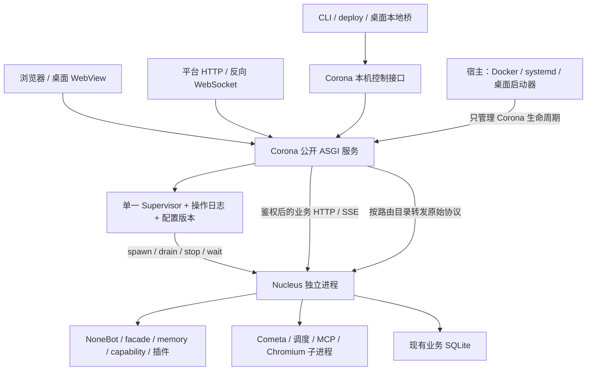

# Corona / Nucleus 双进程工程实施计划

日期：2026-10-23（Asia/Shanghai）。**状态：规划交付；业务实施未开始，运行与发布验收 NOT READY。**

基线：`c1713e3dfb0854e1a7b746e0ef1e5c82ed9a8485`；分析仓库 `Stella_project`，工作区 `/home/vegetable/repos/Stella`。计划分支 `codex/corona-nucleus-plan` 从上述干净 HEAD 创建；包含上一项源码 Dashboard 启动构建工作，不假定其 PR 已合并。

配套：[机器工作包、199 个源码候选、133 条 WebUI 路由、426 个字面量配置键及 34 项验收场景](2026-10-23-corona-nucleus-inventory.json) · [原始证据与复核入口](../reports/evidence/corona-nucleus-20261023/README.md)。数量是本基线下的静态清单，不代表第三方插件、全部配置或全部运行入口。

## 1. 目标、范围和不变量

用户目标：由常驻 Corona（日冕）承接 WebUI 与核心管理通信，按需动态重启 Nucleus（业务核心），使修改配置后的生效过程可观察、可恢复。交付采用**两个独立 OS 进程、一个公开服务入口、单个活动业务核心**。

第一版必须成立：

1. Nucleus 停止、导入失败、启动超时或崩溃时，Corona 仍可提供登录、配置修正、操作进度与启动日志。
2. 一次核心启动只使用一个不可变配置版本；业务常量、NoneBot driver、适配器、后台子进程使用同一来源。修改、删除、继承和环境覆盖均可解释。
3. 每个业务数据根最多有一个受管写核心。新核心只能在旧核心与其所属业务子进程退出获证后进入可写运行态。
4. Corona 独占 Nucleus 的创建、排空、停止、恢复和重启预算。Nucleus 不自派接任进程；桌面、CLI、Runtime、Docker 不直接监管 Nucleus。
5. 每项管理操作有身份、幂等键、目标版本、持久记录和终态。“收到请求”“进程创建”“HTTP 可达”“业务就绪”“平台已连接”分别报告。
6. Corona 不运行对话、记忆、插件、模型调度或业务数据库迁移；Nucleus 保留全部业务规则和受众/权限检查。
7. 保持用户数据目录、现有业务库及 Python/native 合同。第一版不主动改变业务库 schema，不以回滚配置为名恢复或覆盖用户数据库。
8. 现有浏览器 API 路径、登录凭据和公开平台 URL 尽量兼容；新增状态字段可渐进消费。确需变化的 JSON 合同必须版本化并同步消费方。

第一版不承诺：业务零停机、停机期间 QQ 消息无损、跨重启自动续传流式回答、任意插件进程内热卸载、多个 Nucleus 滚动运行、任意代码升级热生效、模型/QQ live 已通过。进程内 Python 模块重载不在本方案路径中。

## 2. 源码事实、证据和风险

### 2.1 当前链路

| 事实 | 源码与核验 | 对设计的影响 |
| --- | --- | --- |
| `.env` 在 import 时进入 `os.environ`，配置导出为常量，`config` 再导出 | `config/settings.py`、`config/__init__.py` | Corona 不能沿用业务配置包作为自己的 bootstrap 入口 |
| 无壳重启先复制当前环境、派生 successor，再写停止哨兵 | `webui/services/system.py:restart` → `core/self_restart.py:spawn_successor` → `core/stop_signal.py:request_stop` | 旧值可被继承；派生成功也不能证明接任已启动 |
| 接任先等父进程退出，再运行源码前端构建 | `bot.py` 的 `wait_for_parent_exit` 与 `rebuild_source_dashboard` | 核心重启窗口会包含前端构建时间；构建失败时旧核心已退出 |
| WebUI 最后挂在 NoneBot ASGI 根路径，状态是进程内 callable 注入 | `webui/mount.py`、`webui/status_source.py`、`bot.py` | 不仅要拆端口，还要替换对象引用与生命周期 |
| WebChat 直接调用 facade、读写聊天库，重置会话含 epoch 围栏 | `webui/chat_ingress.py`、`webui/routers/chat.py` | 这些执行必须留在 Nucleus，代理不得重放对话 |
| 空间写盘后在同进程 `config.spaces.reload()` 清缓存；群绑定还写 `.env` | `webui/services/spaces.py`、`groups.py` | 需要配置写入归属及跨进程生效回执；混合操作须拆合同 |
| 调度、Cometa、插件、知识库、评估等管理入口执行真实业务 | `webui/services/*`、`webui/routers/*` | 不能把整个现有 WebUI 应用原样作为 Corona 运行 |
| deploy 已有 PID、launch token、manifest、启动探测、停止升级链 | `deploy/process.py`、`config/instance.py` | 复用身份思想，区分 Corona 与每代核心的 ownership |
| Rust runtime-manager 当前 binary 只有 `init/status/validate`；长期 supervisor 尚未实现 | `runtime-manager/src/main.rs`、`src/lib.rs`；对照 `deploy/runtime.py:execute_operation` | 不能按注释假设已有可复用的 Rust 常驻监管器；v1 Corona 用 Python 实现 |
| 桌面实际启动走 Python deploy/runtime，关闭窗口调用 stop | `desktop/src-tauri/src/commands.rs`、`lib.rs` | “有 desktop secret 就一定有人自动重启核心”缺源码闭环，须取消该假设 |
| 容器默认 `python bot.py`，compose stop 宽限 15 秒；内部收尾预算还有 30 秒及其他阶段 | `Dockerfile`、`entrypoint.sh`、`docker-compose.yml`、`ai_gateway.py` | 宿主总停止预算必须与完整进程树的全局预算同步 |

配置探针使用真实 `config.settings`，每次仅访问临时 `STELLA_HOME`：父进程 `LLM_TIMEOUT=11`，文件改为 22，复制环境启动 successor 仍为 11；从原始 bootstrap 环境启动为 22；删除键恢复默认 90；外部环境设 44 后 `.env` 仍为 22，但实际为 44；选用 `.env.prod=33` 时实际为 33。见 `config-probe-result.json`。这是配置继承缺陷的复现，不是生产不稳定全部根因的证明。

另一个必须处理的框架边界：本机 NoneBot **2.5.0** 的 `nonebot.init(_env_file=None)` 会继续选择默认文件，**None 不代表禁止读文件**；`Env()` 还会自行读工作目录 `.env`。独立构造 `Env(_env_file=None)`、`Config(_env_file=None)` 才可禁用文件源。已用临时合成 `.env` 验证，见 `framework-probe-result.json`。因此只清理 `os.environ` 不足以保证核心配置快照唯一。

### 2.2 GitNexus 绑定与 upstream impact

本轮图内容在目标 HEAD 对齐：1.6.12，1,830 files / 105,600 nodes / 263,624 edges / 1,119 clusters / 814 inferred flows，含 PDG。`status` 确认 1,828 个 covered 文件内容匹配。图已在前一轮评估时刷新，本轮继续核验并保存结果。

| 对象 | upstream risk | impacted / direct / flows | 直接依赖或流程说明 |
| --- | --- | --- | --- |
| `config/settings.py`（File） | **CRITICAL** | 278 / 76 / 文件无流程归属 | `bot.py`、memory、capability、astrbot、WebUI 等直接 import |
| `config/__init__.py`（File） | **CRITICAL** | 205 / 69 / 同上 | 业务侧 `from config import ...` 冻结引用广泛存在 |
| `config/spaces.py:reload` | **CRITICAL** | 13 / 2 / 7 | WebUI `_reload` 与 WebChat 空间装配；影响 prompt/绑定缓存 |
| `deploy/process.py`（File） | MEDIUM | 40 / 6 / 文件无流程归属 | `bot.py`、deploy CLI/runtime、测试等 |
| `deploy/runtime.py`（File） | MEDIUM | 54 / 7 / 同上 | CLI/桌面合同、状态聚合、组件管理 |
| `core/self_restart.py:spawn_successor` | LOW | 2 / 1 / 1 | service `restart` → route `system_restart`，`System_restart → Bot_entry` |
| `webui/app.py`（File） | LOW | 3 / 2 / 文件无流程归属 | mount 与独立 dev server；测试另行核验 |
| `webui/chat_ingress.py`（File） | LOW | 6 / 2 / 同上 | WebChat route；函数 context 确认 stream 调用 |
| `cometa/runtime.py:stop`（Method） | **UNKNOWN** | 0 / 0 / 0 | context 找到测试调用；源码 `_stop_cometa()` 持有运行时对象后动态调用，不能视为未使用 |
| `bot.py`、Rust `main.rs`、Tauri `commands.rs`（File） | **UNKNOWN** | 0 / 0 / 0 | `Popen` 脚本入口、Cargo binary 与 `generate_handler!`/invoke 字面量，已补查源码 |
| 本轮状态三文件 | LOW | 19/2、26/3、19/2 | 相关 Agent / 进度导航引用 |
| 历史中英文导航 | MEDIUM | 98/7、94/6 | 文档导航引用；不改动历史正文 |

上述 CRITICAL 已在修改任何相关业务代码前提示；本轮只写计划、证据及状态。实施每包必须重新绑定 HEAD 并执行 upstream impact，不能用本表替代未来门禁，也不能用 `riskSharedAxes` 降低原始风险。

图的限制必须随证据保留：分析器此前明确丢弃 2,889 个入口候选、804 条 callee 分支，41 次 walk 到预算、21 条 trace 到深度上限；动态装饰器、接收者、跨语言调用缺边。File risk 的流程/模块轴不可用。`submit_turn` 等本快照的 LOW 只描述已解析边，不作为全链路低风险结论。查询初次 partial、CLI 管道输出不完整的记录留存并重跑，以完整输出为准；流程总表不充当入口覆盖分母。末尾增量刷新还曾使文档符号映射归零且无降级标志，未将零当干净；强制全量重建恢复后才接受最终 all/compare，前后原始结果保存在证据目录。

### 2.3 本轮验证边界

- `python3 scripts/check_docs.py` 基线：119 files / 1,247 links / 577 migration anchors / 0 errors；`git diff --check` 基线通过。
- 独立临时 `STELLA_HOME` 下八个既有测试文件：**83 passed / 37.20s**，涵盖 successor、哨兵、实例、deploy、优雅停止、WebUI 配置、挂载与 WebChat。
- 配置和 NoneBot 二次读文件探针已通过；未启动生产 Bot，未读写生产配置内容、聊天或数据库。
- 新架构 34 项验收均为未执行；本轮不跑全量 Python、Dashboard、Rust 或发行包构建来冒充新架构验收。

## 3. 目标拓扑与代码组织



**v1 选择 Python Corona**，复用现有 FastAPI、鉴权、前端资源及 Python 部署合同；不要求用户额外安装 Rust binary，也不同时开发两种 supervisor。Rust runtime-manager 维护兼容类型与读取适配，不拥有第二套 Nucleus 重启策略。未来替换监管器必须在同一控制协议后进行。

拟新增路径（均为规划名，当前不存在）：

```text
stella_bootstrap/     # 无业务 import：home/identity/env parsing/schema/bootstrap settings
stella_contracts/     # 纯数据合同：身份、配置版本、操作状态、错误码
corona/
  __main__.py app.py supervisor.py process_tree.py ownership.py store.py
  config_store.py operations.py recovery.py local_control.py
  nucleus_client.py proxy.py routes.py adapter_proxy.py
nucleus/
  __main__.py bootstrap.py framework.py lifecycle.py api.py routes.py route_catalog.py
```

不整体搬迁 `core/`、`memory/`、`capability/` 或插件目录；Nucleus 是现有业务装配的新进程边界。`bot.py` 最终成为兼容启动薄入口，先支持显式受管模式，CN11 才切默认；旧模式在约定兼容窗口保留。

**import 围栏**：Corona 及其 WebUI 依赖不得 import `config` 包、`core`、`memory`、`capability`、`cometa`、`knowledge`、`gravitas`、`astrbot_compat`、NoneBot 或 bot_main。`from config.home import ...` 也会先执行 `config/__init__.py`，不算纯入口。纯路径/identity/adapter-name 解析抽到 `stella_bootstrap`，原路径保留薄兼容出口。Corona WebUI 工厂只装控制 routers；业务 routers 仅由 Nucleus 工厂装配。测试用新子进程检查 `sys.modules`，不能只靠静态 import 检查。

Corona 使用一个 ASGI worker 管理一个实例；禁止通过 `uvicorn --workers N` 复制 supervisor。多实例使用独立实例目录与公开/内部端口；共享同一个业务数据根时受写核心锁限制，不支持两个活动写核心。

## 4. 配置来源、版本与存储

### 4.1 兼容的来源顺序

第一版保留实际已验证的优先级，按由低到高：业务默认值 → `STELLA_HOME/.env` → **Corona 启动前捕获的外部环境** → 按 `ENVIRONMENT` 选中的 `.env.dev` / `.env.prod` → 受管身份与内部监听的显式运行参数。

`ENVIRONMENT` 自身按 base `.env` 与启动前外部环境确定，不从后加载的覆盖文件反向重选。末层仅能覆盖进程身份、内部地址、快照标识等受管字段，不能悄悄重写用户模型配置。UI 的 desired 配置与 Nucleus 内部 `host/port` 的运行覆盖分开呈现。

- 外部环境捕获必须发生在 import 任何旧配置/日志模块之前；Corona 以后不把 `.env` 注入自己的 `os.environ`。
- 新子进程环境从原始捕获环境和指定 revision 重建，不能从旧 Nucleus 或已污染的 deploy 配置环境复制。显式剔除桌面会话 secret、Corona client capability、旧 launch token/parent PID，再注入本代身份；用户/插件配置不得覆盖保留的控制身份字段。
- 同时保留业务与第三方插件的未知配置键；426 项仅是静态审计起点。未知键不自动开放到普通表单，不在日志回显值。
- dotenv 引号、注释、重复键、变量插值、JSON 列表、大小写及 Windows 换行需要与当前加载行为逐项对照。解析器不能混用 `parse_env` 的原始右值与 `dotenv` 的有效值。
- 外部环境覆盖的字段显示来源与“保存不会改变有效值”；不把覆盖失败写成已生效。需要修改外部注入值时明确要求重启 Corona/宿主。
- 不直接把 `override=False` 全部改为 True；这会改变 Docker/系统环境覆盖语义，并不能清除已经冻结的 import 引用。

### 4.2 配置归属与重启范围

| 配置 | 唯一编辑/生效责任 | 生效方式 |
| --- | --- | --- |
| 模型、路由、适配器连接、记忆、插件启用、调度、Cometa 的 `.env` 参数 | Corona 管理 `.env` 写入；Nucleus 使用快照 | v1 默认重启 Nucleus |
| `HOST/PORT`、`WEBUI_*`、拟新增 Corona 控制参数 | Corona 纯 bootstrap 读取有效子集 | 明确 `restart_scope=corona`；禁止伪报核心重启即可生效 |
| `STELLA_HOME`、实例 ID、程序根、运行模式 | 启动器/操作系统 | 不通过普通配置 API 改动；数据迁移另走 deploy |
| 业务空间、人格、skills/MCP/Cometa 配置文件 | Nucleus 业务服务 | 现有安全 reload 合同保留；返回明确 applied/needs_restart |
| 群白名单和空间绑定混合请求 | 配置与业务子操作拆开，见 §9 | 不再由 Nucleus 自行写 `.env` |
| 日志/JWT/凭据 | Corona auth/控制日志与 Nucleus 业务日志各自拥有 | Nucleus 重启不改变管理员登录态；不复制 auth secret 到核心 |

Corona 读取控制配置时只校验控制子集，坏模型值、坏插件或业务 schema 不能导致修复界面导入失败。控制监听本身无效时使用上次有效控制绑定；无有效记录则只允许明确的本机恢复模式，并把地址打印给 CLI/桌面，不自动改成公网监听。端口被外部程序占用时不抢占、不扫描进程名结束它。

`WEBUI_ENABLED=false` 仍必须被尊重：受管模式可继续平台代理与监管，关闭浏览器管理面；仅本机受 capability 保护的部署控制接口保留。关闭管理面与改端口属于 Corona 全进程重启，不与普通核心应用混在同一个“自动重启”按钮里。

### 4.3 不可变 revision

拟使用独立的实例控制存储：

```text
STELLA_HOME/.stella/instances/<instance_id>/
  corona/ownership.json
  corona/control.sqlite3          # 仅 Corona 写，operation/config metadata schema v1
  corona/control-client.json      # 本机凭据，不能进公开状态/日志
  revisions/<revision_id>/        # 不可变有效配置与来源，含敏感值时受严格本机权限保护
  generations/<generation_id>/    # 每次启动的 ownership/启动日志/运行元数据
```

配置元数据包含 `revision_id`（随机不透明 ID）、source digests、`created_at`、`expected_revision`、actor 与按键来源；公开状态仅暴露不透明 ID、键名和来源类别。不使用可公开枚举的 secret 明文 hash 作为配置 ID。包含敏感值的快照只在本机必要位置保存，POSIX 目录 0700/文件 0600，Windows 限当前用户 ACL；不经 argv、URL、API、普通日志输出。保留当前、上一有效及诊断所需的有界历史，过期清理；失败草稿也有上限。

业务实际生效常量仍由 `config.settings` 产生，以减少改动面。新增 managed 分支先校验指定快照及 generation，再加载该快照；**跳过所有 live dotenv 读取**。legacy 分支保持旧行为直至退役。NoneBot 的 `Env/Config` 也必须消费同一 revision，不能额外从程序 cwd 读旧 `.env`。

框架适配的实施约束：在 `nucleus/framework.py` 内封装显式 `Env(_env_file=None)`、`Config(_env_file=None, ...)` 与 driver 装配；仅使用已核验版本的最窄桥接。若需要 NoneBot 私有注册点/driver resolver，集中在该文件，建立版本门禁和真实 Driver 初始化测试，不散布 monkeypatch，不以未经证明的 `nonebot.init(None)` 代替。CN00 必须完成这条可执行 spike，CN02 才能继续。保持项目 cwd 和插件相对路径兼容；不靠全局改变 cwd 绕过配置加载。

## 5. 配置事务与应用操作

### 5.1 API 合同

新增公开操作合同使用现有 `{status,message,data}` envelope；下列是拟议接口，尚未实现：

| 接口 | 结果 |
| --- | --- |
| `PUT /api/v1/config` | 兼容旧写法；新增 `If-Match`（expected revision）/`Idempotency-Key` 请求头支持，保留原键值请求体，返回 saved revision、差异键名、来源、restart scope；保存不等于应用成功 |
| `POST /api/v1/system/apply` | 绑定指定 revision，返回 HTTP 202、`operation_id`；同一幂等键+同一内容返回原操作 |
| `POST /api/v1/system/restart` | 兼容原入口，返回 `ok=true` 仅表示受理，并附 `operation_id/restart_scope`；不继续派生 successor |
| `POST /api/v1/system/core/start`、`.../stop` | 管理核心；必须与 apply/restart 进入同一串行执行器 |
| `GET /api/v1/system/operations/{id}` | 可轮询的持久快照：phase、目标/生效 revision、generation、终态、脱敏错误、是否执行过配置恢复 |
| `GET /api/v1/system/operations/{id}/events` | SSE，事件带序号；断线按 ID/游标恢复，丢失事件时提示并回读 operation 快照 |
| `GET /api/v1/status` | 保留业务字段，新增 `control/core/desired_revision/applied_revision/last_operation`；核心不可达时缓存明确标 stale+age，不能伪装在线 |

同一实例只允许一个会改变核心生命周期的活动操作；不同请求冲突返回 409 `operation_in_progress`。同一幂等键不同请求体返回 409 `idempotency_conflict`。新配置可保存为后续 desired revision，但不得偷偷改变已在执行的 target revision；UI 合并一次表单提交后发起一次 apply。operation 的网络连接取消不等于撤销已经接受的管理操作。

### 5.2 跨文件与 SQLite 的提交协议

SQLite 事务不能与 `.env` 原子 replace 组成一个真正的跨资源事务，必须显式实现可恢复日志：

1. 串行配置写锁下校验 `expected_revision` 与原始源文件摘要；外部编辑改变了文件则返回 409 并重新导入版本，不覆盖它。
2. 解析和严格类型/范围/跨字段校验。现有 WebUI 数字校验允许 float 通过 int 字段，不能直接当完整预检复用。保留敏感空串不修改、继承删除、废弃键拒绝语义；拒绝能注入额外行的未编码值。
3. 写独立不可变候选 revision、唯一临时文件并 fsync；控制库记录 `PREPARED`，包含 before/after digest 与恢复步骤。不要继续使用固定 `.env.tmp` 承担并发提交。
4. 再核对源摘要，原子 replace `.env`；更新控制库为 `COMMITTED`，使 desired revision 可见。持久化的 revision/提交日志必须足以判断崩溃发生在哪一侧。
5. Corona 重启恢复：磁盘=before 则未提交；磁盘=after 则补记提交；都不匹配则 external conflict，停止自动处理并保留修复入口。没有证据时不猜哪个配置应该生效。
6. apply 只取已经提交的不可变 revision，预检在隔离子进程/纯校验器运行；不能 import 插件、开业务 worker 或迁移生产库进行“试启动”。

### 5.3 有界应用与配置恢复

操作阶段：`accepted → validating → prepared → draining → stopping → starting → verifying → succeeded`。失败可进入 `restoring_config → starting_previous → rolled_back` 或 `failed`；`rolled_back` 是新配置未生效的独立终态，不是 succeeded。

- preflight 失败：旧核心继续工作，不进入排空。
- 新核心启动失败：确认失败代及其后代退出后，仅尝试一次上一有效配置恢复。保留失败草稿、错误和原操作结果。
- 恢复 `.env` 前比较当前 desired/source digest；若操作期间有人另存了新版本，不覆盖新版本，使用上一有效快照恢复运行并报告 desired/applied 不一致，或进入冲突态要求选择。
- 没有上一有效配置时只保留 Corona；配置恢复再次失败后停止重试，等待修正。
- 同一程序版本的配置恢复才可自动执行。程序升级、插件升级、数据根变动或 schema 迁移存在时，不自动回退程序/数据库；先满足相应迁移备份合同。
- 非 `.env` 的空间/人格/插件文件不自动包含在一次核心配置恢复中；用户需能看到恢复范围。v1 不把“上一份 `.env`”称为整个系统快照。

## 6. Supervisor、身份、进程树和恢复

### 6.1 状态与身份

核心状态：`stopped / validating / starting / ready / draining / stopping / backoff / failed / recovering`。期望状态 `running|stopped` 与观察状态分开存储。外部模型或平台未连用 `dependencies.degraded` 表达，不必让核心永远 starting。

身份至少包含：稳定 `instance_id`、本次 Corona 的 `controller_boot_id`、每次核心启动唯一 `generation_id`、`launch_token`、OS PID+创建身份、程序根、规范化数据根、配置 revision。公开状态不回显能力 token。单凭 PID、端口有响应或进程名均不足以确认 ownership。

- Corona OS 锁防止同实例双监管；业务数据根写核心锁防止不同 instance_id 共享一个库并行运行。锁为进程句柄/OS 原语持有，不仅是“文件存在”。CN00 还需登记实际业务 DB 路径；不同 STELLA_HOME 解析到同一外置 DB_PATH 时也须拒绝第二个 managed 写核心，不能只比较 home 字符串。
- managed Nucleus 用 generation 专属 manifest/sentinel，不覆盖 Corona 的 PID 文件，不调用旧 `replace_running/register_self` 去接管 Corona。
- 启动持有子进程句柄；ready 回执必须匹配当前 controller、generation、revision、pid 及协议版本。旧代 heartbeat/ACK 直接丢弃并记原因。
- 内部端口初始建议 18080，绑定回环；多实例显式分配。被占用即失败，不假定“找到一个空闲端口”之后没人抢占。身份回执不能用端口响应代替。

### 6.2 一次重启的退出合同

Nucleus 收到 drain 后立即关闭 QQ/WebChat/后台任务的新业务准入，但保留内部控制与状态接口；Corona 停止转发新业务并返回结构化 503。随后在**同一个单调时钟截止时间**内：停止认领/主动任务 → 按现有顺序完成或取消 Cometa/调度/facade → 记忆整合与 Compact → 插件/MCP/渲染/嵌入式辅助进程 → 用量与观测 flush → ASGI 退出。

不能为每个阶段分别给完整 grace，导致总时长相加失控。复用现有 shutdown 语义和顺序，提取统一 remaining budget；某阶段失败应记录，最终退出和是否仍有未确认任务由 supervisor 判断。`uvicorn` 在途连接等待与 lifespan 收尾是不同阶段，必须真实测量总预算，不能仅把 `timeout_graceful_shutdown=5` 视为全部关机上限。

停止升级链：有鉴权 drain/stop → 等进程句柄退出 → 只对已证明属于本代的进程树执行 terminate → 限时 kill → reap/wait 并确认业务后代释放。未确认旧代退出，禁止启动下一写核心；不能沿用“父进程等待超时后照常继续”的行为。

### 6.3 所属资源边界

- POSIX：每代核心受控 process group；Corona 可处理组内后代，不能按名称杀全机 Python/Codex/Chromium。可能主动 setsid 的业务 helper 必须登记，恢复时核对创建身份。
- Windows：Nucleus 创建后、放行业务初始化前加入 Job Object（kill-on-job-close），不允许未登记 breakaway；兼容宿主已在 Job 中的限制。Job 绑定失败时核心保持未准入并报错，不能默默失去树监管。
- Cometa 仍由 Nucleus 内现有 WorkerSupervisor 管自己的 worker；Corona 是整代核心树的上层所有者，不越过 Cometa 的租约/attempt 状态机重排任务。
- 外部用户自己启动的 LM Studio、NapCat、llama 服务不属于核心树。Nucleus 的 fallback embedding 若独立 session 启动，需明确归属并在登记表里关闭；不得误杀外部实例。
- 评估 runner、MCP stdio、插件注册任务、Chromium 都纳入所属资源验收；插件私自逃逸进程管理的不支持行为要报告，不能以“主 PID 已死”宣告完全停止。

### 6.4 崩溃恢复

Nucleus 非预期退出：Corona 记录退出码与有界启动日志，核验旧树已释放后，按 1/2/4 秒起点、最大 30 秒退避，5 分钟最多 3 次自动启动；配置应用失败与 crash-loop 使用不同预算。值为实施初始参数，CN10 压测后冻结。平台断线或模型离线本身不触发核心重启风暴。

Corona 非预期退出：Windows Job 句柄关闭触发核心树退出；POSIX 核心监视控制 owner 心跳，丢失 owner 立即停准入并有界退出。Corona 再启动时先进入 recovering，核验遗留进程和业务根锁。v1 **不热收养孤儿核心**；只允许识别并停止属于旧 Corona 的核心，然后启动新代。无法证明归属则 failed，不派生第二个核心。心跳不能靠业务事件循环阻塞就误判，需独立通路与合理 TTL。

宿主只重启 Corona：Docker/systemd/桌面进程只面向控制层。Corona 正常退出先设置 service_stopping 围栏、禁止自动派生，再停止核心树；不要把服务退出误写成用户永久停止核心的意图。单独 core stop 持久化 core_desired=stopped；控制器异常重启按持久化 core_desired 恢复，显式 core start/apply 再置 running。控制日志与未完成 operation 持久化；重启后按日志与实际状态恢复，接受过但未提交/未完成的请求不能无条件重放外部业务。

## 7. 内部协议与信任边界

v1 使用回环 HTTP + SSE/WebSocket，便于复用现有 FastAPI；业务与控制可共用 Nucleus 的私有 ASGI 监听，所有内部路径都增加 generation capability。监听回环只是附加约束，不替代鉴权。

拟定 `control_protocol_version=1`，与 Runtime JSON、业务库 schema、native API 版本各自独立：

| 内部接口 | 合同 |
| --- | --- |
| `GET /_nucleus/v1/health` | 身份、revision、startup phase、核心 ready、依赖摘要、draining、协议能力 |
| `POST /_nucleus/v1/lifecycle/drain` | operation/generation/deadline；幂等拒绝新业务，不先停控制接口 |
| `POST /_nucleus/v1/lifecycle/stop` | 使用已登记 shutdown budget；ACK 只是收到，最终以退出事实确认 |
| `GET /_nucleus/v1/routes` | 本代 adapter 的外部 route/method/protocol 目录，不含凭据 |
| 业务 API | 复用原 `/api/v1/*` 语义，仅在私有监听装配；Corona 精确选择可公开的路由 |

内部 token 每代轮换，由受保护 bootstrap 通道/文件传入，不放 URL/argv；公开 proxy 主动剥离浏览器的 `X-Stella-*` 内部头，再注入自己的 capability、request ID、可信 actor context、目标 generation。Nucleus 只在 capability 验证成功后接受 actor，仍执行已有 owner/audience/domain 权限；不透传管理员 JWT signing secret 到业务核心。

Corona 的本机 deploy 控制接口 `/_corona/local/v1/*` 同时要求原始 peer 为回环、控制 client capability 和实例匹配；不能从外部经 adapter 或通配代理到达。首次控制端点定位从受保护 ownership 获取实际监听地址，不从尚未应用的新 `.env PORT` 推算。

协议大版本不匹配直接拒绝准入，错误可见且管理界面存活；不在故障时回退到旧无鉴权核心路径。错误码至少包含 `core_unavailable`、`core_draining`、`startup_failed`、`startup_timeout`、`shutdown_timeout`、`identity_mismatch`、`protocol_mismatch`、`config_conflict`、`operation_in_progress`、`rollback_failed`；不得把任意异常栈或 secret 原文塞进错误响应。

## 8. 公开入口、代理和数据流

### 8.1 稳定端口和路由顺序

默认保留现有 `HOST:PORT`（常见 8080）为 Corona 公开入口，Nucleus 改为回环私有端口。NapCat 的反向 WS URL 可保持不变，核心重启时连接仍需断开再重连。forward adapter 仍由 Nucleus 主动连接上游。

Corona 路由优先级：本机控制受限命名空间 → 显式控制 API → 显式业务 API → 验证后的 adapter 路由目录 → 静态资源/SPA。内部命名空间绝不能因 catch-all 或编码路径被公开。不能实现为“所有未知路径转发给 Nucleus”，也不能让 SPA 把 adapter webhook/WS 吞掉。

OneBot V11 先交付 `/onebot/v11/ws`（及实际注册的受支持 HTTP 路径）；其他已启用 adapter 在启动后导出 route 目录，按配置允许并验证无保留路径冲突。适配器路由在 core ready 前准备好，目录与 generation 一起原子发布；旧代目录不可指向新代未验证端口。动态运行期注册新路由需要显式目录 revision，否则不公开。不能声称对所有 32 种 adapter 都已认证；未知/非典型路由保留 NOT CERTIFIED。

### 8.2 HTTP、SSE 与 WebSocket 合同

- HTTP 保留 method、path、query、原始 body 与必要内容头，移除 hop-by-hop 头；固定目标为本代回环 endpoint，不接受客户端提供 upstream URL，不跟随重定向到任意地址。
- 平台 Authorization、token、签名头是 adapter 自己的协议，不能拿管理 JWT 替换；内部 capability 用独立头。webhook 原始字节、路径编码和 query 语义有合同测试。
- 在入口即选定 generation/request ID；处理中核心切换不转投新代。写请求、WebChat、工具和任务受理不自动重试；GET 也只有被明确标为安全的读取才可重试。
- SSE 原样有界流转发，客户端断连立即关闭上游；连接已发头之后的核心退出，按该 SSE 既有协议发终止错误或关闭流，不能继续写一个假的 HTTP 200 成功结果。
- WS 转发双向背压、关闭码、子协议和原始平台鉴权；核心退出时关闭连接并允许客户端自行重连。Corona 不持久缓存 QQ 原始消息，也不承担 adapter 的消息重放语义。
- 上传/下载不能先完整读入内存。设置明确连接数、请求体/帧大小、上游连接与空闲超时、SSE 心跳和有界缓冲；初始 chunk 64 KiB，具体阈值由 CN10 验证，容量配置纳入控制子集。
- 上游 Location 不得把浏览器引向私有端口；明确的相对 URL 可按受控规则重写。文件下载路径和业务 ACL 由 Nucleus 校验，不由 Corona 按任意文件路径读取。
- v1 `/stella/status` 原来只限回环。代理之后 Nucleus 看到的 peer 都是 Corona，**必须由 Corona 在入口继续执行原始 peer 回环检查**，不信任外部 `X-Forwarded-For`；公开管理状态仍走登录保护的 `/api/v1/status`。

### 8.3 业务存储与在途行为

| 项目 | 重启语义 |
| --- | --- |
| 普通 QQ 消息 | 排空前已受理的轮次限时完成；停止准入后不新执行；断线期间不保证接收；不自动补发不确定结果 |
| WebChat | 核心 generation 绑定到一次 run；中断显示 interrupted/unknown；保留已有会话重置 epoch 围栏；不自动再调模型/工具 |
| Cometa | 继续使用 owner lease、attempt、通知投递和恢复矩阵；未知投递不当作未发送；不把全部 RUNNING 无条件改 QUEUED |
| 调度/proactive | 先停认领和触发；恢复尊重原有租约与 delivery_unknown；不得因前端断线或恢复重启重复创建任务 |
| 记忆整合/Compact | 失败、无效引用、取消、截断不能推进成功水位；重启恢复依现有落库合同；不在 Corona 写业务库 |
| 流程观测/Gravitas | 核心自有诊断不迁入 Corona 决策；状态快照标 generation/age；Corona 核心重启计数不混同 Cometa worker 重启预算 |

## 9. WebUI 路由与混合管理操作的迁移

机器清单对当前 133 个 decorators 路由逐行给出来源、行号和 proposed_owner：21 个 Corona、111 个 Nucleus、1 个需拆分。它只覆盖 `webui/routers/*.py` 静态路由；`/stella/status`、NoneBot/adapter 动态路由和静态资源另按 §8 登记。

- Corona 21 项：登录/setup/account、配置 schema/current/update、提供商槽与角色配置、平台连接/adapter 配置、system restart/doctor、聚合状态。配置读取展示 desired 与 applied 的来源差异，不再读取 Corona 自己的旧业务常量。
- Nucleus 111 项：模型测试/枚举、运行态、WebChat、聊天/记忆/知识库/trace/usage/flow 数据、空间/persona、插件、MCP、skills、调度、评估及 Cometa（含其后端认证文件）。核心不可用统一 503，管理页面仍能导航并解释原因。
- 现有部分管理路由直接读业务 SQLite，也迁入 Nucleus；第一版 Corona 不保留“先读共享库兜底”旁路。控制日志与历史启动日志由 Corona 自己读取，业务日志通过核心；死核心启动日志不依赖核心 API。
- `system/doctor` 在 Corona 可启动固定参数的诊断 helper；helper 使用显式临时/指定配置来源，不受 Corona import 业务模块影响，不启动 Bot，不执行任意用户 shell；运行超时与子进程回收受控制层监管。

**群绑定混合接口是明确的兼容工作，不留隐含事务**：`PUT /api/v1/groups/bindings` 目前同时修改白名单 `.env` 与空间绑定。v1 新前端拆成配置白名单保存/apply 与 Nucleus 空间绑定请求；新业务服务不再写 `.env`。旧端点由 Corona 兼容协调：核心在线时先验证所有空间/请求，记录 operation 子步骤，按 expected revision 提交白名单，再让 Nucleus 幂等应用绑定；两侧均成功才报告完成并按需重启。业务失败时尝试受版本条件保护的 `.env` 补偿；外部编辑/故障造成补偿冲突则返回明确 partial/needs_reconcile，阻止后续自动 apply，保留原请求与子步骤供恢复。核心不在线则旧混合端点拒绝，用户仍可单独编辑白名单。不能把多文件操作谎称为 SQLite 原子事务。

空间/人格已有即时 reload 保留在 Nucleus；Corona 收到写盘成功但未收到 cache applied ACK 时只报告“已保存，生效待确认”。插件重载仍受原功能开关和资源归属合同限制，不能靠核心分层宣称任意插件安全热卸载。

## 10. CLI、桌面、Runtime、Docker 与兼容策略

### 10.1 启动入口迁移

以下命令是实施目标，当前尚未实现：

```bash
python bot.py --runtime corona     # opt-in 阶段；仍保持熟悉入口
python bot.py --runtime legacy     # 有条件回退；不能与 Corona 同时运行
python -m corona                  # 受管服务入口
python -m deploy start --detach    # CN09 后启动 Corona，身份与就绪语义同步升级
```

`python -m nucleus` 是托管子进程入口，要求有效 bootstrap 身份/快照；不允许无身份用户误启动第二写核心。迁移期 legacy 仍有原入口，但一旦发现受管业务数据根锁，拒绝启动并指向控制层；同理 Corona 启动不能绕过仍在工作的 legacy 写核心。旧发行版不认识新写锁，升级时须先停止并核验已知旧入口；新锁不能被宣传为能约束任意未升级程序。避免 `bot.py` → Corona → `bot.py` 递归。

`deploy start/status/stop` 逐步成为 Corona 客户端；不再在运行态因新 `.env` 端口变化而定位不到旧控制器。纯控制客户端必须先拆掉 `deploy/__main__.py` 顶层的业务配置 import；非控制子命令再按需加载旧模块，保留 init/migrate/schema 的原合同。启动与停止返回值说明“控制面可达”与“业务就绪”的区别。

### 10.2 Runtime / Rust / 桌面

保留 Runtime 外层组件名 `stella`，表示 Corona+核心的产品组件；Corona 核心状态写入有类型的 diagnostics，避免把 `draining/backoff` 直接塞进 schema v1 的枚举。新增字段先作兼容扩展并用 Python/Rust round-trip 锁定；若现有 strict reader 必须破坏性更改，则先独立 bump Runtime schema 并同步 `runtime-manager`、CLI、桌面 mocks/tests，不与业务 DB schema 混淆。

Rust binary `status/init/validate` 的旧状态文件不能假装是 live supervisor 事实；CLI/Tauri 优先经 Python 控制客户端访问 Corona，无控制器才走有身份验证的 legacy fallback。协议存在但操作失败时不降级再启动 legacy。

桌面启动、等待就绪、离线页探活改为 Corona 身份：核心 failed 时 WebView 留在管理界面；只有 Corona 本身不可达才进入 BackendOffline。桌面 session secret 只注入 Corona，核心不再根据它选择“桌面会自动拉起”分支。关窗按既定产品语义停止 Corona，由它停止整棵受管树；停止失败仍反馈并保留诊断，不把外部进程当成本安装杀掉。

### 10.3 容器与源码前端

- Docker PID1/`init:true` 只托管 Corona；Nucleus 重启不退出容器。`entrypoint.sh` 继续支持 deploy/doctor 等非默认命令。
- 配置缺失时受管模式让 Corona 提供本机恢复/初始化说明，Nucleus 不启动。若管理员凭据也未初始化，使用安全的本机恢复绑定，不自动开放远端首管理员注册；通过容器内 CLI/桌面本机桥完成受控初始化后才开放所配置的管理监听。已有管理员凭据的安装保留登录修复能力。legacy 的旧 entrypoint 拒启行为仅在 legacy 路径保留，不能把已有安装的修复界面一起挡掉。
- 区分容器存活与核心业务 readiness：新增 Corona liveness 供 Docker HEALTHCHECK；业务失败在管理状态/单独 readiness 明确显示。记录“容器 healthy 不代表 Bot 已连上 QQ”，并更新监控说明。
- 统一总 shutdown budget；compose `stop_grace_period` 和 systemd TimeoutStopSec 必须大于 Corona 全局排空预算+强停/reap 余量。初始建议总优雅预算 45 秒、强停/reap 10 秒、宿主至少 65 秒，CN10 根据最慢实际路径校准；不能沿用目前 15 秒。
- 源码 Dashboard 构建从 Nucleus 启动移至 Corona 的代码启动/资源准备阶段，配置应用绝不再运行 pnpm。保留源码构建失败可诊断、发行包只用版本匹配预构建产物的约束。若构建失败，无可用资源时提供最小控制 API/静态诊断页，不谎称完整 Dashboard 已就绪。
- Windows 六类发行资产、Docker、源码、CLI 都必须包含 `corona/`、`nucleus/`、`stella_bootstrap/`、`stella_contracts/`。现有 release 脚本独立维护 payload 清单，`pyproject` 包发现也需单独检查；不能仅因本地 import 成功就认为已打包。

## 11. 实施工作包、依赖和退出条件

每包一位实施负责人，按顺序提交；本轮没有授权或启动独立并行实施。跨包公共合同先落地，后续不能绕过前包验收。每次开始记录目标 HEAD、upstream impact、文件所有权和本包退出条件；提交前 `detect-changes --scope all`，阶段回归再 `--scope compare --base-ref main`，partial/truncated 必须补齐。

依赖主链：`CN00 → CN01 → CN02 → CN03 → CN04 → CN05 → CN06 → CN07 → CN08 → CN09 → CN10 → CN11`。机器清单保留真实额外依赖（如 CN05 同时依赖 CN01/03/04），不是允许跳过中间门禁。

<a id="cn00"></a>
### CN00 — 冻结基线、框架 spike 与可执行合同（中）

文件：`bot.py`、配置、deploy、runtime-manager 与既有测试；新 `tests/corona/`、`tests/nucleus/`。先重绑实际实施 HEAD，不能把本计划指纹当成最新源码。

- 将本轮 stale-env、删除、覆盖顺序探针转成正式回归；保留 83 项现有基线，并补 startup/import/source-build 次序合同。
- 完成真实 NoneBot Driver 在快照环境下初始化的 spike，证明 cwd `.env` 与并发变更的源文件无法重新注入配置，保留项目 cwd/插件相对路径；将本机已核验的 NoneBot 2.5.0 纳入明确的支持版本与依赖锁，再冻结适配桥；其他版本未跑同样初始化合同不得宣称兼容。
- 明确操作/身份/配置/错误 JSON、路径保留规则、完整停止总预算以及 lock 选择；CN01 开始前冻结本版协议。
- 核对 133 路由、426 字面量键、当前 enable adapters 与额外动态入口；补录遗漏，不能把清单数量作为功能覆盖证明。

退出：正式回归通过；NoneBot 配置唯一来源有进程级证据；基线失败有归属与处理决定。未完成 framework spike 不进入 CN02。

<a id="cn01"></a>
### CN01 — 纯启动层与不可变配置快照（大）

文件：配置包、env schema/merge、envfile、adapter-name parser；新 `stella_bootstrap/`、配置合同。

- 提取 home/identity/pure parsing 唯一实现，旧路径为兼容出口；Corona 不触发 `config/__init__`。
- 实现原始外部环境捕获、来源优先级、快照序列化/校验与敏感数据权限；managed `config.settings` 只读指定 revision。
- 保留未知插件键，严格校验已知字段，明确删除/继承/空值/插值/路径规则及外部覆盖提示。

退出：新子进程 import 围栏通过；合成 `.env` 全部正反例通过；两个连续 revision 不串环境；旧 legacy 配置基线不回归。回退：关闭 opt-in，继续原配置路径，不覆盖用户配置。

<a id="cn02"></a>
### CN02 — Nucleus 托管入口与有界生命周期（大）

文件：bot 装配、停止/自重启、ai_gateway/facade、Cometa 与子进程资源；新 `nucleus` 启动/框架/生命周期。

- 提取现有启动顺序，受管核心不构建 Dashboard、不自登记 Corona、不派 successor、不抢占其他实例。
- 加 generation 身份、最小私有健康/drain/stop、业务根锁和准入开关；启动完成前不处理业务。
- 统一 remaining shutdown budget，保留记忆、调度、Cometa 与 facade 既有终态/投递语义。

退出：真实子进程可启动/ready/drain/退出；源配置随后变化不影响本代；双核心拒绝；超时不再“照常继续”进入第二写核心。回退：保持 legacy 入口未切默认，已开启 managed 实例必须先退出再回退。

<a id="cn03"></a>
### CN03 — Corona 独立应用与单一监管器（大）

文件：WebUI 控制装配、auth/static/source-build、identity；新 supervisor/process_tree/ownership/store。

- 先启动修复界面，再按 desired 启动核心；核心坏配置/坏依赖不拉垮 Corona。
- 实现 OS 锁、状态机、进程树、启动日志、ready 身份检查、退出确认、有界 crash backoff。
- Windows Job 与 POSIX owner-loss/fence 落地；核心 tree 只属于本代，外部服务不误伤。

退出：fake-core 真子进程在成功、导入失败、挂起、崩溃、外国 PID 场景下均有正确状态；核心退出后登录/config 可用；Corona 崩溃不允许孤儿继续写与新代重叠。Windows 未验收时该包跨平台保持 NOT READY。

<a id="cn04"></a>
### CN04 — 内部协议、业务 API 与身份转发（大）

文件：status_source、status_api、WebChat ingress/routes、responses；新内部合同/api/client/local_control。

- 把最小健康合同扩展为版本化内部接口，绑定 controller/generation/revision。
- Nucleus 认证内部 capability 和可信 actor，Corona 集中验证浏览器 JWT；不让外部伪造内部头。
- 建立本机 deploy capability 接口，支持 `WEBUI_ENABLED=false` 下受控停止与状态读取。

退出：直接私有端口、错代 token、错协议、迟到 ACK 均拒绝；身份/权限正反例通过；核心无法启动时 control API 仍在线。回退：不启用公开业务转发，维持 opt-in。

<a id="cn05"></a>
### CN05 — 配置事务、应用操作和一次配置恢复（大）

文件：envfile/config/providers/platformcfg/groups；新 config_store/operations/recovery。

- 实现 §5 的 revision CAS、PREPARED/COMMITTED 恢复、幂等和单活动操作。
- 配置先校验再停旧核；新核成功需 ready + 版本核验；失败最多一次上一有效配置恢复。
- `.env` 冲突、外部编辑、保存新版本、恢复与业务库迁移各自处理，不覆盖用户的新编辑。

退出：在每个持久化/replace/spawn 边界强制终止并重启 Corona，均能正确重建结果且不重复核心；新值/删除生效实证；rolled_back 与 succeeded 明确不同。回退：仅回到已确认兼容的配置 revision。

<a id="cn06"></a>
### CN06 — 完整路由拆分与业务管理归属（大）

文件：WebUI app/mount、全部 routers/services、DB/审计接入；新 Corona proxy 与 Nucleus routers。

- 按机器清单逐条迁移：控制 21、业务 111、混合 1；新增路由必须补清单并归属。
- 业务 SQLite 访问、模型测试、Cometa auth、评估 runner 和空间缓存全在 Nucleus；Corona 只代理业务输出。
- 拆群绑定兼容协调，保存/生效 ACK 和 partial/reconcile 语义按 §9 实现。

退出：自动路由清单与装配的路由双向差集为空；核心关闭时控制组在线、业务组显式 503；业务鉴权/记忆权限/群绑定补偿负例通过；Corona import 围栏零业务模块。

<a id="cn07"></a>
### CN07 — 稳定平台入口与 HTTP/SSE/WS 代理（大）

文件：adapter loader、status guard、mount；新 adapter_proxy/route_catalog。

- 保持公开 URL 与平台鉴权，建立 generation 原子 route 目录与命名冲突检查。
- 实现流式背压、取消、上传/下载、状态码/关闭码、签名原始字节与禁止内部命名空间暴露。
- 独立检查 `/stella/status` 原始回环边界，避免代理造成远端绕过。

退出：OneBot V11 fake WS/HTTP 真进程重连通过；SSE/上传/下载/路径规范化正反例通过；未知 adapter 不声称 certified。无本包不可将统一入口称为可发布架构。

<a id="cn08"></a>
### CN08 — Dashboard 进度、离线与配置来源（中）

文件：Config/Providers/Platforms/Groups/Spaces/BackendOffline/WebChat 页、HTTP/SSE、auth 与 Tauri bridge；新增 system API/store/banner。

- 保存、应用、核心 ready 三个状态分别显示；改一个表单只发一次 apply，接入幂等 ID 与 operation SSE/轮询恢复。
- 核心失败不清 JWT、不跳整个后端离线页；展示失败阶段、日志摘要、desired/applied、配置恢复结果。
- Corona 级配置明确提示全控制层重启；聊天中断不自动重试，业务缓存标 stale。

退出：Vitest/typecheck/build 通过；浏览器验证成功应用、启动失败、恢复失败、断线重连、核心离线仍可修配置；相同登录态保持。源码与发行 dist 同步合同通过。

<a id="cn09"></a>
### CN09 — 启动器、CLI、桌面与 Runtime 唯一 ownership（大）

文件：bot/deploy/process/runtime、Rust runtime-manager/CLI、Tauri、start.bat；新 pure control_client。

- 所有入口指向同一 Corona，停核与停整个产品语义明确；去掉 managed 下旧 self-restart/desktop-secret 分支。
- deploy 纯控制路径不 import 业务 settings；先找 live ownership 再用目标配置，处理端口修改与 Corona failed。
- Runtime 外层 `stella` 兼容映射与 Python/Rust JSON round-trip；protocol failure 不能 fallback 成第二个 legacy 核心。

退出：前台/后台/CLI/桌面 start-stop-status 与关窗一致；无 owner 误杀、无双监管；原六类产品 profile 的启动参数有测试；Rust fmt/clippy/test 与 Windows native 通过。

<a id="cn10"></a>
### CN10 — 故障注入、跨进程恢复和资源验收（大）

文件：全部相关 tests、Windows process tree、flow 生成、CI；新增 e2e/fault/load suites。

- 执行机器清单 A01–A34；测试必须包含真正进程退出、持久化恢复和真实代理连接，不只 mock Popen。
- fake-core 100 次成功/失败/停止交替重启：同一时刻最多一个写核心；worker/FD/线程/句柄/监听与日志队列无持续增长；有明确测量窗口/容差，不能宣称 OS 指标严格零波动。
- 单独评估 proxy 常规请求增量时延、长 SSE/WS、并发上传和重启期间控制面延迟；测试固定机器/负载并报告 p50/p95、峰值 RSS、控制端点可用率。fake-core 控制请求 p95 < 500ms、重启期间无因核心造成的管理 5xx 为初始目标，不当成未测性能承诺。
- flow inventory 登记 Corona lifecycle、config apply、IPC dispatch、adapter proxy 到 Nucleus 的入口，跨进程 trace 关联不混同同一进程调用图。

退出：完整 Python、Dashboard、Rust 门禁及 Windows/Linux 真进程故障矩阵通过；所有失败/跳过有明确分类；不以本轮 83 项基线替代新架构验收。QQ/真实模型仍须下一包独立记录。

<a id="cn11"></a>
### CN11 — 发布负载、灰度默认切换与退役（大）

文件：Docker/compose/entrypoint、release 与打包校验、依赖 manifests、双语用户/开发/架构正文。

- 将四个新顶层包和匹配 Dashboard 纳入全部 final staging；禁止 runtime token、revision secret、control DB、日志进入发行包。
- 正式安装/升级不搬用户数据，不触发无关业务库 schema 变化；容器 liveness/readiness 与 shutdown budget 同步。
- 先隔离 test-home/source opt-in，再测试部署、Windows/Linux clean VM、Docker、QQ/WebChat live；最后切 `bot.py`/deploy 默认 Corona。
- legacy 回退前必须先证明 Corona 与核心树退出、数据根锁释放、程序/库合同兼容；配置恢复和程序版本回退分别验收。

退出：各产品资产 final archive 内容、版本、入口、冷启动、重启、生效、失败恢复、关闭与升级/回退证据齐全；required live/VM 缺口未关闭则 CORONA-IMPL 保持 NOT READY。legacy 至少保留一个发布兼容窗口，之后另立退役任务，不能在首轮切默认时删除。

## 12. 验证矩阵与执行命令

机器清单 A01–A34 是场景分母，当前全为 `not_run_for_new_architecture`；每项实施后必须挂 command、目标 commit、fixture、结果和 evidence path，不能只标 PASS。

分层要求：

| 层级 | 验证 | 支持的结论 |
| --- | --- | --- |
| L0 | schema/状态机/配置优先级/幂等/CAS/解析/路由归属单测 | 纯合同正确 |
| L1 | fake Nucleus 真进程、实际 HTTP/SSE/WS、SIGKILL、持久化 crash injection | 监管与内部通信正确 |
| L2 | 真 Nucleus + fake adapter/模型，临时业务库，含记忆/调度/Cometa 在途 | 现有业务接线跨进程正确 |
| L3 | 明确授权测试账户的 QQ/WebChat 和真实模型 | 实际平台及模型路径通过；不外推到其他 adapter |
| L4 | Windows/Linux clean VM、Docker、六类 final 产品资产、升级/回退 | 安装与发布可用 |

实施时使用新隔离数据根，以下为命令模板；本轮实际已执行项见 §2.3 与证据。模板中新增 tests 目录须在相应工作包落地后才能执行：

```bash
# 每次实施前
node .gitnexus/run.cjs status
node .gitnexus/run.cjs impact '<具体符号>' --direction upstream --repo Stella_project

# 所有 Python 命令外层显式注入 mktemp 生成的 STELLA_HOME；不复用开发/生产目录
STELLA_HOME="$(mktemp -d /tmp/stella-corona-check-XXXXXX)" .venv/bin/python -m pytest tests/corona tests/nucleus -q
STELLA_HOME="$(mktemp -d /tmp/stella-corona-all-XXXXXX)" .venv/bin/python -m pytest tests -q
.venv/bin/ruff check .
python3 scripts/check_docs.py
python3 scripts/generate_message_flow.py --check
pnpm --dir dashboard test
pnpm --dir dashboard build
cargo fmt --manifest-path cli/Cargo.toml --all --check
cargo clippy --manifest-path cli/Cargo.toml --all-targets -- -D warnings
cargo test --manifest-path cli/Cargo.toml
cargo test --manifest-path runtime-manager/Cargo.toml
cargo test --manifest-path desktop/src-tauri/Cargo.toml
node .gitnexus/run.cjs detect-changes --scope all --repo Stella_project
node .gitnexus/run.cjs detect-changes --scope compare --base-ref main --repo Stella_project
```

Windows 必须用 native Python/Job Object/无控制台子进程验收；Linux 上 skip 不能充作通过。涉及 Rust 目录还需各自 fmt/clippy（以对应 CI 实际 features/targets 为准）。打包/VM 按 final artifacts 跑现有 `scripts/check_release_layout.py`、`check_release_archive.py` 和 Windows reliability matrix；参数以脚本 help 与当前 release workflow 为准，不猜产物路径。

每包都检查允许路径和禁止路径。特别保留：内部伪造 actor、共享数据根双核心、旧代 ACK、停机未知投递、文件中敏感值、取消不推进水位、状态缓存过期、encoded path 绕过与 `/stella/status` 远端访问。

## 13. 风险、回退和决策门禁

| 风险 | 工程处理 | 阻止继续的条件 |
| --- | --- | --- |
| config 入口影响面大 | 纯 bootstrap + legacy 兼容出口 + 子进程 import fence | Corona 导入任意业务配置/运行时 |
| NoneBot 二次 dotenv 读取 | CN00 框架桥 spike + 配置/driver 同 revision | live `.env` 可影响已冻结 generation |
| shutdown 时间叠加、裸后台任务 | 全局单调 deadline、resource registry、Job/进程树 | 旧核心/业务子进程退出无法获证 |
| 控制层崩溃导致孤儿核心 | owner-loss 立即停准入、OS/data lock、启动 reconcile | 旧树身份不明或写锁仍持有 |
| `.env` 与 journal crash 中间态 | before/after digest 可恢复提交 | 磁盘与两个版本都不匹配 |
| 核心启动失败循环 | 区分配置恢复与 crash budget；有限退避 | 一次恢复失败/预算耗尽 |
| 配置恢复误覆盖新编辑/业务库 | CAS、恢复范围、禁止隐式 DB rollback | 有新 desired revision 或 schema 不兼容 |
| 代理扩大信任范围 | 原始 peer guard、固定 upstream、capability/actor 隔离 | 远端可访问 loopback-only 或内部控制路径 |
| 插件/adapter 动态行为 | 路由目录、资源登记、代表性集成 fixture | 不支持行为必须显式 degraded/NOT CERTIFIED |
| 发布漏包/前端旧资源 | final staging/archive 校验四包、assets marker | 任一产品冷启动/恢复验收缺失 |

回退分三层：CN00–CN08 opt-in 失败回到 legacy 代码入口；同版本配置应用失败只恢复上一有效配置；发布切换失败按既有 upgrade/rollback 合同恢复程序，业务库兼容独立审查。任何回退都先停受管核心并获证释放资源，不能用“先起旧版看看”制造双写。

## 14. 完成标准与下一步

**规划完成条件**：目标与非目标明确；基线/图绑定/限制可核验；所有工作包有依赖、候选文件和退出条件；每条静态 WebUI 路由有归属；配置、操作、身份、停止、恢复、代理、部署合同明确；34 项验收场景齐备；计划/清单/链接/源码指纹/证据摘要/文档/图变更门禁通过；任务状态可续接。

**实施完成条件**：CN00–CN11 退出条件全部有证据，L0–L4 的必要路径通过，发布默认切换与 legacy 兼容窗口已执行。规划完成不会把 CORONA-IMPL 标 done。

下一步从 **CN00** 开始：重绑实施 HEAD 与 GitNexus；将两个配置探针正式化，完成 NoneBot 2.5.0 的快照 driver 装配 spike，再冻结版本化控制合同。不要从“大搬目录”或“先把 WebUI 独立起起来”跳过配置/生命周期门禁。
