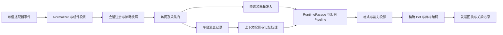

# 借鉴 AstrBot 的多平台发言与消息存储适配方案

中文 | [English](2026-10-24-astrbot-multiplatform-adaptation.en.md)

日期：2026-10-24（Asia/Shanghai）。任务：`XPLAT-ASTRBOT-RESEARCH`。本轮只研究与记录，不实施业务代码、配置或数据库变更。

## 1. 基线、范围与结论

- Stella：`main@3825f994cbec8e7633b2284e7f55271793c99fe5`。初始工作区干净；原分支 `codex/corona-nucleus-implementation@2d1eb73` 已被远端 main 包含，远端同名分支已删除。执行 fetch/prune、切换本地 main、fast-forward；`git rev-list --left-right --count main...origin/main` 为 `0 0`。无需推送既有提交，没有改写历史、应用 stash 或删除本地分支。
- AstrBot：通过 GitHub connector 读取 master，固定研究提交为 [ec77b16eec6096dc75c76292ca329af08766af14](https://github.com/AstrBotDevs/AstrBot/tree/ec77b16eec6096dc75c76292ca329af08766af14)。以下链接均绑定此提交，描述源码事实，不声称已经部署验证。
- 只读路径解析：环境 `STELLA_HOME` 未设置，`stella_bootstrap.home.resolve(Path.cwd(), create=False)` 得到 `/home/vegetable/repos/StellaData`（默认候选路径；未创建）。未打开该目录中的配置、凭据、聊天或生产数据库，未启动 Bot、平台或模型。
- 交付：两方向源码比较、差距、目标合同、分阶段改造和验收。延续 [WP00–WP11 方案](2026-10-20-gitnexus-cross-platform-plan.md)，本方案记录当前代码的接线差距，不重新宣称已完成的合同需要从零建设。

**结论：保留 NoneBot、现有 V2 身份和记忆权限体系，借鉴 AstrBot 的统一事件、按来源路由配置、公共消息流水线、平台历史与模型历史分层。当前优先级是接通非 OneBot 业务入口，以及把发言/人格/会话管理从 QQ 群号推广到可信场景引用。** 不需要换框架，也不需要先换数据库。

同步指的是上述研究起点；本轮新增方案与状态记录留在本地，未提交、未推送。

## 2. AstrBot 怎样处理不同平台的发言设置

### 2.1 来源先归一，再选择配置档案

[MessageSession](https://github.com/AstrBotDevs/AstrBot/blob/ec77b16eec6096dc75c76292ca329af08766af14/astrbot/core/platform/message_session.py#L7) 将来源序列化为 `platform_id:message_type:session_id`。这里 `platform_id` 是适配器**实例**，不是 Telegram/QQ 等平台类型；历史字段 `platform_name` 实际保存此实例 ID。[AstrMessageEvent](https://github.com/AstrBotDevs/AstrBot/blob/ec77b16eec6096dc75c76292ca329af08766af14/astrbot/core/platform/astr_message_event.py#L112) 同时提供平台类型、实例、发送者、消息链和来源标识。

[UmopConfigRouter](https://github.com/AstrBotDevs/AstrBot/blob/ec77b16eec6096dc75c76292ca329af08766af14/astrbot/core/umop_config_router.py#L28) 对三段来源做模式匹配，支持空段、通配符，**按映射遍历顺序取第一条命中**，并不是自动挑选最精确规则。[配置管理器](https://github.com/AstrBotDevs/AstrBot/blob/ec77b16eec6096dc75c76292ca329af08766af14/astrbot/core/astrbot_config_mgr.py#L103) 根据路由取得完整配置档案，未命中使用 default。[EventBus](https://github.com/AstrBotDevs/AstrBot/blob/ec77b16eec6096dc75c76292ca329af08766af14/astrbot/core/event_bus.py#L53) 用原始来源选择对应 PipelineScheduler，之后才应用群成员上下文隔离，再执行流水线。因此一个平台实例可以整个平台使用同一档案，也可以为特定会话使用其他档案；这不是逐字段的多层自动合并。

### 2.2 发言设置分成入口、生成与输出

| 层次 | 已核验实现 | 对 Stella 的意义 |
| --- | --- | --- |
| 唤醒 | [WakingCheckStage](https://github.com/AstrBotDevs/AstrBot/blob/ec77b16eec6096dc75c76292ca329af08766af14/astrbot/core/pipeline/waking_check/stage.py#L91)：前缀、@、引用 Bot 消息、私聊唤醒策略、插件过滤器；可忽略自身消息和 @全体 | 跨平台统一触发意图，平台 codec 负责提取可靠的 @/引用事实 |
| 访问 | [WhitelistCheckStage](https://github.com/AstrBotDevs/AstrBot/blob/ec77b16eec6096dc75c76292ca329af08766af14/astrbot/core/pipeline/whitelist_check/stage.py#L31)：UMO 或裸群 ID 白名单；管理员可配置豁免，WebChat 豁免 | 借鉴会话白名单；Stella 应坚持带连接的规范键，避免裸 ID 跨平台碰撞 |
| 会话状态 | [SessionServiceManager](https://github.com/AstrBotDevs/AstrBot/blob/ec77b16eec6096dc75c76292ca329af08766af14/astrbot/core/star/session_llm_manager.py#L7)：按 UMO 保存会话、LLM、TTS 开关，未设置时默认启用 | 区分“暂停生成”“停止主动发言”“停止采集”，不要用一个静音位覆盖全部行为 |
| 频率 | [RateLimitStage](https://github.com/AstrBotDevs/AstrBot/blob/ec77b16eec6096dc75c76292ca329af08766af14/astrbot/core/pipeline/rate_limit_check/stage.py#L22)：按 UMO 的时间队列和锁，超限等待或丢弃 | 会话请求限流与平台 API 限流分别设计；此实现使用过期队列，不应只凭注释称为固定窗口 |
| 主动回复 | [GroupChatContext](https://github.com/AstrBotDevs/AstrBot/blob/ec77b16eec6096dc75c76292ca329af08766af14/astrbot/builtin_stars/astrbot/group_chat_context.py#L112)：群聊专用、开关、白名单、已唤醒排除；当前分支实现概率触发 | 统一主动发言入口，继续复用 Stella Participation/配额，不照搬概率策略替代现有判断 |
| 输出 | [ResultDecorateStage](https://github.com/AstrBotDevs/AstrBot/blob/ec77b16eec6096dc75c76292ca329af08766af14/astrbot/core/pipeline/result_decorate/stage.py#L202)：前缀、分段、@发送者、引用、TTS/图片等装饰；[RespondStage](https://github.com/AstrBotDevs/AstrBot/blob/ec77b16eec6096dc75c76292ca329af08766af14/astrbot/core/pipeline/respond/stage.py#L154)：节奏、消息段、流式策略和 event.send | 将“说不说、怎么说”与目标平台的发送能力分开 |

AstrBot 并非完全消除了平台分支：普通分段在 qq_official_webhook、微信公众号、钉钉上被排除，长文本合并转发专门针对 aiocqhttp；最终效果由适配器决定。Stella 应复用已有 `AdapterCapabilities` 做能力收窄和显式降级，避免再散布平台名称判断。

群成员隔离也不是统一支持所有平台：[EventBus 的 builder 表](https://github.com/AstrBotDevs/AstrBot/blob/ec77b16eec6096dc75c76292ca329af08766af14/astrbot/core/event_bus.py#L25) 只列出部分平台。`platform/manager.py` 的注释还称 unique_session 依赖默认配置，但当前 EventBus 实际读取已选 scheduler 的配置；本研究以执行代码为准，不把旧注释当行为合同。

## 3. AstrBot 怎样统一处理和保存跨平台信息

### 3.1 同一事件合同，平台负责语义转换

[AstrBotMessage](https://github.com/AstrBotDevs/AstrBot/blob/ec77b16eec6096dc75c76292ca329af08766af14/astrbot/core/platform/astrbot_message.py#L53) 包含字符串形式的 Bot、会话、用户、消息 ID，消息组件列表、纯文本、时间和原始对象。适配器产生事件，事件总线统一交给流水线；原始对象用于平台能力，不直接成为统一数据库记录。

线程语义由适配器实现。例如 [Telegram](https://github.com/AstrBotDevs/AstrBot/blob/ec77b16eec6096dc75c76292ca329af08766af14/astrbot/core/platform/sources/telegram/tg_adapter.py#L491) 将 topic 编入 `chat_id#thread_id`（含 General topic 特例）；[Discord](https://github.com/AstrBotDevs/AstrBot/blob/ec77b16eec6096dc75c76292ca329af08766af14/astrbot/core/platform/sources/discord/discord_platform_adapter.py#L287) 使用 channel ID 标识会话。不能据此推断所有平台都具有同样的父级/线程模型。

### 3.2 三种持久化职责

| 数据 | AstrBot 存储方式 | 注意事项 |
| --- | --- | --- |
| LLM 对话 | [ConversationV2](https://github.com/AstrBotDevs/AstrBot/blob/ec77b16eec6096dc75c76292ca329af08766af14/astrbot/core/db/po.py#L72)：conversation_id、platform_id、user_id、JSON content、persona_id、token_usage；content 是模型消息格式 | 此处 user_id 可承载 UMO，并不等于平台自然人的用户 ID |
| 会话选择和服务偏好 | [ConversationManager](https://github.com/AstrBotDevs/AstrBot/blob/ec77b16eec6096dc75c76292ca329af08766af14/astrbot/core/conversation_mgr.py#L90)：一个会话可有多个对话，当前 CID 按 UMO 存入 shared preferences；[SharedPreferences](https://github.com/AstrBotDevs/AstrBot/blob/ec77b16eec6096dc75c76292ca329af08766af14/astrbot/core/utils/shared_preferences.py#L366) 按 scope/scope_id/key 写数据库 | ConversationManager 顶部仍描述 JSON 存储，当前读写实现已经是数据库偏好接口；区分旧注释与新代码 |
| 平台消息历史 | [PlatformMessageHistory](https://github.com/AstrBotDevs/AstrBot/blob/ec77b16eec6096dc75c76292ca329af08766af14/astrbot/core/db/po.py#L246)：platform_id、会话 user_id、sender_id/name、JSON content、可选 checkpoint | 与 LLM content 独立，按平台实例和会话索引，不是全平台合并一份聊天上下文 |

[PlatformMessageHistoryManager](https://github.com/AstrBotDevs/AstrBot/blob/ec77b16eec6096dc75c76292ca329af08766af14/astrbot/core/platform_message_history_mgr.py#L32) 将链转为无本机路径的结构：文字保留；@和引用保留基本字段；图片、语音、视频、文件保存类型占位。因此这是一份便于查询的消息投影，**不是可无损重放的多媒体归档**。它有按会话保留条数、分页、计数和删除接口。

覆盖范围也需限定：[内置插件](https://github.com/AstrBotDevs/AstrBot/blob/ec77b16eec6096dc75c76292ca329af08766af14/astrbot/builtin_stars/astrbot/main.py#L138) 只有在群聊且 `group_message_history_enable` 开启时写入这条历史路径，并排除 WebChat；不能声称所有私聊和所有消息已自动进入同一张表。Bot 文本在 `on_llm_response` hook 写入，不构成平台发送成功证明。查询工具使用当前事件的实例和 UMO 限定范围，相关夹具见 [历史测试](https://github.com/AstrBotDevs/AstrBot/blob/ec77b16eec6096dc75c76292ca329af08766af14/tests/unit/test_group_message_history.py)。

统一的是合同、处理方式和存储入口；这不提供跨平台同名用户自动认领、跨会话上下文自动合并或个人长期记忆的自动分享授权。

## 4. Stella 当前差距与可复用部分

以下均核对同步后的源码；旧 progress 中出现 schema 19/API 3 的说明不代表此基线事实。当前 Python/native 源码常量为 **memory schema 22/API 4**，与[源码合同](../development/contracts.md)一致，未检查实际部署 wheel。

| 方向 | 已有基础 | 当前缺口与源码证据 |
| --- | --- | --- |
| 身份与会话 | [models](../../core/transport/models.py)、[keys](../../core/transport/keys.py)：BotRef/UserRef/SceneRef、c2/u2 编码、parent_path/thread_id；[registry](../../memory/conversation_registry.py) 有 V2 和 legacy alias | V2 register 函数在生产源码未找到调用；已核对图 UNKNOWN/0 后的全仓引用。不能据结构存在就宣称新平台走通 |
| 入站 | [normalizers](../../core/transport/normalizers.py) 有 OneBot、保守 generic 和 AdmissionPolicy | [ai_gateway](../../stella_project/plugins/bot_main/ai_gateway.py) 的群/私聊 handler 仍以 OneBot 类型、ALLOWED_GROUPS 和 `_normalized_onebot_event` 进入。generic 的生产引用仅定义/导出，未找到注册入口；opaque 默认不被聊天准入 |
| 发言与人格 | 群 @、私聊开关/名单、Participation、主动配额、运行期静音、capture gate 已有 | [config/spaces.py](../../config/spaces.py)、[groups 服务](../../webui/services/groups.py)、[spaces 服务](../../webui/services/spaces.py) 仍以 QQ 整数群号和 qq_groups 管理；人格入口仍含 resolve_space(int(group_id))，后台循环仍有 ALLOWED_GROUPS |
| 出站 | [outbound](../../core/transport/outbound.py) 有统一 message、target、逐段回执、能力降级、长度切分、过期和 unknown 状态 | 默认 OutboundService 仅注册 OneBot exporter；[后台解析](../../stella_project/plugins/bot_main/transport_delivery.py) 只接受 legacy-qq BotRef。其他平台缺 exporter/codec 时明确 unsupported；能力里的速率字段不等于已经实现出站调度器 |
| 消息存储 | [record_message](../../memory/pre_processors.py) 已写 group_messages，含 conversation_key、connection_id、subject_key、不透明 platform_message_id 和关系信封；模型上下文有 projection/compact | 统一入站可持久化消息段目前仍缺：NormalizedEvent 只有正文及 has_image/has_segments 等标志，原始事件是进程对象。需要可持久化组件投影、附件描述和跨平台关系提取；不要只改表名 |
| 记忆权限 | [ownership](../../memory/ownership.py)、[personal_sharing](../../memory/personal_sharing.py) 已有按连接的 owner、主体、audience 与来源校验 | 继续复用，按平台适配提供可信主体；共享空间、人格共用均不能暗含用户绑定或私聊授权 |
| 管理面 | 适配器目录、配置、Driver 和连接状态已经存在 | [会话浏览服务](../../webui/services/conversations.py) 仍主要返回 group_id、旧 msg_id 和纯文本，缺平台、连接、场景、线程与新消息 ID 的统一浏览；Corona 与 legacy 配置路径要同步合同 |
| 验收 | [adapter_matrix.json](../../tests/platforms/adapter_matrix.json) 保留 L0–L3/fixture/live 分层 | 当前 32 行 certified 为 0；这是源码矩阵状态，未在本轮重跑测试。Walle-Q/NTChat/Mail 受[策略](../../stella_bootstrap/adapter_policy.py)屏蔽，Heybox 有 Python 版本限制；不能恢复被屏蔽项来凑支持数量 |

上述“未找到接线”是本提交中图、引用、装配代码共同支持的结论；动态注册与后续版本须重新核验。

## 5. 建议的 Stella 目标合同

### 5.1 发言策略、人格、记忆分开绑定

为可信 ConversationRef 增加统一策略解析入口，逻辑上输出 `ResolvedConversationPolicy`（名称暂定），字段包括：receive/capture、session/LLM、唤醒方式、回复 @/引用、分段/格式、主动发言、静默时段、请求限流、平台发送限额、模型/人格引用。**字段是设计建议，当前尚无此实现。**

建议逐字段优先级：全局默认 < 平台类型模板 < 连接默认 < 会话绑定的策略档案 < 会话显式覆盖 < 有期限的运行期覆盖。每个字段返回来源、修订号；无值继承，空集合与 false 是明确值；同层重复选择器拒绝保存。线程只显式继承父级默认，不继承父级消息尾巴、计数或个人上下文。平台权限与能力约束是最后的硬门，任何档案、管理员开关或人格都不能扩权。此规则是 Stella 新设计，不是 AstrBot 的第一条路由命中行为。

会话绑定拆成三项：`policy_profile_id`、`persona_ref`、`memory_space`。为兼容旧使用方式，默认从原空间读取人格，但变更发言策略不移动记忆，绑定相同人格不合并会话；明确绑定相同 memory_space 时也只按原 audience/owner 规则共享长期记忆。

发言状态至少区分：

1. 允许接收与允许持久化：capture gate 关闭时不落库、不回放，沿用现有合同。
2. 允许 LLM 直接回复：群 @/引用/前缀/所有消息模式，私聊独立设置；关闭主动发言不影响直接回复。
3. 允许主动发言：Participation/定时/验证记忆，独立权限、安静时段、冷却和配额；默认给新增平台关闭，逐能力启用。
4. 允许平台投递：实例权限、线程路由、窗口有效性、格式与限流；生成成功与 API 接受分开记录。

设置页显示“会话名称＋平台＋连接＋场景/线程”和规范键，保留 QQ 快捷操作。保存前预览有效配置及其来源，展示 unsupported/降级项。暂不默认开放通配符全平台授权；若后续引入批量规则，增加命中预览和冲突校验。

### 5.2 统一入口与精确回投

每个平台注册 Normalizer、事件入口、能力提供者、Exporter、TargetCodec 与 BotRef 解析器，复用 RuntimeFacade 的 prepare/generate/finalize。第一批覆盖 OneBot 回归、Telegram、Discord、QQ 官方；排序理由是现有配置入口与私聊/群/频道/线程/回复窗口的代表性，协议细节在各自实施时再依据其当前文档验证。

generic 仅可用于身份事实不足时的受限事件回复；不能猜测 opaque 为群/私聊，也不能据 opaque 开启群记忆、管理员命令或后台投递。可靠聊天平台需要专用语义适配或经核验的 Uninfo 映射。

当前事件回复优先绑定接收它的真实 Bot；后台按持久化完整 BotRef 精确解析，禁止退到第一个在线 Bot。支持能力按 adapter→实例→场景收窄，处理纯文本/@/引用/图片/文件/格式/长度单位/流式与窗口。请求限流按上下文或会话，平台发送限流按账号/目标；重启后冷却/配额需要持久化，短窗口令牌另带期限。API 超时结果 unknown 不自动重投，部分发送保留每段消息 ID 和结果。

### 5.3 一个存储域内的分层投影

继续使用 SQLite，不按平台建立互不兼容的消息库。沿用 group_messages 与旧读接口作为兼容投影；是否新增 `message_events`/`message_parts`/`message_relations`，在实施 DDL 清单与 native 合同评审后定案。本轮不分配 schema 版本、不执行迁移。

| 对象 | 建议合同 |
| --- | --- |
| 会话 | `conversation_key` 来自既有 c2，保留 connection、adapter、scope、Bot、scene、parent_path、thread；内部 storage_session_id 只作兼容代理，不解释为外部群号 |
| 主体 | `subject_key` 来自 u2/domain；显示名只作展示。不同平台同名、同数字都不合并；跨平台绑定必须另做可撤销的明确授权 |
| 消息事件 | 本地 row_id、规范会话、平台消息 ID、作者、方向、事件类型、UTC 时间、来源类别、版本、是否编辑/撤回；不要沿用 int(msg_id) 解释外部消息 |
| 内容组件 | 保序 text/mention/reply/image/audio/video/file/unsupported；稳定附件引用、MIME/文件名/可用性，必要时保存文字占位；原始 SDK 对象、凭据和带签名临时 URL 不落持久记录 |
| 关系 | 引用目标键带 connection＋会话＋平台消息 ID；@含 namespace/subject。允许目标未同步的 unresolved 状态；跨会话引用须重新鉴权 |
| 模型上下文 | 来源行/事件的可追溯投影，含 compact 水位和上下文分支；可选择群共享或群成员隔离，但不能改变物理投递会话 |
| 长期记忆 | 沿用 SPACE/PERSON、owner/subject/audience/source；历史来源未知保持 unknown，禁止按群号正负或昵称猜身份 |
| 出站记录 | 生成意图、发送尝试与 API 接受分开；accepted 不表示用户收到/已读，unknown/部分失败不伪装成已发送；关联原始目标和逐段回执 |

去重在可信平台 ID/事件版本存在时按实例、会话、方向/事件类型及 ID 建约束；同一 ID 的编辑与撤回须能更新/追加版本。缺 ID 使用明确的本地事件身份并标记去重能力不足，不能用“正文一样”删除真实重复发言。附件默认保存描述和状态，原件是否缓存、保留期与磁盘额度独立配置；凭据失效不能导致历史文本不可读。

平台流水、模型上下文、长期记忆分别设置查询权限、保留期和删除范围。管理员分页浏览支持平台/连接/场景/线程/时间筛选，优先返回新消息 ID 和关系。模型历史查询只能取得当前可信会话与明确授权空间的内容；不能由模型参数指定任意连接读取。

## 6. 实施顺序与每阶段完成条件

本表是未来工作，不在本轮实施；不自动续跑旧 XPLAT/CORONA 任务。

| 阶段 | 主要交付与候选模块 | 完成条件 |
| --- | --- | --- |
| A：冻结合同和兼容策略 | 盘点现有 WP 的实际接线；transport、registry、policy、Corona/legacy 配置合同；身份碰撞/线程/双 Bot 夹具 | 明确每平台可用级别、字段优先级、旧 QQ/WebChat 别名和失败语义；提交级 impact 证据完整 |
| B：统一发言和绑定管理 | AdmissionPolicy 的策略解析、spaces/群管理推广为会话管理；Corona/Nucleus/legacy API 与 Persona/Platforms/Conversations UI | 私聊与群/频道/线程的开关、唤醒、人格、主动限制可保存/回读；修订冲突可恢复；QQ 旧配置结果不变 |
| C：第一批真实收发 | Telegram、Discord、QQ 官方的 codec/exporter/能力/Bot resolver；复用 RuntimeFacade，保留 OneBot/WebChat | 真实事件夹具贯穿接收→记录→生成 stub→原 Bot/原线程回投；双连接串线与错投负例为零；随后各平台独立 live |
| D：消息投影与存储补齐 | recorder/projection/schema/migrations/native、附件/关系、会话浏览与历史工具 | schema 22 临时旧库 dry-run/迁移/回滚/重跑；Python/native 对齐；新旧 ID、编辑撤回、重连去重和分页均有正反例 |
| E：后台发言与平台认证 | Participation/Scheduling/Cometa、持久化配额/冷却、窗口与账号限流、L0–L3 矩阵 | 重启/断连/超时不重复、不换 Bot；会话与记忆隔离通过；live、模型、QQ 灰度、干净 VM、发布验收分别留证 |

依赖顺序 A→B→C→D→E；C 的夹具可使用既有文本记录，D 完成后才提升多媒体/历史完整性级别；未通过存储隔离的连接禁止参与主动记忆。每阶段 One feature at a time，扩展其他平台按同一合同逐个认证。

最低验收场景：不同平台 ID 相同、同平台双 Bot 同群号、群与私聊同 ID、Telegram topic、Discord channel/thread、含冒号/Unicode/前导零 ID、无权限/opaque、禁采集/禁主动/禁 LLM 分别控制、同名用户、共享人格但记忆隔离、显式空间共享但私聊不泄漏、部分发送/unknown/过期/限流、重启后后台路由、图片/语音不可用、编辑/撤回、历史查询越权。静态可达、安装成功和 fixture 通过分别记录，不能代替 live。

## 7. 本轮证据、风险与状态

完成条件：仓库同步；两方向有固定版本源码依据；对照当前 Stella 给出增量设计、迁移和验收；只改文档/任务状态；文档检查和图变更检查记录。

- 基线文档检查：`python3 scripts/check_docs.py` → 121 files / 1307 local links / 577 migration anchors / 0 errors。
- GitNexus 1.6.12：`analyze --index-only --pdg --workers 1` 在此源码基线成功，114602 nodes / 288471 edges / 1192 clusters / 796 flows。已运行 ingress/policy/storage query，以及 generic/outbound/record context。`ConversationRegistry` 类查询无结果，源码实际是模块级函数，已改查 register_conversation_v2。
- upstream：AdmissionPolicy.decide **HIGH**，7 impacted / 5 direct / 3 process roots（群监听、群/私聊/插件规则、WebChat run_turn）；resolve_space **CRITICAL**，29 impacted / 13 direct / 6 roots（规划、整合、主动、称呼、管理页等）；record_message **CRITICAL**，18 impacted / 4 direct / 9 roots，直接调用 `_record_bot_lines`、`handle_private_chat`、`record_group_chat`、WebChat `run_turn`。未来实施前必须重跑并提示，不能用 riskSharedAxes 降级。
- V2 register 为 UNKNOWN/0，generic 没有运行流程，均用定义、导出、handler、装配与全仓引用补证；新方案文件尚不存在，impact UNKNOWN，已查同名引用为空。三份状态文件 File upstream LOW，引用来自 AGENTS/workflow/历史记录，0 processes；这只描述文件节点，不代表正文 symbol fanout 一定 LOW。
- 索引限制：38 个 >512KB 文件跳过；流程抽取遗漏 3200/3400 候选入口，952 callees skipped、43 walks cut、23 traces depth capped；callable 候选超限也会不生成边。796 flows 不是运行全集，UNKNOWN/零调用不能证明无影响。
- 最终检查结果见本轮 [progress](../../progress.md) 条目；本轮未运行 Python/Dashboard/Rust 业务测试、真实模型、多平台或 QQ live、部署/迁移/clean VM。方案完成与运行就绪分别记录；多平台实施保持 **NOT READY**。

Files：本中英文方案、feature_list.json、progress.md、session-handoff.md。临时原始图查询留在 `/tmp/stella-xplat-research-20261024` 与 `/tmp/stella-xplat-analyze-20261024.log`，不当作长期证据；长期结论、来源和命令保留在本方案。下一步需要单独授权业务实施，从 A 的接线盘点和可验收合同开始。
