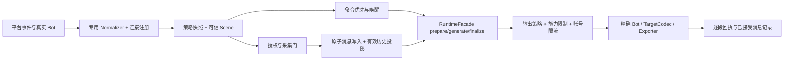

# GitNexus Engineering Plan — 多平台发言策略与统一消息流水线

> Task: 按 G0/P00–P10 逐包实施多平台发言策略、可信会话、统一消息存储与精确回投；本文件同时保留原研究基线与每包执行证据。
> Evidence verified at commit `17e631028344332fcab5dc0f7dbb1ff0cdd0c64b`（main，与本轮 fetch 后 origin/main 一致）。AstrBot `f61a7f42696da6df25dc7a249ec9b8d54ed9da18`（4.29.3）。日期：2026-10-25，Asia/Shanghai。
> Depth: deep · form: full · freshness: strict requested · impact_depth: 3。GitNexus 1.6.12 runner 身份已核验 current；唯一一次 `analyze --index-only --pdg --workers 1` 退出 1，日志无明确错误原因，索引仍为旧 `3825f99` 并标记 `incremental-in-progress`。**当前图不承担实施放行依据；本计划为 source-weighted，执行必须先完成 G0 图恢复门禁。**
> Provenance: schema 2; global dirty digest d4a4c8b94da3b5ba5ff23cfa9e087f218069be8912b1187ff32bcdb0e3d770b3; 151 sorted cited-path entries; exact generated plan path excluded.

G0 implementation re-anchor (2026-10-25): the verified GitNexus 1.6.12 runner rebuilt an index with PDG successfully at source HEAD 17e631028344332fcab5dc0f7dbb1ff0cdd0c64b. status --json is up-to-date with no incomplete reasons; current upstream impacts and local PDG slices are recorded in sections 4, 5 and 9. Flow extraction still drops candidate entry points, callees and traces; source reference checks remain required where impact is lower-bound.

`[verified]` 表示在对应提交/工作树读取确认（外部资料另给固定提交）；`[graph]` 表示工具输出但未被源码确认；`[inferred]` 表示设计决策或推导。§1–§10保留研究基线与候选设计，已实施内容及当前包状态见§7和§11；不再把已落地的P00–P06-T笼统称为拟新增。

## 1. Objective

[inferred] 交付一个逐平台可启用、可以停止和回滚的工程：同一可信会话贯穿策略解析、采集、消息组件、模型上下文、长期记忆和投递；群/私聊/频道/线程分别配置是否回复、如何回复、是否主动发言，任何跨平台同号不串数据或错投。

范围包括 OneBot/WebChat 回归、Telegram、Discord、QQ 官方首批适配，及后续适配器复用的注册合同。平台依赖已装、连接上线、L1 文本、L2 隔离、L3 高级能力、live 认证分别标记。**不更换 NoneBot/SQLite，不自动合并账号，不做跨平台转发，不切换 Corona/legacy 默认入口。**

计划最初只发布研究与实施上下文；当前已按 §7 开始逐包实现。各包源码、测试和外部验收状态以本计划及 progress.md 为准。原 2026-10-24 中英文研究保留为历史材料，不作为当前运行证明。

## 2. Current Behaviour

- [verified] `core/transport/normalizers.py:20–34,198–275` 已有可信 Bot/User/Scene 引用和 generic normalizer，但 payload 只有 text/标志及进程内句柄；generic 把会话保留为 opaque。全仓 Python 引用审计中，generic 只有定义/导出，`register_conversation_v2` 只有定义及测试调用；未找到生产接线。
- [verified] `stella_project/plugins/bot_main/ai_gateway.py:1152–1197,1463–1512,1922–1971` 的主入口仍为 OneBot 类型、ALLOWED_GROUPS/@ 与 QQ 私聊开关。`AdmissionPolicy.decide` 在 `core/transport/normalizers.py:281–330` 区分 passive/group/private/webchat/plugin，默认拒绝 opaque。
- [verified] `core/transport/outbound.py:437–558` 默认只注册 OneBot；先检查目标/能力/Bot/codec，再分段发送；超时/调用异常为 UNKNOWN，出现部分成功返回 PARTIAL。`transport_delivery.py:20–50` 的后台 Bot 解析只接受 legacy-qq 绑定。
- [verified] `memory/pre_processors.py:192–338` 在采集允许后记录正文与身份，但仍对旧 msg_id 做整数转换；332–335 在 commit 前设置 row_id/captured，异常被捕获后直接返回。`resolve_reply_target:341–365` 仍先用 QQ 数字 codec，缺少不透明 ID 路径。
- [verified] `core/context.py:158–222,585–651` 已保留 storage_session_id、c2/u2 所需引用与原始用户 ID。`memory/ownership.py:173–177` 目前只接纳 group/private/webchat；channel/thread 会返回 None，不能只加入口就宣称记忆权限完成。
- [verified] `corona/config_api.py:349–438,726–757` 已有 desired/applied、If-Match、幂等键与 ConfigStore 保存；`corona/group_bindings.py:40–235` 的 QQ 绑定是“验证→保存配置→Nucleus 应用→Apply→确认”的 saga，不能绕过。`nucleus/group_bindings.py:384–440` 只允许正整数群号，写 qq_groups。
- [verified] 最新主分支已包含 PR #123。其旧状态文字仍有“PR open”，以合并提交为准；本轮未重跑其 hosted CI 或复验 QQ。`corona/routes.py:44–72` 与 `nucleus/routes.py:20–63` 固定控制/业务归属，缺失或重复业务路由会阻止启动。
- [verified] memory schema=22、native API=4；Rust 严格核验 schema 相等（`memory/schema.py:63`、`memory_rust/backend.py:14–23`、`memory_rust/native/src/schema.rs:11–39`）。这不是某个部署 wheel 的验收。

## 3. Relevant Architecture

### 3.1 应吸收的 AstrBot 机制

[verified, external] [MessageSession](https://github.com/AstrBotDevs/AstrBot/blob/f61a7f42696da6df25dc7a249ec9b8d54ed9da18/astrbot/core/platform/message_session.py#L7) 用实例 ID、消息类型、会话标识来源；[EventBus](https://github.com/AstrBotDevs/AstrBot/blob/f61a7f42696da6df25dc7a249ec9b8d54ed9da18/astrbot/core/event_bus.py#L53) 先选配置 scheduler，再执行受支持平台的群成员隔离。[UmopConfigRouter](https://github.com/AstrBotDevs/AstrBot/blob/f61a7f42696da6df25dc7a249ec9b8d54ed9da18/astrbot/core/umop_config_router.py#L48) 按映射顺序取第一条命中，并非自动挑最精确规则。

[verified, external] [模型会话与平台历史](https://github.com/AstrBotDevs/AstrBot/blob/f61a7f42696da6df25dc7a249ec9b8d54ed9da18/astrbot/core/db/po.py#L72) 分表；[历史组件投影](https://github.com/AstrBotDevs/AstrBot/blob/f61a7f42696da6df25dc7a249ec9b8d54ed9da18/astrbot/core/platform_message_history_mgr.py#L56) 将图片/音视频/文件转为占位，保留文字和基本 @/引用。它不是无损媒体档案。[内置持久化入口](https://github.com/AstrBotDevs/AstrBot/blob/f61a7f42696da6df25dc7a249ec9b8d54ed9da18/astrbot/builtin_stars/astrbot/main.py#L138) 受群历史开关控制并排除 WebChat；Bot 记录来自 on_llm_response，不代表平台发送成功。

[inferred] Stella 吸收“统一事件、按来源策略、分层历史”，保留自己的 c2/u2、owner/subject/audience、采集门、RuntimeFacade、UNKNOWN 回执与 managed 修订合同。不会直接照搬 UMO 的裸 ID 白名单、顺序通配授权或概率主动发言。

### 3.2 目标流程与职责



[inferred] 控制面仅保存非秘密连接引用、策略和绑定；凭据仍使用既有平台连接配置。Nucleus 解析实际消息、登记会话、持有 DB 锁并执行发送。平台 payload 不决定管理员身份、共享权限或任意后台目标。模型上下文键、物理会话键、memory_space 是三个概念；MVP 只支持 `context_mode=scene`，群成员分支隔离另列后续。

## 4. GitNexus Findings

### 4.1 规划阶段工具事实与限制（历史记录）

| 问题/工具 | 本轮结果 | 如何使用 |
| --- | --- | --- |
| `status --json; list` | [graph] runner 1.6.12/schema4 current，旧索引 3825f99；随后主分支快进 4 commits | 分析器身份可追溯；不能把旧索引当新源码 |
| `analyze --index-only --pdg --workers 1` | [graph] exit 1，结束于 incremental 写入阶段；无明确报错原因；context 仍含 incremental-in-progress | 原因未知，不推断 OOM/锁等；遵守技能一次刷新预算，不在规划中构建/修复分析器 |
| resources context/clusters/processes | [graph] context “Index is 4 commits behind HEAD”；clusters 显示 Memory/Transport 相关社区，processes 只有展示摘要 | 只导航；不根据缺失流程判 unused |
| query ingress/policy/managed/storage | [graph] Python 主流程未定位到，主要返回不相关定义 | 改用定向源码/装配/引用审计，不扩散查询 |
| context 5 primaries | [graph] 部分 found 但无调用边，部分 not_found；拼写/UID 参数纠正后仍无法得到完整调用集合 | 所有 load-bearing 声明均回到最新源码 |
| upstream impact 5 primaries，depth3 | [graph] UNKNOWN/无可证明调用；exact UID admission 为 direct=0，riskNote 明示无边不等于未使用 | **不是 LOW，不是可编辑许可**；G0 恢复后重跑 |
| `pdg_query controls` admission/文件锚点 | [graph] 具名符号未解析；文件锚点 total=0 | §5 只做 source-derived 控制审计，不伪造 PDG 边 |

[graph] 刷新日志还报告 3203/3403 候选入口遗漏、952 callees skipped、43 walks cut、23 depth caps；大于 512KB 的生成物被跳过。旧元数据 796 flows 不是运行全集。旧研究中的 HIGH/CRITICAL 数字不移植为新提交图结果。

### 4.1.1 实施入口 G0 复核（2026-10-25）

| 检查 | 当前结果 | 实施解释 |
| --- | --- | --- |
| runner/index | node .gitnexus/run.cjs，GitNexus 1.6.12；analyze --index-only --pdg --workers 1 exit 0。status --json：index commit=HEAD 17e631028344332fcab5dc0f7dbb1ff0cdd0c64b，runner identity current，incompleteReasons=[]，status up-to-date | G0 索引恢复通过；状态文档更新后又增量索引 changed=3。最新统计 114,886 nodes / 289,073 edges / 1,193 clusters / 796 flows |
| query/context/impact | query 定位到群消息记录、能力查询、私聊/群回复和绑定流程；五个 primary 均可用 context/impact 定位 | 以 d=1 集合为包级回归清单，不把 processes 摘要当作全流程 |
| 当前 extraction 限制 | 重建日志：39 个 >512 KiB 文件跳过；3,203/3,403 候选入口未进入排序，952 callees skipped，43 walks cut，23 traces depth-capped；102 name-fallback call sites，其中11 refused | 缺失的图边/flow不能解释为无调用；每包对 unresolved/lower-bound 项做定向源码引用核对 |
| AdmissionPolicy.decide | CRITICAL / exact；7 d=1；affected processes: chat、record_group_chat、stream | 5 个生产调用者为 record_group_chat、is_chat_trigger、is_plugin_trigger、is_private_trigger、WebChat run_turn，另2个测试；与§4.2一致 |
| register_conversation_v2 | MEDIUM / exact；6 d=1；0 processes | 6 个直接调用均为 registry 测试；当前生产接线仍未发现，与§4.2一致 |
| OutboundService.send | HIGH / lower-bound；7 d=1；affected processes: proactive_speak_job、handle_capability_query；4 个 receiver-typing call sites 未解析 | 图中含6个生产发送调用和1个测试；源码审计确认群/私聊、能力查询、主动@、主动发言及后台发送用途。另有4个未分类调用点不得视作已排除 |
| record_message | CRITICAL / lower-bound；19 d=1、9 affected processes；3 个 receiver-typing call sites 未解析 | 图与源码共同确认 _record_bot_lines、handle_private_chat、record_group_chat、WebChat run_turn 四个生产调用函数（WebChat 同时写入用户行与 Bot 行）；其余直接项含测试。事务修改必须覆盖四个入口 |
| GroupBindingsCoordinator.execute | LOW / lower-bound；1 个 d=1 production handler；15 个通用 execute call sites 未解析 | 源码确认 install_group_bindings.groups_bindings 经 coordinator.execute 进入 saga，corona/app.py 负责装配；低图 risk 不覆盖未解析调用 |

G0 的 d=1 与§4.2 source-derived 生产消费者已调和，没有发现需要新增的生产消费者类别。impact 结果中的 lower-bound 与分析器截断继续保留为约束，不升格为完整调用全集。

### 4.1.2 P06-T Telegram fixture closeout (2026-10-25)

- Base: P05 commit `f44cee13633760b8be248f774f80316c2f965809`; `EventNormalizer` upstream impact LOW/exact (4 direct, 14 total), `NormalizedEvent` CRITICAL/exact (4 direct, 191 total / 182 reported processes; unchanged), and `TransportIngress` UNKNOWN/0. Source audit found ingress construction only in the pipeline fixture and no production call site. New Telegram symbols are UNKNOWN/0; source audit found fixture references only and no production registration path.
- The locked `nonebot-adapter-telegram==0.1.0b20` wheel source was inspected and installed only under `/tmp`; repository `.venv` was not modified. `message_thread_id` is present for forum topics and `Bot.send_to` accepts chat/thread routing. The current official Bot API has separate `direct_messages_topic_id`, absent from this pinned adapter; direct-message topic support remains unsupported. Ephemeral message ID `0` is rejected for durable relations.
- Focused isolated tests passed 72 with two existing warnings; Ruff, py_compile, import boundary and docs passed. Flow check exits 1 because 21 body anchors changed with no topology change; final immutable refresh belongs to P10. No live account or production data was used. Telegram remains not_certified; matrix remains 0/32.
- Repeated identical staged GitNexus structured calls had no error/partial/truncated: `scope=all` 9 files / 26–35 symbols / 784–791 affected processes / CRITICAL; `scope=compare base_ref=main` 56 files / 144–155 symbols / 791–792 processes / CRITICAL. Last repeated result: all 26 symbols / 791 processes; compare 144 symbols / 791 processes. Code symbols are additive Telegram classes/constants and fixture names; generic Get_config/Cometa/skill/main process attribution does not identify a Telegram route, so retain CRITICAL and do not waive it. Index limits remain: 39 large files skipped; 3,262/3,462 candidate entries unranked; 925 callees skipped; 46 walks cut; 23 traces capped. Counts varied across identical runs on the same staged tree; all runs remained CRITICAL and complete.

### 4.1.3 P06-D Discord fixture closeout (2026-10-25)

- Base: P06-T commit `ef06712ca322a970d528fc9a9c8a2f878c133193`. Before edits, `EventNormalizer` was CRITICAL/exact (5 direct; 193 total / 182 reported processes / 20 modules), `NormalizedEvent` CRITICAL/exact (5 direct; 9 total / 7 processes / 5 modules), and `AdapterCapabilities` CRITICAL/exact (5 direct; 16 total / 11 processes / 11 modules). Shared boundaries were not edited. `TransportIngress` context was UNKNOWN/test-only; source audit found no production construction/call.
- Locked `nonebot-adapter-discord==1.1.10` source was installed only under `/tmp`. Its Gateway message model does not carry channel type, so normalization requires an injected trusted resolver. Resolver evidence is required for text/announcement channels and public/private/announcement threads; thread identity and outbound target are the actual thread channel ID, with category ancestry kept as metadata. Guild and direct-message intents are checked; guild content is accepted only with message-content intent or adapter-confirmed bot mention/reply; group DMs and cross-channel replies are rejected. Attachments remain metadata-only.
- Added explicit opt-in Discord normalization/export/target codecs; no default matcher/startup registration. Outbound mentions are disabled, text is capped at 1900 characters, reply references require an existing target, explicit adapter permission failure maps FAILED, ambiguous network outcomes map UNKNOWN, and UNKNOWN is not retried.
- Validation: focused Discord fixtures 7 passed; isolated regression command using `STELLA_HOME=/tmp/stella-p06-discord-regression-20261025` and the locked wheel under `/tmp` passed 74 tests / 2 existing warnings. Changed-file Ruff, py_compile, lazy-import boundary, docs (121 files / 1322 links / 577 anchors / 0 errors), and diff check passed. `generate_message_flow.py --check` exits 1 on the known same-topology body-anchor drift; immutable refresh remains deferred to P10.
- Official protocol sources reviewed: [Gateway intents and events](https://docs.discord.com/developers/events/gateway), [message content, replies and allowed mentions](https://docs.discord.com/developers/resources/message), and [channel/thread permission rules](https://docs.discord.com/developers/topics/permissions). No live Discord account, permission grant, driver lifecycle, bot, or production data was used. Matrix remains 0/32 certified and Discord `not_certified`.
- GitNexus recovery: the first incremental write did not complete and default 16 GiB detect attempts could not open the database; neither was treated as clean. Re-running `analyze --index-only --pdg --workers 1` with `GITNEXUS_LBUG_MAX_DB_SIZE=68719476736` exited 0, rebuilt the index, and status became up-to-date at P06-T HEAD with 794 reported flows. Limits: 39 large files skipped, 3276/3476 entry candidates unranked, 925 callees skipped, 46 walks cut, 23 traces depth-capped. Repeated staged P06-D detections varied: `scope=all` on 9 files returned both LOW/0-process and CRITICAL aggregate results; `scope=compare base_ref=main` on 58 files remained CRITICAL. Zero-process results were source-audited: Discord references occur only in the adapter, fixture and matrix, with none in adapter_loader/outbound/ingress, consistent with deliberate no-production-registration but still lower-bound under graph extraction limits. Generic `channel_id`/`user_id`/`__init__` attribution reaches unrelated Get_config/Cometa-auth flows; preserve compare CRITICAL without waiver.
- Package fixture work is complete; separate commit closeout remains. P04 native wheel/API-schema parity and restore drill remain open; overall plan remains NOT READY.

### 4.1.4 P06-Q official QQ fixture closeout (2026-10-25)

- Package commit: `f427ae093bb9bf30dcb65cf7e4292e4dad8cdaf4` (`feat(qq): add opt-in official transport codecs`).

- Base: P06-D commit `b26d4d8`. Before code edits, `EventNormalizer` was CRITICAL/exact; `NormalizedEvent` and `AdapterCapabilities` were MEDIUM/exact; `TransportRegistry` was HIGH/exact; `OutboundService` was CRITICAL/exact. Shared boundaries were left unchanged. `TransportIngress` context was UNKNOWN/test-only and source audit found no production construction/call. QQ-specific GitNexus query returned no QQ execution flow, so the adapter and official API source were inspected directly.
- Project dependencies now pin `nonebot-adapter-qq==1.7.3` in `pyproject.toml` and `requirements.txt`; current repository `.venv` remains without that distribution. Exact 1.7.3 wheel source was extracted under `/tmp`. Supports only configured-intent C2C private, @group, @text-channel, and guild direct-message events. IDs stay opaque; signed attachment URLs are discarded. Targets require the original event and exact Bot/scene/message identity. Passive windows use source timestamps: 60 minutes for C2C, five minutes for group/text-channel/guild-DM. Exporter accepts explicit text segments and calls exact SDK `send_to_*` with source `msg_id`; proactive/media output and UNKNOWN replay are disabled.
- Validation: focused QQ fixtures 16 passed; combined isolated ingress/normalizer/registry/outbound/matrix/pipeline/Discord/QQ regression 90 passed with two existing warnings. Additional negatives cover source-Bot identity, routing-parameter injection, and invalid Unicode surrogates. Ruff, py_compile, import boundary, docs (121 files / 1322 links / 577 anchors / 0 errors), and diff check passed. `generate_message_flow.py --check` exits 1 with known same-topology body-anchor drift (21 body anchors; no topology change); immutable refresh stays deferred to P10.
- Matrix: L1/L2 fixtures pass; L3 fake-send mapping is partial; L0 and all live checks are not_run. QQ remains `not_certified`, matrix remains 0/32 certified. No live account, credentials, driver, permission grant, production data, or service was used. Sources: [QQ send policy](https://github.com/tencent-connect/bot-docs/blob/main/docs/develop/api-v2/server-inter/message/send-receive/send.md), [NoneBot QQ 1.7.3 Bot source](https://github.com/nonebot/adapter-qq/blob/v1.7.3/nonebot/adapters/qq/bot.py), and [v1.7.3 release](https://github.com/nonebot/adapter-qq/releases/tag/v1.7.3).
- GitNexus closeout: refreshed 1.6.12 PDG index is up-to-date at P06-D HEAD, covers 2,040 files, and recognizes the new QQ symbols. Process extraction remains incomplete (39 large files skipped; 3,288/3,488 entry candidates unranked; 925 callees skipped; 46 walks cut; 23 traces depth-capped). Staged `scope=all`: 11 files / 14–82 symbols / 0–777 affected processes, with LOW and CRITICAL outputs; `compare main`: 62 files / 175–694 symbols / 69–788 affected processes, CRITICAL in all samples. Generic `route_kind` and settings attribution fans into unrelated Get_config/Cometa-auth flows. Source audit found `register_qq_transport` only in the QQ adapter, fixture, and documentation, with no production loader/ingress/startup call. Preserve the highest CRITICAL output; no risk is waived and graph silence is not evidence of no callers.
- GitNexus closeout: refreshed 1.6.12 PDG index is up-to-date at P06-D HEAD, covers 2,040 files, and recognizes the new QQ symbols. Process extraction remains incomplete (39 large files skipped; 3,288/3,488 entry candidates unranked; 925 callees skipped; 46 walks cut; 23 traces depth-capped). Staged `scope=all`: 11 files / 14–39 symbols / 396–777 affected processes / CRITICAL; `compare main`: 62 files / 175–204 symbols / 784–788 affected processes / CRITICAL. Generic `route_kind` and settings attribution fans into unrelated Get_config/Cometa-auth flows. Source audit found `register_qq_transport` only in the QQ adapter, fixture, and documentation, with no production loader/ingress/startup call. Keep CRITICAL; no risk is waived and graph silence is not evidence of no callers.
- GitNexus closeout: refreshed 1.6.12 PDG index is up-to-date at P06-D HEAD, covers 2,040 files, and recognizes the new QQ symbols. Process extraction remains incomplete (39 large files skipped; 3,288/3,488 entry candidates unranked; 925 callees skipped; 46 walks cut; 23 traces depth-capped). Staged `scope=all`: 11 files / 14–39 symbols / 396–777 affected processes / CRITICAL; `compare main`: 62 files / 175–189 symbols / 784–788 affected processes / CRITICAL. Generic `route_kind` and settings attribution fans into unrelated Get_config/Cometa-auth flows. Source audit found `register_qq_transport` only in the QQ adapter, fixture, and documentation, with no production loader/ingress/startup call. Keep CRITICAL; no risk is waived and graph silence is not evidence of no callers.
- GitNexus closeout: refreshed 1.6.12 PDG index is up-to-date at P06-D HEAD, covers 2,040 files, and recognizes the new QQ symbols. Process extraction remains incomplete (39 large files skipped; 3,288/3,488 entry candidates unranked; 925 callees skipped; 46 walks cut; 23 traces depth-capped). Staged `scope=all`: 11 files / 14 symbols / 775 affected processes / CRITICAL; `compare main`: 62 files / 175 symbols / 784 affected processes / CRITICAL. Generic `route_kind` and settings attribution fans into unrelated Get_config/Cometa-auth flows. Source audit found `register_qq_transport` only in the QQ adapter, fixture, and documentation, with no production loader/ingress/startup call. Keep CRITICAL; no risk is waived and graph silence is not evidence of no callers.
- GitNexus closeout: refreshed 1.6.12 PDG index is up-to-date at P06-D HEAD, covers 2,040 files, and recognizes the new QQ symbols. Process extraction remains incomplete (39 large files skipped; 3,288/3,488 entry candidates unranked; 925 callees skipped; 46 walks cut; 23 traces depth-capped). Staged `scope=all`: 11 files / 14 symbols / 775 affected processes / CRITICAL; `compare main`: 62 files / 175 symbols / 784 affected processes / CRITICAL. Generic `route_kind` and settings attribution fans into unrelated Get_config/Cometa-auth flows. Source audit found `register_qq_transport` only in the QQ adapter, fixture, and documentation, with no production loader/ingress/startup call. Keep CRITICAL; no risk is waived and graph silence is not evidence of no callers.

### 4.1.5 P07 scene policy and cross-platform history (2026-10-25; committed)

- Package commit: `f231abe33c09d0549b8b0ce32ac8923b3c01e9e8` (`feat(policy): add scene policy and cross-platform history`).
- Base: P06-Q commit `f427ae093bb9bf30dcb65cf7e4292e4dad8cdaf4`. Before edits, GitNexus reported `webui/services/conversations.py` LOW (13 impacted/4 direct), `messages` LOW (one direct caller and one process), `managed_response_data` LOW (two direct Corona callers), `spaces.list_spaces` LOW (two callers), and `spaces.delete_space` LOW (one route caller). The legacy `platform_conversation_settings_put` symbol and Dashboard page file impacts were UNKNOWN/0; source audits confirmed the HTTP route and mounted view references. The V2 scene-list helper was UNKNOWN/0; source audit found the existing registry-list helper creates/ensures schema, so the new endpoints read the existing registry without DDL. No HIGH/CRITICAL-impact symbol was changed.
- Implementation: added authenticated read-only V2 scene listing and exact connection/conversation history endpoints. History applies edit/delete effective-source filtering and cursor pagination pinned to a fixed high-water `snapshot_id`; malformed and unregistered identities fail closed. Existing legacy QQ groups/history API remains. Persona/Platforms now host the policy editor with source/effective/applied values, revision state, managed CAS/idempotency and system-store apply. The separate cross-platform history page retains the legacy QQ history page. Server checks reject unknown persona references, memory-space changes for scenes with effective history, and deletion of a space referenced by active transport settings. Route ownership, OpenAPI and localized UI strings are synchronized.
- Validation: isolated `STELLA_HOME=/tmp/stella-p07-check-20261025`; focused Python command across V2 history, conversation settings, WebUI config/history, Corona config and route ownership passed **47 tests**, with two existing duplicate-operation-ID warnings. Dashboard Vitest passed **110 tests in 9 files**; Vite build and `pnpm --dir dashboard run sync:webui` succeeded. Changed-file Ruff, py_compile, `scripts/check_docs.py` (121 files / 1322 links / 577 migration anchors / 0 errors), and `git diff --check` passed. System npm is unavailable; bundled pnpm was used. Build reported existing mixed static/dynamic import and large-chunk warnings.
- Boundaries: no production `STELLA_HOME`, DB, credentials, service, Bot, live model or platform was used. Full Python, browser visual review, native wheel/API parity, restore drill, live adapter/model and clean-VM checks were not run in P07. Platform matrix remains 0/32 certified; P04 and overall readiness remain open.
- Pre-commit GitNexus 1.6.12 detect-changes exited 0 without partial/truncated marker: scope=all 21 files / 47 symbols / 17 processes / CRITICAL; compare main 73 files / 719 symbols / 75 processes / CRITICAL (cumulative branch). Repeated calls after state/plan evidence updates returned the same counts. Preserve CRITICAL and known graph attribution/extraction limits; no risk is waived.

### 4.1.6 P08 legacy QQ/WebChat shared ingress (2026-10-25; committed)

- Package commit: `32845a7` (`feat(transport): bridge legacy ingress boundaries`).
- Base and pre-edit graph: P07 implementation commit `f231abe33c09d0549b8b0ce32ac8923b3c01e9e8`; state closeout base `ddbddf2`. `AdmissionPolicy.decide` exact impact CRITICAL (79 direct, 19 processes, 17 modules with generic/unrelated attribution), unchanged. `TransportIngress` file impact UNKNOWN/0; source audit found test-only construction/use. Legacy QQ/WebChat entrypoint function names were UNKNOWN/not found and were source-audited against matcher declarations and callsites. File impacts: `ai_gateway.py` LOW (4 direct / 7 processes), `webui/chat_ingress.py` LOW (2 direct). `OutboundService.send` was not edited.
- Implementation: added `core/transport/legacy_ingress.py` and `LegacyIngressBridge` to delegate policy decisions, capture snapshots, message writes and RuntimeFacade turn submission. QQ and WebChat call shared helpers behind `STELLA_SHARED_INGRESS_ENABLED` (default true); false uses the handlers' existing direct callbacks/facade paths. Platform parsing, matcher registration, command/plugin precedence, exact Bot/scene output, and platform-specific post-processing stay with their respective handlers. No duplicate write/turn path is enabled.
- Validation: isolated `STELLA_HOME=/tmp/stella-p08-check-20261025`. Focused legacy ingress/capture/WebUI/outbound/pipeline/deterministic reply and delivery regressions: **119 passed**, with one existing NoneBot “No adapters found” warning. Compatibility/capability/normalizer suite: **99 passed**. Changed-file Ruff, py_compile, `scripts/check_docs.py` (121 files / 1322 links / 577 migration anchors / 0 errors), and `git diff --check` passed. `generate_message_flow.py --check` still exits 1 for the known same-topology body-anchor drift; no nodes or edges were added/removed, and final immutable refresh remains in P10.
- GitNexus pre-commit: all 9 files / 5 symbols / 756 affected processes / CRITICAL; compare main 80 files / 424 symbols / 786 processes / CRITICAL cumulative. Preserve CRITICAL and graph attribution/extraction limits; no risk is waived. Index refresh exited 0 and status is current at `32845a7`, covering 2,045 files; 39 large files skipped, 3,318/3,518 candidate entries unranked, 931 callees skipped, 46 walks cut, and 23 traces capped.
- Boundaries: no production `STELLA_HOME`, credentials, database, service, Bot, model, live platform or VM used. Fixtures do not certify QQ/WebChat/model behavior. Matrix remains 0/32 certified; P04 native wheel/API parity and restore drill remain open; overall NOT READY.

### 4.2 五个主符号及直接消费者核算（source-derived）

| 主符号 | 已确认生产消费者/接线 | 计划对应 |
| --- | --- | --- |
| AdmissionPolicy.decide | ai_gateway 的 record_group_chat、is_chat_trigger、is_plugin_trigger、is_private_trigger；WebChat run_turn | P03/P08 同时回归五条入口，保留优先级与插件去重 |
| register_conversation_v2 | 生产调用未找到；测试覆盖注册、别名碰撞与并发 | P01/P03 显式接线；不得把新连接冒充 legacy QQ |
| OutboundService.send | ai_gateway 的群/私聊回复、能力查询、主动 @、主动发言；send_background_message；测试桩 | P05/P09 逐项迁移/验证；统一结果不能丢失 parts/IDs |
| record_message | record_group_chat、handle_private_chat、_record_bot_lines、WebChat run_turn | P04/P08 所有路径共享事务和采集结果；失败不能伪报 captured |
| GroupBindingsCoordinator.execute | install_group_bindings 中 HTTP handler；corona/app.py 装配；coordinator 测试 | P02/P07 保留 QQ saga，不把跨平台绑定写进 ALLOWED_GROUPS |

这不是声称解析了所有动态消费者；G0 的新图 d=1 集合必须逐项与此表调和。若发现新消费者，先更新对应工作包与回归，不跳过。

## 5. 规划阶段 Source-Level Findings（G0 前）

**历史核对（G0 前）：PDG unavailable for load-bearing claims。** 当时文件锚点返回空集且索引 incomplete，本节没有使用 statement-level PDG。以下时序约束来自逐句源码核对，标记为 **[verified, source-derived]**，不是图依赖边。实施入口 G0 的局部切片见§5.1；不得把下表读作当前 PDG 结果。

| 中央函数/语句锚点 | 控制、数据和状态约束 | 实施后果 |
| --- | --- | --- |
| AdmissionPolicy.decide 293–304,315–329 | enabled/self/scene/文本/@/插件/命令/opaque 分别能提前返回 | 新策略不得绕过 self echo、命令消费和 opaque 拒绝；capture 与 reply 开关分开 |
| record_message 217–226,286–302,314–335 | 拒采集在连接库前返回；pressure 在写锁内重新检查；正文与身份同时写；目前 captured 在 commit 前设置 | 新组件/事件插入必须同事务且无 await/网络；commit 成功才回填 row_id/captured；异常清零并返回明确失败；pressure 拒绝零正文 |
| OutboundService.send 463–507,511–558 | 过期→binding→能力→精确 Bot→场景→codec→投影→分段；每段受 deadline；异常 UNKNOWN，非 ACCEPTED 停止 | 限流排队必须算进原 deadline；恢复前重验窗口/能力/代际；UNKNOWN 无自动重投；部分成功不重新发第一段 |

[inferred] 额外事务边界：V2 注册 239–271 自行 commit/BEGIN IMMEDIATE；不能把它嵌入消息正文事务，造成提前提交。先登记必要的可信路由元数据，再在独立短事务写消息；捕获拒绝时不得写正文、组件或排队补录。managed saga 90–156 保存配置后才调用业务 apply，补偿失败必须保留 needs_reconcile，不能对 UI 报成功。

### 5.1 G0 当前 PDG 局部切片

| anchor | GitNexus statement-level 结果 | 约束与证据边界 |
| --- | --- | --- |
| AdmissionPolicy.decide，normalizers.py:326，direction=downstream | 4 个局部依赖语句：327–330，覆盖 opaque 拒绝、purpose 校验和允许返回 | opaque 守卫必须先于新入口放行；该切片是 CDG + REACHING_DEF 的局部结果，不提供跨函数调用覆盖 |
| record_message，pre_processors.py:292，direction=downstream | 14 个依赖语句，包含 row_id 清零、压力拒绝 return、后续 INSERT 和异常出口；line303 INSERT anchor 得到10个下游语句 | 压力拒绝必须 rollback/close/return 且不能写正文。line333/334 commit/capture 赋值未解析到起始 PDG block；commit 顺序仍以源码为准，成功 commit 后才能报告 captured |
| OutboundService.send，outbound.py:542，direction=downstream | 41 个依赖语句，经3个 inter-procedural hops；局部包含非 ACCEPTED break、逐段结果、PARTIAL/UNKNOWN 汇总和 DeliveryResult | 保留每段 ID/status 且非 ACCEPTED 后停发。PDG 报告6个 unproven bridge、4个 callgraph bridge；CALL_SUMMARY ascent incomplete（traversal-truncated / callee-ids-unrecorded），无跨边界 alias/exception ascent 模型 |

这些切片证明 PDG 层可用，但不是全流程完整性证明；G0 的 flow 候选截断和 source-derived consumer 清单仍适用。实现中不得从缺失的 inter-procedural bridge 推断“不受影响”。

## 6. Proposed Changes

### 6.1 稳定连接、策略与配置：P01/P02

[inferred] 拟新增 `stella_bootstrap/transport_settings.py`，提供纯解析/规范化/校验；拟新增 `core/transport/connection_registry.py`、`core/transport/policy.py` 与 `core/transport/message_event.py`。控制面不导入 nonebot、core runtime 或 memory。P01 冻结 SDK-free MessageEventV1 值合同；P03 再把它接入 NormalizedEvent 和运行时入站。

采用一个新环境键（拟议名 `STELLA_TRANSPORT_SETTINGS_JSON`），保存**有大小上限、单行 canonical JSON 的 version1 bundle**，作为既有 ConfigRevision.values 中的字符串。上限 256KiB、最多256连接/1024档案/10000绑定；拒绝重复键、未知枚举和悬空引用。schema、legacy env writer 与 bootstrap 校验须同步。不要在配置目录另造一份独立可变策略主库，不升级 ConfigRevision format1。

bundle 至少含 `version`、`connections`、`profiles`、`bindings`。连接为持久 UUID、adapter canonical name、platform_scope、self_id 与已有连接凭据的引用；不保存 token、原始事件或 SDK 对象。ID 不随 UI 顺序、进程 PID、display name 改变。纯配置校验器必须在保存/启动阶段拒绝重复 `(adapter,self_id)` 槽；在线 `TransportRegistry.bind_bot` 仍负责验证实际 BotRef 与 Bot 句柄，不在 P01 改动这个高影响运行时边界。

逐字段优先级固定为全局默认 < 平台模板 < 连接默认 < 档案 < 场景覆盖 < 有期限的运行期覆盖；false/空数组是显式值，缺省才继承。同级冲突拒绝保存。权限、能力、实例限制在解析后再次相交，不能通过覆盖放宽。每轮记录配置 revision、策略摘要与字段来源，不记录正文/凭据。

策略字段首批：`capture_enabled`、`llm_enabled`、`wake_mode`（mention/reply/prefix/all/private_direct）、`wake_prefixes`、`reply_mention`、`reply_quote`、`format_mode`、`segmentation`、`proactive_enabled`、quiet hours、请求配额。`policy_profile_id`、`persona_ref`、`memory_space` 分开绑定；主体名单使用 namespaced subject。`context_mode` 首版仅 scene；对未实现的 member 模式明确拒绝。

兼容缺省严格保留原 ALLOWED_GROUPS、PRIVATE_CHAT_ENABLED/ALLOWLIST、qq_groups 和 WebChat 鉴权语义。不把裸群号自动绑定到未知 Bot。旧 QQ 配置编译成兼容策略，不立即重写旧数据库或空间账本；首版新 bundle 不覆盖旧 QQ 权威绑定。QQ 新策略只有显式启用时生效，冲突通过 UI 提示。

### 6.2 配置写入与管理面：P02/P07

[inferred] 拟新增 `webui/services/conversation_settings.py`（纯 DTO/受控读写门面），在现有 managed/legacy API 中增加 `GET/PUT /api/v1/platform/conversation-settings`；managed 由 Corona 承担，复用 `_save` 的 If-Match、Idempotency-Key、desired/applied 和 Apply。缺 If-Match 的新 PUT 返回 428；冲突409；invalid400；同幂等键同内容返回同一修订，不同内容409。core down 时仍可修复 JSON 语法和连接配置，涉及 persona/空间存在性的语义校验在 Nucleus 启动/ready 之前完成，失败走原 Apply 恢复。

业务查询拟增 `GET /api/v1/conversations/scenes` 与 `GET /api/v1/conversations/messages`（固定 schema 的 query 参数，不让模型传任意 SQL）；归 Nucleus。同步 `corona/routes.py`、`nucleus/routes.py`、`webui/routers/config.py`、`openspec/openapi-v1.yaml` 和 route-matrix 测试，保留现有路径兼容。新增业务路由不应被 Corona status DTO 替代。

Persona 绑定仅引用已存在的人格文件，内容编辑仍走独立 API并保留“内容成功、绑定失败”提示；不声称两个 PUT 原子。新绑定只改变后续会话的检索空间引用，不搬移历史、合并画像或修改私人授权。非空历史会话改 memory_space 必须单独的受审计显式操作；首版拒绝并给出 preview/迁移入口，不能靠改 JSON 自动移动历史。空间重命名/删除前检查活动绑定并拒绝悬空。

拟增 `dashboard/src/components/ConversationPolicyEditor.vue`，接入现有 Persona/Platforms 页面：按平台/连接/场景筛选；显示有效策略来源、配置修订、能力与 fixture/live 级别；复用 system store 的操作状态。不会把尚未应用的草稿当成当前有效设置，不重复请求 restart。Welcome 的 QQ 计数语义不悄悄改成全平台总数。

### 6.3 统一入站与可信上下文：P03/P06/P08

[inferred] 拟新增 `core/transport/ingress.py`，集中“识别 adapter→绑定完整 BotRef→专用 normalizer→策略快照→访问/采集门→V2 注册→构造 ChatContext→单轮服务”。Normalizer 只从受信任适配器事实提取 SceneRef 的 kind/parent/thread，不解析 opaque session 字符串猜权限。

NormalizedEvent 增加拟议 `MessageEventV1`：版本、event_kind（create/edit/delete）、不透明平台消息 ID、可选平台 update/revision ID、UTC 时间、保序组件与关系。组件允许 text、mention、reply、image、audio、video、file、unsupported；文件只存稳定描述和受控附件引用，临时签名 URL/本机敏感路径/原始对象不落库。SDK 对象仍只作 repr=False 的短生命周期句柄。

新增平台填充现有 user_ref/bot_ref/scene_ref、storage_session_id 与 platform_message_id。legacy msg_id 只允许在 OneBot codec 中解释；其他平台占位0，不能把 DB row_id 冒充外部 msg_id，不能散布 int(raw_id)。用户主体以 user_ref 为准；发现消费者仍要求 QQ 数字语义时，明确 unsupported 或补适配，不把它伪装成 QQ。

扩展 `scope_for_chat_context` 对可信 channel/thread 的分支：共享场景 audience 与 group 相同，私聊仍 PRIVATE_ONLY/USER_SHARED；opaque 不进入记忆授权。若新 transport 场景无法产生明确 scope，则在该入口关闭 PERSON 处理，不退回旧有无作用域检索。群级主动发言保持 SPACE-only。消息尾巴、压缩水位、缓存、锁和运行期静音均使用规范会话/内部 storage key，不能用 shared space 或真实群号替代。

RuntimeFacade.submit_turn 保留 prepare/generate/finalize、owner_epoch、deadline 和取消隔离。新增策略/事件投影若需要持久化，ChatContext projection 候选升至8，显式兼容6/7，runtime deadline 不序列化。旧 QQ/WebChat 先保留原入口，新的 matcher 机械排除它们；P08 才将其委托共享服务，保证一次入站只记录/生成/发送一次。AstrBot QQ 兼容插件保持现有边界，不让非 OneBot 事件访问 QQ API。

### 6.4 SQLite 追加消息层与关系：P04

[inferred] 不重命名 group_messages，不重复建立一套平台数据库。保留它作为既有记忆消费者的来源行；拟新增 `memory/message_store.py` 并在一个 memory DB 事务内维护三张附加表：

| 拟新增对象 | 字段/约束 | 与旧记录的关系 |
| --- | --- | --- |
| transport_message_events | event_id PK、conversation_key、connection_id、direction、event_kind、platform_message_id TEXT、platform_revision/local_event_id、UTC时间、legacy_row_id、availability、payload_version | create/有正文的 edit 关联原文快照行；delete 为无正文 tombstone；不覆盖旧证据文本 |
| transport_message_parts | `(event_id,part_index)` PK、kind、safe JSON payload | 有序组件；仅允许受控字段，不存 SDK repr |
| transport_message_relations | event_id、relation_kind、目标 connection/conversation/message、subject_key、resolved/unresolved | 目标不存在时保留 unresolved；禁止跨会话无授权解析 |

建立 `(connection_id,conversation_key,direction,event_kind,platform_message_id,platform_revision)` 的条件唯一约束，仅在平台提供可信键时启用；缺 revision 的编辑用 adapter update ID，否则记录本地事件身份并披露去重能力不足。不要按正文 hash 或时间窗口抑制真实相同发言。发送端 msg_ids 为物理分段列表，与 logical_message_id/part_index 关联；ACCEPTED、UNKNOWN、PARTIAL 分别保留。

有效历史查询通过规范 source-row 映射选择最新 create/edit 和 delete 状态。原 group_messages 是不可变来源证据；新平台的上下文必须读有效投影，不能把编辑版本同时塞进尾巴。删除隐藏未来上下文，给引用的既有记忆证据标记 source unavailable；不在本批工程自动重写全部长期记忆。没有附加事件的旧行仍可读，迁移不为缺失附件/主体补造事实。

capture 不允许、pressure 超限或策略禁采集：正文、parts、relations 均零写入、零重放队列。V2 注册单独事务先结束；消息事务内不 await。record_message 的捕获成功状态移到 COMMIT 后，任何异常 rollback/close，row_id归零并给明确失败结果；受控旧调用不传 capture 的兼容行为单独测试。

resolve_reply_target 增加按完整连接/规范会话/不透明 message ID 查询的路径；只有明确 legacy QQ 来源才走旧整数 fallback。未命中、歧义、跨会话拒绝都返回 unknown，不猜“最近作者”。附件先只留安全元数据与文字占位，原件缓存/转存默认关闭；保留期和磁盘预算独立配置。清理时按 FK 顺序删除 parts/relations/events 并更新有效投影/缓存，不能先删来源行留下错误映射。

### 6.5 精确出站与平台范围：P05/P06/P09

[inferred] OutboundService.send 继续唯一发送门面；TransportRegistry 登记各 adapter 的 normalizer/exporter/target codec/capability provider 和在线 Bot。连接上下线、generation 切换必须重新校验完整身份，离线不回退另一账号。后台 resolve_background_bot 改为先解析注册表，旧 legacy-qq 分支作为兼容入口保留。

能力分为 adapter→实例→场景三层；quote/@不支持时可丢弃装饰，媒体无安全等价文本则 unsupported。长度单位和富文本 escape 由平台 exporter 负责，不能把统一 Python len 当所有平台的最终 API 计数。接入 FIFO 有界发送调度器，按账号和目标限速；request quota 与平台 API quota 分开。

[verified] AdapterCapabilities.narrowed_by 当前逐数值 min 包括 rate_window_seconds（`capabilities.py:50–64`）。[inferred] 对计数/窗口不能简单逐字段 min 作为速率交集：各层保留独立 bucket 并同时满足；发送窗口/长度上限则取更严约束。排队超原 deadline/回复窗口就返回 EXPIRED；收到明确 429/未接受失败才依据 retry_after 在剩余预算内有界重试。一次不明超时不重投。

首批每个平台各自完成专用 codec 与实事件 fixture：Telegram（private/group/topic）、Discord（DM/channel/thread）、QQ 官方（私聊/群/频道实际覆盖子集、事件回复窗口）。这些语义须在 P06 对锁定适配器源码/官方文档核验，不在本计划捏造其 API 参数/限额。无 passive_receive 的平台不能打开全量旁听；无 proactive_send 或窗口过期时后台主动禁用。未覆盖能力保持 unsupported。

## 7. Implementation Sequence

工作包按依赖顺序单任务推进，建议一包一个可审查提交并关联本计划；已实施包的证据与状态列于§4和§13。计划状态不关闭 XPLAT/CORONA 的运行验收。

| 包/依赖 | 具体工作与文件范围 | 完成证据与停靠点 | 回滚/风险 |
| --- | --- | --- | --- |
| **G0（阻塞入口）** | 实施入口 G0 已于 2026-10-25 完成：恢复 GitNexus index-only/PDG，核对五主符号及 d=1，更新§4/§5/§9；详见§4.1.1/§5.1 | status 对应源 HEAD、无 incompleteReasons；query/context/impact 可定位；局部 PDG 与来源限制均已记录。每包源文件编辑前重新 upstream impact | 提取遗漏仍是约束；不能以未解析调用或缺失 flow 推断无调用 |
| **P00 / G0** | 对既有 QQ/WebChat、managed/legacy 建隔离基线与锁定适配器矩阵；记录真实源码/schema/wheel合同，排除旧状态文案 | 固定夹具、现有定向套件、CI解释；区分工具/host/live失败，未经验证不复用旧pass数字 | 零产品行为变化，可独立停止 |
| **P01 / P00** | 冻结配置连接身份注册器、SDK-free MessageEventV1、策略bundle、错误/能力合同；新增纯bootstrap parser与配置身份注册器；先只在测试接线 | 不透明ID、同号双平台/多Bot、连接改名重启、冲突槽、UTC/安全附件/事件关系、json大小/非法字段/悬空引用测试 | 默认关闭新入口；不升级DB；P03 再接入 NormalizedEvent/runtime |
| **P02 / P01** | 新JSON键贯穿 config/settings.py、bootstrap校验、managed/legacy GET/PUT；保留revision format1；先做headless API | desired save/readback、一次Apply、wrong revision409、幂等冲突、core-down修复、非法配置Apply回滚；QQ saga旧测试全保留 | 配置回滚先于开连接；绑定设置不另写空间TOML；不移动历史 |
| **P03 / P01,P02** | 共用入站、V2注册、RuntimeFacade接线、channel/thread ownership、上下文投影；首用合成adapter实事件fixture，不开live | 禁采集零写、5类准入分支、同会话串行/不同会话并行、双Bot和线程隔离；旧QQ/WebChat不重复命中 | 新matcher只匹配明确新adapter，主入口不切换 |
| **P04 / P03** | 原子消息附加表、有效投影、opaque reply、迁移和Python/native合同 | schema22临时库→候选23；dry-run、故障注入、重跑、旧行不丢；commit失败不captured；Python/native一致；新wheel读写实际常量 | 建新表加列；API4仅在接口未变时保留。先备份锁库，再升级；不能让旧native打开新schema |
| **P05 / P03,P04** | exporter/codec注册、精确Bot、独立限流bucket、deadline、逐段回执；通用fake exporter先验证 | 队列/429/过期/断连/unknown/partial、重启/代际、同self_id不同adapter与冲突槽负例 | 不承诺exactly-once；限流排队有界；不明结果不重投 |
| **P06-T / P04,P05** | Telegram专用normalizer/exporter/codec并接入配置connection引用 | private/group/topic fixtures→文本live→关系/媒体live；实际身份/目标/消息回执匹配 | 每连接opt-in；无live保留not_certified |
| **P06-D / P06-T** | Discord专用适配；channel/thread/DM与权限收窄（fixtures已完成，见§4.1.3；live未认证） | 同频道不同thread、权限不足、缺intents、引用不可取、格式与长文本fixture/live | 缺权限不能启用旁听；不把parent/guild当回复目标 |
| **P06-Q / P06-D** | QQ官方适配固定 `nonebot-adapter-qq==1.7.3`；C2C私聊、@群、@文字子频道、频道私信的事件夹具已完成，live仍未认证 | intent/不透明ID/原事件精确msg_id/60分钟与5分钟窗口/失败与不明回执夹具；真实账号、driver和权限单列 | 显式opt-in；不开放主动发送或媒体，不复制OneBot能力；过期不切换Bot补发 |
| **P07 / P02,P06-Q** | Persona/Platforms会话策略编辑、场景查询和history分页；前后端route/OpenAPI同步 | managed与legacy保存/回读；field来源和applied显示；Nucleus不可用；身份过滤；UI auth与路由；构建/同步 | 保留旧/groups兼容及QQ计数；人格内容与绑定分开反馈 |
| **P08 / P04,P05,P07** | 将QQ/WebChat委托共用服务，逐入口保留旧命令/插件优先级、capturegate及生成协议 | policy五调用者、record四调用者、send所有调用点逐项回归；每事件1行/1轮/1次send；真实QQ/WebChat与模型验收单列 | 显式可回退开关；不得同时启用两套写入/生成路径 |
| **P09 / P06-Q,P08** | Participation/Scheduling/Cometa后台使用完整目标、会话配额/quiet hours/发送窗口；先fixture再逐连接live | 重启后仍投原Bot/原线程；断连不换Bot；sending→unknown不自动重投；静音与直接reply独立 | 默认新增平台proactive=false；不升级未证实可路由的历史任务 |
| **P10 / P09** | 关闭分支验证、文档、打包、CI与L0–L3矩阵；最终一次更新immutable flow/锁定基线工件 | Python3.10/3.11/3.12、Dashboard、Rust/native、所有必要live和发布矩阵留证；all/compare图检查完整 | 功能包停靠提交保持源码/测试一致；生成flow只在最终包刷新，未刷新期间不得宣称中间包已过flow gate |

[inferred] P00–P10 是依赖序列，不是并行授权。P06三平台顺序验证，后续平台按同一矩阵扩展。任何包失败停在该包，不以关闭测试或扩大默认权限继续。

### 7.1 数据与版本迁移/回滚

- 候选 memory schema **23** 只在 P04 落地时分配；若上游已升级则重新编号并 re-anchor，不硬占版本。迁移必须有 migrate_vN、旧库夹具、事务回滚与 dry-run；更新所有建表路径。
- Python/native schema 同步，API 是否加号依据真正签名变化；新增表本身不强制 API5。先构建候选 wheel 并显式读取 API/schema，再放开新表写入。旧 wheel mismatch 必须拒载或按明确策略安全回落，不静默对新库用旧扩展。
- 升级前停止业务写者/后台任务，证明 STELLA_HOME DB 锁释放，备份 memory DB及相关配置revision；控制面与业务库不能混归同一迁移。
- 优先前向修复。需代码降级时，先关闭新平台并停止新写入，再恢复匹配的代码/wheel及完整升级前备份；若升级后已有消息，必须先导出/保存增量，明确数据保留取舍。禁止只改 schema_meta 为22骗过旧native。首次live前做一次恢复演练。

## 8. Test Strategy

所有下表新增路径是**拟新增**；现有路径已定位，不伪造已经存在的测试。fixture/provider stub、真实平台、真实模型、VM/installer分别留证，不互相替代。

| 套件/工作包 | 输入→动作→应有结果 |
| --- | --- |
| tests/test_transport_normalizers.py、tests/test_conversation_registry.py（更新） | opaque/Unicode/前导零；不同连接同ID；注册后重启→原identity/alias不变；unknown不获群权限 |
| tests/test_transport_outbound.py（更新） | accepted首段＋unknown次段→PARTIAL保留全部ID、不重发；排队过deadline→EXPIRED零send；多bucket均满足 |
| tests/test_transport_policy.py（拟新增，P01/P02） | 继承/false/空集合/冲突；私聊与群独立；禁主动但@仍答；禁capture不存；通配/超大JSON/悬空引用拒绝 |
| tests/platforms/test_transport_pipeline.py（拟新增，P03/P06） | 实adapter事件→trustedctx→写入→stub生成→原Bot原线程回投；两套matcher不双命中；不支持能力显式降级 |
| tests/test_message_store.py（拟新增，P04） | 录入多组件→保序恢复；重连重复create→一条；edit/delete→有效投影正确且原证据不变；缺ID不按正文删重；故障注入commit→无部分表/无captured |
| tests/test_migrations.py、tests/test_message_relations.py（更新） | 临时schema22→新schema；旧行仍读；重跑幂等；任一步失败整级回滚；opaque引用同会话可解析/跨连接拒绝 |
| tests/test_context_projection_identity.py、tests/runtime/test_session_ownership.py（更新） | 新投影兼容6/7；deadline不序列化；不同thread并行、同ctx串行；取消/epoch不串线 |
| tests/test_personal_memory_scope.py、tests/test_personal_memory_sharing.py（更新） | channel/thread只读对应SPACE及已分享PERSON；同名/同数字用户不合并；私聊跨平台不泄漏；scope缺失拒绝新平台PERSON |
| tests/corona/test_config_api.py、tests/corona/test_group_bindings.py、tests/webui/test_platform_adapters.py（更新） | auth、CAS、幂等、secret原样保护、core-down、Apply失败恢复；新bundle不改变旧QQ saga/ALLOWED_GROUPS |
| tests/nucleus/test_internal_api.py、tests/nucleus/test_route_catalog.py（更新） | route所有权无缺漏/重复、私有业务鉴权；新HTTP/webhook只代理实际目录允许的路径 |
| dashboard/tests/system-store.spec.ts（更新）＋ dashboard/tests/conversation-policy.spec.ts（拟新增） | desired/applied不混、一次Apply、409恢复、core-down禁业务保存、人格/绑定部分失败提示、字符ID不被JS number截断 |
| tests/scheduling/test_scheduling_delivery.py、tests/observability/test_background_flow_roots.py（更新） | 配额/quiet hours/跨Bot/重启/窗口；sending crash→unknown终态；历史不明目标零投递 |
| tests/platforms/test_adapter_matrix.py 与 adapter_matrix.json（更新） | 保留32项历史分母和屏蔽原因，local/fixture/live逐格记录；无live不能certified |

### 8.1 经核验的执行命令与前置条件

[verified] `.venv/bin/python`/Ruff 与 pnpm 在本机存在，Dashboard scripts 有 test/typecheck/build/sync:webui。cargo 与 maturin 当前未就绪；Rust/native命令属于实施环境前置条件，不是本轮已运行结果。CI Python矩阵为3.10/3.11/3.12，先安装requirements-platform.lock及开发依赖，再测试。`tests/test_message_relations.py` 在用例函数内导入 bot_main，需要同一 pytest 收集阶段由 `tests/test_private_chat_ingress.py` 初始化 NoneBot driver；P00 首次独立运行显现此 harness 前置，后续命令已包含该入口。

```bash
# 在隔离验证会话中；不要复制生产 .env/数据库/聊天。
validation_root="$(mktemp -d /tmp/stella-xplat-validation.XXXXXX)"
mkdir -p "$validation_root/memory"
STELLA_HOME="$validation_root" .venv/bin/python -m pytest tests/test_private_chat_ingress.py tests/test_transport_normalizers.py tests/test_conversation_registry.py tests/test_transport_outbound.py tests/test_context_projection_identity.py tests/test_message_relations.py tests/test_migrations.py tests/test_personal_memory_scope.py tests/test_personal_memory_sharing.py tests/runtime/test_session_ownership.py -q
STELLA_HOME="$validation_root" .venv/bin/python -m pytest tests/corona/test_config_api.py tests/corona/test_group_bindings.py tests/webui/test_platform_adapters.py tests/nucleus/test_internal_api.py tests/nucleus/test_route_catalog.py tests/scheduling/test_scheduling_delivery.py tests/observability/test_background_flow_roots.py tests/platforms -q
# 各包另运行其新增测试；最终P10完整回归。
STELLA_HOME="$validation_root" .venv/bin/python -m pytest tests -q
.venv/bin/ruff check .
pnpm --dir dashboard test
pnpm --dir dashboard build
pnpm --dir dashboard sync:webui
python3 scripts/check_docs.py
python3 scripts/generate_message_flow.py --check
git diff --check
```

Native 前置：安装仓库支持的 Rust toolchain/maturin（在隔离build环境），执行 `cargo fmt --manifest-path memory_rust/native/Cargo.toml --check`、`cargo test --manifest-path memory_rust/native/Cargo.toml`，构建候选wheel后显式读取 API/schema并运行项目既有 parity。旧库迁移 CLI 只能指向临时 STELLA_HOME 的复制夹具，绝不默认回落生产。每次关键源文件编辑前重新 upstream impact；提交前 all、对main compare，partial/truncated需补齐，不能将0当干净。

## 9. Risk and Impact Analysis

G0 当前 graph impact：AdmissionPolicy.decide=CRITICAL、record_message=CRITICAL（lower-bound）、OutboundService.send=HIGH（lower-bound）、register_conversation_v2=MEDIUM、GroupBindingsCoordinator.execute=LOW（lower-bound）；d=1 与未解析边界见§4.1.1。整体不按 LOW 放行。下列 **[inferred] 工程风险等级** 与 graph risk 分开。P06-T 新增符号为UNKNOWN/0且来源审计没有生产注册路径；staged all/compare 聚合仍为CRITICAL，generic-property扇出不构成风险豁免。

- **CRITICAL：来源/身份/记忆隔离。** 涉及 record_message四消费者、registry接线、owner scope、native schema。channel/thread不能沿用None退回宽松旧路径；不得按昵称、数字正负、共享人格推授权。
- **HIGH：发送与后台恢复。** send五类网关用途及后台sender、Cometa桥；每段receipt保留，429与UNKNOWN分清，generation/目标期限和账号精确性重验。
- **HIGH：managed配置与补偿。** QQ saga的HTTP入口、Corona装配、Nucleus store及UI必须仍有一致结果。新bundle不触碰旧TOML；CAS/幂等和external_environment/profile覆盖要显示来源。
- **HIGH：采集事务与压力。** duplicate事件检查、压力计数与正文/组件写入保持短锁；不得将附件下载或模型调用放入事务。commit失败修正capture结果后，所有四消费者须有失败分支。
- **HIGH：能力速率与格式。** 独立bucket交集，长度单位/markup留给平台；限流队列有界、deadline包含等待。临时URL、Bot repr、配置bundle正文不进审计日志。
- **MEDIUM：管理页读写与兼容。** Persona目前两个PUT有部分成功提示；不能包装成原子保存。历史API保留旧字段，新增平台用string IDs，分页稳定游标且过滤受鉴权控制。
- **HIGH：Telegram 适配器边界。** Fixture-only 适配器有显式启用门、精确 Bot/chat/topic target 与无 UNKNOWN 重试；locked SDK 缺 `direct_messages_topic_id`，live driver、权限、媒体/关系、发送窗口/限额仍未验证。范围扩展须先补齐源码合同与真实 fixture/live 证据，不能从通用流程摘要推断认证。

可观测性字段：connection_id、规范会话摘要/受控key、adapter、scene kind、revision/generation、policy decision/reason、capture result、queue wait、delivery status/part count、media availability、schema。禁止凭据/聊天全文混入公开证据。对全部§4 source-derived直接消费者逐项勾回归；G0发现的额外d=1同样必须加入。

## 10. Files Expected to Change

以下是原始实施候选清单；P00–P06-Q的实际新增/修改文件及状态以§7/§11证据为准。后续包仍须逐包核对当前目录与GitNexus引用。

| 文件/组 | 已核验符号或拟新增责任 | 包 |
| --- | --- | --- |
| core/transport/normalizers.py、models.py、core/context.py | NormalizedEvent；MessageEventV1拟新增；ChatContext安全投影 | P01/P03 |
| core/transport/connection_registry.py、policy.py、message_event.py、ingress.py（拟新增） | 稳定连接、策略解析、纯事件合同、共用入站服务 | P01/P03 |
| stella_bootstrap/transport_settings.py（拟新增）、config.py、config/settings.py | 纯JSON解析、build_config_revision/_validate_known_values和新环境键 | P01/P02 |
| corona/config_api.py、webui/routers/config.py、webui/services/conversation_settings.py（拟新增） | platform_adapters_put/_save模式复用；新配置DTO/API | P02 |
| corona/routes.py、nucleus/routes.py、openspec/openapi-v1.yaml | 新控制/业务route归属和文档；create_nucleus_business_app纳入目录 | P02/P07 |
| core/transport/outbound.py、capabilities.py、adapters/onebot_v11.py | OutboundService.send、TransportRegistry.bind_bot、AdapterCapabilities.narrowed_by及兼容codec | P05/P08 |
| core/transport/adapters/telegram.py、discord.py、qq_official.py（拟新增） | 各平台专用normalizer/exporter/codec/能力；名称以实际模块锁定 | P06 |
| memory/conversation_registry.py、pre_processors.py、message_store.py（拟新增） | register_conversation_v2、record_message、resolve_reply_target、有效历史 | P03/P04 |
| memory/schema.py、migrations.py、memory_rust/backend.py、memory_rust/native/src/schema.rs | 附加表迁移与严格schema合同；API按真实变化决定 | P04 |
| memory/ownership.py、conversation_projection.py、config/spaces.py | scope_for_chat_context、消息投影和prompt_path/resolve_space兼容；不自动搬记忆 | P03/P04/P08 |
| stella_project/plugins/bot_main/ai_gateway.py、transport_delivery.py、cometa_bridge.py、scheduling/delivery.py | 五入口/四记录消费者与发送点委托；resolve_background_bot/send_background_message | P08/P09 |
| webui/services/conversations.py、dashboard/src/views/PersonaPage.vue、PlatformsPage.vue | 历史过滤、saveSpaceSettings的兼容反馈、场景策略入口 | P07 |
| dashboard/src/components/ConversationPolicyEditor.vue（拟新增）及中英文locale | 策略来源/能力/修订可视化 | P07 |
| §8现有及拟新增测试；tests/platforms/adapter_matrix.json | 同步各包合同与负例，认证分层 | 各包 |
| core/observability/flows/*、docs/architecture/*、docs/reference/*、feature_list.json、progress.md、session-handoff.md | 最终flow工件、双语正文与状态/验收 | P10 |

## 11. Reusable Implementation Context

下面JSON是可机器读取的实施包；evidence_provenance由技能原版helper生成，未手写digest。它固定整个dirty工作树（只排除此计划路径）及所引用路径每一层的字节摘要。实现前若HEAD/dirty/cited path变化，应只重验漂移项并更新计划，不能盲信旧行号。

```json
{
  "implementation_context": {
    "task_summary": "P00–P10 package work is recorded on codex/multiplatform-policy-message-pipeline. Python 3.12.14 full suite, Dashboard, docs, local Rust/native abi3 wheel/API4/schema23 parity, restore drill, and four-version message-flow checks have local evidence. P04 native acceptance was closed with follow-up commit d03d9b5; final flow refresh is message-flow.7c3a08d0677e.json (commit bc2f396). Python 3.10.21/3.11.16 latest sequential full suites remain unstable (3.10: 4243 passed/34 skipped/2 failed; 3.11: 4244/34/1); observed failures pass isolated reruns, so the matrix remains NOT GREEN. Real platform/model verification is deferred until this branch is merged to main per user instruction. Clean Windows VM/release acceptance remains open; overall plan NOT READY. Final docs check passed 121 files / 1,327 local links / 577 anchors / 0 errors.",
    "acceptance_criteria": [
      "Current graph/PDG and every d=1 reconciled before code edits",
      "Managed/legacy settings preserve revision/CAS/idempotency/apply recovery",
      "Opaque users/scenes/messages and channel/thread memory remain isolated",
      "Body, parts and relations commit atomically; failure cannot report captured",
      "Exact Bot/scene/thread delivery, bounded quotas/deadlines, no unknown replay",
      "Old schema migration and native parity, verified wheel contract and rollback drill",
      "OneBot/WebChat regression and Telegram/Discord/official QQ fixture/live levels separately evidenced",
      "Official QQ 1.7.3 event-bound passive reply fixtures, documented scenario windows, and live certification gaps are separately recorded."
    ],
    "evidence_provenance": {
      "schema_version": 2,
      "head_commit": "bc2f396dda85bc879a4910b3e8253ef1c164e5c1",
      "generated_plan_path": "docs/plans/2026-10-25-gitnexus-plan-multiplatform-policy-message-pipeline.md",
      "global_dirty_digest": {
        "algorithm": "sha256",
        "canonicalization": "gitnexus-evidence-provenance-v2 NUL-framed UTF-8 records",
        "value": "6fc56fc6bb722f6f690bdf1de1898acead9874c4fa56f03ad360dbddd62a7893"
      },
      "cited_path_manifest": [
        {
          "path": ".env.example",
          "object_kind": {
            "head": "regular",
            "index": "regular",
            "worktree": "regular",
            "untracked": "absent"
          },
          "state": "clean",
          "rename_from": null,
          "rename_to": null,
          "head_digest": "sha256:d918f35279d5dd6372a588aa182953bd4274ef19cf538e4fa7da8c4893ea01cf",
          "index_digest": "sha256:d918f35279d5dd6372a588aa182953bd4274ef19cf538e4fa7da8c4893ea01cf",
          "worktree_digest": "sha256:d918f35279d5dd6372a588aa182953bd4274ef19cf538e4fa7da8c4893ea01cf",
          "untracked_digest": "absent"
        },
        {
          "path": ".github/workflows/ci.yml",
          "object_kind": {
            "head": "regular",
            "index": "regular",
            "worktree": "regular",
            "untracked": "absent"
          },
          "state": "clean",
          "rename_from": null,
          "rename_to": null,
          "head_digest": "sha256:e30a270926d4035807498439cf350c40aa52cdcdf3bfe140834bd17dc3907d16",
          "index_digest": "sha256:e30a270926d4035807498439cf350c40aa52cdcdf3bfe140834bd17dc3907d16",
          "worktree_digest": "sha256:e30a270926d4035807498439cf350c40aa52cdcdf3bfe140834bd17dc3907d16",
          "untracked_digest": "absent"
        },
        {
          "path": "AGENTS.md",
          "object_kind": {
            "head": "regular",
            "index": "regular",
            "worktree": "regular",
            "untracked": "absent"
          },
          "state": "clean",
          "rename_from": null,
          "rename_to": null,
          "head_digest": "sha256:884400bc09e5f4bb4679ab1ecff289179ebd4ab7a7aabe0a6aefd282a627bfd1",
          "index_digest": "sha256:884400bc09e5f4bb4679ab1ecff289179ebd4ab7a7aabe0a6aefd282a627bfd1",
          "worktree_digest": "sha256:884400bc09e5f4bb4679ab1ecff289179ebd4ab7a7aabe0a6aefd282a627bfd1",
          "untracked_digest": "absent"
        },
        {
          "path": "config/settings.py",
          "object_kind": {
            "head": "regular",
            "index": "regular",
            "worktree": "regular",
            "untracked": "absent"
          },
          "state": "clean",
          "rename_from": null,
          "rename_to": null,
          "head_digest": "sha256:264cbb4fc181fdea35ad77985bd8b0d23d00a56cae267aa98c08cdbb9b125fb3",
          "index_digest": "sha256:264cbb4fc181fdea35ad77985bd8b0d23d00a56cae267aa98c08cdbb9b125fb3",
          "worktree_digest": "sha256:264cbb4fc181fdea35ad77985bd8b0d23d00a56cae267aa98c08cdbb9b125fb3",
          "untracked_digest": "absent"
        },
        {
          "path": "config/spaces.py",
          "object_kind": {
            "head": "regular",
            "index": "regular",
            "worktree": "regular",
            "untracked": "absent"
          },
          "state": "clean",
          "rename_from": null,
          "rename_to": null,
          "head_digest": "sha256:47a8ab809acf58ac9eff08f2b63f399a02797f2c0c6b7094d815730e62ccbda8",
          "index_digest": "sha256:47a8ab809acf58ac9eff08f2b63f399a02797f2c0c6b7094d815730e62ccbda8",
          "worktree_digest": "sha256:47a8ab809acf58ac9eff08f2b63f399a02797f2c0c6b7094d815730e62ccbda8",
          "untracked_digest": "absent"
        },
        {
          "path": "core/context.py",
          "object_kind": {
            "head": "regular",
            "index": "regular",
            "worktree": "regular",
            "untracked": "absent"
          },
          "state": "clean",
          "rename_from": null,
          "rename_to": null,
          "head_digest": "sha256:ba87053ff01467bc09edaeaaa254d2c69cd1b6dd05001b82a3bb4f09d58b29da",
          "index_digest": "sha256:ba87053ff01467bc09edaeaaa254d2c69cd1b6dd05001b82a3bb4f09d58b29da",
          "worktree_digest": "sha256:ba87053ff01467bc09edaeaaa254d2c69cd1b6dd05001b82a3bb4f09d58b29da",
          "untracked_digest": "absent"
        },
        {
          "path": "core/observability/flows/message-flow.462d5c256f73.json",
          "object_kind": {
            "head": "regular",
            "index": "regular",
            "worktree": "regular",
            "untracked": "absent"
          },
          "state": "clean",
          "rename_from": null,
          "rename_to": null,
          "head_digest": "sha256:1c6f5599dbb8d43967248b4e78d0df0a700de0d0afbc5af2ebf83c32053579a0",
          "index_digest": "sha256:1c6f5599dbb8d43967248b4e78d0df0a700de0d0afbc5af2ebf83c32053579a0",
          "worktree_digest": "sha256:1c6f5599dbb8d43967248b4e78d0df0a700de0d0afbc5af2ebf83c32053579a0",
          "untracked_digest": "absent"
        },
        {
          "path": "core/observability/flows/message-flow.7c3a08d0677e.json",
          "object_kind": {
            "head": "regular",
            "index": "regular",
            "worktree": "regular",
            "untracked": "absent"
          },
          "state": "clean",
          "rename_from": null,
          "rename_to": null,
          "head_digest": "sha256:dabeec0ecb2bd1bbb8dae5e55cbbc6abf1f4661c618c5dbf458fd5a012783bad",
          "index_digest": "sha256:dabeec0ecb2bd1bbb8dae5e55cbbc6abf1f4661c618c5dbf458fd5a012783bad",
          "worktree_digest": "sha256:dabeec0ecb2bd1bbb8dae5e55cbbc6abf1f4661c618c5dbf458fd5a012783bad",
          "untracked_digest": "absent"
        },
        {
          "path": "core/planner.py",
          "object_kind": {
            "head": "regular",
            "index": "regular",
            "worktree": "regular",
            "untracked": "absent"
          },
          "state": "clean",
          "rename_from": null,
          "rename_to": null,
          "head_digest": "sha256:34fbf5ff28a932c14fbaf2caf8013e2b918b93ac6038dd87914dd6623a1e65ca",
          "index_digest": "sha256:34fbf5ff28a932c14fbaf2caf8013e2b918b93ac6038dd87914dd6623a1e65ca",
          "worktree_digest": "sha256:34fbf5ff28a932c14fbaf2caf8013e2b918b93ac6038dd87914dd6623a1e65ca",
          "untracked_digest": "absent"
        },
        {
          "path": "core/runtime/facade.py",
          "object_kind": {
            "head": "regular",
            "index": "regular",
            "worktree": "regular",
            "untracked": "absent"
          },
          "state": "clean",
          "rename_from": null,
          "rename_to": null,
          "head_digest": "sha256:2268838d5f6b7722b653b57d434790d34155f4ad6e88f921f6575e8af1accd30",
          "index_digest": "sha256:2268838d5f6b7722b653b57d434790d34155f4ad6e88f921f6575e8af1accd30",
          "worktree_digest": "sha256:2268838d5f6b7722b653b57d434790d34155f4ad6e88f921f6575e8af1accd30",
          "untracked_digest": "absent"
        },
        {
          "path": "core/transport/adapter_loader.py",
          "object_kind": {
            "head": "regular",
            "index": "regular",
            "worktree": "regular",
            "untracked": "absent"
          },
          "state": "clean",
          "rename_from": null,
          "rename_to": null,
          "head_digest": "sha256:d87bc5053e1d2420c914e860b33e5a80472a833b08b079aa490d6940c614a9b7",
          "index_digest": "sha256:d87bc5053e1d2420c914e860b33e5a80472a833b08b079aa490d6940c614a9b7",
          "worktree_digest": "sha256:d87bc5053e1d2420c914e860b33e5a80472a833b08b079aa490d6940c614a9b7",
          "untracked_digest": "absent"
        },
        {
          "path": "core/transport/adapters/discord.py",
          "object_kind": {
            "head": "regular",
            "index": "regular",
            "worktree": "regular",
            "untracked": "absent"
          },
          "state": "clean",
          "rename_from": null,
          "rename_to": null,
          "head_digest": "sha256:b71714c3ede8677cad647a30dce1e30964134090d040ce22fdbfde3294a57378",
          "index_digest": "sha256:b71714c3ede8677cad647a30dce1e30964134090d040ce22fdbfde3294a57378",
          "worktree_digest": "sha256:b71714c3ede8677cad647a30dce1e30964134090d040ce22fdbfde3294a57378",
          "untracked_digest": "absent"
        },
        {
          "path": "core/transport/adapters/onebot_v11.py",
          "object_kind": {
            "head": "regular",
            "index": "regular",
            "worktree": "regular",
            "untracked": "absent"
          },
          "state": "clean",
          "rename_from": null,
          "rename_to": null,
          "head_digest": "sha256:c2c218b12b7daea62482e739a526339b3bcd5197d45c953d76567bc5d8524eaa",
          "index_digest": "sha256:c2c218b12b7daea62482e739a526339b3bcd5197d45c953d76567bc5d8524eaa",
          "worktree_digest": "sha256:c2c218b12b7daea62482e739a526339b3bcd5197d45c953d76567bc5d8524eaa",
          "untracked_digest": "absent"
        },
        {
          "path": "core/transport/adapters/qq.py",
          "object_kind": {
            "head": "regular",
            "index": "regular",
            "worktree": "regular",
            "untracked": "absent"
          },
          "state": "clean",
          "rename_from": null,
          "rename_to": null,
          "head_digest": "sha256:b36c53a3d087786d4b318f6f4e19cb4d1a01de12c52d7be75c41d76f92a96e73",
          "index_digest": "sha256:b36c53a3d087786d4b318f6f4e19cb4d1a01de12c52d7be75c41d76f92a96e73",
          "worktree_digest": "sha256:b36c53a3d087786d4b318f6f4e19cb4d1a01de12c52d7be75c41d76f92a96e73",
          "untracked_digest": "absent"
        },
        {
          "path": "core/transport/adapters/qq_official.py",
          "object_kind": {
            "head": "absent",
            "index": "absent",
            "worktree": "absent",
            "untracked": "absent"
          },
          "state": "absent",
          "rename_from": null,
          "rename_to": null,
          "head_digest": "absent",
          "index_digest": "absent",
          "worktree_digest": "absent",
          "untracked_digest": "absent"
        },
        {
          "path": "core/transport/adapters/telegram.py",
          "object_kind": {
            "head": "regular",
            "index": "regular",
            "worktree": "regular",
            "untracked": "absent"
          },
          "state": "clean",
          "rename_from": null,
          "rename_to": null,
          "head_digest": "sha256:120bed8eb9d27233a8e89b5046d5882a7f9b4d4bab5016101bcafa55694fa02e",
          "index_digest": "sha256:120bed8eb9d27233a8e89b5046d5882a7f9b4d4bab5016101bcafa55694fa02e",
          "worktree_digest": "sha256:120bed8eb9d27233a8e89b5046d5882a7f9b4d4bab5016101bcafa55694fa02e",
          "untracked_digest": "absent"
        },
        {
          "path": "core/transport/background_policy.py",
          "object_kind": {
            "head": "regular",
            "index": "regular",
            "worktree": "regular",
            "untracked": "absent"
          },
          "state": "clean",
          "rename_from": null,
          "rename_to": null,
          "head_digest": "sha256:57b3602420e2133c0d42f47b87b96f5de74fb8dd1b228e0a285b863f6025a1ed",
          "index_digest": "sha256:57b3602420e2133c0d42f47b87b96f5de74fb8dd1b228e0a285b863f6025a1ed",
          "worktree_digest": "sha256:57b3602420e2133c0d42f47b87b96f5de74fb8dd1b228e0a285b863f6025a1ed",
          "untracked_digest": "absent"
        },
        {
          "path": "core/transport/capabilities.py",
          "object_kind": {
            "head": "regular",
            "index": "regular",
            "worktree": "regular",
            "untracked": "absent"
          },
          "state": "clean",
          "rename_from": null,
          "rename_to": null,
          "head_digest": "sha256:31183882924210a32a42162774e46663b4c39546d0f278141796343e11a25652",
          "index_digest": "sha256:31183882924210a32a42162774e46663b4c39546d0f278141796343e11a25652",
          "worktree_digest": "sha256:31183882924210a32a42162774e46663b4c39546d0f278141796343e11a25652",
          "untracked_digest": "absent"
        },
        {
          "path": "core/transport/connection_registry.py",
          "object_kind": {
            "head": "regular",
            "index": "regular",
            "worktree": "regular",
            "untracked": "absent"
          },
          "state": "clean",
          "rename_from": null,
          "rename_to": null,
          "head_digest": "sha256:fbc77f279684b3d7b8e62f1c85423d2650efebc8a6c5e966879ef8c32a73101a",
          "index_digest": "sha256:fbc77f279684b3d7b8e62f1c85423d2650efebc8a6c5e966879ef8c32a73101a",
          "worktree_digest": "sha256:fbc77f279684b3d7b8e62f1c85423d2650efebc8a6c5e966879ef8c32a73101a",
          "untracked_digest": "absent"
        },
        {
          "path": "core/transport/ingress.py",
          "object_kind": {
            "head": "regular",
            "index": "regular",
            "worktree": "regular",
            "untracked": "absent"
          },
          "state": "clean",
          "rename_from": null,
          "rename_to": null,
          "head_digest": "sha256:a1569bd127ff801dbedce21cde312b437e71c7218e2f18952e6740cca4e71aa8",
          "index_digest": "sha256:a1569bd127ff801dbedce21cde312b437e71c7218e2f18952e6740cca4e71aa8",
          "worktree_digest": "sha256:a1569bd127ff801dbedce21cde312b437e71c7218e2f18952e6740cca4e71aa8",
          "untracked_digest": "absent"
        },
        {
          "path": "core/transport/legacy_ingress.py",
          "object_kind": {
            "head": "regular",
            "index": "regular",
            "worktree": "regular",
            "untracked": "absent"
          },
          "state": "clean",
          "rename_from": null,
          "rename_to": null,
          "head_digest": "sha256:1a8478727f8a0049261c196f5a4c1ad0b094e8f5999eb1fb342a295304caa0d8",
          "index_digest": "sha256:1a8478727f8a0049261c196f5a4c1ad0b094e8f5999eb1fb342a295304caa0d8",
          "worktree_digest": "sha256:1a8478727f8a0049261c196f5a4c1ad0b094e8f5999eb1fb342a295304caa0d8",
          "untracked_digest": "absent"
        },
        {
          "path": "core/transport/message_event.py",
          "object_kind": {
            "head": "regular",
            "index": "regular",
            "worktree": "regular",
            "untracked": "absent"
          },
          "state": "clean",
          "rename_from": null,
          "rename_to": null,
          "head_digest": "sha256:f6a81ce74f7d36e9bdfb735f204bbde624d6eef5ca1ccaaa5849f8685917027f",
          "index_digest": "sha256:f6a81ce74f7d36e9bdfb735f204bbde624d6eef5ca1ccaaa5849f8685917027f",
          "worktree_digest": "sha256:f6a81ce74f7d36e9bdfb735f204bbde624d6eef5ca1ccaaa5849f8685917027f",
          "untracked_digest": "absent"
        },
        {
          "path": "core/transport/models.py",
          "object_kind": {
            "head": "regular",
            "index": "regular",
            "worktree": "regular",
            "untracked": "absent"
          },
          "state": "clean",
          "rename_from": null,
          "rename_to": null,
          "head_digest": "sha256:cba11526fb7d017c9ba15389d51234af5194fb1e7b3284e864c3fa1fbef45773",
          "index_digest": "sha256:cba11526fb7d017c9ba15389d51234af5194fb1e7b3284e864c3fa1fbef45773",
          "worktree_digest": "sha256:cba11526fb7d017c9ba15389d51234af5194fb1e7b3284e864c3fa1fbef45773",
          "untracked_digest": "absent"
        },
        {
          "path": "core/transport/normalizers.py",
          "object_kind": {
            "head": "regular",
            "index": "regular",
            "worktree": "regular",
            "untracked": "absent"
          },
          "state": "clean",
          "rename_from": null,
          "rename_to": null,
          "head_digest": "sha256:65ee3aca863c27122acef43eef90801785aa484552ffdfb991b3fc61c8768060",
          "index_digest": "sha256:65ee3aca863c27122acef43eef90801785aa484552ffdfb991b3fc61c8768060",
          "worktree_digest": "sha256:65ee3aca863c27122acef43eef90801785aa484552ffdfb991b3fc61c8768060",
          "untracked_digest": "absent"
        },
        {
          "path": "core/transport/outbound.py",
          "object_kind": {
            "head": "regular",
            "index": "regular",
            "worktree": "regular",
            "untracked": "absent"
          },
          "state": "clean",
          "rename_from": null,
          "rename_to": null,
          "head_digest": "sha256:ef634217b9adca396845f18bb71c2f220ba8edfb373b988d69af4c81c74c00dc",
          "index_digest": "sha256:ef634217b9adca396845f18bb71c2f220ba8edfb373b988d69af4c81c74c00dc",
          "worktree_digest": "sha256:ef634217b9adca396845f18bb71c2f220ba8edfb373b988d69af4c81c74c00dc",
          "untracked_digest": "absent"
        },
        {
          "path": "core/transport/policy.py",
          "object_kind": {
            "head": "regular",
            "index": "regular",
            "worktree": "regular",
            "untracked": "absent"
          },
          "state": "clean",
          "rename_from": null,
          "rename_to": null,
          "head_digest": "sha256:c807b2b6da529a0a52421253b13978d1f7e7cd4d6e86dc3c617aa4539ef88e74",
          "index_digest": "sha256:c807b2b6da529a0a52421253b13978d1f7e7cd4d6e86dc3c617aa4539ef88e74",
          "worktree_digest": "sha256:c807b2b6da529a0a52421253b13978d1f7e7cd4d6e86dc3c617aa4539ef88e74",
          "untracked_digest": "absent"
        },
        {
          "path": "core/transport/scheduler.py",
          "object_kind": {
            "head": "regular",
            "index": "regular",
            "worktree": "regular",
            "untracked": "absent"
          },
          "state": "clean",
          "rename_from": null,
          "rename_to": null,
          "head_digest": "sha256:aaa35bc80786b69b487c21c80045749f646b7bad0290d0d68b27f29340c9cffb",
          "index_digest": "sha256:aaa35bc80786b69b487c21c80045749f646b7bad0290d0d68b27f29340c9cffb",
          "worktree_digest": "sha256:aaa35bc80786b69b487c21c80045749f646b7bad0290d0d68b27f29340c9cffb",
          "untracked_digest": "absent"
        },
        {
          "path": "corona/app.py",
          "object_kind": {
            "head": "regular",
            "index": "regular",
            "worktree": "regular",
            "untracked": "absent"
          },
          "state": "clean",
          "rename_from": null,
          "rename_to": null,
          "head_digest": "sha256:73ed3fb238f2b998841092efe14ebd6f946846e9b2fac1017cd9f0c332665126",
          "index_digest": "sha256:73ed3fb238f2b998841092efe14ebd6f946846e9b2fac1017cd9f0c332665126",
          "worktree_digest": "sha256:73ed3fb238f2b998841092efe14ebd6f946846e9b2fac1017cd9f0c332665126",
          "untracked_digest": "absent"
        },
        {
          "path": "corona/config_api.py",
          "object_kind": {
            "head": "regular",
            "index": "regular",
            "worktree": "regular",
            "untracked": "absent"
          },
          "state": "clean",
          "rename_from": null,
          "rename_to": null,
          "head_digest": "sha256:70eda76df7cb1f26b5be3960204047fdc33dab4aafcfcd3788b42f937e2d5d23",
          "index_digest": "sha256:70eda76df7cb1f26b5be3960204047fdc33dab4aafcfcd3788b42f937e2d5d23",
          "worktree_digest": "sha256:70eda76df7cb1f26b5be3960204047fdc33dab4aafcfcd3788b42f937e2d5d23",
          "untracked_digest": "absent"
        },
        {
          "path": "corona/group_bindings.py",
          "object_kind": {
            "head": "regular",
            "index": "regular",
            "worktree": "regular",
            "untracked": "absent"
          },
          "state": "clean",
          "rename_from": null,
          "rename_to": null,
          "head_digest": "sha256:c5f5b877bbef29eacee3c9f04d5f12b9d06040089b079a5935a9296d48775300",
          "index_digest": "sha256:c5f5b877bbef29eacee3c9f04d5f12b9d06040089b079a5935a9296d48775300",
          "worktree_digest": "sha256:c5f5b877bbef29eacee3c9f04d5f12b9d06040089b079a5935a9296d48775300",
          "untracked_digest": "absent"
        },
        {
          "path": "corona/routes.py",
          "object_kind": {
            "head": "regular",
            "index": "regular",
            "worktree": "regular",
            "untracked": "absent"
          },
          "state": "clean",
          "rename_from": null,
          "rename_to": null,
          "head_digest": "sha256:4574c2c19301a7859129f984f48ecc19dcb1115fba4f32cb2b24a957a87d20ed",
          "index_digest": "sha256:4574c2c19301a7859129f984f48ecc19dcb1115fba4f32cb2b24a957a87d20ed",
          "worktree_digest": "sha256:4574c2c19301a7859129f984f48ecc19dcb1115fba4f32cb2b24a957a87d20ed",
          "untracked_digest": "absent"
        },
        {
          "path": "dashboard/package.json",
          "object_kind": {
            "head": "regular",
            "index": "regular",
            "worktree": "regular",
            "untracked": "absent"
          },
          "state": "clean",
          "rename_from": null,
          "rename_to": null,
          "head_digest": "sha256:128421dcac14c9126c08c30fee649ef3d1dd9216bc94fb4aad58fda8975afeae",
          "index_digest": "sha256:128421dcac14c9126c08c30fee649ef3d1dd9216bc94fb4aad58fda8975afeae",
          "worktree_digest": "sha256:128421dcac14c9126c08c30fee649ef3d1dd9216bc94fb4aad58fda8975afeae",
          "untracked_digest": "absent"
        },
        {
          "path": "dashboard/src/api/system.ts",
          "object_kind": {
            "head": "regular",
            "index": "regular",
            "worktree": "regular",
            "untracked": "absent"
          },
          "state": "clean",
          "rename_from": null,
          "rename_to": null,
          "head_digest": "sha256:b5d5bed85063315159161fe796417cf2ef784ee5d288112005267b0c2ae606df",
          "index_digest": "sha256:b5d5bed85063315159161fe796417cf2ef784ee5d288112005267b0c2ae606df",
          "worktree_digest": "sha256:b5d5bed85063315159161fe796417cf2ef784ee5d288112005267b0c2ae606df",
          "untracked_digest": "absent"
        },
        {
          "path": "dashboard/src/components/ConversationPolicyEditor.vue",
          "object_kind": {
            "head": "regular",
            "index": "regular",
            "worktree": "regular",
            "untracked": "absent"
          },
          "state": "clean",
          "rename_from": null,
          "rename_to": null,
          "head_digest": "sha256:fd5fc329073d04482719e04e53c76eb4fef9a3c4bd2fbbe538b399ca3f191249",
          "index_digest": "sha256:fd5fc329073d04482719e04e53c76eb4fef9a3c4bd2fbbe538b399ca3f191249",
          "worktree_digest": "sha256:fd5fc329073d04482719e04e53c76eb4fef9a3c4bd2fbbe538b399ca3f191249",
          "untracked_digest": "absent"
        },
        {
          "path": "dashboard/src/data/transportEvidence.ts",
          "object_kind": {
            "head": "regular",
            "index": "regular",
            "worktree": "regular",
            "untracked": "absent"
          },
          "state": "clean",
          "rename_from": null,
          "rename_to": null,
          "head_digest": "sha256:c3833d1fdcb5f4a6c5380a5c261b9e1c3d2dd72b29002bced8b09342cee351e1",
          "index_digest": "sha256:c3833d1fdcb5f4a6c5380a5c261b9e1c3d2dd72b29002bced8b09342cee351e1",
          "worktree_digest": "sha256:c3833d1fdcb5f4a6c5380a5c261b9e1c3d2dd72b29002bced8b09342cee351e1",
          "untracked_digest": "absent"
        },
        {
          "path": "dashboard/src/i18n/locales/en-US.json",
          "object_kind": {
            "head": "regular",
            "index": "regular",
            "worktree": "regular",
            "untracked": "absent"
          },
          "state": "clean",
          "rename_from": null,
          "rename_to": null,
          "head_digest": "sha256:8fe2a021a9e168eb218fa9034e7be3879a1aa41e3bb38f5059436c281dd02514",
          "index_digest": "sha256:8fe2a021a9e168eb218fa9034e7be3879a1aa41e3bb38f5059436c281dd02514",
          "worktree_digest": "sha256:8fe2a021a9e168eb218fa9034e7be3879a1aa41e3bb38f5059436c281dd02514",
          "untracked_digest": "absent"
        },
        {
          "path": "dashboard/src/i18n/locales/zh-CN.json",
          "object_kind": {
            "head": "regular",
            "index": "regular",
            "worktree": "regular",
            "untracked": "absent"
          },
          "state": "clean",
          "rename_from": null,
          "rename_to": null,
          "head_digest": "sha256:ffde852bef8131a51ddd59824803d288ffbcb952ff8334a1de1ca4e8c3f691e5",
          "index_digest": "sha256:ffde852bef8131a51ddd59824803d288ffbcb952ff8334a1de1ca4e8c3f691e5",
          "worktree_digest": "sha256:ffde852bef8131a51ddd59824803d288ffbcb952ff8334a1de1ca4e8c3f691e5",
          "untracked_digest": "absent"
        },
        {
          "path": "dashboard/src/views/PersonaPage.vue",
          "object_kind": {
            "head": "regular",
            "index": "regular",
            "worktree": "regular",
            "untracked": "absent"
          },
          "state": "clean",
          "rename_from": null,
          "rename_to": null,
          "head_digest": "sha256:1088e0c54319c3ed1836cd5a78e5bf2dc2dec4ba2d664042e3b6bd2c58f4163a",
          "index_digest": "sha256:1088e0c54319c3ed1836cd5a78e5bf2dc2dec4ba2d664042e3b6bd2c58f4163a",
          "worktree_digest": "sha256:1088e0c54319c3ed1836cd5a78e5bf2dc2dec4ba2d664042e3b6bd2c58f4163a",
          "untracked_digest": "absent"
        },
        {
          "path": "dashboard/src/views/PlatformsPage.vue",
          "object_kind": {
            "head": "regular",
            "index": "regular",
            "worktree": "regular",
            "untracked": "absent"
          },
          "state": "clean",
          "rename_from": null,
          "rename_to": null,
          "head_digest": "sha256:f929437a0746eb986e42fb7ed0ae3a202b0e991d1c664ab17ee0f4f1bf44ac06",
          "index_digest": "sha256:f929437a0746eb986e42fb7ed0ae3a202b0e991d1c664ab17ee0f4f1bf44ac06",
          "worktree_digest": "sha256:f929437a0746eb986e42fb7ed0ae3a202b0e991d1c664ab17ee0f4f1bf44ac06",
          "untracked_digest": "absent"
        },
        {
          "path": "dashboard/src/views/data/ConversationsPage.vue",
          "object_kind": {
            "head": "regular",
            "index": "regular",
            "worktree": "regular",
            "untracked": "absent"
          },
          "state": "clean",
          "rename_from": null,
          "rename_to": null,
          "head_digest": "sha256:fc4b87cad8c96d007301625f77d10747224dcd8a4a101aabdcb79ab17dc0fdd4",
          "index_digest": "sha256:fc4b87cad8c96d007301625f77d10747224dcd8a4a101aabdcb79ab17dc0fdd4",
          "worktree_digest": "sha256:fc4b87cad8c96d007301625f77d10747224dcd8a4a101aabdcb79ab17dc0fdd4",
          "untracked_digest": "absent"
        },
        {
          "path": "dashboard/tests/conversation-policy.spec.ts",
          "object_kind": {
            "head": "absent",
            "index": "absent",
            "worktree": "absent",
            "untracked": "absent"
          },
          "state": "absent",
          "rename_from": null,
          "rename_to": null,
          "head_digest": "absent",
          "index_digest": "absent",
          "worktree_digest": "absent",
          "untracked_digest": "absent"
        },
        {
          "path": "dashboard/tests/system-store.spec.ts",
          "object_kind": {
            "head": "regular",
            "index": "regular",
            "worktree": "regular",
            "untracked": "absent"
          },
          "state": "clean",
          "rename_from": null,
          "rename_to": null,
          "head_digest": "sha256:a03c772c1a094d7291efd2379f7ed3fd81d2771256a8cbdd2d8b9e28e51a7ad7",
          "index_digest": "sha256:a03c772c1a094d7291efd2379f7ed3fd81d2771256a8cbdd2d8b9e28e51a7ad7",
          "worktree_digest": "sha256:a03c772c1a094d7291efd2379f7ed3fd81d2771256a8cbdd2d8b9e28e51a7ad7",
          "untracked_digest": "absent"
        },
        {
          "path": "docs/agent/boundaries.md",
          "object_kind": {
            "head": "regular",
            "index": "regular",
            "worktree": "regular",
            "untracked": "absent"
          },
          "state": "clean",
          "rename_from": null,
          "rename_to": null,
          "head_digest": "sha256:d9f7708fdcbc7c953c4e0d2cf3b5f3578d88ee9ee698710751cb391d7abf52c9",
          "index_digest": "sha256:d9f7708fdcbc7c953c4e0d2cf3b5f3578d88ee9ee698710751cb391d7abf52c9",
          "worktree_digest": "sha256:d9f7708fdcbc7c953c4e0d2cf3b5f3578d88ee9ee698710751cb391d7abf52c9",
          "untracked_digest": "absent"
        },
        {
          "path": "docs/agent/gitnexus.md",
          "object_kind": {
            "head": "regular",
            "index": "regular",
            "worktree": "regular",
            "untracked": "absent"
          },
          "state": "clean",
          "rename_from": null,
          "rename_to": null,
          "head_digest": "sha256:de875abc431000eb9efa4c9f79bd18210c43e9c08b87ca5ae95bb275d588495f",
          "index_digest": "sha256:de875abc431000eb9efa4c9f79bd18210c43e9c08b87ca5ae95bb275d588495f",
          "worktree_digest": "sha256:de875abc431000eb9efa4c9f79bd18210c43e9c08b87ca5ae95bb275d588495f",
          "untracked_digest": "absent"
        },
        {
          "path": "docs/agent/verification.md",
          "object_kind": {
            "head": "regular",
            "index": "regular",
            "worktree": "regular",
            "untracked": "absent"
          },
          "state": "clean",
          "rename_from": null,
          "rename_to": null,
          "head_digest": "sha256:499f5479874902e4cd9b1b783644c4ac010cfa70c8357ad69dc80af11e83a707",
          "index_digest": "sha256:499f5479874902e4cd9b1b783644c4ac010cfa70c8357ad69dc80af11e83a707",
          "worktree_digest": "sha256:499f5479874902e4cd9b1b783644c4ac010cfa70c8357ad69dc80af11e83a707",
          "untracked_digest": "absent"
        },
        {
          "path": "docs/agent/workflow.md",
          "object_kind": {
            "head": "regular",
            "index": "regular",
            "worktree": "regular",
            "untracked": "absent"
          },
          "state": "clean",
          "rename_from": null,
          "rename_to": null,
          "head_digest": "sha256:f3058d37ebaa877ba68da8140e44c9600bcf16ab7118b4a8806245a3a0b7acbb",
          "index_digest": "sha256:f3058d37ebaa877ba68da8140e44c9600bcf16ab7118b4a8806245a3a0b7acbb",
          "worktree_digest": "sha256:f3058d37ebaa877ba68da8140e44c9600bcf16ab7118b4a8806245a3a0b7acbb",
          "untracked_digest": "absent"
        },
        {
          "path": "docs/architecture/message-lifecycle.md",
          "object_kind": {
            "head": "regular",
            "index": "regular",
            "worktree": "regular",
            "untracked": "absent"
          },
          "state": "clean",
          "rename_from": null,
          "rename_to": null,
          "head_digest": "sha256:5d611e3ae2b46c541f156ee88b2841e8409722e816c6d00cbd22ec68eac4e582",
          "index_digest": "sha256:5d611e3ae2b46c541f156ee88b2841e8409722e816c6d00cbd22ec68eac4e582",
          "worktree_digest": "sha256:5d611e3ae2b46c541f156ee88b2841e8409722e816c6d00cbd22ec68eac4e582",
          "untracked_digest": "absent"
        },
        {
          "path": "docs/development/contracts.en.md",
          "object_kind": {
            "head": "regular",
            "index": "regular",
            "worktree": "regular",
            "untracked": "absent"
          },
          "state": "staged",
          "rename_from": null,
          "rename_to": null,
          "head_digest": "sha256:b5d43174c0c1262f8d0a40ecc4bd9fdda50b6684f968af1ca56f6c94f38a2fde",
          "index_digest": "sha256:7118651c438bf639aa7f872363d899c262982e393e96ada737462cfb849bb1e4",
          "worktree_digest": "sha256:7118651c438bf639aa7f872363d899c262982e393e96ada737462cfb849bb1e4",
          "untracked_digest": "absent"
        },
        {
          "path": "docs/development/contracts.md",
          "object_kind": {
            "head": "regular",
            "index": "regular",
            "worktree": "regular",
            "untracked": "absent"
          },
          "state": "staged",
          "rename_from": null,
          "rename_to": null,
          "head_digest": "sha256:68486a9f6000f56365670310067b9f005bc9629e837d09eef0349043fbdce180",
          "index_digest": "sha256:cdc473d28c143225a5405389b045b4f3a5daf9a43da60a89ab88040de39ae185",
          "worktree_digest": "sha256:cdc473d28c143225a5405389b045b4f3a5daf9a43da60a89ab88040de39ae185",
          "untracked_digest": "absent"
        },
        {
          "path": "docs/development/database.md",
          "object_kind": {
            "head": "regular",
            "index": "regular",
            "worktree": "regular",
            "untracked": "absent"
          },
          "state": "clean",
          "rename_from": null,
          "rename_to": null,
          "head_digest": "sha256:4fa5cda1dab9b8367838d23a55f49f5efefad216d8c340d2ef1dd787a6e0a77f",
          "index_digest": "sha256:4fa5cda1dab9b8367838d23a55f49f5efefad216d8c340d2ef1dd787a6e0a77f",
          "worktree_digest": "sha256:4fa5cda1dab9b8367838d23a55f49f5efefad216d8c340d2ef1dd787a6e0a77f",
          "untracked_digest": "absent"
        },
        {
          "path": "docs/development/deployment.md",
          "object_kind": {
            "head": "regular",
            "index": "regular",
            "worktree": "regular",
            "untracked": "absent"
          },
          "state": "clean",
          "rename_from": null,
          "rename_to": null,
          "head_digest": "sha256:2fd8b497bdb1b16537500b7138f5f540ee6056df0ac4137a0f80c04b97f7b407",
          "index_digest": "sha256:2fd8b497bdb1b16537500b7138f5f540ee6056df0ac4137a0f80c04b97f7b407",
          "worktree_digest": "sha256:2fd8b497bdb1b16537500b7138f5f540ee6056df0ac4137a0f80c04b97f7b407",
          "untracked_digest": "absent"
        },
        {
          "path": "docs/development/release.md",
          "object_kind": {
            "head": "regular",
            "index": "regular",
            "worktree": "regular",
            "untracked": "absent"
          },
          "state": "clean",
          "rename_from": null,
          "rename_to": null,
          "head_digest": "sha256:39c3c7f86567240b19c6f12a590dd4fa5e0b82a49ea96a128036d45f20baa7a2",
          "index_digest": "sha256:39c3c7f86567240b19c6f12a590dd4fa5e0b82a49ea96a128036d45f20baa7a2",
          "worktree_digest": "sha256:39c3c7f86567240b19c6f12a590dd4fa5e0b82a49ea96a128036d45f20baa7a2",
          "untracked_digest": "absent"
        },
        {
          "path": "docs/plans/2026-10-24-astrbot-multiplatform-adaptation.en.md",
          "object_kind": {
            "head": "regular",
            "index": "regular",
            "worktree": "regular",
            "untracked": "absent"
          },
          "state": "clean",
          "rename_from": null,
          "rename_to": null,
          "head_digest": "sha256:a65ea8438ffe0ef105296974a80bc2a5350120276469fff835320b7fc5fe836d",
          "index_digest": "sha256:a65ea8438ffe0ef105296974a80bc2a5350120276469fff835320b7fc5fe836d",
          "worktree_digest": "sha256:a65ea8438ffe0ef105296974a80bc2a5350120276469fff835320b7fc5fe836d",
          "untracked_digest": "absent"
        },
        {
          "path": "docs/plans/2026-10-24-astrbot-multiplatform-adaptation.md",
          "object_kind": {
            "head": "regular",
            "index": "regular",
            "worktree": "regular",
            "untracked": "absent"
          },
          "state": "clean",
          "rename_from": null,
          "rename_to": null,
          "head_digest": "sha256:e19f9204397fc9dd6f05571d9d3553bfcf779589b91f6833569894648d4831ef",
          "index_digest": "sha256:e19f9204397fc9dd6f05571d9d3553bfcf779589b91f6833569894648d4831ef",
          "worktree_digest": "sha256:e19f9204397fc9dd6f05571d9d3553bfcf779589b91f6833569894648d4831ef",
          "untracked_digest": "absent"
        },
        {
          "path": "docs/reference/configuration.en.md",
          "object_kind": {
            "head": "regular",
            "index": "regular",
            "worktree": "regular",
            "untracked": "absent"
          },
          "state": "clean",
          "rename_from": null,
          "rename_to": null,
          "head_digest": "sha256:d7966f1589f0eaf29621d3ead41ff3e727aeab4484c33041269c03dfadfe4211",
          "index_digest": "sha256:d7966f1589f0eaf29621d3ead41ff3e727aeab4484c33041269c03dfadfe4211",
          "worktree_digest": "sha256:d7966f1589f0eaf29621d3ead41ff3e727aeab4484c33041269c03dfadfe4211",
          "untracked_digest": "absent"
        },
        {
          "path": "docs/reference/configuration.md",
          "object_kind": {
            "head": "regular",
            "index": "regular",
            "worktree": "regular",
            "untracked": "absent"
          },
          "state": "clean",
          "rename_from": null,
          "rename_to": null,
          "head_digest": "sha256:e3d547a4b0d083ea0658c311ea4618ac9f7d346a494d519cf5025bf67d2a209c",
          "index_digest": "sha256:e3d547a4b0d083ea0658c311ea4618ac9f7d346a494d519cf5025bf67d2a209c",
          "worktree_digest": "sha256:e3d547a4b0d083ea0658c311ea4618ac9f7d346a494d519cf5025bf67d2a209c",
          "untracked_digest": "absent"
        },
        {
          "path": "docs/reports/2026-10-25-p09-background-delivery.md",
          "object_kind": {
            "head": "regular",
            "index": "regular",
            "worktree": "regular",
            "untracked": "absent"
          },
          "state": "clean",
          "rename_from": null,
          "rename_to": null,
          "head_digest": "sha256:67fe72136c5f2c4d9f196908cd05b02855e43f8ca55bc43865a77f5f7f77056a",
          "index_digest": "sha256:67fe72136c5f2c4d9f196908cd05b02855e43f8ca55bc43865a77f5f7f77056a",
          "worktree_digest": "sha256:67fe72136c5f2c4d9f196908cd05b02855e43f8ca55bc43865a77f5f7f77056a",
          "untracked_digest": "absent"
        },
        {
          "path": "docs/reports/2026-10-26-xplat-p10-validation.md",
          "object_kind": {
            "head": "regular",
            "index": "regular",
            "worktree": "regular",
            "untracked": "absent"
          },
          "state": "staged",
          "rename_from": null,
          "rename_to": null,
          "head_digest": "sha256:97a4c707074035507fa2e67b5916353aa56922fc359260d9c177013ca6871547",
          "index_digest": "sha256:212c12f2512a223b269c59b858f0b4d809cde7be5624fcb57888347c596a30a7",
          "worktree_digest": "sha256:212c12f2512a223b269c59b858f0b4d809cde7be5624fcb57888347c596a30a7",
          "untracked_digest": "absent"
        },
        {
          "path": "feature_list.json",
          "object_kind": {
            "head": "regular",
            "index": "regular",
            "worktree": "regular",
            "untracked": "absent"
          },
          "state": "staged",
          "rename_from": null,
          "rename_to": null,
          "head_digest": "sha256:ad3cef845d4f18d8607f316322e9d6af4bedf74e5e287c5dd86e6b9ca8466443",
          "index_digest": "sha256:5885f5b60dcead78930830cacb2532a20a0af9a23e2b27f6609357283c85f4ce",
          "worktree_digest": "sha256:5885f5b60dcead78930830cacb2532a20a0af9a23e2b27f6609357283c85f4ce",
          "untracked_digest": "absent"
        },
        {
          "path": "memory/conversation_projection.py",
          "object_kind": {
            "head": "regular",
            "index": "regular",
            "worktree": "regular",
            "untracked": "absent"
          },
          "state": "clean",
          "rename_from": null,
          "rename_to": null,
          "head_digest": "sha256:364fbc7b259f77d4f40a4d8819362e23679a444b87595e8458d895a126cb9fbf",
          "index_digest": "sha256:364fbc7b259f77d4f40a4d8819362e23679a444b87595e8458d895a126cb9fbf",
          "worktree_digest": "sha256:364fbc7b259f77d4f40a4d8819362e23679a444b87595e8458d895a126cb9fbf",
          "untracked_digest": "absent"
        },
        {
          "path": "memory/conversation_registry.py",
          "object_kind": {
            "head": "regular",
            "index": "regular",
            "worktree": "regular",
            "untracked": "absent"
          },
          "state": "clean",
          "rename_from": null,
          "rename_to": null,
          "head_digest": "sha256:b568be514087b074bfbf9d52da206e6afdd56ea51dc5be52a6227223b1b9ca2d",
          "index_digest": "sha256:b568be514087b074bfbf9d52da206e6afdd56ea51dc5be52a6227223b1b9ca2d",
          "worktree_digest": "sha256:b568be514087b074bfbf9d52da206e6afdd56ea51dc5be52a6227223b1b9ca2d",
          "untracked_digest": "absent"
        },
        {
          "path": "memory/message_store.py",
          "object_kind": {
            "head": "regular",
            "index": "regular",
            "worktree": "regular",
            "untracked": "absent"
          },
          "state": "clean",
          "rename_from": null,
          "rename_to": null,
          "head_digest": "sha256:b17dccd65b04f347c729cc73c71ed26dfb6d8c486fab9403b7be16abf600db4d",
          "index_digest": "sha256:b17dccd65b04f347c729cc73c71ed26dfb6d8c486fab9403b7be16abf600db4d",
          "worktree_digest": "sha256:b17dccd65b04f347c729cc73c71ed26dfb6d8c486fab9403b7be16abf600db4d",
          "untracked_digest": "absent"
        },
        {
          "path": "memory/migrations.py",
          "object_kind": {
            "head": "regular",
            "index": "regular",
            "worktree": "regular",
            "untracked": "absent"
          },
          "state": "clean",
          "rename_from": null,
          "rename_to": null,
          "head_digest": "sha256:66495314b943cfa0607c50f82f084e9db62d1758238e79711bf6fe415d7a9eb2",
          "index_digest": "sha256:66495314b943cfa0607c50f82f084e9db62d1758238e79711bf6fe415d7a9eb2",
          "worktree_digest": "sha256:66495314b943cfa0607c50f82f084e9db62d1758238e79711bf6fe415d7a9eb2",
          "untracked_digest": "absent"
        },
        {
          "path": "memory/ownership.py",
          "object_kind": {
            "head": "regular",
            "index": "regular",
            "worktree": "regular",
            "untracked": "absent"
          },
          "state": "clean",
          "rename_from": null,
          "rename_to": null,
          "head_digest": "sha256:fd24a0482708c73c38a66a511cf753d10e6b75c2fa3fd24bea0770e52dc01660",
          "index_digest": "sha256:fd24a0482708c73c38a66a511cf753d10e6b75c2fa3fd24bea0770e52dc01660",
          "worktree_digest": "sha256:fd24a0482708c73c38a66a511cf753d10e6b75c2fa3fd24bea0770e52dc01660",
          "untracked_digest": "absent"
        },
        {
          "path": "memory/pre_processors.py",
          "object_kind": {
            "head": "regular",
            "index": "regular",
            "worktree": "regular",
            "untracked": "absent"
          },
          "state": "clean",
          "rename_from": null,
          "rename_to": null,
          "head_digest": "sha256:573f055e11c640c28649e6b94fb0a6a7e6e8963c636196795a854dc7a6774b88",
          "index_digest": "sha256:573f055e11c640c28649e6b94fb0a6a7e6e8963c636196795a854dc7a6774b88",
          "worktree_digest": "sha256:573f055e11c640c28649e6b94fb0a6a7e6e8963c636196795a854dc7a6774b88",
          "untracked_digest": "absent"
        },
        {
          "path": "memory/proactive_gate.py",
          "object_kind": {
            "head": "regular",
            "index": "regular",
            "worktree": "regular",
            "untracked": "absent"
          },
          "state": "clean",
          "rename_from": null,
          "rename_to": null,
          "head_digest": "sha256:ce21e03e72cacd77bd4af790e59573cf87c23afdca7f3d8f570a7cdd377865dd",
          "index_digest": "sha256:ce21e03e72cacd77bd4af790e59573cf87c23afdca7f3d8f570a7cdd377865dd",
          "worktree_digest": "sha256:ce21e03e72cacd77bd4af790e59573cf87c23afdca7f3d8f570a7cdd377865dd",
          "untracked_digest": "absent"
        },
        {
          "path": "memory/schema.py",
          "object_kind": {
            "head": "regular",
            "index": "regular",
            "worktree": "regular",
            "untracked": "absent"
          },
          "state": "clean",
          "rename_from": null,
          "rename_to": null,
          "head_digest": "sha256:8def3a12e30fd42de70b84b056005a5ffc7e3c54824718a4873f611b48a19605",
          "index_digest": "sha256:8def3a12e30fd42de70b84b056005a5ffc7e3c54824718a4873f611b48a19605",
          "worktree_digest": "sha256:8def3a12e30fd42de70b84b056005a5ffc7e3c54824718a4873f611b48a19605",
          "untracked_digest": "absent"
        },
        {
          "path": "memory_rust/backend.py",
          "object_kind": {
            "head": "regular",
            "index": "regular",
            "worktree": "regular",
            "untracked": "absent"
          },
          "state": "clean",
          "rename_from": null,
          "rename_to": null,
          "head_digest": "sha256:93514f0c0f5daec33baf3389e3242d2e4f32885c1bf8e976ebd2c6be93a44302",
          "index_digest": "sha256:93514f0c0f5daec33baf3389e3242d2e4f32885c1bf8e976ebd2c6be93a44302",
          "worktree_digest": "sha256:93514f0c0f5daec33baf3389e3242d2e4f32885c1bf8e976ebd2c6be93a44302",
          "untracked_digest": "absent"
        },
        {
          "path": "memory_rust/native/src/promotion.rs",
          "object_kind": {
            "head": "regular",
            "index": "regular",
            "worktree": "regular",
            "untracked": "absent"
          },
          "state": "clean",
          "rename_from": null,
          "rename_to": null,
          "head_digest": "sha256:fb92289b2c1d8e020aa943fe29288ddb02ce67fc78a15e43066d998274878236",
          "index_digest": "sha256:fb92289b2c1d8e020aa943fe29288ddb02ce67fc78a15e43066d998274878236",
          "worktree_digest": "sha256:fb92289b2c1d8e020aa943fe29288ddb02ce67fc78a15e43066d998274878236",
          "untracked_digest": "absent"
        },
        {
          "path": "memory_rust/native/src/schema.rs",
          "object_kind": {
            "head": "regular",
            "index": "regular",
            "worktree": "regular",
            "untracked": "absent"
          },
          "state": "clean",
          "rename_from": null,
          "rename_to": null,
          "head_digest": "sha256:d533a9825bf2aeb1e2d65506977feaf6ea29f58f90dc1dc06690355f70247d2d",
          "index_digest": "sha256:d533a9825bf2aeb1e2d65506977feaf6ea29f58f90dc1dc06690355f70247d2d",
          "worktree_digest": "sha256:d533a9825bf2aeb1e2d65506977feaf6ea29f58f90dc1dc06690355f70247d2d",
          "untracked_digest": "absent"
        },
        {
          "path": "nucleus/group_bindings.py",
          "object_kind": {
            "head": "regular",
            "index": "regular",
            "worktree": "regular",
            "untracked": "absent"
          },
          "state": "clean",
          "rename_from": null,
          "rename_to": null,
          "head_digest": "sha256:bd7b306415f89ef3f35fc2d20304e73bbb630d87f36fcb3f24ed0789dc538912",
          "index_digest": "sha256:bd7b306415f89ef3f35fc2d20304e73bbb630d87f36fcb3f24ed0789dc538912",
          "worktree_digest": "sha256:bd7b306415f89ef3f35fc2d20304e73bbb630d87f36fcb3f24ed0789dc538912",
          "untracked_digest": "absent"
        },
        {
          "path": "nucleus/routes.py",
          "object_kind": {
            "head": "regular",
            "index": "regular",
            "worktree": "regular",
            "untracked": "absent"
          },
          "state": "clean",
          "rename_from": null,
          "rename_to": null,
          "head_digest": "sha256:31153d11d9c6c6e6a45bd7b2e0dc9d7116c069c30f3b35cb604e88b863b4f879",
          "index_digest": "sha256:31153d11d9c6c6e6a45bd7b2e0dc9d7116c069c30f3b35cb604e88b863b4f879",
          "worktree_digest": "sha256:31153d11d9c6c6e6a45bd7b2e0dc9d7116c069c30f3b35cb604e88b863b4f879",
          "untracked_digest": "absent"
        },
        {
          "path": "openspec/openapi-v1.yaml",
          "object_kind": {
            "head": "regular",
            "index": "regular",
            "worktree": "regular",
            "untracked": "absent"
          },
          "state": "clean",
          "rename_from": null,
          "rename_to": null,
          "head_digest": "sha256:efb6756445f2c60bb24a8bfabbd407fd65931fb7684135a0615be7ea4c6c788e",
          "index_digest": "sha256:efb6756445f2c60bb24a8bfabbd407fd65931fb7684135a0615be7ea4c6c788e",
          "worktree_digest": "sha256:efb6756445f2c60bb24a8bfabbd407fd65931fb7684135a0615be7ea4c6c788e",
          "untracked_digest": "absent"
        },
        {
          "path": "progress.md",
          "object_kind": {
            "head": "regular",
            "index": "regular",
            "worktree": "regular",
            "untracked": "absent"
          },
          "state": "staged",
          "rename_from": null,
          "rename_to": null,
          "head_digest": "sha256:aaa10fce21c3703c2bd635e716f39f973a2b1c7f787bbbddcbdd6d3e020a34b6",
          "index_digest": "sha256:0efdb3b0ee9eedc62e84c6e2cf052e60aba64647551eb0a04c95c869749b2c47",
          "worktree_digest": "sha256:0efdb3b0ee9eedc62e84c6e2cf052e60aba64647551eb0a04c95c869749b2c47",
          "untracked_digest": "absent"
        },
        {
          "path": "pyproject.toml",
          "object_kind": {
            "head": "regular",
            "index": "regular",
            "worktree": "regular",
            "untracked": "absent"
          },
          "state": "clean",
          "rename_from": null,
          "rename_to": null,
          "head_digest": "sha256:564f4af262d7bd88f6504f183d1566e8ec525d452c970a962442e0ef0d555876",
          "index_digest": "sha256:564f4af262d7bd88f6504f183d1566e8ec525d452c970a962442e0ef0d555876",
          "worktree_digest": "sha256:564f4af262d7bd88f6504f183d1566e8ec525d452c970a962442e0ef0d555876",
          "untracked_digest": "absent"
        },
        {
          "path": "requirements.txt",
          "object_kind": {
            "head": "regular",
            "index": "regular",
            "worktree": "regular",
            "untracked": "absent"
          },
          "state": "clean",
          "rename_from": null,
          "rename_to": null,
          "head_digest": "sha256:1dc0c89b17dd08757bdbca26544c6e72d6cee7211792c4a4919895fe369870dd",
          "index_digest": "sha256:1dc0c89b17dd08757bdbca26544c6e72d6cee7211792c4a4919895fe369870dd",
          "worktree_digest": "sha256:1dc0c89b17dd08757bdbca26544c6e72d6cee7211792c4a4919895fe369870dd",
          "untracked_digest": "absent"
        },
        {
          "path": "scripts/generate_message_flow.py",
          "object_kind": {
            "head": "regular",
            "index": "regular",
            "worktree": "regular",
            "untracked": "absent"
          },
          "state": "clean",
          "rename_from": null,
          "rename_to": null,
          "head_digest": "sha256:22c3e01e741589dcb301956ca48055da43fdf6c83d0b06f5d39e7d699582e3c3",
          "index_digest": "sha256:22c3e01e741589dcb301956ca48055da43fdf6c83d0b06f5d39e7d699582e3c3",
          "worktree_digest": "sha256:22c3e01e741589dcb301956ca48055da43fdf6c83d0b06f5d39e7d699582e3c3",
          "untracked_digest": "absent"
        },
        {
          "path": "scripts/validate_rust_fullchain.py",
          "object_kind": {
            "head": "regular",
            "index": "regular",
            "worktree": "regular",
            "untracked": "absent"
          },
          "state": "clean",
          "rename_from": null,
          "rename_to": null,
          "head_digest": "sha256:bc6ace807c2f4a53212425ada0b1e60aebc48c54fbd5072867a47224726b5f65",
          "index_digest": "sha256:bc6ace807c2f4a53212425ada0b1e60aebc48c54fbd5072867a47224726b5f65",
          "worktree_digest": "sha256:bc6ace807c2f4a53212425ada0b1e60aebc48c54fbd5072867a47224726b5f65",
          "untracked_digest": "absent"
        },
        {
          "path": "session-handoff.md",
          "object_kind": {
            "head": "regular",
            "index": "regular",
            "worktree": "regular",
            "untracked": "absent"
          },
          "state": "staged",
          "rename_from": null,
          "rename_to": null,
          "head_digest": "sha256:8c225b0e6100ccb5dcef099eb00b7820f65552ea0f791c0b3cc47f337cd2fe63",
          "index_digest": "sha256:2e456d59ad79fb30c398aaeedcc3f33b54a6b8f141476014dc113c56dbd6f52a",
          "worktree_digest": "sha256:2e456d59ad79fb30c398aaeedcc3f33b54a6b8f141476014dc113c56dbd6f52a",
          "untracked_digest": "absent"
        },
        {
          "path": "stella_bootstrap/adapter_policy.py",
          "object_kind": {
            "head": "regular",
            "index": "regular",
            "worktree": "regular",
            "untracked": "absent"
          },
          "state": "clean",
          "rename_from": null,
          "rename_to": null,
          "head_digest": "sha256:03ba8805f0b4c46dc2ca894e35ea2e8dc893e4b43c89b54920329f7c3f889f97",
          "index_digest": "sha256:03ba8805f0b4c46dc2ca894e35ea2e8dc893e4b43c89b54920329f7c3f889f97",
          "worktree_digest": "sha256:03ba8805f0b4c46dc2ca894e35ea2e8dc893e4b43c89b54920329f7c3f889f97",
          "untracked_digest": "absent"
        },
        {
          "path": "stella_bootstrap/config.py",
          "object_kind": {
            "head": "regular",
            "index": "regular",
            "worktree": "regular",
            "untracked": "absent"
          },
          "state": "clean",
          "rename_from": null,
          "rename_to": null,
          "head_digest": "sha256:f754ab47a095e58773b29ea9c5809130d963d63cb824562758114ee15f085971",
          "index_digest": "sha256:f754ab47a095e58773b29ea9c5809130d963d63cb824562758114ee15f085971",
          "worktree_digest": "sha256:f754ab47a095e58773b29ea9c5809130d963d63cb824562758114ee15f085971",
          "untracked_digest": "absent"
        },
        {
          "path": "stella_bootstrap/home.py",
          "object_kind": {
            "head": "regular",
            "index": "regular",
            "worktree": "regular",
            "untracked": "absent"
          },
          "state": "clean",
          "rename_from": null,
          "rename_to": null,
          "head_digest": "sha256:19962796bfa319ae99267b02ce5d365c2838a36f9ef3201e93d56003bea3d5be",
          "index_digest": "sha256:19962796bfa319ae99267b02ce5d365c2838a36f9ef3201e93d56003bea3d5be",
          "worktree_digest": "sha256:19962796bfa319ae99267b02ce5d365c2838a36f9ef3201e93d56003bea3d5be",
          "untracked_digest": "absent"
        },
        {
          "path": "stella_bootstrap/transport_settings.py",
          "object_kind": {
            "head": "regular",
            "index": "regular",
            "worktree": "regular",
            "untracked": "absent"
          },
          "state": "clean",
          "rename_from": null,
          "rename_to": null,
          "head_digest": "sha256:9cb1a4ed9d4a27d8d7b4c817ecb4a5be2f0debcd4b84e00277de49cfe9b139d8",
          "index_digest": "sha256:9cb1a4ed9d4a27d8d7b4c817ecb4a5be2f0debcd4b84e00277de49cfe9b139d8",
          "worktree_digest": "sha256:9cb1a4ed9d4a27d8d7b4c817ecb4a5be2f0debcd4b84e00277de49cfe9b139d8",
          "untracked_digest": "absent"
        },
        {
          "path": "stella_contracts/config.py",
          "object_kind": {
            "head": "regular",
            "index": "regular",
            "worktree": "regular",
            "untracked": "absent"
          },
          "state": "clean",
          "rename_from": null,
          "rename_to": null,
          "head_digest": "sha256:e1ff2108da3fb94d7eee00fceb0c6547ec6497083d13bcfe7108feb2f37613ae",
          "index_digest": "sha256:e1ff2108da3fb94d7eee00fceb0c6547ec6497083d13bcfe7108feb2f37613ae",
          "worktree_digest": "sha256:e1ff2108da3fb94d7eee00fceb0c6547ec6497083d13bcfe7108feb2f37613ae",
          "untracked_digest": "absent"
        },
        {
          "path": "stella_contracts/route_catalog.py",
          "object_kind": {
            "head": "regular",
            "index": "regular",
            "worktree": "regular",
            "untracked": "absent"
          },
          "state": "clean",
          "rename_from": null,
          "rename_to": null,
          "head_digest": "sha256:e4c6d4d060c5ccc537b61c9eea7362813df941246c9f118bee4c21bbe218550b",
          "index_digest": "sha256:e4c6d4d060c5ccc537b61c9eea7362813df941246c9f118bee4c21bbe218550b",
          "worktree_digest": "sha256:e4c6d4d060c5ccc537b61c9eea7362813df941246c9f118bee4c21bbe218550b",
          "untracked_digest": "absent"
        },
        {
          "path": "stella_project/plugins/bot_main/ai_gateway.py",
          "object_kind": {
            "head": "regular",
            "index": "regular",
            "worktree": "regular",
            "untracked": "absent"
          },
          "state": "clean",
          "rename_from": null,
          "rename_to": null,
          "head_digest": "sha256:fb0bf8b93367b0cffd787a39fa7c0f224d2fb5de06f80a36fa09d463ecd0a3ec",
          "index_digest": "sha256:fb0bf8b93367b0cffd787a39fa7c0f224d2fb5de06f80a36fa09d463ecd0a3ec",
          "worktree_digest": "sha256:fb0bf8b93367b0cffd787a39fa7c0f224d2fb5de06f80a36fa09d463ecd0a3ec",
          "untracked_digest": "absent"
        },
        {
          "path": "stella_project/plugins/bot_main/cometa_bridge.py",
          "object_kind": {
            "head": "regular",
            "index": "regular",
            "worktree": "regular",
            "untracked": "absent"
          },
          "state": "clean",
          "rename_from": null,
          "rename_to": null,
          "head_digest": "sha256:95550777815021882a21863c6012fe2cfaaa32bca515a7f6c37c922241b4ff7b",
          "index_digest": "sha256:95550777815021882a21863c6012fe2cfaaa32bca515a7f6c37c922241b4ff7b",
          "worktree_digest": "sha256:95550777815021882a21863c6012fe2cfaaa32bca515a7f6c37c922241b4ff7b",
          "untracked_digest": "absent"
        },
        {
          "path": "stella_project/plugins/bot_main/scheduling/delivery.py",
          "object_kind": {
            "head": "regular",
            "index": "regular",
            "worktree": "regular",
            "untracked": "absent"
          },
          "state": "clean",
          "rename_from": null,
          "rename_to": null,
          "head_digest": "sha256:a40861a14735f9763259d9a86df92a65fb78a5e201d9e43bbd6d335b68cb2eaf",
          "index_digest": "sha256:a40861a14735f9763259d9a86df92a65fb78a5e201d9e43bbd6d335b68cb2eaf",
          "worktree_digest": "sha256:a40861a14735f9763259d9a86df92a65fb78a5e201d9e43bbd6d335b68cb2eaf",
          "untracked_digest": "absent"
        },
        {
          "path": "stella_project/plugins/bot_main/scheduling/runtime.py",
          "object_kind": {
            "head": "regular",
            "index": "regular",
            "worktree": "regular",
            "untracked": "absent"
          },
          "state": "clean",
          "rename_from": null,
          "rename_to": null,
          "head_digest": "sha256:e3c8d1796c225f5a89ef5349c44073478846fa4bf90a5a8834a721609a6eb047",
          "index_digest": "sha256:e3c8d1796c225f5a89ef5349c44073478846fa4bf90a5a8834a721609a6eb047",
          "worktree_digest": "sha256:e3c8d1796c225f5a89ef5349c44073478846fa4bf90a5a8834a721609a6eb047",
          "untracked_digest": "absent"
        },
        {
          "path": "stella_project/plugins/bot_main/scheduling/store.py",
          "object_kind": {
            "head": "regular",
            "index": "regular",
            "worktree": "regular",
            "untracked": "absent"
          },
          "state": "clean",
          "rename_from": null,
          "rename_to": null,
          "head_digest": "sha256:6b6e385f62aa0b511310768ab2e9a6783b3d8232cc60afa95bce5510900ffcfb",
          "index_digest": "sha256:6b6e385f62aa0b511310768ab2e9a6783b3d8232cc60afa95bce5510900ffcfb",
          "worktree_digest": "sha256:6b6e385f62aa0b511310768ab2e9a6783b3d8232cc60afa95bce5510900ffcfb",
          "untracked_digest": "absent"
        },
        {
          "path": "stella_project/plugins/bot_main/transport_delivery.py",
          "object_kind": {
            "head": "regular",
            "index": "regular",
            "worktree": "regular",
            "untracked": "absent"
          },
          "state": "clean",
          "rename_from": null,
          "rename_to": null,
          "head_digest": "sha256:a5a981183fbc87861e696ce8f776deabd9b87cbf5c92e24b0223f9fc1cd87a32",
          "index_digest": "sha256:a5a981183fbc87861e696ce8f776deabd9b87cbf5c92e24b0223f9fc1cd87a32",
          "worktree_digest": "sha256:a5a981183fbc87861e696ce8f776deabd9b87cbf5c92e24b0223f9fc1cd87a32",
          "untracked_digest": "absent"
        },
        {
          "path": "tests/astrbot_compat/test_dispatch.py",
          "object_kind": {
            "head": "regular",
            "index": "regular",
            "worktree": "regular",
            "untracked": "absent"
          },
          "state": "clean",
          "rename_from": null,
          "rename_to": null,
          "head_digest": "sha256:477b503981d73f3c2664a74228e73c51c4219bcae137c8dab103553511dd7e47",
          "index_digest": "sha256:477b503981d73f3c2664a74228e73c51c4219bcae137c8dab103553511dd7e47",
          "worktree_digest": "sha256:477b503981d73f3c2664a74228e73c51c4219bcae137c8dab103553511dd7e47",
          "untracked_digest": "absent"
        },
        {
          "path": "tests/astrbot_compat/test_filters.py",
          "object_kind": {
            "head": "regular",
            "index": "regular",
            "worktree": "regular",
            "untracked": "absent"
          },
          "state": "clean",
          "rename_from": null,
          "rename_to": null,
          "head_digest": "sha256:a52c3ca953e9184eb4dc4ea6ed161bcd797faa67b4cc852235478d1e6062d174",
          "index_digest": "sha256:a52c3ca953e9184eb4dc4ea6ed161bcd797faa67b4cc852235478d1e6062d174",
          "worktree_digest": "sha256:a52c3ca953e9184eb4dc4ea6ed161bcd797faa67b4cc852235478d1e6062d174",
          "untracked_digest": "absent"
        },
        {
          "path": "tests/cometa/test_bridge.py",
          "object_kind": {
            "head": "regular",
            "index": "regular",
            "worktree": "regular",
            "untracked": "absent"
          },
          "state": "clean",
          "rename_from": null,
          "rename_to": null,
          "head_digest": "sha256:fbf57968a3b24592c07a72bb9763fa1a51ccd597f8ce9b89f17d93a8b51a5ebf",
          "index_digest": "sha256:fbf57968a3b24592c07a72bb9763fa1a51ccd597f8ce9b89f17d93a8b51a5ebf",
          "worktree_digest": "sha256:fbf57968a3b24592c07a72bb9763fa1a51ccd597f8ce9b89f17d93a8b51a5ebf",
          "untracked_digest": "absent"
        },
        {
          "path": "tests/cometa/test_delivery.py",
          "object_kind": {
            "head": "regular",
            "index": "regular",
            "worktree": "regular",
            "untracked": "absent"
          },
          "state": "clean",
          "rename_from": null,
          "rename_to": null,
          "head_digest": "sha256:12ab6e07a7f58fa2fe6af5b87366b83eb2cf73ee8cdbd1dce7475ba294827cca",
          "index_digest": "sha256:12ab6e07a7f58fa2fe6af5b87366b83eb2cf73ee8cdbd1dce7475ba294827cca",
          "worktree_digest": "sha256:12ab6e07a7f58fa2fe6af5b87366b83eb2cf73ee8cdbd1dce7475ba294827cca",
          "untracked_digest": "absent"
        },
        {
          "path": "tests/cometa/test_qq_delivery.py",
          "object_kind": {
            "head": "regular",
            "index": "regular",
            "worktree": "regular",
            "untracked": "absent"
          },
          "state": "clean",
          "rename_from": null,
          "rename_to": null,
          "head_digest": "sha256:0c56c4cbe1c84ec3d6cd82604579fcf9a1a7f8806a614e49733d5d87e9d94da2",
          "index_digest": "sha256:0c56c4cbe1c84ec3d6cd82604579fcf9a1a7f8806a614e49733d5d87e9d94da2",
          "worktree_digest": "sha256:0c56c4cbe1c84ec3d6cd82604579fcf9a1a7f8806a614e49733d5d87e9d94da2",
          "untracked_digest": "absent"
        },
        {
          "path": "tests/cometa/test_recovery.py",
          "object_kind": {
            "head": "regular",
            "index": "regular",
            "worktree": "regular",
            "untracked": "absent"
          },
          "state": "clean",
          "rename_from": null,
          "rename_to": null,
          "head_digest": "sha256:1884004d42a0a19930dcb4a237cfaf1e04205a9884da33ee23616bc1434a4a77",
          "index_digest": "sha256:1884004d42a0a19930dcb4a237cfaf1e04205a9884da33ee23616bc1434a4a77",
          "worktree_digest": "sha256:1884004d42a0a19930dcb4a237cfaf1e04205a9884da33ee23616bc1434a4a77",
          "untracked_digest": "absent"
        },
        {
          "path": "tests/corona/test_config_api.py",
          "object_kind": {
            "head": "regular",
            "index": "regular",
            "worktree": "regular",
            "untracked": "absent"
          },
          "state": "clean",
          "rename_from": null,
          "rename_to": null,
          "head_digest": "sha256:674e10f23cd5f23ebab40f5a4874f5dfb0d892450e7cfec137ddb5cccca7ec72",
          "index_digest": "sha256:674e10f23cd5f23ebab40f5a4874f5dfb0d892450e7cfec137ddb5cccca7ec72",
          "worktree_digest": "sha256:674e10f23cd5f23ebab40f5a4874f5dfb0d892450e7cfec137ddb5cccca7ec72",
          "untracked_digest": "absent"
        },
        {
          "path": "tests/corona/test_group_bindings.py",
          "object_kind": {
            "head": "regular",
            "index": "regular",
            "worktree": "regular",
            "untracked": "absent"
          },
          "state": "clean",
          "rename_from": null,
          "rename_to": null,
          "head_digest": "sha256:82f3c44af541b8de0c4a9230c563a441561cd3da0cae4a0a804b6fa9834a7b63",
          "index_digest": "sha256:82f3c44af541b8de0c4a9230c563a441561cd3da0cae4a0a804b6fa9834a7b63",
          "worktree_digest": "sha256:82f3c44af541b8de0c4a9230c563a441561cd3da0cae4a0a804b6fa9834a7b63",
          "untracked_digest": "absent"
        },
        {
          "path": "tests/gravitas/test_g05_pressure_boundaries.py",
          "object_kind": {
            "head": "regular",
            "index": "regular",
            "worktree": "regular",
            "untracked": "absent"
          },
          "state": "clean",
          "rename_from": null,
          "rename_to": null,
          "head_digest": "sha256:a21290fdf19f9b0799bf98c00b5275f1b7dc7ca2d829822aa3923ea091871d64",
          "index_digest": "sha256:a21290fdf19f9b0799bf98c00b5275f1b7dc7ca2d829822aa3923ea091871d64",
          "worktree_digest": "sha256:a21290fdf19f9b0799bf98c00b5275f1b7dc7ca2d829822aa3923ea091871d64",
          "untracked_digest": "absent"
        },
        {
          "path": "tests/nucleus/test_internal_api.py",
          "object_kind": {
            "head": "regular",
            "index": "regular",
            "worktree": "regular",
            "untracked": "absent"
          },
          "state": "clean",
          "rename_from": null,
          "rename_to": null,
          "head_digest": "sha256:6c99ca749b96d025883b41627a1a912b2a15cd6930c3a26458f2dd485c20b563",
          "index_digest": "sha256:6c99ca749b96d025883b41627a1a912b2a15cd6930c3a26458f2dd485c20b563",
          "worktree_digest": "sha256:6c99ca749b96d025883b41627a1a912b2a15cd6930c3a26458f2dd485c20b563",
          "untracked_digest": "absent"
        },
        {
          "path": "tests/nucleus/test_route_catalog.py",
          "object_kind": {
            "head": "regular",
            "index": "regular",
            "worktree": "regular",
            "untracked": "absent"
          },
          "state": "clean",
          "rename_from": null,
          "rename_to": null,
          "head_digest": "sha256:a0e7ea56ddd7c9f9ae3866f2e2e4ead96de71d277ccbeb88d56a3477e38f89a5",
          "index_digest": "sha256:a0e7ea56ddd7c9f9ae3866f2e2e4ead96de71d277ccbeb88d56a3477e38f89a5",
          "worktree_digest": "sha256:a0e7ea56ddd7c9f9ae3866f2e2e4ead96de71d277ccbeb88d56a3477e38f89a5",
          "untracked_digest": "absent"
        },
        {
          "path": "tests/observability/test_background_flow_roots.py",
          "object_kind": {
            "head": "regular",
            "index": "regular",
            "worktree": "regular",
            "untracked": "absent"
          },
          "state": "clean",
          "rename_from": null,
          "rename_to": null,
          "head_digest": "sha256:d7fcc2ec6fb4f824fed1897110e0ecfab70ce85b446b14059c5152c12253791e",
          "index_digest": "sha256:d7fcc2ec6fb4f824fed1897110e0ecfab70ce85b446b14059c5152c12253791e",
          "worktree_digest": "sha256:d7fcc2ec6fb4f824fed1897110e0ecfab70ce85b446b14059c5152c12253791e",
          "untracked_digest": "absent"
        },
        {
          "path": "tests/observability/test_proactive_flow_lifecycle.py",
          "object_kind": {
            "head": "regular",
            "index": "regular",
            "worktree": "regular",
            "untracked": "absent"
          },
          "state": "clean",
          "rename_from": null,
          "rename_to": null,
          "head_digest": "sha256:44de099a6662a80b77df0339096e1b9ccd3975b6a7f65eba33e1f56199b4a360",
          "index_digest": "sha256:44de099a6662a80b77df0339096e1b9ccd3975b6a7f65eba33e1f56199b4a360",
          "worktree_digest": "sha256:44de099a6662a80b77df0339096e1b9ccd3975b6a7f65eba33e1f56199b4a360",
          "untracked_digest": "absent"
        },
        {
          "path": "tests/platforms/adapter_matrix.json",
          "object_kind": {
            "head": "regular",
            "index": "regular",
            "worktree": "regular",
            "untracked": "absent"
          },
          "state": "clean",
          "rename_from": null,
          "rename_to": null,
          "head_digest": "sha256:d17e3833c2aae7990344d61559843e81d3f18430667c6fe78890fed818476c05",
          "index_digest": "sha256:d17e3833c2aae7990344d61559843e81d3f18430667c6fe78890fed818476c05",
          "worktree_digest": "sha256:d17e3833c2aae7990344d61559843e81d3f18430667c6fe78890fed818476c05",
          "untracked_digest": "absent"
        },
        {
          "path": "tests/platforms/test_adapter_matrix.py",
          "object_kind": {
            "head": "regular",
            "index": "regular",
            "worktree": "regular",
            "untracked": "absent"
          },
          "state": "clean",
          "rename_from": null,
          "rename_to": null,
          "head_digest": "sha256:2af8654c73fec7ae6be02a243af5e8f758bbb703e98569a7e4ac5b266f360739",
          "index_digest": "sha256:2af8654c73fec7ae6be02a243af5e8f758bbb703e98569a7e4ac5b266f360739",
          "worktree_digest": "sha256:2af8654c73fec7ae6be02a243af5e8f758bbb703e98569a7e4ac5b266f360739",
          "untracked_digest": "absent"
        },
        {
          "path": "tests/platforms/test_discord_adapter.py",
          "object_kind": {
            "head": "regular",
            "index": "regular",
            "worktree": "regular",
            "untracked": "absent"
          },
          "state": "clean",
          "rename_from": null,
          "rename_to": null,
          "head_digest": "sha256:2c9c3895ed9039fe32a457ac0a3f216cb3801971ef99d6a6c2939869e47a7f16",
          "index_digest": "sha256:2c9c3895ed9039fe32a457ac0a3f216cb3801971ef99d6a6c2939869e47a7f16",
          "worktree_digest": "sha256:2c9c3895ed9039fe32a457ac0a3f216cb3801971ef99d6a6c2939869e47a7f16",
          "untracked_digest": "absent"
        },
        {
          "path": "tests/platforms/test_qq_adapter.py",
          "object_kind": {
            "head": "regular",
            "index": "regular",
            "worktree": "regular",
            "untracked": "absent"
          },
          "state": "clean",
          "rename_from": null,
          "rename_to": null,
          "head_digest": "sha256:2ae23eee669585ca7804c81d2e8367c8dc2939c5b709b7f1b07dd07a7083bbfc",
          "index_digest": "sha256:2ae23eee669585ca7804c81d2e8367c8dc2939c5b709b7f1b07dd07a7083bbfc",
          "worktree_digest": "sha256:2ae23eee669585ca7804c81d2e8367c8dc2939c5b709b7f1b07dd07a7083bbfc",
          "untracked_digest": "absent"
        },
        {
          "path": "tests/platforms/test_telegram_adapter.py",
          "object_kind": {
            "head": "regular",
            "index": "regular",
            "worktree": "regular",
            "untracked": "absent"
          },
          "state": "clean",
          "rename_from": null,
          "rename_to": null,
          "head_digest": "sha256:8e3764af4ccefd50f7ec9b21085069c0057bc30176c391d1dddd149d92cbf233",
          "index_digest": "sha256:8e3764af4ccefd50f7ec9b21085069c0057bc30176c391d1dddd149d92cbf233",
          "worktree_digest": "sha256:8e3764af4ccefd50f7ec9b21085069c0057bc30176c391d1dddd149d92cbf233",
          "untracked_digest": "absent"
        },
        {
          "path": "tests/platforms/test_transport_pipeline.py",
          "object_kind": {
            "head": "regular",
            "index": "regular",
            "worktree": "regular",
            "untracked": "absent"
          },
          "state": "clean",
          "rename_from": null,
          "rename_to": null,
          "head_digest": "sha256:7976bd5c724ca47e0aa159cb7a2d3d359e96a1005d5f1368deee0873640f37fc",
          "index_digest": "sha256:7976bd5c724ca47e0aa159cb7a2d3d359e96a1005d5f1368deee0873640f37fc",
          "worktree_digest": "sha256:7976bd5c724ca47e0aa159cb7a2d3d359e96a1005d5f1368deee0873640f37fc",
          "untracked_digest": "absent"
        },
        {
          "path": "tests/runtime/test_proactive_native.py",
          "object_kind": {
            "head": "regular",
            "index": "regular",
            "worktree": "regular",
            "untracked": "absent"
          },
          "state": "clean",
          "rename_from": null,
          "rename_to": null,
          "head_digest": "sha256:673a0c363c9ed0cc7fd0142c367f99af4fbd3e7423939d96d3a9a3b39ec626a7",
          "index_digest": "sha256:673a0c363c9ed0cc7fd0142c367f99af4fbd3e7423939d96d3a9a3b39ec626a7",
          "worktree_digest": "sha256:673a0c363c9ed0cc7fd0142c367f99af4fbd3e7423939d96d3a9a3b39ec626a7",
          "untracked_digest": "absent"
        },
        {
          "path": "tests/runtime/test_session_ownership.py",
          "object_kind": {
            "head": "regular",
            "index": "regular",
            "worktree": "regular",
            "untracked": "absent"
          },
          "state": "clean",
          "rename_from": null,
          "rename_to": null,
          "head_digest": "sha256:b06dffc8d8cbc1cd8b532d4a2a8a22f1013bae4ec210d3d164e91272039335fd",
          "index_digest": "sha256:b06dffc8d8cbc1cd8b532d4a2a8a22f1013bae4ec210d3d164e91272039335fd",
          "worktree_digest": "sha256:b06dffc8d8cbc1cd8b532d4a2a8a22f1013bae4ec210d3d164e91272039335fd",
          "untracked_digest": "absent"
        },
        {
          "path": "tests/scheduling/test_scheduling_delivery.py",
          "object_kind": {
            "head": "regular",
            "index": "regular",
            "worktree": "regular",
            "untracked": "absent"
          },
          "state": "clean",
          "rename_from": null,
          "rename_to": null,
          "head_digest": "sha256:39950205d838cbc82614dfdc4bbaa364ba9f5434c3e04e12243c53c1a353111a",
          "index_digest": "sha256:39950205d838cbc82614dfdc4bbaa364ba9f5434c3e04e12243c53c1a353111a",
          "worktree_digest": "sha256:39950205d838cbc82614dfdc4bbaa364ba9f5434c3e04e12243c53c1a353111a",
          "untracked_digest": "absent"
        },
        {
          "path": "tests/scheduling/test_scheduling_gate.py",
          "object_kind": {
            "head": "regular",
            "index": "regular",
            "worktree": "regular",
            "untracked": "absent"
          },
          "state": "clean",
          "rename_from": null,
          "rename_to": null,
          "head_digest": "sha256:fb9906c41739cb26843282576004c00eac615c3eabc53352f6df93b868e5b097",
          "index_digest": "sha256:fb9906c41739cb26843282576004c00eac615c3eabc53352f6df93b868e5b097",
          "worktree_digest": "sha256:fb9906c41739cb26843282576004c00eac615c3eabc53352f6df93b868e5b097",
          "untracked_digest": "absent"
        },
        {
          "path": "tests/scheduling/test_scheduling_runtime.py",
          "object_kind": {
            "head": "regular",
            "index": "regular",
            "worktree": "regular",
            "untracked": "absent"
          },
          "state": "clean",
          "rename_from": null,
          "rename_to": null,
          "head_digest": "sha256:c36c07044163fb3d670aed9aa8b4efdd01b7677ca56f8bd6a042faffdd80db61",
          "index_digest": "sha256:c36c07044163fb3d670aed9aa8b4efdd01b7677ca56f8bd6a042faffdd80db61",
          "worktree_digest": "sha256:c36c07044163fb3d670aed9aa8b4efdd01b7677ca56f8bd6a042faffdd80db61",
          "untracked_digest": "absent"
        },
        {
          "path": "tests/scheduling/test_scheduling_store.py",
          "object_kind": {
            "head": "regular",
            "index": "regular",
            "worktree": "regular",
            "untracked": "absent"
          },
          "state": "clean",
          "rename_from": null,
          "rename_to": null,
          "head_digest": "sha256:5e4ca984446c02cea93d7ddc2e26ef8e8190c5c89295bb9c8c0291a3c8d6b0e8",
          "index_digest": "sha256:5e4ca984446c02cea93d7ddc2e26ef8e8190c5c89295bb9c8c0291a3c8d6b0e8",
          "worktree_digest": "sha256:5e4ca984446c02cea93d7ddc2e26ef8e8190c5c89295bb9c8c0291a3c8d6b0e8",
          "untracked_digest": "absent"
        },
        {
          "path": "tests/test_ai_gateway_deterministic_reply.py",
          "object_kind": {
            "head": "regular",
            "index": "regular",
            "worktree": "regular",
            "untracked": "absent"
          },
          "state": "clean",
          "rename_from": null,
          "rename_to": null,
          "head_digest": "sha256:7d7f358794a392900b7b0634572b1f39c277f7b3335eb511e84349ceb36cafa8",
          "index_digest": "sha256:7d7f358794a392900b7b0634572b1f39c277f7b3335eb511e84349ceb36cafa8",
          "worktree_digest": "sha256:7d7f358794a392900b7b0634572b1f39c277f7b3335eb511e84349ceb36cafa8",
          "untracked_digest": "absent"
        },
        {
          "path": "tests/test_capability_query.py",
          "object_kind": {
            "head": "regular",
            "index": "regular",
            "worktree": "regular",
            "untracked": "absent"
          },
          "state": "clean",
          "rename_from": null,
          "rename_to": null,
          "head_digest": "sha256:9f4f17c2f2267bcad623bad6fec87df64d510dc587b2430c9f4ba62eb788e3a8",
          "index_digest": "sha256:9f4f17c2f2267bcad623bad6fec87df64d510dc587b2430c9f4ba62eb788e3a8",
          "worktree_digest": "sha256:9f4f17c2f2267bcad623bad6fec87df64d510dc587b2430c9f4ba62eb788e3a8",
          "untracked_digest": "absent"
        },
        {
          "path": "tests/test_capture_ingress_gating.py",
          "object_kind": {
            "head": "regular",
            "index": "regular",
            "worktree": "regular",
            "untracked": "absent"
          },
          "state": "clean",
          "rename_from": null,
          "rename_to": null,
          "head_digest": "sha256:5fbf4a1ed21d6d8512dd4a5c699764e1e0cb22717efd7dcc72ae8424279b4284",
          "index_digest": "sha256:5fbf4a1ed21d6d8512dd4a5c699764e1e0cb22717efd7dcc72ae8424279b4284",
          "worktree_digest": "sha256:5fbf4a1ed21d6d8512dd4a5c699764e1e0cb22717efd7dcc72ae8424279b4284",
          "untracked_digest": "absent"
        },
        {
          "path": "tests/test_context_projection_identity.py",
          "object_kind": {
            "head": "regular",
            "index": "regular",
            "worktree": "regular",
            "untracked": "absent"
          },
          "state": "clean",
          "rename_from": null,
          "rename_to": null,
          "head_digest": "sha256:bfe9e0aeae44b390cc71decc0dae28ffbb6e3bc297f5d33baf39c465a19d1816",
          "index_digest": "sha256:bfe9e0aeae44b390cc71decc0dae28ffbb6e3bc297f5d33baf39c465a19d1816",
          "worktree_digest": "sha256:bfe9e0aeae44b390cc71decc0dae28ffbb6e3bc297f5d33baf39c465a19d1816",
          "untracked_digest": "absent"
        },
        {
          "path": "tests/test_conversation_registry.py",
          "object_kind": {
            "head": "regular",
            "index": "regular",
            "worktree": "regular",
            "untracked": "absent"
          },
          "state": "clean",
          "rename_from": null,
          "rename_to": null,
          "head_digest": "sha256:b5c5e01520797eaa57bbaaccff73472e567c10603ac983a31652ff0d2c491071",
          "index_digest": "sha256:b5c5e01520797eaa57bbaaccff73472e567c10603ac983a31652ff0d2c491071",
          "worktree_digest": "sha256:b5c5e01520797eaa57bbaaccff73472e567c10603ac983a31652ff0d2c491071",
          "untracked_digest": "absent"
        },
        {
          "path": "tests/test_env_schema.py",
          "object_kind": {
            "head": "regular",
            "index": "regular",
            "worktree": "regular",
            "untracked": "absent"
          },
          "state": "clean",
          "rename_from": null,
          "rename_to": null,
          "head_digest": "sha256:d671145626d6acfe46359e140089601ee5d5eae19907daa7fc7937f6a4ecab7c",
          "index_digest": "sha256:d671145626d6acfe46359e140089601ee5d5eae19907daa7fc7937f6a4ecab7c",
          "worktree_digest": "sha256:d671145626d6acfe46359e140089601ee5d5eae19907daa7fc7937f6a4ecab7c",
          "untracked_digest": "absent"
        },
        {
          "path": "tests/test_legacy_ingress_bridge.py",
          "object_kind": {
            "head": "regular",
            "index": "regular",
            "worktree": "regular",
            "untracked": "absent"
          },
          "state": "clean",
          "rename_from": null,
          "rename_to": null,
          "head_digest": "sha256:5ff8f9c9c87bd0612bb96401f3b24f3e3071f194a79b584fb774650c68f35f44",
          "index_digest": "sha256:5ff8f9c9c87bd0612bb96401f3b24f3e3071f194a79b584fb774650c68f35f44",
          "worktree_digest": "sha256:5ff8f9c9c87bd0612bb96401f3b24f3e3071f194a79b584fb774650c68f35f44",
          "untracked_digest": "absent"
        },
        {
          "path": "tests/test_message_relations.py",
          "object_kind": {
            "head": "regular",
            "index": "regular",
            "worktree": "regular",
            "untracked": "absent"
          },
          "state": "clean",
          "rename_from": null,
          "rename_to": null,
          "head_digest": "sha256:955d648e4066593f9d6e914fca523111cd2ac488f2a28bae245a9e8f324d066a",
          "index_digest": "sha256:955d648e4066593f9d6e914fca523111cd2ac488f2a28bae245a9e8f324d066a",
          "worktree_digest": "sha256:955d648e4066593f9d6e914fca523111cd2ac488f2a28bae245a9e8f324d066a",
          "untracked_digest": "absent"
        },
        {
          "path": "tests/test_message_store.py",
          "object_kind": {
            "head": "regular",
            "index": "regular",
            "worktree": "regular",
            "untracked": "absent"
          },
          "state": "clean",
          "rename_from": null,
          "rename_to": null,
          "head_digest": "sha256:d36d3c1530ef2cf59a46281189fa112c573b0ab5ae529217e88bcb6731a5e983",
          "index_digest": "sha256:d36d3c1530ef2cf59a46281189fa112c573b0ab5ae529217e88bcb6731a5e983",
          "worktree_digest": "sha256:d36d3c1530ef2cf59a46281189fa112c573b0ab5ae529217e88bcb6731a5e983",
          "untracked_digest": "absent"
        },
        {
          "path": "tests/test_migrations.py",
          "object_kind": {
            "head": "regular",
            "index": "regular",
            "worktree": "regular",
            "untracked": "absent"
          },
          "state": "clean",
          "rename_from": null,
          "rename_to": null,
          "head_digest": "sha256:60a64917e7948e702fc0aee3b8b6eac98f81aad63071f0c514100ddd7381472c",
          "index_digest": "sha256:60a64917e7948e702fc0aee3b8b6eac98f81aad63071f0c514100ddd7381472c",
          "worktree_digest": "sha256:60a64917e7948e702fc0aee3b8b6eac98f81aad63071f0c514100ddd7381472c",
          "untracked_digest": "absent"
        },
        {
          "path": "tests/test_outbound_scheduler.py",
          "object_kind": {
            "head": "regular",
            "index": "regular",
            "worktree": "regular",
            "untracked": "absent"
          },
          "state": "clean",
          "rename_from": null,
          "rename_to": null,
          "head_digest": "sha256:7eaff45ae5236af4c603f039456c53b444a82dcdaec601358c0e0ff97b3cd9d7",
          "index_digest": "sha256:7eaff45ae5236af4c603f039456c53b444a82dcdaec601358c0e0ff97b3cd9d7",
          "worktree_digest": "sha256:7eaff45ae5236af4c603f039456c53b444a82dcdaec601358c0e0ff97b3cd9d7",
          "untracked_digest": "absent"
        },
        {
          "path": "tests/test_personal_memory_scope.py",
          "object_kind": {
            "head": "regular",
            "index": "regular",
            "worktree": "regular",
            "untracked": "absent"
          },
          "state": "clean",
          "rename_from": null,
          "rename_to": null,
          "head_digest": "sha256:af71827278511de53a2c8f9e666a4cb8b90c663fd41b1665792956f9e0b07d87",
          "index_digest": "sha256:af71827278511de53a2c8f9e666a4cb8b90c663fd41b1665792956f9e0b07d87",
          "worktree_digest": "sha256:af71827278511de53a2c8f9e666a4cb8b90c663fd41b1665792956f9e0b07d87",
          "untracked_digest": "absent"
        },
        {
          "path": "tests/test_personal_memory_sharing.py",
          "object_kind": {
            "head": "regular",
            "index": "regular",
            "worktree": "regular",
            "untracked": "absent"
          },
          "state": "clean",
          "rename_from": null,
          "rename_to": null,
          "head_digest": "sha256:90270b1408238344b6910cd8ee69677f632e9f42506d0db7147a231f086b7c42",
          "index_digest": "sha256:90270b1408238344b6910cd8ee69677f632e9f42506d0db7147a231f086b7c42",
          "worktree_digest": "sha256:90270b1408238344b6910cd8ee69677f632e9f42506d0db7147a231f086b7c42",
          "untracked_digest": "absent"
        },
        {
          "path": "tests/test_private_chat_ingress.py",
          "object_kind": {
            "head": "regular",
            "index": "regular",
            "worktree": "regular",
            "untracked": "absent"
          },
          "state": "clean",
          "rename_from": null,
          "rename_to": null,
          "head_digest": "sha256:7a97fccbc807e818a3a4c6f2f1e3a574213ded3ef8ea1aca11f41d214257c359",
          "index_digest": "sha256:7a97fccbc807e818a3a4c6f2f1e3a574213ded3ef8ea1aca11f41d214257c359",
          "worktree_digest": "sha256:7a97fccbc807e818a3a4c6f2f1e3a574213ded3ef8ea1aca11f41d214257c359",
          "untracked_digest": "absent"
        },
        {
          "path": "tests/test_proactive_at_flow.py",
          "object_kind": {
            "head": "regular",
            "index": "regular",
            "worktree": "regular",
            "untracked": "absent"
          },
          "state": "clean",
          "rename_from": null,
          "rename_to": null,
          "head_digest": "sha256:30ed8117501caeff1a525e746ef2d011c45be078c8651ae835b13d2f65883817",
          "index_digest": "sha256:30ed8117501caeff1a525e746ef2d011c45be078c8651ae835b13d2f65883817",
          "worktree_digest": "sha256:30ed8117501caeff1a525e746ef2d011c45be078c8651ae835b13d2f65883817",
          "untracked_digest": "absent"
        },
        {
          "path": "tests/test_proactive_gate.py",
          "object_kind": {
            "head": "regular",
            "index": "regular",
            "worktree": "regular",
            "untracked": "absent"
          },
          "state": "clean",
          "rename_from": null,
          "rename_to": null,
          "head_digest": "sha256:1f16b8b56a79dddd6fd3f43d49e306c81c5d584fa69fc3e65457afdf209a8642",
          "index_digest": "sha256:1f16b8b56a79dddd6fd3f43d49e306c81c5d584fa69fc3e65457afdf209a8642",
          "worktree_digest": "sha256:1f16b8b56a79dddd6fd3f43d49e306c81c5d584fa69fc3e65457afdf209a8642",
          "untracked_digest": "absent"
        },
        {
          "path": "tests/test_proactive_state.py",
          "object_kind": {
            "head": "regular",
            "index": "regular",
            "worktree": "regular",
            "untracked": "absent"
          },
          "state": "clean",
          "rename_from": null,
          "rename_to": null,
          "head_digest": "sha256:deac786b23375d434496fab3bfc239d122e490b5310fbfc49d11023a5f2cebe2",
          "index_digest": "sha256:deac786b23375d434496fab3bfc239d122e490b5310fbfc49d11023a5f2cebe2",
          "worktree_digest": "sha256:deac786b23375d434496fab3bfc239d122e490b5310fbfc49d11023a5f2cebe2",
          "untracked_digest": "absent"
        },
        {
          "path": "tests/test_transport_background_delivery.py",
          "object_kind": {
            "head": "regular",
            "index": "regular",
            "worktree": "regular",
            "untracked": "absent"
          },
          "state": "clean",
          "rename_from": null,
          "rename_to": null,
          "head_digest": "sha256:4419cf9c50205224cb9269bcdbe19ed49d5030e83a92d63048f967c0315962b5",
          "index_digest": "sha256:4419cf9c50205224cb9269bcdbe19ed49d5030e83a92d63048f967c0315962b5",
          "worktree_digest": "sha256:4419cf9c50205224cb9269bcdbe19ed49d5030e83a92d63048f967c0315962b5",
          "untracked_digest": "absent"
        },
        {
          "path": "tests/test_transport_background_policy.py",
          "object_kind": {
            "head": "regular",
            "index": "regular",
            "worktree": "regular",
            "untracked": "absent"
          },
          "state": "clean",
          "rename_from": null,
          "rename_to": null,
          "head_digest": "sha256:fadcd785f025ec34f3e7d0ce59d1effde433d8f224256d0641c9ab82a1af4959",
          "index_digest": "sha256:fadcd785f025ec34f3e7d0ce59d1effde433d8f224256d0641c9ab82a1af4959",
          "worktree_digest": "sha256:fadcd785f025ec34f3e7d0ce59d1effde433d8f224256d0641c9ab82a1af4959",
          "untracked_digest": "absent"
        },
        {
          "path": "tests/test_transport_connection_registry.py",
          "object_kind": {
            "head": "regular",
            "index": "regular",
            "worktree": "regular",
            "untracked": "absent"
          },
          "state": "clean",
          "rename_from": null,
          "rename_to": null,
          "head_digest": "sha256:07e93228f4b0a6f6ac07c35cdbe24ee8203153718e2a2579f894d2aac0272de9",
          "index_digest": "sha256:07e93228f4b0a6f6ac07c35cdbe24ee8203153718e2a2579f894d2aac0272de9",
          "worktree_digest": "sha256:07e93228f4b0a6f6ac07c35cdbe24ee8203153718e2a2579f894d2aac0272de9",
          "untracked_digest": "absent"
        },
        {
          "path": "tests/test_transport_message_event.py",
          "object_kind": {
            "head": "regular",
            "index": "regular",
            "worktree": "regular",
            "untracked": "absent"
          },
          "state": "clean",
          "rename_from": null,
          "rename_to": null,
          "head_digest": "sha256:4fa771f60fa371cb88e0a1c46b4edefebd4e94828fb7c700a3de3e4d0ffa18a7",
          "index_digest": "sha256:4fa771f60fa371cb88e0a1c46b4edefebd4e94828fb7c700a3de3e4d0ffa18a7",
          "worktree_digest": "sha256:4fa771f60fa371cb88e0a1c46b4edefebd4e94828fb7c700a3de3e4d0ffa18a7",
          "untracked_digest": "absent"
        },
        {
          "path": "tests/test_transport_normalizers.py",
          "object_kind": {
            "head": "regular",
            "index": "regular",
            "worktree": "regular",
            "untracked": "absent"
          },
          "state": "clean",
          "rename_from": null,
          "rename_to": null,
          "head_digest": "sha256:1391529e5f52d65c17c5400eaa997ce7e7b1b5ace1498cc2fc635833f1e21223",
          "index_digest": "sha256:1391529e5f52d65c17c5400eaa997ce7e7b1b5ace1498cc2fc635833f1e21223",
          "worktree_digest": "sha256:1391529e5f52d65c17c5400eaa997ce7e7b1b5ace1498cc2fc635833f1e21223",
          "untracked_digest": "absent"
        },
        {
          "path": "tests/test_transport_outbound.py",
          "object_kind": {
            "head": "regular",
            "index": "regular",
            "worktree": "regular",
            "untracked": "absent"
          },
          "state": "clean",
          "rename_from": null,
          "rename_to": null,
          "head_digest": "sha256:3655d299c67025a26fc7f000f7e2f6f68bec43dd79a2621332c4dc739543bd6a",
          "index_digest": "sha256:3655d299c67025a26fc7f000f7e2f6f68bec43dd79a2621332c4dc739543bd6a",
          "worktree_digest": "sha256:3655d299c67025a26fc7f000f7e2f6f68bec43dd79a2621332c4dc739543bd6a",
          "untracked_digest": "absent"
        },
        {
          "path": "tests/test_transport_policy.py",
          "object_kind": {
            "head": "regular",
            "index": "regular",
            "worktree": "regular",
            "untracked": "absent"
          },
          "state": "clean",
          "rename_from": null,
          "rename_to": null,
          "head_digest": "sha256:caf883d9572bbf95833038c1a4f4a0398bf0caa9f93c297979d20018f3683f31",
          "index_digest": "sha256:caf883d9572bbf95833038c1a4f4a0398bf0caa9f93c297979d20018f3683f31",
          "worktree_digest": "sha256:caf883d9572bbf95833038c1a4f4a0398bf0caa9f93c297979d20018f3683f31",
          "untracked_digest": "absent"
        },
        {
          "path": "tests/test_transport_settings.py",
          "object_kind": {
            "head": "regular",
            "index": "regular",
            "worktree": "regular",
            "untracked": "absent"
          },
          "state": "clean",
          "rename_from": null,
          "rename_to": null,
          "head_digest": "sha256:8f4858878c9436bcd9a40128e28279dd9286bed45e364d9326ced337fdb8aefe",
          "index_digest": "sha256:8f4858878c9436bcd9a40128e28279dd9286bed45e364d9326ced337fdb8aefe",
          "worktree_digest": "sha256:8f4858878c9436bcd9a40128e28279dd9286bed45e364d9326ced337fdb8aefe",
          "untracked_digest": "absent"
        },
        {
          "path": "tests/webui/test_conversation_settings.py",
          "object_kind": {
            "head": "regular",
            "index": "regular",
            "worktree": "regular",
            "untracked": "absent"
          },
          "state": "clean",
          "rename_from": null,
          "rename_to": null,
          "head_digest": "sha256:5caf2bade9e26e0f32ac760e73ab6edb23118f13faac76dc3919503b91f9c00d",
          "index_digest": "sha256:5caf2bade9e26e0f32ac760e73ab6edb23118f13faac76dc3919503b91f9c00d",
          "worktree_digest": "sha256:5caf2bade9e26e0f32ac760e73ab6edb23118f13faac76dc3919503b91f9c00d",
          "untracked_digest": "absent"
        },
        {
          "path": "tests/webui/test_conversations_v2.py",
          "object_kind": {
            "head": "regular",
            "index": "regular",
            "worktree": "regular",
            "untracked": "absent"
          },
          "state": "clean",
          "rename_from": null,
          "rename_to": null,
          "head_digest": "sha256:f46109713ebefb82e7f581dee8ada36178fff9f00568954675434269d5be46aa",
          "index_digest": "sha256:f46109713ebefb82e7f581dee8ada36178fff9f00568954675434269d5be46aa",
          "worktree_digest": "sha256:f46109713ebefb82e7f581dee8ada36178fff9f00568954675434269d5be46aa",
          "untracked_digest": "absent"
        },
        {
          "path": "tests/webui/test_platform_adapters.py",
          "object_kind": {
            "head": "regular",
            "index": "regular",
            "worktree": "regular",
            "untracked": "absent"
          },
          "state": "clean",
          "rename_from": null,
          "rename_to": null,
          "head_digest": "sha256:ac6b558310fb0707f1de20078450dbb1bab244ab11e2a85d194af56e091b4ec7",
          "index_digest": "sha256:ac6b558310fb0707f1de20078450dbb1bab244ab11e2a85d194af56e091b4ec7",
          "worktree_digest": "sha256:ac6b558310fb0707f1de20078450dbb1bab244ab11e2a85d194af56e091b4ec7",
          "untracked_digest": "absent"
        },
        {
          "path": "tests/webui/test_webui_chat.py",
          "object_kind": {
            "head": "regular",
            "index": "regular",
            "worktree": "regular",
            "untracked": "absent"
          },
          "state": "clean",
          "rename_from": null,
          "rename_to": null,
          "head_digest": "sha256:0bfd30c624feb7d9e7b20d0de2778285c24b5177d6bdd56c07473e4647da2689",
          "index_digest": "sha256:0bfd30c624feb7d9e7b20d0de2778285c24b5177d6bdd56c07473e4647da2689",
          "worktree_digest": "sha256:0bfd30c624feb7d9e7b20d0de2778285c24b5177d6bdd56c07473e4647da2689",
          "untracked_digest": "absent"
        },
        {
          "path": "tests/webui/test_webui_config.py",
          "object_kind": {
            "head": "regular",
            "index": "regular",
            "worktree": "regular",
            "untracked": "absent"
          },
          "state": "clean",
          "rename_from": null,
          "rename_to": null,
          "head_digest": "sha256:414e2441185eb5cabf5d8a555ca465e80ae6f0fc70af1c6c9ced209f3cb96525",
          "index_digest": "sha256:414e2441185eb5cabf5d8a555ca465e80ae6f0fc70af1c6c9ced209f3cb96525",
          "worktree_digest": "sha256:414e2441185eb5cabf5d8a555ca465e80ae6f0fc70af1c6c9ced209f3cb96525",
          "untracked_digest": "absent"
        },
        {
          "path": "webui/chat_ingress.py",
          "object_kind": {
            "head": "regular",
            "index": "regular",
            "worktree": "regular",
            "untracked": "absent"
          },
          "state": "clean",
          "rename_from": null,
          "rename_to": null,
          "head_digest": "sha256:43df7bb75b7aafb0c73450b5ba9b8d76ca75b469325b536a49461addf488fba5",
          "index_digest": "sha256:43df7bb75b7aafb0c73450b5ba9b8d76ca75b469325b536a49461addf488fba5",
          "worktree_digest": "sha256:43df7bb75b7aafb0c73450b5ba9b8d76ca75b469325b536a49461addf488fba5",
          "untracked_digest": "absent"
        },
        {
          "path": "webui/routers/config.py",
          "object_kind": {
            "head": "regular",
            "index": "regular",
            "worktree": "regular",
            "untracked": "absent"
          },
          "state": "clean",
          "rename_from": null,
          "rename_to": null,
          "head_digest": "sha256:0ee75cee0d84f020b5c04dc1699a36238f7c33e90e9b58fdb40922d1c32d67e1",
          "index_digest": "sha256:0ee75cee0d84f020b5c04dc1699a36238f7c33e90e9b58fdb40922d1c32d67e1",
          "worktree_digest": "sha256:0ee75cee0d84f020b5c04dc1699a36238f7c33e90e9b58fdb40922d1c32d67e1",
          "untracked_digest": "absent"
        },
        {
          "path": "webui/routers/conversations.py",
          "object_kind": {
            "head": "regular",
            "index": "regular",
            "worktree": "regular",
            "untracked": "absent"
          },
          "state": "clean",
          "rename_from": null,
          "rename_to": null,
          "head_digest": "sha256:a8257f84d51018b1e70efc414b5bc4b11fd3aa292676279f35daeb30bac9a64c",
          "index_digest": "sha256:a8257f84d51018b1e70efc414b5bc4b11fd3aa292676279f35daeb30bac9a64c",
          "worktree_digest": "sha256:a8257f84d51018b1e70efc414b5bc4b11fd3aa292676279f35daeb30bac9a64c",
          "untracked_digest": "absent"
        },
        {
          "path": "webui/services/config.py",
          "object_kind": {
            "head": "regular",
            "index": "regular",
            "worktree": "regular",
            "untracked": "absent"
          },
          "state": "clean",
          "rename_from": null,
          "rename_to": null,
          "head_digest": "sha256:e4c23ff1b73383e49303cb500b3403c214c51e0a861ef3a1b5bad79756756fc9",
          "index_digest": "sha256:e4c23ff1b73383e49303cb500b3403c214c51e0a861ef3a1b5bad79756756fc9",
          "worktree_digest": "sha256:e4c23ff1b73383e49303cb500b3403c214c51e0a861ef3a1b5bad79756756fc9",
          "untracked_digest": "absent"
        },
        {
          "path": "webui/services/conversation_settings.py",
          "object_kind": {
            "head": "regular",
            "index": "regular",
            "worktree": "regular",
            "untracked": "absent"
          },
          "state": "clean",
          "rename_from": null,
          "rename_to": null,
          "head_digest": "sha256:c63058b5a3aff437a3ff74f84a0fc366176f2955f84bd5ba51311fefc80689a1",
          "index_digest": "sha256:c63058b5a3aff437a3ff74f84a0fc366176f2955f84bd5ba51311fefc80689a1",
          "worktree_digest": "sha256:c63058b5a3aff437a3ff74f84a0fc366176f2955f84bd5ba51311fefc80689a1",
          "untracked_digest": "absent"
        },
        {
          "path": "webui/services/conversations.py",
          "object_kind": {
            "head": "regular",
            "index": "regular",
            "worktree": "regular",
            "untracked": "absent"
          },
          "state": "clean",
          "rename_from": null,
          "rename_to": null,
          "head_digest": "sha256:5dd1338b89728c5a2240ff600f7602633463d310180d4e402246dd5abb246683",
          "index_digest": "sha256:5dd1338b89728c5a2240ff600f7602633463d310180d4e402246dd5abb246683",
          "worktree_digest": "sha256:5dd1338b89728c5a2240ff600f7602633463d310180d4e402246dd5abb246683",
          "untracked_digest": "absent"
        },
        {
          "path": "webui/services/envfile.py",
          "object_kind": {
            "head": "regular",
            "index": "regular",
            "worktree": "regular",
            "untracked": "absent"
          },
          "state": "clean",
          "rename_from": null,
          "rename_to": null,
          "head_digest": "sha256:4769331a18022debdf6f8ab5c26892a9feb98c49447f744d736703891ad25f60",
          "index_digest": "sha256:4769331a18022debdf6f8ab5c26892a9feb98c49447f744d736703891ad25f60",
          "worktree_digest": "sha256:4769331a18022debdf6f8ab5c26892a9feb98c49447f744d736703891ad25f60",
          "untracked_digest": "absent"
        },
        {
          "path": "webui/services/spaces.py",
          "object_kind": {
            "head": "regular",
            "index": "regular",
            "worktree": "regular",
            "untracked": "absent"
          },
          "state": "clean",
          "rename_from": null,
          "rename_to": null,
          "head_digest": "sha256:ecc3f91399ca0b7bd40e08bf1bac17da7c044453716cc139a9559bd264c8fe6a",
          "index_digest": "sha256:ecc3f91399ca0b7bd40e08bf1bac17da7c044453716cc139a9559bd264c8fe6a",
          "worktree_digest": "sha256:ecc3f91399ca0b7bd40e08bf1bac17da7c044453716cc139a9559bd264c8fe6a",
          "untracked_digest": "absent"
        }
      ]
    },
    "primary_symbols": [
      {
        "symbol": "AdmissionPolicy.decide",
        "file": "core/transport/normalizers.py",
        "lines": "281-330",
        "role": "source-verified central change; GitNexus CRITICAL, 7 direct dependents, 5 production callers and 3 reported processes"
      },
      {
        "symbol": "register_conversation_v2",
        "file": "memory/conversation_registry.py",
        "lines": "231-328",
        "role": "GitNexus MEDIUM, 6 direct dependents are tests; no production wiring found by current graph/source audit"
      },
      {
        "symbol": "OutboundService.send",
        "file": "core/transport/outbound.py",
        "lines": "437-558",
        "role": "GitNexus HIGH lower-bound, 7 direct dependents, 2 reported processes, 4 receiver-typing omissions; source audit covers all planned send categories"
      },
      {
        "symbol": "record_message",
        "file": "memory/pre_processors.py",
        "lines": "192-338",
        "role": "GitNexus CRITICAL lower-bound, 19 direct dependents, 9 reported processes, 3 receiver-typing omissions; source audit confirms four production caller functions"
      },
      {
        "symbol": "GroupBindingsCoordinator.execute",
        "file": "corona/group_bindings.py",
        "lines": "40-235",
        "role": "GitNexus LOW lower-bound, one direct production handler, 15 generic execute sites unresolved; preserve the existing saga"
      }
    ],
    "related_symbols": [
      {
        "symbol": "NormalizedEvent",
        "relationship": "source-derived supporting contract/consumer",
        "relevance": "core/transport/normalizers.py"
      },
      {
        "symbol": "GenericNoneBotNormalizer.normalize",
        "relationship": "source-derived supporting contract/consumer",
        "relevance": "core/transport/normalizers.py"
      },
      {
        "symbol": "ChatContext",
        "relationship": "source-derived supporting contract/consumer",
        "relevance": "core/context.py"
      },
      {
        "symbol": "RuntimeFacade.submit_turn",
        "relationship": "source-derived supporting contract/consumer",
        "relevance": "core/runtime/facade.py"
      },
      {
        "symbol": "AdapterCapabilities.narrowed_by",
        "relationship": "source-derived supporting contract/consumer",
        "relevance": "core/transport/capabilities.py"
      },
      {
        "symbol": "TransportRegistry.bind_bot",
        "relationship": "source-derived supporting contract/consumer",
        "relevance": "core/transport/outbound.py"
      },
      {
        "symbol": "resolve_background_bot",
        "relationship": "source-derived supporting contract/consumer",
        "relevance": "stella_project/plugins/bot_main/transport_delivery.py"
      },
      {
        "symbol": "send_background_message",
        "relationship": "source-derived supporting contract/consumer",
        "relevance": "stella_project/plugins/bot_main/transport_delivery.py"
      },
      {
        "symbol": "resolve_reply_target",
        "relationship": "source-derived supporting contract/consumer",
        "relevance": "memory/pre_processors.py"
      },
      {
        "symbol": "prompt_path",
        "relationship": "source-derived supporting contract/consumer",
        "relevance": "config/spaces.py"
      },
      {
        "symbol": "resolve_space",
        "relationship": "source-derived supporting contract/consumer",
        "relevance": "config/spaces.py"
      },
      {
        "symbol": "build_config_revision",
        "relationship": "source-derived supporting contract/consumer",
        "relevance": "stella_bootstrap/config.py"
      },
      {
        "symbol": "_validate_known_values",
        "relationship": "source-derived supporting contract/consumer",
        "relevance": "stella_bootstrap/config.py"
      },
      {
        "symbol": "ConfigRevision",
        "relationship": "source-derived supporting contract/consumer",
        "relevance": "stella_contracts/config.py"
      },
      {
        "symbol": "platform_adapters_put",
        "relationship": "source-derived supporting contract/consumer",
        "relevance": "corona/config_api.py"
      },
      {
        "symbol": "_save",
        "relationship": "source-derived supporting contract/consumer",
        "relevance": "corona/config_api.py"
      },
      {
        "symbol": "normalize_bindings",
        "relationship": "source-derived supporting contract/consumer",
        "relevance": "nucleus/group_bindings.py"
      },
      {
        "symbol": "create_nucleus_business_app",
        "relationship": "source-derived supporting contract/consumer",
        "relevance": "nucleus/routes.py"
      },
      {
        "symbol": "saveSpaceSettings",
        "relationship": "source-derived supporting contract/consumer",
        "relevance": "dashboard/src/views/PersonaPage.vue"
      },
      {
        "symbol": "scope_for_chat_context",
        "relationship": "source-derived supporting contract/consumer",
        "relevance": "memory/ownership.py"
      }
    ],
    "execution_path": [
      "trusted adapter event and actual Bot",
      "stable connection/scene + resolved policy snapshot",
      "access/capture admission before content side effects",
      "route registration completes separately; atomic message transaction",
      "wake and RuntimeFacade prepare/generate/finalize",
      "effective history and source-scoped memory projection",
      "capability/format/independent quota/deadline gates",
      "exact target codec/exporter send",
      "persist per-part API acceptance/partial/unknown, never automatic ambiguous retry"
    ],
    "pdg_constraints": [
      {
        "description": "AdmissionPolicy.decide opaque-scene guard at line 326 controls the opaque rejection and final purpose/allow returns at lines 327-330.",
        "affected_statements": [
          "core/transport/normalizers.py:326-330"
        ],
        "implementation_consequence": "New admission routes must preserve self-echo, command/plugin precedence and opaque-scene rejection before a policy can allow the turn."
      },
      {
        "description": "record_message pressure predicate at line 292 reaches row-id clearing, denial return, later insert and exception handling; the exact commit line did not resolve to a PDG block.",
        "affected_statements": [
          "memory/pre_processors.py:292-303",
          "memory/pre_processors.py:336-338"
        ],
        "implementation_consequence": "A denied pressure decision must rollback and return before body/parts/relations are inserted; captured and row_id become successful only after commit, verified by source and fault tests."
      },
      {
        "description": "OutboundService.send non-ACCEPTED status check at line 542 controls stopping the physical-message loop and downstream per-part/final status assembly through line 558.",
        "affected_statements": [
          "core/transport/outbound.py:511-558"
        ],
        "implementation_consequence": "Keep every part receipt and message ID; UNKNOWN or any non-ACCEPTED result must stop automatic later sends. Interprocedural bridge and return ascent are incomplete."
      }
    ],
    "pdg_status": "Unavailable for load-bearing conclusions: named target unresolved; file controls total0; stale/incremental graph. No invented PDG edges. G0 must reconstruct.",
    "source_constraints": [
      {
        "description": "Capture denial before DB; pressure rechecked inside write lock; commit succeeds before captured/row_id",
        "affected_statements": [
          "memory/pre_processors.py:217",
          "memory/pre_processors.py:286",
          "memory/pre_processors.py:332"
        ]
      },
      {
        "description": "V2 registry begins and commits its own transaction; never nest within message unit of work",
        "affected_statements": [
          "memory/conversation_registry.py:239",
          "memory/conversation_registry.py:267"
        ]
      },
      {
        "description": "Exact Bot/capability/target validation precedes exporter call; unknown/partial not replayed",
        "affected_statements": [
          "core/transport/outbound.py:463",
          "core/transport/outbound.py:476",
          "core/transport/outbound.py:527",
          "core/transport/outbound.py:542"
        ]
      },
      {
        "description": "channel/thread are currently rejected by memory scope and require explicit secure branch",
        "affected_statements": [
          "memory/ownership.py:175",
          "memory/ownership.py:176"
        ]
      }
    ],
    "architectural_patterns": [
      {
        "pattern": "immutable flat string configuration revision",
        "example_location": "stella_contracts/config.py:27",
        "usage_guidance": "one canonical JSON scalar; retain format1 and existing store/CAS/apply"
      },
      {
        "pattern": "control/business route ownership",
        "example_location": "corona/routes.py:44",
        "usage_guidance": "Corona owns configuration; Nucleus owns business history; update frozen matrix"
      },
      {
        "pattern": "single-turn runtime ownership",
        "example_location": "core/runtime/facade.py:269",
        "usage_guidance": "preserve key lock/epoch/deadline; no duplicated platform-specific pipeline"
      },
      {
        "pattern": "namespaced transport and memory scope",
        "example_location": "memory/ownership.py:158",
        "usage_guidance": "do not infer people from scene IDs or reuse broad legacy fallback for new scenes"
      }
    ],
    "files_to_modify": [
      {
        "file": "core/transport/normalizers.py",
        "symbols": [
          "NormalizedEvent",
          "GenericNoneBotNormalizer.normalize",
          "AdmissionPolicy.decide"
        ],
        "intended_change": "Implementation candidate; responsibility and package in §6/§10; source-verify current impact before edit"
      },
      {
        "file": "core/transport/models.py",
        "symbols": [],
        "intended_change": "Implementation candidate; responsibility and package in §6/§10; source-verify current impact before edit"
      },
      {
        "file": "core/context.py",
        "symbols": [
          "ChatContext"
        ],
        "intended_change": "Implementation candidate; responsibility and package in §6/§10; source-verify current impact before edit"
      },
      {
        "file": "core/transport/outbound.py",
        "symbols": [
          "TransportRegistry.bind_bot",
          "OutboundService.send"
        ],
        "intended_change": "Implementation candidate; responsibility and package in §6/§10; source-verify current impact before edit"
      },
      {
        "file": "core/transport/capabilities.py",
        "symbols": [
          "AdapterCapabilities.narrowed_by"
        ],
        "intended_change": "Implementation candidate; responsibility and package in §6/§10; source-verify current impact before edit"
      },
      {
        "file": "core/transport/adapters/onebot_v11.py",
        "symbols": [],
        "intended_change": "Implementation candidate; responsibility and package in §6/§10; source-verify current impact before edit"
      },
      {
        "file": "core/transport/adapter_loader.py",
        "symbols": [],
        "intended_change": "Implementation candidate; responsibility and package in §6/§10; source-verify current impact before edit"
      },
      {
        "file": "stella_bootstrap/config.py",
        "symbols": [
          "build_config_revision",
          "_validate_known_values"
        ],
        "intended_change": "Implementation candidate; responsibility and package in §6/§10; source-verify current impact before edit"
      },
      {
        "file": "config/settings.py",
        "symbols": [],
        "intended_change": "Implementation candidate; responsibility and package in §6/§10; source-verify current impact before edit"
      },
      {
        "file": "corona/config_api.py",
        "symbols": [
          "platform_adapters_put",
          "_save"
        ],
        "intended_change": "Implementation candidate; responsibility and package in §6/§10; source-verify current impact before edit"
      },
      {
        "file": "webui/routers/config.py",
        "symbols": [],
        "intended_change": "Implementation candidate; responsibility and package in §6/§10; source-verify current impact before edit"
      },
      {
        "file": "corona/routes.py",
        "symbols": [],
        "intended_change": "Implementation candidate; responsibility and package in §6/§10; source-verify current impact before edit"
      },
      {
        "file": "nucleus/routes.py",
        "symbols": [
          "create_nucleus_business_app"
        ],
        "intended_change": "Implementation candidate; responsibility and package in §6/§10; source-verify current impact before edit"
      },
      {
        "file": "openspec/openapi-v1.yaml",
        "symbols": [],
        "intended_change": "Implementation candidate; responsibility and package in §6/§10; source-verify current impact before edit"
      },
      {
        "file": "memory/conversation_registry.py",
        "symbols": [
          "register_conversation_v2"
        ],
        "intended_change": "Implementation candidate; responsibility and package in §6/§10; source-verify current impact before edit"
      },
      {
        "file": "memory/pre_processors.py",
        "symbols": [
          "record_message",
          "resolve_reply_target"
        ],
        "intended_change": "Implementation candidate; responsibility and package in §6/§10; source-verify current impact before edit"
      },
      {
        "file": "memory/schema.py",
        "symbols": [],
        "intended_change": "Implementation candidate; responsibility and package in §6/§10; source-verify current impact before edit"
      },
      {
        "file": "memory/migrations.py",
        "symbols": [],
        "intended_change": "Implementation candidate; responsibility and package in §6/§10; source-verify current impact before edit"
      },
      {
        "file": "memory_rust/backend.py",
        "symbols": [],
        "intended_change": "Implementation candidate; responsibility and package in §6/§10; source-verify current impact before edit"
      },
      {
        "file": "memory_rust/native/src/schema.rs",
        "symbols": [],
        "intended_change": "Implementation candidate; responsibility and package in §6/§10; source-verify current impact before edit"
      },
      {
        "file": "memory/ownership.py",
        "symbols": [
          "scope_for_chat_context"
        ],
        "intended_change": "Implementation candidate; responsibility and package in §6/§10; source-verify current impact before edit"
      },
      {
        "file": "memory/conversation_projection.py",
        "symbols": [],
        "intended_change": "Implementation candidate; responsibility and package in §6/§10; source-verify current impact before edit"
      },
      {
        "file": "config/spaces.py",
        "symbols": [
          "prompt_path",
          "resolve_space"
        ],
        "intended_change": "Implementation candidate; responsibility and package in §6/§10; source-verify current impact before edit"
      },
      {
        "file": "stella_project/plugins/bot_main/ai_gateway.py",
        "symbols": [],
        "intended_change": "Implementation candidate; responsibility and package in §6/§10; source-verify current impact before edit"
      },
      {
        "file": "stella_project/plugins/bot_main/transport_delivery.py",
        "symbols": [
          "resolve_background_bot",
          "send_background_message"
        ],
        "intended_change": "Implementation candidate; responsibility and package in §6/§10; source-verify current impact before edit"
      },
      {
        "file": "stella_project/plugins/bot_main/cometa_bridge.py",
        "symbols": [],
        "intended_change": "Implementation candidate; responsibility and package in §6/§10; source-verify current impact before edit"
      },
      {
        "file": "stella_project/plugins/bot_main/scheduling/delivery.py",
        "symbols": [],
        "intended_change": "Implementation candidate; responsibility and package in §6/§10; source-verify current impact before edit"
      },
      {
        "file": "webui/services/conversations.py",
        "symbols": [],
        "intended_change": "Implementation candidate; responsibility and package in §6/§10; source-verify current impact before edit"
      },
      {
        "file": "dashboard/src/views/PersonaPage.vue",
        "symbols": [
          "saveSpaceSettings"
        ],
        "intended_change": "Implementation candidate; responsibility and package in §6/§10; source-verify current impact before edit"
      },
      {
        "file": "dashboard/src/views/PlatformsPage.vue",
        "symbols": [],
        "intended_change": "Implementation candidate; responsibility and package in §6/§10; source-verify current impact before edit"
      },
      {
        "file": "dashboard/src/i18n/locales/zh-CN.json",
        "symbols": [],
        "intended_change": "Implementation candidate; responsibility and package in §6/§10; source-verify current impact before edit"
      },
      {
        "file": "dashboard/src/i18n/locales/en-US.json",
        "symbols": [],
        "intended_change": "Implementation candidate; responsibility and package in §6/§10; source-verify current impact before edit"
      },
      {
        "file": "stella_bootstrap/transport_settings.py",
        "symbols": [],
        "intended_change": "拟新增: pure version1 canonical JSON parser and limits"
      },
      {
        "file": "core/transport/connection_registry.py",
        "symbols": [],
        "intended_change": "拟新增: stable connection identity and exact Bot lifecycle binding"
      },
      {
        "file": "core/transport/policy.py",
        "symbols": [],
        "intended_change": "拟新增: field precedence, provenance and immutable resolved policy"
      },
      {
        "file": "core/transport/ingress.py",
        "symbols": [],
        "intended_change": "拟新增: explicit trusted ingress assembly and single-turn wiring"
      },
      {
        "file": "core/transport/adapters/telegram.py",
        "symbols": [],
        "intended_change": "拟新增: Telegram codec/normalizer/exporter/capabilities"
      },
      {
        "file": "core/transport/adapters/discord.py",
        "symbols": [],
        "intended_change": "拟新增: Discord codec/normalizer/exporter/capabilities"
      },
      {
        "file": "core/transport/adapters/qq_official.py",
        "symbols": [],
        "intended_change": "拟新增: official QQ codec/normalizer/exporter/capabilities"
      },
      {
        "file": "memory/message_store.py",
        "symbols": [],
        "intended_change": "拟新增: atomic event/parts/relations and effective history projection"
      },
      {
        "file": "webui/services/conversation_settings.py",
        "symbols": [],
        "intended_change": "拟新增: validated DTO service facade with managed/legacy write boundaries"
      },
      {
        "file": "dashboard/src/components/ConversationPolicyEditor.vue",
        "symbols": [],
        "intended_change": "拟新增: scoped policy/scene editor with revision and capability status"
      },
      {
        "file": "tests/platforms/test_discord_adapter.py",
        "symbols": [],
        "intended_change": "P06-D Discord identity, permission, reply, send, and opt-in fixtures."
      },
      {
        "file": "tests/platforms/adapter_matrix.json",
        "symbols": [],
        "intended_change": "Record QQ 1.7.3 pin, fixture levels, documented windows, and live acceptance gaps."
      },
      {
        "file": "docs/development/contracts.md",
        "symbols": [],
        "intended_change": "Document P06-Q official QQ source, passive reply, target, and certification contract."
      },
      {
        "file": "docs/development/contracts.en.md",
        "symbols": [],
        "intended_change": "Document P06-Q official QQ source, passive reply, target, and certification contract."
      },
      {
        "file": "pyproject.toml",
        "symbols": [],
        "intended_change": "Pin official QQ adapter to 1.7.3 for reproducible event and Bot contracts."
      },
      {
        "file": "requirements.txt",
        "symbols": [],
        "intended_change": "Keep runtime requirements aligned with the exact QQ adapter pin."
      },
      {
        "file": "core/transport/adapters/qq.py",
        "symbols": [
          "QQNormalizer",
          "QQTargetCodec",
          "QQExporter",
          "register_qq_transport"
        ],
        "intended_change": "Add SDK-lazy opt-in normalization and exact event-bound passive QQ reply routes."
      },
      {
        "file": "tests/platforms/test_qq_adapter.py",
        "symbols": [],
        "intended_change": "Fixture actual pinned 1.7.3 C2C/group/channel/DM event, intent, opaque ID, deadline, exact route, and send-status contracts."
      },
      {
        "file": "progress.md",
        "symbols": [],
        "intended_change": "Record P06-Q implementation, verification, and remaining live gates."
      },
      {
        "file": "session-handoff.md",
        "symbols": [],
        "intended_change": "Handoff P06-Q package state and next P07 work."
      },
      {
        "file": "feature_list.json",
        "symbols": [],
        "intended_change": "Record P06-Q fixture and validation evidence without closing overall NOT READY status."
      }
    ],
    "tests": [
      {
        "file": "tests/test_transport_normalizers.py",
        "scenarios": [
          "opaque rejection, vision, self echo, plugin/command priority"
        ],
        "state": "existing_to_update"
      },
      {
        "file": "tests/test_conversation_registry.py",
        "scenarios": [
          "opaque Unicode IDs, alias collisions, restart identity, concurrent registration"
        ],
        "state": "existing_to_update"
      },
      {
        "file": "tests/test_transport_outbound.py",
        "scenarios": [
          "partial/unknown parts without replay, deadline including queue, independent rate buckets"
        ],
        "state": "existing_to_update"
      },
      {
        "file": "tests/test_context_projection_identity.py",
        "scenarios": [
          "projection8 only if necessary; read6/7; no deadline persistence"
        ],
        "state": "existing_to_update"
      },
      {
        "file": "tests/runtime/test_session_ownership.py",
        "scenarios": [
          "same key serial, separate thread keys concurrent, cancellation fencing"
        ],
        "state": "existing_to_update"
      },
      {
        "file": "tests/test_migrations.py",
        "scenarios": [
          "temporary schema22 upgrade/dry-run/replay/rollback, no legacy row loss"
        ],
        "state": "existing_to_update"
      },
      {
        "file": "tests/test_message_relations.py",
        "scenarios": [
          "opaque same-session lookup; cross-connection/session denial; QQ signed IDs preserved"
        ],
        "state": "existing_to_update"
      },
      {
        "file": "tests/test_personal_memory_scope.py",
        "scenarios": [
          "trusted channel/thread scope, missing scope deny, shared persona no shared private memory"
        ],
        "state": "existing_to_update"
      },
      {
        "file": "tests/test_personal_memory_sharing.py",
        "scenarios": [
          "different platform same ID not same account; source-bound consent unchanged"
        ],
        "state": "existing_to_update"
      },
      {
        "file": "tests/corona/test_config_api.py",
        "scenarios": [
          "CAS/idempotency/secret preservation/core-down/apply recovery"
        ],
        "state": "existing_to_update"
      },
      {
        "file": "tests/corona/test_group_bindings.py",
        "scenarios": [
          "existing saga and compensation retained unchanged for QQ"
        ],
        "state": "existing_to_update"
      },
      {
        "file": "tests/webui/test_platform_adapters.py",
        "scenarios": [
          "legacy API auth and safe readback"
        ],
        "state": "existing_to_update"
      },
      {
        "file": "tests/nucleus/test_internal_api.py",
        "scenarios": [
          "owned route registration and managed-admin boundary"
        ],
        "state": "existing_to_update"
      },
      {
        "file": "tests/nucleus/test_route_catalog.py",
        "scenarios": [
          "actual adapter HTTP/WS routes only, no duplicate/missing API ownership"
        ],
        "state": "existing_to_update"
      },
      {
        "file": "tests/scheduling/test_scheduling_delivery.py",
        "scenarios": [
          "sending crash unknown, exact persisted route, no automatic replay"
        ],
        "state": "existing_to_update"
      },
      {
        "file": "tests/observability/test_background_flow_roots.py",
        "scenarios": [
          "proactive/scheduler/Cometa routing roots and cause links"
        ],
        "state": "existing_to_update"
      },
      {
        "file": "tests/platforms/test_adapter_matrix.py",
        "scenarios": [
          "32 denominator preserved; fixture/live separated; no live=no certification"
        ],
        "state": "existing_to_update"
      },
      {
        "file": "dashboard/tests/system-store.spec.ts",
        "scenarios": [
          "desired/applied distinction, single apply, conflict recovery"
        ],
        "state": "existing_to_update"
      },
      {
        "file": "tests/test_transport_policy.py",
        "scenarios": [
          "拟新增: inheritance/false/empty/list/conflict/size/quiet-hours/capture independence"
        ],
        "state": "proposed_new"
      },
      {
        "file": "tests/platforms/test_transport_pipeline.py",
        "scenarios": [
          "拟新增: real adapter fixtures through recording/stub model/exact target; no matcher duplication"
        ],
        "state": "proposed_new"
      },
      {
        "file": "tests/test_message_store.py",
        "scenarios": [
          "拟新增: component ordering, edit/tombstone effective projection, missing ID, commit fault rollback"
        ],
        "state": "proposed_new"
      },
      {
        "file": "dashboard/tests/conversation-policy.spec.ts",
        "scenarios": [
          "拟新增: scene filtering, string IDs, unsupported state, partial persona save notice"
        ],
        "state": "proposed_new"
      },
      {
        "file": "tests/platforms/test_discord_adapter.py",
        "scenarios": [
          "channel/thread/DM identity and resolver evidence",
          "intent and message-content gates",
          "reply/cross-channel safety, exact thread target, no mentions, failed/unknown no-replay and long text"
        ],
        "state": "P06-D completed"
      },
      {
        "file": "tests/platforms/test_qq_adapter.py",
        "scenarios": [
          "real 1.7.3 C2C/group-at/channel-at/guild-DM events, opaque IDs, and intent gates",
          "exact original event and Bot object, exact scene/msg_id, source-derived 60m/5m expiry, no routing-parameter injection or serialized target",
          "metadata-only attachments, exact send_to_* mapping, FAILED vs UNKNOWN, Unicode safety, and explicit opt-in registration"
        ],
        "state": "P06-Q fixtures complete; live NOT READY"
      }
    ],
    "verification_commands": [
      "python3 scripts/check_docs.py",
      "git diff --check",
      "STELLA_HOME=<new isolated validation_root> .venv/bin/python -m pytest tests -q",
      ".venv/bin/ruff check .",
      "pnpm --dir dashboard test",
      "pnpm --dir dashboard build",
      "pnpm --dir dashboard sync:webui",
      "python3 scripts/generate_message_flow.py --check",
      "cargo fmt --manifest-path memory_rust/native/Cargo.toml --check",
      "cargo test --manifest-path memory_rust/native/Cargo.toml",
      "GitNexus upstream impact before each code edit; structured detect_changes all and compare main before commit",
      "STELLA_HOME=/tmp/stella-p06-discord-regression-20261025 PYTHONPATH=/tmp/stella-p06-discord-bootstrap:/tmp/stella-p06-discord-pkg .venv/bin/python -m pytest tests/test_private_chat_ingress.py tests/test_transport_normalizers.py tests/test_transport_connection_registry.py tests/test_transport_outbound.py tests/platforms/test_adapter_matrix.py tests/platforms/test_transport_pipeline.py tests/platforms/test_discord_adapter.py -q",
      "STELLA_QQ_ADAPTER_SOURCE=/tmp/stella-p06-qq-source STELLA_HOME=/tmp/stella-p06-qq-fixture-20261025 .venv/bin/python -m pytest tests/platforms/test_qq_adapter.py -q",
      "STELLA_QQ_ADAPTER_SOURCE=/tmp/stella-p06-qq-source STELLA_HOME=/tmp/stella-p06-qq-regression-20261025 PYTHONPATH=/tmp/stella-p06-discord-bootstrap:/tmp/stella-p06-discord-pkg .venv/bin/python -m pytest tests/test_private_chat_ingress.py tests/test_transport_normalizers.py tests/test_transport_connection_registry.py tests/test_transport_outbound.py tests/platforms/test_adapter_matrix.py tests/platforms/test_transport_pipeline.py tests/platforms/test_discord_adapter.py tests/platforms/test_qq_adapter.py -q"
    ],
    "verification_prerequisites": [
      "use §8 shell setup for isolated STELLA_HOME; no production data",
      "locked Python3.10/3.11/3.12 dependency environments per CI",
      "Isolated Rust/cargo 1.99.1, Python 3.12.10 and maturin 1.15.0 were provisioned under /tmp; abi3 wheel/API4/schema23 parity and restore drill passed locally. Windows release/clean-VM checks remain separate.",
      "final flow artifacts generated once at P10; intermediate stages do not claim flow gate passed",
      "P06-Q local fixtures used exact official 1.7.3 wheel source extracted under /tmp; repo .venv remains without the distribution. Project manifests are pinned for clean CI/install environments."
    ],
    "risks": [
      "Current graph impact is CRITICAL for AdmissionPolicy.decide and record_message, HIGH lower-bound for OutboundService.send, MEDIUM for register_conversation_v2 and LOW lower-bound for GroupBindingsCoordinator.execute; see G0 d=1 accounting.",
      "Flow extraction drops 3,203/3,403 entry-point candidates, 952 callees, 43 walks and 23 depth-capped traces; lower-bound call sites require source audit at each package.",
      "Source-inferred CRITICAL identity/capture/storage/memory isolation.",
      "Source-inferred HIGH managed compensation, background route, rate/window and schema downgrade.",
      "Current rate windows narrow numerically; use independent buckets, not naive paired minima.",
      "Old source rows and new edit/tombstone visibility must not invalidate provenance silently.",
      "QQ 1.7.3 L0 driver and all live account/permission/send acceptance remain untested; fixtures do not certify API acceptance."
    ],
    "assumptions": [
      "P06-T/P06-D/P06-Q verify exact adapter event and target semantics from pinned source plus fixtures; unsupported facts stay closed and live acceptance remains separate.",
      "P02 prove canonical JSON dotenv/revision roundtrip including Unicode, quotes, size and external/profile overrides",
      "P03 verify whether portable event persistence requires projection8; if not keep7; if yes read6/7 compat and no deadline persistence",
      "P06 verify update/revision ID availability per platform; otherwise disclose limited dedup without fabricated revisions",
      "P04 reread actual schema/native contract and deployed wheel exports before assigning next schema version"
    ],
    "open_questions": [
      "P00 must establish the existing OneBot/WebChat and managed/legacy fixture baseline, preserve adapter-matrix denominator 32, and distinguish source/CI/host/live evidence.",
      "Receiver-typing and process-extraction omissions remain unresolved graph limits; source reference checks are required for every touched primary consumer.",
      "Implementation live accounts, credentials and test windows must be provided/specified separately.",
      "Business tests/model/platform/native/VM acceptance remain unrun until their corresponding packages."
    ],
    "avoid": [
      "Do not repeat full repository discovery; reverify only changed cited paths and G0 missing graph facts",
      "Do not replace NoneBot, SQLite, RuntimeFacade or ConfigRevision format without new evidence",
      "Do not edit production code before G0/current upstream impacts",
      "Do not auto-link accounts, forward cross-platform messages, infer opaque group permissions or expand private audience",
      "Do not bypass capture/pressure gates, persist raw SDK objects/secrets/signed media URLs, or replay capture gaps",
      "Do not retry unknown delivery or select first online Bot",
      "Do not change legacy/managed runtime defaults, unblock Walle-Q/NTChat/Mail or claim all adapters certified",
      "Do not delete safety stashes, production data, old evidence or unrelated branches",
      "Do not restore schema_meta alone for rollback; preserve post-upgrade increments before backup restore"
    ],
    "work_packages": [
      {
        "id": "G0",
        "depends_on": [],
        "objective": "restore current graph and PDG; reconcile every direct consumer; code-edit blocker",
        "status": "done"
      },
      {
        "id": "P00",
        "depends_on": [
          "G0"
        ],
        "objective": "isolated baseline and frozen adapter/test denominator",
        "status": "done",
        "evidence": {
          "source_head": "ef8c9b89231c490e0955941143428dddf08231d4",
          "python": "3.12.14",
          "stella_home": "isolated temporary directory; production data was not copied or opened",
          "transport_memory": "142 passed, 1 warning; first attempt without the NoneBot collection bootstrap had 7 import failures, rerun with tests/test_private_chat_ingress.py passed",
          "managed_legacy_platform": "51 passed, 2 warnings",
          "adapter_matrix_guard": "2 passed after matrix update",
          "matrix": "32 rows preserved; certified=0; not_certified=32",
          "unrun": "live platform exchange, real model, Rust/native build, clean VM/installer",
          "gitnexus_changes": "GitNexus initial pre-refresh detection had inconsistently mapped Markdown section edits to 784–792 process hits/CRITICAL; heading context showed no process edges and mismatched UIDs. After reindex, final pre-commit staged/all were 5 files / 1 symbol / 0 processes / LOW; compare-main was 7 files / 10 symbols / 0 processes / LOW, with no partial/truncated markers. Source-scope audit confirms only implementation-plan/status Markdown and adapter_matrix.json changed; no production or test source file changed.",
          "package_commit": "7743385e76883214fecda55cec8a92ca02778741"
        }
      },
      {
        "id": "P01",
        "depends_on": [
          "P00"
        ],
        "objective": "stable identities and pure versioned contracts",
        "status": "done",
        "evidence": {
          "source_head": "7743385e76883214fecda55cec8a92ca02778741",
          "implementation": "Added pure bounded settings parser, deterministic configured-connection identity registry, policy precedence/provenance resolver and SDK-free MessageEventV1 DTO. No existing runtime identity, ingress, configuration API, schema or defaults were changed.",
          "upstream_impact": "Before P01 source additions: BotRef and SceneRef exact CRITICAL (18 direct references each); NormalizedEvent CRITICAL (3 direct references). Existing TransportRegistry has live consumers in Cometa, OneBot, scheduling, delivery and bot-main. None of those existing boundaries were edited. New symbols had UNKNOWN/zero graph callers; source search confirmed only P01 tests consume them.",
          "tests": "STELLA_HOME=/tmp/stella-xplat-p01-8s1vyk_2 .venv/bin/python -m pytest tests/test_transport_settings.py tests/test_transport_connection_registry.py tests/test_transport_policy.py tests/test_transport_message_event.py tests/test_transport_identity.py tests/test_bootstrap.py -q: 45 passed, 0.68s.",
          "ruff": "Ruff passed for all four new modules and four focused test files.",
          "import_boundary": "Isolated import probe confirmed nonebot, memory, bot_main and stella_project.plugins.bot_main were not imported.",
          "docs": "python3 scripts/check_docs.py passed: 121 maintained files, 1322 local links, 577 migration anchors, 0 errors.",
          "gitnexus_changes": "analyze --index-only --pdg --workers 1 exited 0; status up-to-date, incompleteReasons empty (115422 nodes / 304355 edges / 1189 clusters / 796 flows). detect-changes staged/all/compare main remained CRITICAL across reruns, with varying symbol and process totals. Returned flows included unrelated Get_config and Cometa-auth functions and repeated generic connection_id/__init__ names. This is recorded as unresolved over-broad attribution, not a clean/LOW result. Source audit confirmed no production consumer of new symbols and no existing high-risk source edits.",
          "unrun": "No live platform, real model, Rust/native wheel, clean-VM/installer acceptance. Adapter matrix remains 0/32 certified."
        }
      },
      {
        "id": "P02",
        "depends_on": [
          "P01"
        ],
        "objective": "managed/legacy JSON policy bundle CAS save/readback/apply recovery",
        "status": "done",
        "evidence": {
          "source_head": "9f70d56810d2634bfda0c3089c858e7fc1ce1247",
          "implementation": "Added STELLA_TRANSPORT_SETTINGS_JSON to AST settings and bootstrap candidate validation; authenticated managed and legacy conversation-settings GET/PUT; managed save reuses ConfigStore and existing If-Match/idempotency/apply-recovery boundaries; legacy save uses whole-.env digest CAS, atomic write/readback and duplicate-key repair. ConfigRevision format 1, existing ConfigStore recovery and QQ saga remain unchanged. Legacy GET distinguishes base file, effective profile/external source, and process-applied value. New bundle is not wired to runtime ingress or adapters.",
          "upstream_impact": "Before edits, config/settings.py exact CRITICAL / 78 direct importers; stella_bootstrap/config.py default-depth CRITICAL and depth-1 MEDIUM / 10; ConfigStore MEDIUM / 6 direct importers and unmodified; envfile.py LOW / 4 service importers; Corona/WebUI route files LOW in their owning assemblers. _validate_known_values was UNKNOWN and source-audited as called by build_config_revision.",
          "tests": "STELLA_HOME=/tmp/stella-xplat-p02-20261025 .venv/bin/python -m pytest -q tests/corona/test_config_api.py tests/corona/test_config_store.py tests/corona/test_config_operations.py tests/corona/test_group_bindings.py tests/webui/test_conversation_settings.py tests/webui/test_platform_adapters.py tests/webui/test_webui_config.py: 52 passed, 2 pre-existing duplicate-operation-ID warnings.",
          "ruff": "Ruff passed on every changed Python module and focused test file.",
          "import_boundary": "Isolated config AST/import probe passed; nonebot, memory, bot_main and stella_project.plugins.bot_main were not imported.",
          "docs": "python3 scripts/check_docs.py passed: 121 maintained files / 1322 local links / 577 migration anchors / 0 errors. git diff --check and feature_list.json parse passed. New OpenAPI path/schema fragments parse; full-file PyYAML validation is blocked by pre-existing unquoted descriptions outside the added fragment.",
          "unrun": "No production STELLA_HOME, credentials, database or service was accessed. No live Apply, Bot, platform, model, Rust/native, or clean-VM validation; adapter matrix remains 0/32 certified. Overall plan remains NOT READY.",
          "gitnexus_changes": "GitNexus analyze --index-only --pdg --workers 1 exited 0; status was up-to-date with incompleteReasons empty. The global flow corpus retains material extraction limits: 39 large files skipped, 3231/3431 entry candidates unranked, 946 callees skipped, 46 walks cut and 23 traces depth-capped. Pre-commit detect-changes scope=all and compare --base-ref main both remained CRITICAL across repeated identical runs; changed-symbol and affected-process totals varied. Summaries include real conversation-settings/config API flows plus generic values/connection_id and _fields/_object/_text attribution into Get_config/Cometa-auth flows. Source audit reconciled changed source paths to the intended configuration/settings/API/envfile scope, but analyzer CRITICAL remains unresolved and is not treated as clean.",
          "package_commit": "5c7c8253a4da7c12290c23e779423af0671bb130"
        }
      },
      {
        "id": "P03",
        "depends_on": [
          "P01",
          "P02"
        ],
        "objective": "trusted common ingress, channel/thread owner scope, context projection",
        "status": "done",
        "evidence": {
          "source_head": "5c7c8253a4da7c12290c23e779423af0671bb130",
          "implementation": "Added opt-in core/transport/ingress.py; no matcher was registered and legacy QQ/WebChat routes were untouched. NormalizedEvent now carries optional SDK-free MessageEventV1 at the end of the dataclass fields to preserve positional constructors. Effective policy layers global/platform/connection/profile/scene. Exact enabled BotRef/SceneRef is required; opaque scenes, missing thread identity, edits/deletes, commands/plugins and legacy identities fail closed. Capture gate precedes V2 registration; denied/unavailable capture never invokes the body writer. sqlite_v2_registrar adapts isolated SQLite connections to register_conversation_v2. RuntimeFacade.submit_turn is reused unchanged and keyed by canonical conversation key. Channel/thread USER_SHARED scope requires matching BotRef, SceneRef, user, connection, scene path/thread and canonical key. ChatContext projection stays v7 because MessageEventV1 remains process-local.",
          "upstream_impact": "Before source edits NormalizedEvent CRITICAL (3 direct, 182 reported processes / 20 modules with unrelated process attribution); ChatContext CRITICAL (33 symbols / 12 direct); RuntimeFacade.submit_turn CRITICAL (337 symbols / 75 direct), reused unchanged; AdmissionPolicy.decide remains CRITICAL with existing routes unchanged. scope_for_chat_context, register_conversation_v2 and to_json_projection were GitNexus UNKNOWN; source audit confirmed two ownership production consumers, no previous production V2 registrar caller, and projection helper tests only.",
          "tests": "STELLA_HOME=/tmp/stella-xplat-p03-20261025 .venv/bin/python -m pytest tests/platforms/test_transport_pipeline.py tests/test_transport_message_event.py tests/test_transport_identity.py tests/test_transport_connection_registry.py tests/runtime/test_facade_turns.py tests/runtime/test_session_ownership.py tests/test_context_projection_identity.py tests/test_personal_memory_scope.py tests/test_multi_user_identity.py tests/test_conversation_identity.py tests/test_context_tail.py tests/test_private_chat_ingress.py tests/test_transport_normalizers.py tests/test_ai_gateway_deterministic_reply.py tests/test_capture_ingress_gating.py tests/webui/test_webui_chat.py -q: 212 passed, 1 existing NoneBot no-adapters warning.",
          "ruff": "Changed Python modules and focused test file passed Ruff.",
          "import_boundary": "Fresh Python process importing core.transport.ingress did not load nonebot, memory, stella_project.plugins.bot_main or ai_gateway.",
          "docs": "python3 scripts/check_docs.py: 121 maintained files / 1322 local links / 577 migration anchors / 0 errors; git diff --check passed.",
          "projection_decision": "Projection schema remains v7; MessageEventV1 is not included in ChatContext JSON projection. Tests cover opaque string roundtrip and version 7.",
          "data_boundary": "Tests used /tmp/stella-xplat-p03-20261025 and pytest temporary SQLite. No production STELLA_HOME, credentials, database, service, Bot, model or platform was accessed.",
          "unrun": "No real adapter SDK fixture/live exchange, matcher activation, full Python suite, atomic P04 event/parts/relations store, native build/wheel, clean VM/installer or external platform/model acceptance. Adapter matrix remains 0/32 certified; full plan remains NOT READY.",
          "gitnexus_changes": "The default `analyze --index-only --pdg --workers 1` hit the local LadybugDB 16 GiB per-file ceiling copying BasicBlock and left `incremental-in-progress`; it was not treated as passing. Retry with `GITNEXUS_LBUG_MAX_DB_SIZE=34359738368` exited 0; status up-to-date, 116243 nodes / 292744 edges / 1199 clusters / 792 reported flows. Across successful reindexed staged detections, scope all varied within 9 files / 22–80 symbols / 0–792 processes / LOW–CRITICAL; compare main varied within 33 files / 79–351 symbols / 50–792 processes and stayed CRITICAL. Keep CRITICAL findings and instability; a zero-process result is not clean. Exact context TransportIngress found only the test import and no process; source audit found no production reference outside the opt-in service/test, consistent with no matcher activation. ChatContext has broad production imports. Some detector runs mapped generic user_id/submit_turn into unrelated Get_config/Cometa-auth flows and included Markdown section nodes; attribution is not a precise route map. Extraction is materially incomplete: 39 large files skipped; 3237/3437 entry candidates unranked; 928 callees skipped; 46 walks budget-cut; 23 traces depth-capped. Risk is unresolved and not waived."
        }
      },
      {
        "id": "P04",
        "depends_on": [
          "P03"
        ],
        "objective": "atomic message extension, opaque relations, candidate schema23/native parity",
        "status": "done",
        "evidence": {
          "source_head": "3f2316b",
          "scope": "Add atomic transport event/parts/relations persistence with effective edit/delete projection and opaque reply lookup; move capture success after commit; migrate schema 22→23 and align Python/Rust native schema guards while retaining API 4.",
          "upstream_impact": "GitNexus 1.6.12: record_message CRITICAL (18 affected, 4 direct, lower-bound with 3 receiver-typing omissions); resolve_reply_target HIGH (3 direct); memory.schema._migrate_db HIGH (40 affected, 2 direct); _fetch_recent_tail LOW (1 direct). migrate_v22, SCHEMA_VERSION and Python/Rust MEMORY_SCHEMA_VERSION were UNKNOWN/zero graph edges.",
          "source_audit": "MIGRATIONS.get(version) dynamically dispatches versioned migrations; _migrate_db reads/writes SCHEMA_VERSION. memory_rust.selector validates Python and exported native version constants; Rust ensure_supported strictly compares schema_meta.version. record_message has QQ and WebChat production paths plus three unresolved receiver-typed callers.",
          "verification": "Baseline at P03 commit: 214 passed, 1 existing NoneBot warning. Final isolated command STELLA_HOME=/tmp/stella-xplat-p04-final-20261025-2 .venv/bin/python -m pytest tests/test_message_store.py tests/test_message_relations.py tests/test_migrations.py tests/test_retrieval_v2_and_schema.py tests/test_retriever.py tests/test_context_tail.py tests/test_context_projection_identity.py tests/test_memory_rust_selector.py tests/test_transport_identity.py tests/platforms/test_transport_pipeline.py tests/test_capture_ingress_gating.py tests/test_session_context_cache.py -q: 167 passed, 1 existing NoneBot warning. Changed-file Ruff passed; scripts/check_docs.py: 121 files / 1322 links / 577 anchors / 0 errors; git diff --check passed. Follow-up: cargo fmt --check and Clippy -D warnings passed; cargo tests 26 passed; isolated wheel fullchain PASS; focused Python P04 regressions 26 passed; temporary DB restore drill passed 3 integrity checks and preserved legacy rows.",
          "implementation": "Added append-only transport_message_events/parts/relations. Event and body snapshot commit atomically; create replay and trusted revisions dedupe; unversioned edits keep local identities. Latest local append order drives effective edit/delete history and tail filtering. Opaque reply lookup is exact by connection+conversation+message ID; integer fallback requires explicit legacy_qq. Delete marks source evidence unavailable and transactionally bumps owner scope versions. Schema 22→23; Python/Rust source schema 23; API 4 unchanged. Native promotion verifier now accepts historical 2026-10-08.1 and current 2026-10-21.1 evidence assessment versions; current namespaced snapshots bind evidence to opaque subject_key and connection_id, while legacy QQ keeps its qq:{user_id} path. Fullchain helper seeds proper BotRef/UserRef/conversation identity and current evidence.",
          "native_gap": "Local P04 native acceptance complete using isolated /tmp toolchains: built/installed Linux abi3 wheel, exported API 4/schema 23 matched Python source, installed-wheel fullchain passed, and schema22→23 restore/re-migration drill passed. This does not certify Windows release assets or a clean VM.",
          "gitnexus_closeout": "Analyze --index-only --pdg --workers 1 with GITNEXUS_LBUG_MAX_DB_SIZE=68719476736 exited 0; status up-to-date at 3f2316b02edf9dd4c792097bd1fb5f0046b5965f, incompleteReasons empty; 116529 nodes / 293728 edges / 1198 clusters / 792 flows. Limits: 39 large files skipped; 3243/3443 candidates unranked; 928 callees skipped; 46 walks cut; 23 depth-capped traces. Repeated staged detect results varied: all 20–22 files / 43–62 symbols / 588–597 processes; compare main 46–48 / 234–266 / 603; every run CRITICAL. Latest limit=2000 run: all 22 / 62 / 597, compare 48 / 251 / 603. Generic capture/settings attribution fans into unrelated Get_config/Cometa-auth flows; retain CRITICAL, no waiver. CLI flow listing is sampled; graph extraction remains incomplete.",
          "package_commit": "4de5a06d9d8be6ad3e83ea92d14322a6f269a49d",
          "followup_commits": [
            "d03d9b5 fix(memory): align native promotion evidence contract"
          ]
        }
      },
      {
        "id": "P05",
        "depends_on": [
          "P03",
          "P04"
        ],
        "objective": "exact delivery, capability intersection, bounded queues and receipts",
        "status": "done",
        "evidence": {
          "source_head": "4de5a06d9d8be6ad3e83ea92d14322a6f269a49d",
          "scope": "Bounded FIFO for full Bot/scene/route targets; independent adapter/connection/scene/target and api/request quota buckets; deadline/expiry/send-window enforcement; retry only explicit known-not-accepted rate limits; per-part receipts/attempt counts; exact Bot generation/disconnect validation.",
          "implementation": "Added RateLimitBucket and OutboundSendScheduler. Default bounds: 32 queued per target, 4096 target lanes, 4096 quota states; all buckets reserve atomically for each physical send and retry. Legacy rate fields map to adapter API and connection API buckets without collapsing different windows. Explicit FAILED 429/rate-limit results with retry-after can retry at most twice; each retry wait capped at 30s and bounded by send deadline/window. UNKNOWN is never retried. TransportRegistry generations advance on replacement/unbind and queued sends revalidate before each attempt. OutboundPartResult retains attempt count and opaque message IDs.",
          "verification": "STELLA_HOME=/tmp/stella-xplat-p05-final-20261025-2 focused outbound/registry/adapter-matrix/QQ-ingress/AI-gateway/proactive/Cometa regression with new scheduler tests: 64 passed, 1 existing NoneBot no-adapters warning. Changed-file Ruff, py_compile, scripts/check_docs.py (121 files / 1322 links / 577 migration anchors / 0 errors), and git diff --check passed.",
          "upstream_impact": "Before edits at P04 commit: OutboundService.send CRITICAL (517 impacted /235 direct), MessageExporter.send protocol CRITICAL (349 /95), TransportRegistry CRITICAL (78 /13 direct; 182 processes/20 modules), AdapterCapabilities CRITICAL (48 /3). bind_bot/resolve_bot/narrowed_by results included inconsistent UNKNOWN/degraded graph queries; source reference audit supplements, risk retained.",
          "source_audit": "Five AI gateway sends plus transport_delivery and adapter/delivery wrappers depend on the outbound contract. Same self_id across distinct adapters is supported; a conflicting same-adapter slot is rejected. Scheduler state is process-local; explicit binding lifecycle is used for generation/disconnect revalidation.",
          "gitnexus_closeout": "Analyze exited 0, status index at 4de5a06d9d8be6ad3e83ea92d14322a6f269a49d with current runner/incompleteReasons empty (116984 nodes /295155 edges /1213 clusters /786 flows). Extraction limits: 39 large files skipped; 3252/3452 candidates unranked; 926 callees skipped; 46 walks cut; 23 depth-capped traces. After staging all package paths, all: 12 files /86 symbols /6 processes /HIGH; structured counts complete, no partial/truncated/error. compare main: 54 files /507 symbols /69 processes /CRITICAL; structured counts complete, no partial/truncated/error. Compare includes prior packages and generic Settings/Cometa/auth attribution; retain CRITICAL, no waiver. All-scope flows map changed send to capability-query paths.",
          "unrun": "Live adapters/platform/model, full test suite, Rust/native P04 wheel/API-schema parity and restore drill, clean VM. Adapter matrix remains 0/32 certified; overall plan remains NOT READY."
        }
      },
      {
        "id": "P06-T",
        "depends_on": [
          "P04",
          "P05"
        ],
        "objective": "Telegram fixture then per-capability live",
        "status": "done",
        "evidence": {
          "source_head": "f44cee13633760b8be248f774f80316c2f965809",
          "scope": "Telegram fixture implementation; live capability certification remains open.",
          "upstream_impact": "Before edit EventNormalizer LOW/exact (4 direct, 14 total); NormalizedEvent CRITICAL/exact (4 direct, 191 total / 182 processes), unchanged; TransportIngress UNKNOWN/0, source audit found only test construction and no production call site. New TelegramNormalizer/TelegramExporter/TelegramTargetCodec are UNKNOWN/0; source audit found fixture references only and no production registration path.",
          "implementation": "SDK-lazy Telegram normalizer/exporter/target codec and static capabilities behind explicit configured connection plus injected ingress mapping. Private/group/supergroup/forum message_thread_id identity, exact canonical chat/topic routing, safe media hints, unresolved same-conversation reply relation, exact Bot send_to receipt, FAILED vs UNKNOWN and no replay. Locked adapter 0.1.0b20 lacks current Bot API direct_messages_topic_id, so those topics stay unsupported. No default matcher/startup registration.",
          "verification": "Exact locked wheel installed only in /tmp; repo .venv unchanged. Isolated focused suite: 72 passed, 2 existing warnings. Ruff, py_compile, import boundary and docs passed (121 files / 1322 links / 577 anchors / 0 errors). generate_message_flow.py --check exits 1 with same topology and 21 body anchors changed; immutable flow refresh deferred to P10.",
          "live_gap": "No live account/credentials/driver lifecycle/permissions, persistent relation/media exchange, send windows/rate limits or clean VM. Telegram remains not_certified; matrix remains 0/32 certified and overall plan NOT READY.",
          "gitnexus_closeout": "Repeated identical staged structured detect_changes calls returned no error/partial/truncated: scope all = 9 files, 26–35 symbols, 784–791 affected processes, CRITICAL; compare base_ref=main = 56 files, 144–155 symbols, 791–792 affected processes, CRITICAL. Last repeated result: all 26 symbols / 791 processes; compare 144 symbols / 791 processes. Generic common-property attribution includes unrelated Get_config/Cometa/skill/main flows; preserve CRITICAL without waiver. Index limits: 39 large files skipped; 3262/3462 candidate entries unranked; 925 callees skipped; 46 walks cut; 23 traces capped.",
          "package_commit": "ef06712ca322a970d528fc9a9c8a2f878c133193"
        }
      },
      {
        "id": "P06-D",
        "depends_on": [
          "P06-T"
        ],
        "objective": "Discord fixture then per-capability live",
        "status": "done",
        "evidence": {
          "source_head": "ef06712ca322a970d528fc9a9c8a2f878c133193",
          "scope": "Discord fixture implementation complete; per-capability live certification remains open.",
          "upstream_impact": "Before edit EventNormalizer CRITICAL/exact (5 direct; 193 total / 182 reported processes / 20 modules), NormalizedEvent CRITICAL/exact (5 direct; 9 total / 7 processes / 5 modules), AdapterCapabilities CRITICAL/exact (5 direct; 16 total / 11 processes / 11 modules). Shared boundaries were not edited. TransportIngress context UNKNOWN/test-only; source audit found no production construction/call.",
          "source_audit": "Locked nonebot-adapter-discord 1.1.10 was inspected/installed only under /tmp. Gateway message has no channel type; trusted resolver is required. Group DMs/cross-channel references rejected. New adapter remains explicit opt-in with no startup registration.",
          "implementation": "SDK-lazy Discord normalizer, target codec and exporter. Validates intents and guild-content availability; preserves guild/channel/category/thread paths with actual thread channel as scene and send target; attachments are safe metadata only; replies fail if missing; allowed_mentions empty; text cap 1900; permission failure is FAILED, ambiguous network outcome UNKNOWN, with no replay.",
          "verification": "Focused tests 7 passed; isolated regression command STELLA_HOME=/tmp/stella-p06-discord-regression-20261025 PYTHONPATH=/tmp/stella-p06-discord-bootstrap:/tmp/stella-p06-discord-pkg .venv/bin/python -m pytest tests/test_private_chat_ingress.py tests/test_transport_normalizers.py tests/test_transport_connection_registry.py tests/test_transport_outbound.py tests/platforms/test_adapter_matrix.py tests/platforms/test_transport_pipeline.py tests/platforms/test_discord_adapter.py -q passed 74 tests / 2 existing warnings. Ruff, py_compile, import-boundary probe, docs (121 files / 1322 links / 577 anchors / 0 errors) and diff check passed. Message-flow --check exits 1 due same-topology body-anchor drift; refresh deferred to P10.",
          "live_gap": "No live Discord account, credentials, permission grant, driver lifecycle, message-window or clean VM acceptance. Discord remains not_certified; adapter matrix 0/32 certified and overall plan NOT READY.",
          "gitnexus_closeout": "Initial incremental rebuild was interrupted and default 16 GiB detect could not open the database; neither was treated as clean. Full recovery rebuild with GITNEXUS_LBUG_MAX_DB_SIZE=68719476736 exited 0; status up-to-date at ef06712, 794 reported flows. Limits: 39 large files skipped; 3276/3476 entries unranked; 925 callees skipped; 46 walks cut; 23 traces depth-capped. Repeated staged detections varied: all on 9 files returned both LOW/0-process and CRITICAL aggregate results; compare-main on 58 files remained CRITICAL. Zero-process results were source-audited: Discord references occur only in its adapter, fixture and matrix, with none in adapter_loader/outbound/ingress, consistent with deliberate no-production-registration but still lower-bound under extraction limits. Generic channel_id/user_id/__init__ attribution reaches unrelated Get_config/Cometa-auth flows; preserve compare CRITICAL without waiver.",
          "external_sources": [
            "https://docs.discord.com/developers/events/gateway",
            "https://docs.discord.com/developers/resources/message",
            "https://docs.discord.com/developers/topics/permissions"
          ],
          "package_commit": "b26d4d8 feat(discord): add opt-in transport codecs"
        }
      },
      {
        "id": "P06-Q",
        "depends_on": [
          "P06-D"
        ],
        "objective": "Pin official QQ adapter 1.7.3 and implement event-bound passive fixtures; live acceptance remains separate.",
        "status": "fixture_complete_live_not_certified",
        "evidence": {
          "source_head": "b26d4d8 (P06-D Discord package commit)",
          "scope": "Four explicit QQ 1.7.3 event classes only: C2C private, group-at, guild channel-at, and guild direct message; no default wiring.",
          "upstream_impact": "EventNormalizer CRITICAL/exact; NormalizedEvent MEDIUM/exact; AdapterCapabilities MEDIUM/exact; TransportRegistry HIGH/exact; OutboundService CRITICAL/exact. Shared boundaries unchanged. TransportIngress UNKNOWN/test-only; source audit found no production use. QQ flow query sparse, supplemented by pinned source and official protocol.",
          "implementation": "Pinned 1.7.3 in both manifests. SDK-lazy QQ normalizer/exporter/target codec; exact original event/Bot/scene/msg_id, opaque IDs, explicit intents, safe attachment metadata, 60-minute C2C and five-minute group/channel/guild-DM expiry, explicit text segment, passive only, no UNKNOWN replay or default registration.",
          "verification": "Exact 1.7.3 source fixtures: focused QQ suite 16 passed; combined ingress/normalizer/registry/outbound/matrix/pipeline/Discord/QQ regression 90 passed / 2 existing warnings. Ruff, py_compile, lazy-import boundary, docs 121/1322/577/0, and diff check passed. Additional negative fixtures reject same-self_id Bot substitution, routing-parameter injection, and surrogate IDs/names. Message-flow --check exits 1 on the known same-topology 21-body-anchor drift, deferred to P10.",
          "live_gap": "Current .venv has no QQ distribution; exact 1.7.3 wheel source was extracted under /tmp. No driver, live account, credentials, permission, channel WebSocket or production data used. Matrix remains not_certified / 0 of 32 certified.",
          "package_commit": "f427ae093bb9bf30dcb65cf7e4292e4dad8cdaf4 feat(qq): add opt-in official transport codecs",
          "gitnexus_closeout": "After a successful 1.6.12 --index-only --pdg refresh at b26d4d8, status was up-to-date with 2,040 covered files; the index recognizes QQ symbols but remains lower-bound (39 large files skipped, 3,288/3,488 candidate entries unranked, 925 callees skipped, 46 walks cut, 23 traces capped). Repeated staged all: 11 files / 14–82 symbols / 0–777 affected processes, with LOW and CRITICAL outputs; compare main: 62 files / 175–694 symbols / 69–788 affected processes, CRITICAL in all samples. Generic route_kind/settings attribution reaches unrelated Get_config/Cometa-auth flows. Source audit finds no QQ production registration in loader/ingress/startup. Preserve the highest CRITICAL output; no risk waived."
        }
      },
      {
        "id": "P07",
        "depends_on": [
          "P02",
          "P06-Q"
        ],
        "objective": "scene/policy/history APIs and Dashboard revisions",
        "status": "done",
        "evidence": {
          "source_head": "f427ae093bb9bf30dcb65cf7e4292e4dad8cdaf4 (P06-Q package commit)",
          "scope": "Authenticated scene policy/history API and Dashboard revisions, retaining legacy QQ groups/history behavior.",
          "upstream_impact": "webui/services/conversations.py LOW (13 impacted/4 direct); messages LOW (one direct/one process); managed_response_data LOW (two direct Corona callers); spaces.list_spaces LOW (two callers); spaces.delete_space LOW (one route caller). platform_conversation_settings_put UNKNOWN/0 and Dashboard page impacts UNKNOWN/0 were source-audited. Existing V2 scene-list helper UNKNOWN/0; source audit found it ensures registry DDL, so new API uses read-only existing registry access. No HIGH/CRITICAL impact was edited.",
          "source_audit": "Source audit confirmed exact router mounts/callers, Nucleus business route ownership via dynamically assembled BUSINESS_ROUTE_KEYS, and the existing V2 registry-list helper DDL behavior. Identity history filters both configured connection and canonical conversation key; no dynamic SQL. Existing legacy QQ groups and history endpoints remain.",
          "implementation": "Added authenticated V2 scene list and identity-specific message history with effective edit/delete filtering and stable high-water snapshot/cursor paging. Added Persona/Platforms policy editor with source/effective/applied revision display, managed CAS/idempotency/system-store apply, persona/profile/memory space, and fixture/live capability evidence. Added a separate cross-platform history view; retained legacy QQ view. Validates persona references, blocks memory-space changes for scenes with effective history, and refuses active-bound space deletion. Updated Corona route ownership, OpenAPI and zh-CN/en-US locales.",
          "verification": "STELLA_HOME=/tmp/stella-p07-check-20261025 focused pytest across V2 history, conversation settings, WebUI conversation/config, Corona config and route ownership: 47 passed, 2 existing FastAPI duplicate operation-ID warnings. Dashboard Vitest: 9 files/110 tests passed; Vite build and pnpm --dir dashboard run sync:webui succeeded with existing mixed static/dynamic import and >500KB chunk warnings. Changed Python Ruff, py_compile, scripts/check_docs.py (121 files/1322 local links/577 migration anchors/0 errors), and git diff --check passed. System npm unavailable; bundled pnpm runtime used.",
          "limitations": "No production STELLA_HOME, credentials, database, service, Bot, live model, or platform was accessed. Full Python, browser visual review, native wheel/API-schema parity, restore drill, live adapter/model, and clean-VM acceptance were not run in P07. Matrix remains 0/32 certified and overall NOT READY.",
          "gitnexus_closeout": "Pre-commit GitNexus 1.6.12 detect-changes exited 0 without partial/truncated marker: scope=all 21 files / 47 symbols / 17 processes / CRITICAL; compare main 73 files / 719 symbols / 75 processes / CRITICAL (cumulative branch). Preserve CRITICAL; generic settings/context/property attribution and known graph extraction omissions remain unresolved. Repeated pre-commit all/compare calls, including after evidence edits, returned the same counts and risks; no partial/truncated marker was emitted.",
          "package_commit": "f231abe33c09d0549b8b0ce32ac8923b3c01e9e8 feat(policy): add scene policy and cross-platform history"
        }
      },
      {
        "id": "P08",
        "depends_on": [
          "P04",
          "P05",
          "P07"
        ],
        "objective": "delegate QQ/WebChat without duplicate execution",
        "status": "done",
        "evidence": {
          "source_head": "f231abe33c09d0549b8b0ce32ac8923b3c01e9e8 (P07 implementation); state closeout base ddbddf2",
          "scope": "Delegate legacy QQ and WebChat admission, capture, message recording and turn submission to shared transport helpers while preserving the platform handlers and providing a restart-required opt-out fallback.",
          "upstream_impact": "AdmissionPolicy.decide exact method impact CRITICAL (79 direct, 19 processes, 17 modules; generic/unrelated attribution), unchanged. TransportIngress file impact UNKNOWN/0, source audit found test-only use. Dynamic legacy QQ/WebChat entrypoint names UNKNOWN/not found and source-audited against handler declarations/callsites. ai_gateway.py LOW (4 direct/7 processes); webui/chat_ingress.py LOW (2 direct). OutboundService.send unchanged.",
          "source_audit": "QQ groups retain passive listener, runtime/capability, plugin, then chat priorities; plugin marker short-circuits chat. Capture still happens before subsequent matcher delivery. Private QQ retains its independent trigger and identity/target/send path. WebChat retains trusted per-request identity/context and SSE result. All legacy record_message production paths were mapped through group/private handlers, successful QQ output recording, and WebChat incoming/BOT_SELF recording. Old Bot/scene identities and platform post-processing remain at the handler boundary.",
          "implementation": "Added core/transport/legacy_ingress.py with LegacyIngressBridge and shared_legacy_ingress for common policy, capture snapshot, message recording and RuntimeFacade submission. Routed QQ ai_gateway.py and WebChat chat_ingress.py through the shared bridge behind STELLA_SHARED_INGRESS_ENABLED (default true); false selects their existing direct callback/facade fallback after restart. Added settings/schema/env example/documentation and regression coverage. No matcher registration, duplicate writer, duplicate turn or OutboundService change.",
          "verification": "Isolated STELLA_HOME=/tmp/stella-p08-check-20261025. Focused command tests/test_legacy_ingress_bridge.py tests/test_env_schema.py tests/test_capture_ingress_gating.py tests/test_private_chat_ingress.py tests/webui/test_webui_chat.py tests/platforms/test_transport_pipeline.py tests/test_ai_gateway_deterministic_reply.py tests/test_transport_outbound.py tests/test_proactive_at_flow.py tests/cometa/test_qq_delivery.py tests/cometa/test_bridge.py -q: 119 passed, 1 existing NoneBot no-adapters warning. Secondary command tests/astrbot_compat/test_dispatch.py tests/astrbot_compat/test_filters.py tests/test_capability_query.py tests/test_transport_normalizers.py -q: 99 passed. Changed-file Ruff and py_compile passed; docs 121 files/1322 local links/577 migration anchors/0 errors; diff check passed. Message-flow --check exits 1 on existing same-topology body-anchor drift (no topology change), final immutable refresh deferred to P10.",
          "gitnexus_closeout": "Pre-commit 1.6.12 detect-changes all exited 0: 9 files / 5 symbols / 756 affected processes / CRITICAL; compare main exited 0: 80 files / 424 symbols / 786 processes / CRITICAL cumulative. Preserve CRITICAL; generic attribution and extraction limits remain unresolved. PDG index refresh exited 0 and status is current at commit 32845a7, covering 2,045 files; extraction omitted 39 large files, 3,318/3,518 candidate entries, 931 callees, cut 46 walks, and capped 23 traces. State closeout detection: scope=all 4 files / 10 Markdown section symbols / 0 processes / LOW; compare main 80 files / 911 symbols / 90 processes / CRITICAL cumulative. Source audit confirms only plan/status Markdown and feature JSON changed. Preserve cumulative CRITICAL. CLI detail is capped (896 additional symbols beyond the short display), aggregate counts complete, no partial/truncated marker emitted.",
          "limitations": "No production STELLA_HOME, credentials, database, service, Bot, live model, platform, or VM used; tests prove fixture route semantics, not live QQ/WebChat/model or replay delivery. Matrix remains 0/32 certified. P04 native wheel/API parity and restore drill remain open; overall plan NOT READY.",
          "package_commit": "32845a7 feat(transport): bridge legacy ingress boundaries"
        }
      },
      {
        "id": "P09",
        "depends_on": [
          "P06-Q",
          "P08"
        ],
        "objective": "durable proactive/scheduler/Cometa routes and quotas",
        "status": "done",
        "evidence": {
          "source_head": "d69e36781979a573c69946840bd4e254c98e7a89 (P08 state-closeout commit)",
          "scope": "Exact BotRef background resolution and explicit per-connection/per-scene proactive policy for durable Scheduling and Cometa sends; preserve the existing legacy QQ route and Participation/direct-reply behavior.",
          "upstream_impact": "GitNexus 1.6.12 impact on stella_project/plugins/bot_main/transport_delivery.py: LOW (13 upstream nodes, 4 direct refs, 5 modules including Scheduling and Cometa). Exact resolve_background_bot and send_background_message symbols were UNKNOWN/not found; no process was returned by the concept query. Source audit was used; no HIGH/CRITICAL function was edited.",
          "source_audit": "Direct refs verified in ai_gateway.py (Scheduling/sleep sends and Participation resolver) and cometa_bridge.py (text and QQ long-result send); tests were source-checked. Participation already uses full DeliveryTarget and OutboundService under its existing mute/cooldown gate. Scheduling/Cometa persist exact targets and scopes; DeliveryService marks sending before send and never automatically retries delivery_unknown. Direct-reply paths do not use the new background policy.",
          "implementation": "Added core/transport/background_policy.py and updated transport_delivery.py to resolve exact registry BotRef bindings first. Only exact legacy-qq:{self_id} OneBot QQ may use the old get_bots() compatibility lookup; other unbound identities fail. Nonlegacy background sends require an enabled exact configured connection, exact scene binding including parent path/thread, proactive_enabled=true, adapter proactive_send=true, and an out-of-quiet-hours local time. Effective requests_per_window/rate_window_seconds become an independent scene-scoped request bucket passed to OutboundService. Unknown outcomes remain owned by the existing durable delivery state machines.",
          "verification": "STELLA_HOME=/tmp/stella-p09-check-20261025 and STELLA_TRANSPORT_SETTINGS_JSON explicitly empty. Focused route/policy/outbound/scheduler/Scheduling store-runtime-gate/Cometa delivery-recovery/Participation-proactive/pipeline regression: 234 passed, 1 existing NoneBot no-adapters RuntimeWarning. Ruff, changed-file py_compile, docs 121 files/1322 local links/577 migration anchors/0 errors, and diff check passed. generate_message_flow.py --check exited 1 for same-topology body-anchor drift only (no nodes/edges changed); immutable refresh is deferred to P10.",
          "gitnexus_closeout": "Pre-commit detect-changes scope=all: 5 files/1 indexed symbol/0 processes/LOW. Compare main: 85 files/398 symbols/791 processes/CRITICAL cumulative. The CLI emitted aggregate counts without partial/truncated markers; new helper/test files were not indexed and were source/test audited. Post-commit index refresh first exited 1 and left incremental-in-progress; retry completed successfully. Status is up-to-date at f8bdc71, covering 2,049 files. Analyzer extraction still reports 39 large files skipped, 3,323/3,523 candidate entries unranked, 931 callees skipped, 46 walks cut, 23 traces capped, and 364 cross-language property sites not linked.",
          "limitations": "No production STELLA_HOME/config, credentials, database, service, Bot, model, live platform, clean VM or release environment was accessed. Matrix remains 0/32 certified. P04 native wheel/API parity and restore drill remain open; full Python/dashboard/Rust/native/live/product acceptance is not established. Overall NOT READY.",
          "package_commit": "f8bdc71c2f359cefc77727cc96ab8c3892cda1dc feat(transport): enforce background proactive policy",
          "state_closeout": {
            "command": "P09 state closeout: GitNexus detect-changes scope=all and scope=compare base_ref=main; safe plan snapshot; feature JSON/docs/diff checks",
            "result": "State scope=all: 4 files/7 symbols/0 processes/LOW. Compare main: 85 files/957 symbols/90 processes/CRITICAL cumulative. An initial compare was PARTIAL after a process lookup interruption and was discarded; a later all was PARTIAL after a file-symbol lookup interruption and was discarded. Complete serial reruns produced the recorded totals with no partial/truncated markers. Source audit confirms the staged state change is limited to plan/progress/handoff/feature evidence. Cumulative CRITICAL is preserved."
          }
        }
      },
      {
        "id": "P10",
        "depends_on": [
          "P09"
        ],
        "objective": "full gates, docs/release, final single immutable flow refresh",
        "status": "blocked",
        "package_commits": [
          "30cdf87 fix(transport): close final validation boundary gaps",
          "cefec48 fix(observability): stabilize flow closure across Python versions",
          "47548f0 chore(observability): publish stable P10 message flow",
          "d03d9b5 fix(memory): align native promotion evidence contract",
          "bc2f396 chore(observability): refresh P10 flow after native follow-up"
        ],
        "report": "docs/reports/2026-10-26-xplat-p10-validation.md",
        "verification": "Locked Python 3.12.14 full suite 4245 passed / 34 skipped / 3 existing warnings; Ruff, Dashboard 110 tests/build/typecheck/sync, observability 139 tests passed. P04 isolated Linux abi3 wheel exports API4/schema23 and fullchain PASS; Rust 26 tests; restore drill 3 integrity checks PASS. Final message-flow 7c3a08d0677e checks under Python 3.10.21/3.11.16/3.12.10/3.12.14. Latest sequential Python 3.10 full suite 4243/34/2 failed (stale revision 401 vs 200; participation stream had no data), each isolated rerun passed. Latest Python 3.11 full suite 4244/34/1 failed (empty objective 401 vs 422), isolated rerun passed. Docs: 121 files/1327 local links/577 migration anchors/0 errors.",
        "gitnexus_closeout": "Pre-edit create_corona_app MEDIUM (18 impacted/9 direct/1 main process); record_message UNKNOWN/0 plus three omitted receiver-typed calls, supplemented with source audit (only test assertion edited); platform_conversation_settings_put UNKNOWN/0 but source-confirmed FastAPI route and untouched; generator file LOW (4 direct imports/3 modules). Source batches after edits: Corona/G05 HIGH (3 files/4 symbols/6 processes); generator CRITICAL (2 files/1 symbol/753 processes, broad generic counts attribution, retained without waiver); final large flow artifact changed one file with no indexed symbol overlap, so its graph coverage is unresolved. Cumulative compare-main remains CRITICAL. Current index extraction omits 40 large files, leaves 3324/3524 candidates unranked, drops 931 callees, cuts 46 walks, depth-caps 23 traces and leaves 364 cross-language property sites unresolved. Final staged state-file checks: scope all 5 files/14 symbols/0 processes/LOW; repeated compare main 90 files/314–444 symbols/777–797 processes/CRITICAL cumulative, no partial/truncated marker. Compare display is capped (variable capped symbol listing and latest display omitted 787 flows) and generic user_id attribution remains noisy; retain CRITICAL without waiver. Native follow-up pre-edit `verify_candidate_evidence` upstream impact CRITICAL (11 nodes, about 183 process attributions / 20 modules), retained without waiver; production process_new_candidates path was not edited. Native source precommit detect all 4 files/12 symbols/770 process attributions/CRITICAL; compare main 91/319/789/CRITICAL. Flow refresh precommit detect all 7 files/8 symbols/0 processes/LOW; compare main 92/324/797/CRITICAL. Outputs had no partial/truncated markers; flow listing was capped and broad db_path/user_id attribution remains.",
        "limitations": "Python 3.10/3.11 full matrix remains not green due to non-reproducible full-suite WebUI/auth/trace failures; isolated passes do not close it. Local native wheel/API/schema parity and restore drill are complete on Linux temporary data, but Windows packaging/clean VM remain unverified. Real platform/model checks are deferred until this branch is merged to main. Adapter matrix remains 0/32 certified; overall NOT READY. No production config/database/service was accessed."
      }
    ],
    "index_refresh": [
      {
        "command": "node .gitnexus/run.cjs analyze --index-only --pdg --workers 1",
        "runner": "1.6.12 known-current schema4 distribution; same digests as status-before.json",
        "outcome": "FAILED exit 1; resource context still 3825f99, 4 commits behind, incomplete_reasons incremental-in-progress. Source-weighted fallback, no second refresh allowed by skill budget.",
        "limitations": "3203/3403 candidate entries omitted; 952 callees; 43 walks; 23 depth caps; >512KB generated files excluded"
      },
      {
        "command": "P06-D analyze --index-only --pdg --workers 1 with GITNEXUS_LBUG_MAX_DB_SIZE=68719476736; status --json",
        "runner": "GitNexus 1.6.12 current repository distribution",
        "outcome": "Index refresh succeeded and status was up-to-date at P06-D commit b26d4d8; 794 reported flows. P06-Q pre-edit graph queries/impacts used this index.",
        "limitations": "39 large files skipped; 3,276/3,476 candidate entries unranked; 925 callees skipped; 46 walks cut; 23 traces depth-capped."
      },
      {
        "command": "P06-Q: GITNEXUS_LBUG_MAX_DB_SIZE=68719476736 node .gitnexus/run.cjs analyze --index-only --pdg --workers 1; node .gitnexus/run.cjs status",
        "runner": "GitNexus 1.6.12 current repository distribution",
        "outcome": "Refresh exited 0 after 47.1s; status is up-to-date at source commit b26d4d8 and covers 2,040 files. Incremental worktree refresh added 9 changed and 2 new files; the refreshed graph resolves new QQ symbols.",
        "limitations": "39 large files skipped; 3,288/3,488 entry candidates unranked; 925 callees skipped; 46 walks cut; 23 traces depth-capped; absent process paths are not evidence of absent callers."
      }
    ],
    "external_sources": [
      {
        "repository": "AstrBotDevs/AstrBot",
        "commit": "f61a7f42696da6df25dc7a249ec9b8d54ed9da18",
        "paths": [
          "astrbot/core/platform/message_session.py",
          "astrbot/core/event_bus.py",
          "astrbot/core/umop_config_router.py",
          "astrbot/core/platform_message_history_mgr.py",
          "astrbot/core/db/po.py",
          "astrbot/builtin_stars/astrbot/main.py"
        ],
        "claim_scope": "unified origin/profile routing/platform history separation; source inspected, not runtime tested"
      },
      "https://github.com/tencent-connect/bot-docs/blob/main/docs/develop/api-v2/server-inter/message/send-receive/send.md",
      "https://github.com/nonebot/adapter-qq/blob/v1.7.3/nonebot/adapters/qq/bot.py",
      "https://github.com/nonebot/adapter-qq/releases/tag/v1.7.3"
    ]
  }
}
```

## 12. Assumptions and Open Questions

### 已作决策、无需再阻塞询问

- [inferred] 第一批 OneBot/WebChat兼容＋Telegram→Discord→QQ官方；新平台默认不主动发言、不自动共享PERSON，配置显式opt-in。
- [inferred] 单canonical JSON配置bundle进入现有revision，而不是再建可变配置主库；首版不升级ConfigRevision格式。旧QQ saga保留；跨平台绑定不写ALLOWED_GROUPS。
- [inferred] SQLite附加消息层，旧表继续作来源与兼容投影；schema候选23、native同升；每包可停，flow/baseline最终P10统一刷新。

### 必须在对应包验证的假设

- [assumed] 锁定的NoneBot适配器能从可信事件提供目标及reply/@/thread必要事实。P06读实际adapter源码/官方合同并用真实事件fixture证明；不足时降为unsupported，不猜。
- [assumed] canonical JSON在legacy dotenv与managed revision的实际保存/readback能保持字符串和特殊字符。P02用Unicode、引号、换行转义、边界大小、外部env/profile覆盖验证；必要时收紧编码，不能绕过ConfigStore。
- [assumed] 新payload投影需要跨Runtime持久化；P03若确实需要新增字段才升projection8，并证明6/7读取。若只是进程内组件，则保留version7并在变更说明记录决定，不做无意义升级。
- [assumed] 适配器能给编辑/撤回提供update/revision ID。P06逐平台判定；缺失时声明有限去重，不能制造版本号。
- [assumed] 规划后的schema/native合同没有被新上游抢占。P04先读实际常量再分配，并对部署wheel执行导出常量核验。

### 未解决门禁与明确延期

1. G0图恢复和d=1/PDG已在实施入口完成；每个新源包仍须重跑upstream impact。索引有39个大文件跳过及入口/边/路径预算上限；UNKNOWN和聚合CRITICAL保持未解决证据状态，不视为LOW。
2. P06-T/P06-D/P06-Q 隔离 fixtures、Ruff、py_compile、导入边界与文档门禁已运行；P10 重新生成的 immutable flow 已通过 Python 3.10.21、3.11.16、3.12.10 和 3.12.14 校验。Python 3.12、Dashboard、文档、本地 native wheel/API-schema parity 与 schema22→23 恢复演练有本地证据；Python 3.10/3.11 全量矩阵仍未通过，clean Windows VM/release 验收未完成。真实平台/模型验证按用户要求留待本分支合并至 main 后执行；整体仍 NOT READY。
3. 真实 Telegram/Discord/QQ/WebChat 与模型验收按用户要求待本分支合并至 main 后执行；不读取生产配置补齐。各平台 live、权限和发送时窗仍须另行验收，无 live 就不认证。
4. 延期：跨平台账号绑定/转发、群成员独立模型分支、所有AstrBot插件仿真、原件媒体归档、全库历史回填与自动重写长期记忆、其余适配器的一次性认证、Corona默认模式切换。它们不是P00–P10隐含工作。
5. 上一轮dirty研究/state已定向stash并在外部备份；两份旧研究原字节恢复，状态按最新远端合并，stash留作恢复点。G0前不删除其他stash或无关分支。

## 13. Definition of Done

### 实施状态快照（2026-10-26）

- [x] G0与P00–P05已按独立包提交；P04本地 native wheel/API-schema parity 和恢复演练已完成（后续提交 `d03d9b5`）。
- [x] P06-T Telegram、P06-D Discord fixture 与 P06-Q QQ官方 fixture 已分别提交。三平台均保持`not_certified`，不把fixture宣称为平台认证。
- [x] P07 scene/policy/history APIs 与 Dashboard revisions 已独立提交；定向检查通过。
- [x] P08 legacy QQ/WebChat shared ingress 独立提交，focused checks 完成。
- [x] P09 后台投递路由、quiet hours 与策略配额已独立提交 `f8bdc71`；fixture 与定向检查完成。
- [ ] P10 Python 3.12、Dashboard、文档与最终 immutable flow 已通过；Python 3.10/3.11 最新顺序全量仍分别有 2 项和 1 项 WebUI/auth/trace 失败，单项复跑通过但根因未解。P04 本地 native wheel/API parity 与恢复演练已完成；真实平台/模型验收待合并至 main 后执行，clean Windows VM 与发布门禁仍未完成。详见[验证报告](../reports/2026-10-26-xplat-p10-validation.md)，P10保持blocked。
- [x] 生成计划仍由原版helper snapshot与safe write维护，禁止直接写目标计划路径。

### 整体实施产品验收（尚未全部完成）

- [x] G0完成；已执行代码编辑均有upstream影响记录，UNKNOWN/零调用者均做源码补证，高/严重聚合风险未豁免；后续每包继续执行。
- [ ] 策略保存/回读/Apply/回滚与managed/legacy一致，五准入/四记录消费者和全部send用途回归，旧QQ/WebChat无双执行。
- [ ] 字符ID/双Bot/群私聊/线程/权限负例通过；正文、组件、关系原子提交；无scope不得PERSON；引用与有效历史不串线。
- [x] schema迁移/失败回滚/重跑/native parity和wheel合同确认，升级后增量保留及恢复演练有证据（隔离 Linux abi3 wheel/API4/schema23 与临时 schema22→23 恢复演练，见验证报告）。
- [ ] 账号/目标限流、deadline、窗口、UNKNOWN/PARTIAL、后台重启/断连无错投；新增平台主动默认关闭。
- [ ] Python矩阵、Dashboard测试/构建/资源同步、Rust/native、文档/flow/图门禁通过；平台fixture/live/L0–L3分别记证，无live不认证。
- [ ] 模型、真实QQ/WebChat、各平台live及发布/VM验收分别明确；缺必要验收继续NOT READY，不通过文档done关闭运行门禁。
