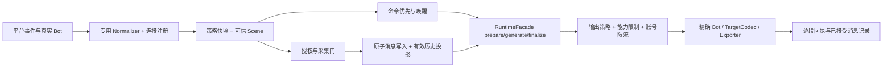

# GitNexus Engineering Plan — 多平台发言策略与统一消息流水线

> Task: 基于最新 Stella 与 AstrBot，补齐多平台发言设置、可信会话接线、统一消息存储与精确回投；本轮只规划。
> Evidence verified at commit `17e631028344332fcab5dc0f7dbb1ff0cdd0c64b`（main，与本轮 fetch 后 origin/main 一致）。AstrBot `f61a7f42696da6df25dc7a249ec9b8d54ed9da18`（4.29.3）。日期：2026-10-25，Asia/Shanghai。
> Depth: deep · form: full · freshness: strict requested · impact_depth: 3。GitNexus 1.6.12 runner 身份已核验 current；唯一一次 `analyze --index-only --pdg --workers 1` 退出 1，日志无明确错误原因，索引仍为旧 `3825f99` 并标记 `incremental-in-progress`。**当前图不承担实施放行依据；本计划为 source-weighted，执行必须先完成 G0 图恢复门禁。**
> Provenance: schema 2; global dirty digest `ddb2dcd4680a5d14185d520cad1280b3e086ba50031578ee9ea3db342a6c2ce3`; 87 sorted cited-path entries; exact generated plan path excluded.

G0 implementation re-anchor (2026-10-25): the verified GitNexus 1.6.12 runner rebuilt an index with PDG successfully at source HEAD 17e631028344332fcab5dc0f7dbb1ff0cdd0c64b. status --json is up-to-date with no incomplete reasons; current upstream impacts and local PDG slices are recorded in sections 4, 5 and 9. Flow extraction still drops candidate entry points, callees and traces; source reference checks remain required where impact is lower-bound.

`[verified]` 表示在上述提交/当前工作树读取确认（外部资料另给固定提交）；`[graph]` 表示本轮工具输出但未被源码确认；`[inferred]` 表示设计决策或推导；`[assumed]` 必须在 §12 验证。新文件/新符号均明确标为“拟新增”，不声称已经实现。

## 1. Objective

[inferred] 交付一个逐平台可启用、可以停止和回滚的工程：同一可信会话贯穿策略解析、采集、消息组件、模型上下文、长期记忆和投递；群/私聊/频道/线程分别配置是否回复、如何回复、是否主动发言，任何跨平台同号不串数据或错投。

范围包括 OneBot/WebChat 回归、Telegram、Discord、QQ 官方首批适配，及后续适配器复用的注册合同。平台依赖已装、连接上线、L1 文本、L2 隔离、L3 高级能力、live 认证分别标记。**不更换 NoneBot/SQLite，不自动合并账号，不做跨平台转发，不切换 Corona/legacy 默认入口。**

本轮产物是本计划及 §11 实施上下文包；不改业务代码、测试、用户配置、数据库或运行服务。按仓库 AGENTS 要求只额外同步任务状态。原 2026-10-24 中英文研究保留原结论，作为历史材料而非当前运行证明。

## 2. Current Behaviour

- [verified] `core/transport/normalizers.py:20–34,198–275` 已有可信 Bot/User/Scene 引用和 generic normalizer，但 payload 只有 text/标志及进程内句柄；generic 把会话保留为 opaque。全仓 Python 引用审计中，generic 只有定义/导出，`register_conversation_v2` 只有定义及测试调用；未找到生产接线。
- [verified] `stella_project/plugins/bot_main/ai_gateway.py:1152–1197,1463–1512,1922–1971` 的主入口仍为 OneBot 类型、ALLOWED_GROUPS/@ 与 QQ 私聊开关。`AdmissionPolicy.decide` 在 `core/transport/normalizers.py:281–330` 区分 passive/group/private/webchat/plugin，默认拒绝 opaque。
- [verified] `core/transport/outbound.py:437–558` 默认只注册 OneBot；先检查目标/能力/Bot/codec，再分段发送；超时/调用异常为 UNKNOWN，出现部分成功返回 PARTIAL。`transport_delivery.py:20–50` 的后台 Bot 解析只接受 legacy-qq 绑定。
- [verified] `memory/pre_processors.py:192–338` 在采集允许后记录正文与身份，但仍对旧 msg_id 做整数转换；332–335 在 commit 前设置 row_id/captured，异常被捕获后直接返回。`resolve_reply_target:341–365` 仍先用 QQ 数字 codec，缺少不透明 ID 路径。
- [verified] `core/context.py:158–222,585–651` 已保留 storage_session_id、c2/u2 所需引用与原始用户 ID。`memory/ownership.py:173–177` 目前只接纳 group/private/webchat；channel/thread 会返回 None，不能只加入口就宣称记忆权限完成。
- [verified] `corona/config_api.py:349–438,726–757` 已有 desired/applied、If-Match、幂等键与 ConfigStore 保存；`corona/group_bindings.py:40–235` 的 QQ 绑定是“验证→保存配置→Nucleus 应用→Apply→确认”的 saga，不能绕过。`nucleus/group_bindings.py:384–440` 只允许正整数群号，写 qq_groups。
- [verified] 最新主分支已包含 PR #123。其旧状态文字仍有“PR open”，以合并提交为准；本轮未重跑其 hosted CI 或复验 QQ。`corona/routes.py:44–72` 与 `nucleus/routes.py:20–63` 固定控制/业务归属，缺失或重复业务路由会阻止启动。
- [verified] memory schema=22、native API=4；Rust 严格核验 schema 相等（`memory/schema.py:63`、`memory_rust/backend.py:14–23`、`memory_rust/native/src/schema.rs:11–39`）。这不是某个部署 wheel 的验收。

## 3. Relevant Architecture

### 3.1 应吸收的 AstrBot 机制

[verified, external] [MessageSession](https://github.com/AstrBotDevs/AstrBot/blob/f61a7f42696da6df25dc7a249ec9b8d54ed9da18/astrbot/core/platform/message_session.py#L7) 用实例 ID、消息类型、会话标识来源；[EventBus](https://github.com/AstrBotDevs/AstrBot/blob/f61a7f42696da6df25dc7a249ec9b8d54ed9da18/astrbot/core/event_bus.py#L53) 先选配置 scheduler，再执行受支持平台的群成员隔离。[UmopConfigRouter](https://github.com/AstrBotDevs/AstrBot/blob/f61a7f42696da6df25dc7a249ec9b8d54ed9da18/astrbot/core/umop_config_router.py#L48) 按映射顺序取第一条命中，并非自动挑最精确规则。

[verified, external] [模型会话与平台历史](https://github.com/AstrBotDevs/AstrBot/blob/f61a7f42696da6df25dc7a249ec9b8d54ed9da18/astrbot/core/db/po.py#L72) 分表；[历史组件投影](https://github.com/AstrBotDevs/AstrBot/blob/f61a7f42696da6df25dc7a249ec9b8d54ed9da18/astrbot/core/platform_message_history_mgr.py#L56) 将图片/音视频/文件转为占位，保留文字和基本 @/引用。它不是无损媒体档案。[内置持久化入口](https://github.com/AstrBotDevs/AstrBot/blob/f61a7f42696da6df25dc7a249ec9b8d54ed9da18/astrbot/builtin_stars/astrbot/main.py#L138) 受群历史开关控制并排除 WebChat；Bot 记录来自 on_llm_response，不代表平台发送成功。

[inferred] Stella 吸收“统一事件、按来源策略、分层历史”，保留自己的 c2/u2、owner/subject/audience、采集门、RuntimeFacade、UNKNOWN 回执与 managed 修订合同。不会直接照搬 UMO 的裸 ID 白名单、顺序通配授权或概率主动发言。

### 3.2 目标流程与职责



[inferred] 控制面仅保存非秘密连接引用、策略和绑定；凭据仍使用既有平台连接配置。Nucleus 解析实际消息、登记会话、持有 DB 锁并执行发送。平台 payload 不决定管理员身份、共享权限或任意后台目标。模型上下文键、物理会话键、memory_space 是三个概念；MVP 只支持 `context_mode=scene`，群成员分支隔离另列后续。

## 4. GitNexus Findings

### 4.1 规划阶段工具事实与限制（历史记录）

| 问题/工具 | 本轮结果 | 如何使用 |
| --- | --- | --- |
| `status --json; list` | [graph] runner 1.6.12/schema4 current，旧索引 3825f99；随后主分支快进 4 commits | 分析器身份可追溯；不能把旧索引当新源码 |
| `analyze --index-only --pdg --workers 1` | [graph] exit 1，结束于 incremental 写入阶段；无明确报错原因；context 仍含 incremental-in-progress | 原因未知，不推断 OOM/锁等；遵守技能一次刷新预算，不在规划中构建/修复分析器 |
| resources context/clusters/processes | [graph] context “Index is 4 commits behind HEAD”；clusters 显示 Memory/Transport 相关社区，processes 只有展示摘要 | 只导航；不根据缺失流程判 unused |
| query ingress/policy/managed/storage | [graph] Python 主流程未定位到，主要返回不相关定义 | 改用定向源码/装配/引用审计，不扩散查询 |
| context 5 primaries | [graph] 部分 found 但无调用边，部分 not_found；拼写/UID 参数纠正后仍无法得到完整调用集合 | 所有 load-bearing 声明均回到最新源码 |
| upstream impact 5 primaries，depth3 | [graph] UNKNOWN/无可证明调用；exact UID admission 为 direct=0，riskNote 明示无边不等于未使用 | **不是 LOW，不是可编辑许可**；G0 恢复后重跑 |
| `pdg_query controls` admission/文件锚点 | [graph] 具名符号未解析；文件锚点 total=0 | §5 只做 source-derived 控制审计，不伪造 PDG 边 |

[graph] 刷新日志还报告 3203/3403 候选入口遗漏、952 callees skipped、43 walks cut、23 depth caps；大于 512KB 的生成物被跳过。旧元数据 796 flows 不是运行全集。旧研究中的 HIGH/CRITICAL 数字不移植为新提交图结果。

### 4.1.1 实施入口 G0 复核（2026-10-25）

| 检查 | 当前结果 | 实施解释 |
| --- | --- | --- |
| runner/index | node .gitnexus/run.cjs，GitNexus 1.6.12；analyze --index-only --pdg --workers 1 exit 0。status --json：index commit=HEAD 17e631028344332fcab5dc0f7dbb1ff0cdd0c64b，runner identity current，incompleteReasons=[]，status up-to-date | G0 索引恢复通过；状态文档更新后又增量索引 changed=3。最新统计 114,886 nodes / 289,073 edges / 1,193 clusters / 796 flows |
| query/context/impact | query 定位到群消息记录、能力查询、私聊/群回复和绑定流程；五个 primary 均可用 context/impact 定位 | 以 d=1 集合为包级回归清单，不把 processes 摘要当作全流程 |
| 当前 extraction 限制 | 重建日志：39 个 >512 KiB 文件跳过；3,203/3,403 候选入口未进入排序，952 callees skipped，43 walks cut，23 traces depth-capped；102 name-fallback call sites，其中11 refused | 缺失的图边/flow不能解释为无调用；每包对 unresolved/lower-bound 项做定向源码引用核对 |
| AdmissionPolicy.decide | CRITICAL / exact；7 d=1；affected processes: chat、record_group_chat、stream | 5 个生产调用者为 record_group_chat、is_chat_trigger、is_plugin_trigger、is_private_trigger、WebChat run_turn，另2个测试；与§4.2一致 |
| register_conversation_v2 | MEDIUM / exact；6 d=1；0 processes | 6 个直接调用均为 registry 测试；当前生产接线仍未发现，与§4.2一致 |
| OutboundService.send | HIGH / lower-bound；7 d=1；affected processes: proactive_speak_job、handle_capability_query；4 个 receiver-typing call sites 未解析 | 图中含6个生产发送调用和1个测试；源码审计确认群/私聊、能力查询、主动@、主动发言及后台发送用途。另有4个未分类调用点不得视作已排除 |
| record_message | CRITICAL / lower-bound；19 d=1、9 affected processes；3 个 receiver-typing call sites 未解析 | 图与源码共同确认 _record_bot_lines、handle_private_chat、record_group_chat、WebChat run_turn 四个生产调用函数（WebChat 同时写入用户行与 Bot 行）；其余直接项含测试。事务修改必须覆盖四个入口 |
| GroupBindingsCoordinator.execute | LOW / lower-bound；1 个 d=1 production handler；15 个通用 execute call sites 未解析 | 源码确认 install_group_bindings.groups_bindings 经 coordinator.execute 进入 saga，corona/app.py 负责装配；低图 risk 不覆盖未解析调用 |

G0 的 d=1 与§4.2 source-derived 生产消费者已调和，没有发现需要新增的生产消费者类别。impact 结果中的 lower-bound 与分析器截断继续保留为约束，不升格为完整调用全集。

### 4.2 五个主符号及直接消费者核算（source-derived）

| 主符号 | 已确认生产消费者/接线 | 计划对应 |
| --- | --- | --- |
| AdmissionPolicy.decide | ai_gateway 的 record_group_chat、is_chat_trigger、is_plugin_trigger、is_private_trigger；WebChat run_turn | P03/P08 同时回归五条入口，保留优先级与插件去重 |
| register_conversation_v2 | 生产调用未找到；测试覆盖注册、别名碰撞与并发 | P01/P03 显式接线；不得把新连接冒充 legacy QQ |
| OutboundService.send | ai_gateway 的群/私聊回复、能力查询、主动 @、主动发言；send_background_message；测试桩 | P05/P09 逐项迁移/验证；统一结果不能丢失 parts/IDs |
| record_message | record_group_chat、handle_private_chat、_record_bot_lines、WebChat run_turn | P04/P08 所有路径共享事务和采集结果；失败不能伪报 captured |
| GroupBindingsCoordinator.execute | install_group_bindings 中 HTTP handler；corona/app.py 装配；coordinator 测试 | P02/P07 保留 QQ saga，不把跨平台绑定写进 ALLOWED_GROUPS |

这不是声称解析了所有动态消费者；G0 的新图 d=1 集合必须逐项与此表调和。若发现新消费者，先更新对应工作包与回归，不跳过。

## 5. 规划阶段 Source-Level Findings（G0 前）

**历史核对（G0 前）：PDG unavailable for load-bearing claims。** 当时文件锚点返回空集且索引 incomplete，本节没有使用 statement-level PDG。以下时序约束来自逐句源码核对，标记为 **[verified, source-derived]**，不是图依赖边。实施入口 G0 的局部切片见§5.1；不得把下表读作当前 PDG 结果。

| 中央函数/语句锚点 | 控制、数据和状态约束 | 实施后果 |
| --- | --- | --- |
| AdmissionPolicy.decide 293–304,315–329 | enabled/self/scene/文本/@/插件/命令/opaque 分别能提前返回 | 新策略不得绕过 self echo、命令消费和 opaque 拒绝；capture 与 reply 开关分开 |
| record_message 217–226,286–302,314–335 | 拒采集在连接库前返回；pressure 在写锁内重新检查；正文与身份同时写；目前 captured 在 commit 前设置 | 新组件/事件插入必须同事务且无 await/网络；commit 成功才回填 row_id/captured；异常清零并返回明确失败；pressure 拒绝零正文 |
| OutboundService.send 463–507,511–558 | 过期→binding→能力→精确 Bot→场景→codec→投影→分段；每段受 deadline；异常 UNKNOWN，非 ACCEPTED 停止 | 限流排队必须算进原 deadline；恢复前重验窗口/能力/代际；UNKNOWN 无自动重投；部分成功不重新发第一段 |

[inferred] 额外事务边界：V2 注册 239–271 自行 commit/BEGIN IMMEDIATE；不能把它嵌入消息正文事务，造成提前提交。先登记必要的可信路由元数据，再在独立短事务写消息；捕获拒绝时不得写正文、组件或排队补录。managed saga 90–156 保存配置后才调用业务 apply，补偿失败必须保留 needs_reconcile，不能对 UI 报成功。

### 5.1 G0 当前 PDG 局部切片

| anchor | GitNexus statement-level 结果 | 约束与证据边界 |
| --- | --- | --- |
| AdmissionPolicy.decide，normalizers.py:326，direction=downstream | 4 个局部依赖语句：327–330，覆盖 opaque 拒绝、purpose 校验和允许返回 | opaque 守卫必须先于新入口放行；该切片是 CDG + REACHING_DEF 的局部结果，不提供跨函数调用覆盖 |
| record_message，pre_processors.py:292，direction=downstream | 14 个依赖语句，包含 row_id 清零、压力拒绝 return、后续 INSERT 和异常出口；line303 INSERT anchor 得到10个下游语句 | 压力拒绝必须 rollback/close/return 且不能写正文。line333/334 commit/capture 赋值未解析到起始 PDG block；commit 顺序仍以源码为准，成功 commit 后才能报告 captured |
| OutboundService.send，outbound.py:542，direction=downstream | 41 个依赖语句，经3个 inter-procedural hops；局部包含非 ACCEPTED break、逐段结果、PARTIAL/UNKNOWN 汇总和 DeliveryResult | 保留每段 ID/status 且非 ACCEPTED 后停发。PDG 报告6个 unproven bridge、4个 callgraph bridge；CALL_SUMMARY ascent incomplete（traversal-truncated / callee-ids-unrecorded），无跨边界 alias/exception ascent 模型 |

这些切片证明 PDG 层可用，但不是全流程完整性证明；G0 的 flow 候选截断和 source-derived consumer 清单仍适用。实现中不得从缺失的 inter-procedural bridge 推断“不受影响”。

## 6. Proposed Changes

### 6.1 稳定连接、策略与配置：P01/P02

[inferred] 拟新增 `stella_bootstrap/transport_settings.py`，提供纯解析/规范化/校验；拟新增 `core/transport/connection_registry.py` 与 `core/transport/policy.py`。控制面不导入 nonebot、core runtime 或 memory。

采用一个新环境键（拟议名 `STELLA_TRANSPORT_SETTINGS_JSON`），保存**有大小上限、单行 canonical JSON 的 version1 bundle**，作为既有 ConfigRevision.values 中的字符串。上限 256KiB、最多256连接/1024档案/10000绑定；拒绝重复键、未知枚举和悬空引用。schema、legacy env writer 与 bootstrap 校验须同步。不要在配置目录另造一份独立可变策略主库，不升级 ConfigRevision format1。

bundle 至少含 `version`、`connections`、`profiles`、`bindings`。连接为持久 UUID、adapter canonical name、platform_scope、self_id 与已有连接凭据的引用；不保存 token、原始事件或 SDK 对象。ID 不随 UI 顺序、进程 PID、display name 改变。复用 TransportRegistry.bind_bot 对重复 `(adapter,self_id)` 槽的拒绝；同槽无法表达的双连接在保存/启动阶段显式报错。

逐字段优先级固定为全局默认 < 平台模板 < 连接默认 < 档案 < 场景覆盖 < 有期限的运行期覆盖；false/空数组是显式值，缺省才继承。同级冲突拒绝保存。权限、能力、实例限制在解析后再次相交，不能通过覆盖放宽。每轮记录配置 revision、策略摘要与字段来源，不记录正文/凭据。

策略字段首批：`capture_enabled`、`llm_enabled`、`wake_mode`（mention/reply/prefix/all/private_direct）、`wake_prefixes`、`reply_mention`、`reply_quote`、`format_mode`、`segmentation`、`proactive_enabled`、quiet hours、请求配额。`policy_profile_id`、`persona_ref`、`memory_space` 分开绑定；主体名单使用 namespaced subject。`context_mode` 首版仅 scene；对未实现的 member 模式明确拒绝。

兼容缺省严格保留原 ALLOWED_GROUPS、PRIVATE_CHAT_ENABLED/ALLOWLIST、qq_groups 和 WebChat 鉴权语义。不把裸群号自动绑定到未知 Bot。旧 QQ 配置编译成兼容策略，不立即重写旧数据库或空间账本；首版新 bundle 不覆盖旧 QQ 权威绑定。QQ 新策略只有显式启用时生效，冲突通过 UI 提示。

### 6.2 配置写入与管理面：P02/P07

[inferred] 拟新增 `webui/services/conversation_settings.py`（纯 DTO/受控读写门面），在现有 managed/legacy API 中增加 `GET/PUT /api/v1/platform/conversation-settings`；managed 由 Corona 承担，复用 `_save` 的 If-Match、Idempotency-Key、desired/applied 和 Apply。缺 If-Match 的新 PUT 返回 428；冲突409；invalid400；同幂等键同内容返回同一修订，不同内容409。core down 时仍可修复 JSON 语法和连接配置，涉及 persona/空间存在性的语义校验在 Nucleus 启动/ready 之前完成，失败走原 Apply 恢复。

业务查询拟增 `GET /api/v1/conversations/scenes` 与 `GET /api/v1/conversations/messages`（固定 schema 的 query 参数，不让模型传任意 SQL）；归 Nucleus。同步 `corona/routes.py`、`nucleus/routes.py`、`webui/routers/config.py`、`openspec/openapi-v1.yaml` 和 route-matrix 测试，保留现有路径兼容。新增业务路由不应被 Corona status DTO 替代。

Persona 绑定仅引用已存在的人格文件，内容编辑仍走独立 API并保留“内容成功、绑定失败”提示；不声称两个 PUT 原子。新绑定只改变后续会话的检索空间引用，不搬移历史、合并画像或修改私人授权。非空历史会话改 memory_space 必须单独的受审计显式操作；首版拒绝并给出 preview/迁移入口，不能靠改 JSON 自动移动历史。空间重命名/删除前检查活动绑定并拒绝悬空。

拟增 `dashboard/src/components/ConversationPolicyEditor.vue`，接入现有 Persona/Platforms 页面：按平台/连接/场景筛选；显示有效策略来源、配置修订、能力与 fixture/live 级别；复用 system store 的操作状态。不会把尚未应用的草稿当成当前有效设置，不重复请求 restart。Welcome 的 QQ 计数语义不悄悄改成全平台总数。

### 6.3 统一入站与可信上下文：P03/P06/P08

[inferred] 拟新增 `core/transport/ingress.py`，集中“识别 adapter→绑定完整 BotRef→专用 normalizer→策略快照→访问/采集门→V2 注册→构造 ChatContext→单轮服务”。Normalizer 只从受信任适配器事实提取 SceneRef 的 kind/parent/thread，不解析 opaque session 字符串猜权限。

NormalizedEvent 增加拟议 `MessageEventV1`：版本、event_kind（create/edit/delete）、不透明平台消息 ID、可选平台 update/revision ID、UTC 时间、保序组件与关系。组件允许 text、mention、reply、image、audio、video、file、unsupported；文件只存稳定描述和受控附件引用，临时签名 URL/本机敏感路径/原始对象不落库。SDK 对象仍只作 repr=False 的短生命周期句柄。

新增平台填充现有 user_ref/bot_ref/scene_ref、storage_session_id 与 platform_message_id。legacy msg_id 只允许在 OneBot codec 中解释；其他平台占位0，不能把 DB row_id 冒充外部 msg_id，不能散布 int(raw_id)。用户主体以 user_ref 为准；发现消费者仍要求 QQ 数字语义时，明确 unsupported 或补适配，不把它伪装成 QQ。

扩展 `scope_for_chat_context` 对可信 channel/thread 的分支：共享场景 audience 与 group 相同，私聊仍 PRIVATE_ONLY/USER_SHARED；opaque 不进入记忆授权。若新 transport 场景无法产生明确 scope，则在该入口关闭 PERSON 处理，不退回旧有无作用域检索。群级主动发言保持 SPACE-only。消息尾巴、压缩水位、缓存、锁和运行期静音均使用规范会话/内部 storage key，不能用 shared space 或真实群号替代。

RuntimeFacade.submit_turn 保留 prepare/generate/finalize、owner_epoch、deadline 和取消隔离。新增策略/事件投影若需要持久化，ChatContext projection 候选升至8，显式兼容6/7，runtime deadline 不序列化。旧 QQ/WebChat 先保留原入口，新的 matcher 机械排除它们；P08 才将其委托共享服务，保证一次入站只记录/生成/发送一次。AstrBot QQ 兼容插件保持现有边界，不让非 OneBot 事件访问 QQ API。

### 6.4 SQLite 追加消息层与关系：P04

[inferred] 不重命名 group_messages，不重复建立一套平台数据库。保留它作为既有记忆消费者的来源行；拟新增 `memory/message_store.py` 并在一个 memory DB 事务内维护三张附加表：

| 拟新增对象 | 字段/约束 | 与旧记录的关系 |
| --- | --- | --- |
| transport_message_events | event_id PK、conversation_key、connection_id、direction、event_kind、platform_message_id TEXT、platform_revision/local_event_id、UTC时间、legacy_row_id、availability、payload_version | create/有正文的 edit 关联原文快照行；delete 为无正文 tombstone；不覆盖旧证据文本 |
| transport_message_parts | `(event_id,part_index)` PK、kind、safe JSON payload | 有序组件；仅允许受控字段，不存 SDK repr |
| transport_message_relations | event_id、relation_kind、目标 connection/conversation/message、subject_key、resolved/unresolved | 目标不存在时保留 unresolved；禁止跨会话无授权解析 |

建立 `(connection_id,conversation_key,direction,event_kind,platform_message_id,platform_revision)` 的条件唯一约束，仅在平台提供可信键时启用；缺 revision 的编辑用 adapter update ID，否则记录本地事件身份并披露去重能力不足。不要按正文 hash 或时间窗口抑制真实相同发言。发送端 msg_ids 为物理分段列表，与 logical_message_id/part_index 关联；ACCEPTED、UNKNOWN、PARTIAL 分别保留。

有效历史查询通过规范 source-row 映射选择最新 create/edit 和 delete 状态。原 group_messages 是不可变来源证据；新平台的上下文必须读有效投影，不能把编辑版本同时塞进尾巴。删除隐藏未来上下文，给引用的既有记忆证据标记 source unavailable；不在本批工程自动重写全部长期记忆。没有附加事件的旧行仍可读，迁移不为缺失附件/主体补造事实。

capture 不允许、pressure 超限或策略禁采集：正文、parts、relations 均零写入、零重放队列。V2 注册单独事务先结束；消息事务内不 await。record_message 的捕获成功状态移到 COMMIT 后，任何异常 rollback/close，row_id归零并给明确失败结果；受控旧调用不传 capture 的兼容行为单独测试。

resolve_reply_target 增加按完整连接/规范会话/不透明 message ID 查询的路径；只有明确 legacy QQ 来源才走旧整数 fallback。未命中、歧义、跨会话拒绝都返回 unknown，不猜“最近作者”。附件先只留安全元数据与文字占位，原件缓存/转存默认关闭；保留期和磁盘预算独立配置。清理时按 FK 顺序删除 parts/relations/events 并更新有效投影/缓存，不能先删来源行留下错误映射。

### 6.5 精确出站与平台范围：P05/P06/P09

[inferred] OutboundService.send 继续唯一发送门面；TransportRegistry 登记各 adapter 的 normalizer/exporter/target codec/capability provider 和在线 Bot。连接上下线、generation 切换必须重新校验完整身份，离线不回退另一账号。后台 resolve_background_bot 改为先解析注册表，旧 legacy-qq 分支作为兼容入口保留。

能力分为 adapter→实例→场景三层；quote/@不支持时可丢弃装饰，媒体无安全等价文本则 unsupported。长度单位和富文本 escape 由平台 exporter 负责，不能把统一 Python len 当所有平台的最终 API 计数。接入 FIFO 有界发送调度器，按账号和目标限速；request quota 与平台 API quota 分开。

[verified] AdapterCapabilities.narrowed_by 当前逐数值 min 包括 rate_window_seconds（`capabilities.py:50–64`）。[inferred] 对计数/窗口不能简单逐字段 min 作为速率交集：各层保留独立 bucket 并同时满足；发送窗口/长度上限则取更严约束。排队超原 deadline/回复窗口就返回 EXPIRED；收到明确 429/未接受失败才依据 retry_after 在剩余预算内有界重试。一次不明超时不重投。

首批每个平台各自完成专用 codec 与实事件 fixture：Telegram（private/group/topic）、Discord（DM/channel/thread）、QQ 官方（私聊/群/频道实际覆盖子集、事件回复窗口）。这些语义须在 P06 对锁定适配器源码/官方文档核验，不在本计划捏造其 API 参数/限额。无 passive_receive 的平台不能打开全量旁听；无 proactive_send 或窗口过期时后台主动禁用。未覆盖能力保持 unsupported。

## 7. Implementation Sequence

工作包均为未来实施；按顺序单任务推进。建议一包一个可审查提交，关联本计划和目标提交；不得用本轮“计划 done”关闭 XPLAT/CORONA 的运行验收。

| 包/依赖 | 具体工作与文件范围 | 完成证据与停靠点 | 回滚/风险 |
| --- | --- | --- | --- |
| **G0（阻塞入口）** | 实施入口 G0 已于 2026-10-25 完成：恢复 GitNexus index-only/PDG，核对五主符号及 d=1，更新§4/§5/§9；详见§4.1.1/§5.1 | status 对应源 HEAD、无 incompleteReasons；query/context/impact 可定位；局部 PDG 与来源限制均已记录。每包源文件编辑前重新 upstream impact | 提取遗漏仍是约束；不能以未解析调用或缺失 flow 推断无调用 |
| **P00 / G0** | 对既有 QQ/WebChat、managed/legacy 建隔离基线与锁定适配器矩阵；记录真实源码/schema/wheel合同，排除旧状态文案 | 固定夹具、现有定向套件、CI解释；区分工具/host/live失败，未经验证不复用旧pass数字 | 零产品行为变化，可独立停止 |
| **P01 / P00** | 冻结 connection registry、MessageEventV1、策略bundle、错误/能力合同；新增纯bootstrap parser与 transport registry；先只在测试接线 | 不透明ID、同号双平台/多Bot、连接改名重启、冲突槽、json大小/非法字段/悬空引用测试 | 默认关闭新入口；不升级DB |
| **P02 / P01** | 新JSON键贯穿 config/settings.py、bootstrap校验、managed/legacy GET/PUT；保留revision format1；先做headless API | desired save/readback、一次Apply、wrong revision409、幂等冲突、core-down修复、非法配置Apply回滚；QQ saga旧测试全保留 | 配置回滚先于开连接；绑定设置不另写空间TOML；不移动历史 |
| **P03 / P01,P02** | 共用入站、V2注册、RuntimeFacade接线、channel/thread ownership、上下文投影；首用合成adapter实事件fixture，不开live | 禁采集零写、5类准入分支、同会话串行/不同会话并行、双Bot和线程隔离；旧QQ/WebChat不重复命中 | 新matcher只匹配明确新adapter，主入口不切换 |
| **P04 / P03** | 原子消息附加表、有效投影、opaque reply、迁移和Python/native合同 | schema22临时库→候选23；dry-run、故障注入、重跑、旧行不丢；commit失败不captured；Python/native一致；新wheel读写实际常量 | 建新表加列；API4仅在接口未变时保留。先备份锁库，再升级；不能让旧native打开新schema |
| **P05 / P03,P04** | exporter/codec注册、精确Bot、独立限流bucket、deadline、逐段回执；通用fake exporter先验证 | 队列/429/过期/断连/unknown/partial、重启/代际、同self_id不同adapter与冲突槽负例 | 不承诺exactly-once；限流排队有界；不明结果不重投 |
| **P06-T / P04,P05** | Telegram专用normalizer/exporter/codec并接入配置connection引用 | private/group/topic fixtures→文本live→关系/媒体live；实际身份/目标/消息回执匹配 | 每连接opt-in；无live保留not_certified |
| **P06-D / P06-T** | Discord专用适配；channel/thread/DM与权限收窄 | 同频道不同thread、权限不足、缺intents、引用不可取、格式与长文本fixture/live | 缺权限不能启用旁听；不把parent/guild当回复目标 |
| **P06-Q / P06-D** | QQ官方专用适配，按锁定adapter验证事件窗口、私聊/群/频道子集 | 必要真实事件fixture、窗口内/外、消息ID不透明、主动限制与live | 不复制OneBot能力；超期不得换账号补发 |
| **P07 / P02,P06-Q** | Persona/Platforms会话策略编辑、场景查询和history分页；前后端route/OpenAPI同步 | managed与legacy保存/回读；field来源和applied显示；Nucleus不可用；身份过滤；UI auth与路由；构建/同步 | 保留旧/groups兼容及QQ计数；人格内容与绑定分开反馈 |
| **P08 / P04,P05,P07** | 将QQ/WebChat委托共用服务，逐入口保留旧命令/插件优先级、capturegate及生成协议 | policy五调用者、record四调用者、send所有调用点逐项回归；每事件1行/1轮/1次send；真实QQ/WebChat与模型验收单列 | 显式可回退开关；不得同时启用两套写入/生成路径 |
| **P09 / P06-Q,P08** | Participation/Scheduling/Cometa后台使用完整目标、会话配额/quiet hours/发送窗口；先fixture再逐连接live | 重启后仍投原Bot/原线程；断连不换Bot；sending→unknown不自动重投；静音与直接reply独立 | 默认新增平台proactive=false；不升级未证实可路由的历史任务 |
| **P10 / P09** | 关闭分支验证、文档、打包、CI与L0–L3矩阵；最终一次更新immutable flow/锁定基线工件 | Python3.10/3.11/3.12、Dashboard、Rust/native、所有必要live和发布矩阵留证；all/compare图检查完整 | 功能包停靠提交保持源码/测试一致；生成flow只在最终包刷新，未刷新期间不得宣称中间包已过flow gate |

[inferred] P00–P10 是依赖序列，不是并行授权。P06三平台顺序验证，后续平台按同一矩阵扩展。任何包失败停在该包，不以关闭测试或扩大默认权限继续。

### 7.1 数据与版本迁移/回滚

- 候选 memory schema **23** 只在 P04 落地时分配；若上游已升级则重新编号并 re-anchor，不硬占版本。迁移必须有 migrate_vN、旧库夹具、事务回滚与 dry-run；更新所有建表路径。
- Python/native schema 同步，API 是否加号依据真正签名变化；新增表本身不强制 API5。先构建候选 wheel 并显式读取 API/schema，再放开新表写入。旧 wheel mismatch 必须拒载或按明确策略安全回落，不静默对新库用旧扩展。
- 升级前停止业务写者/后台任务，证明 STELLA_HOME DB 锁释放，备份 memory DB及相关配置revision；控制面与业务库不能混归同一迁移。
- 优先前向修复。需代码降级时，先关闭新平台并停止新写入，再恢复匹配的代码/wheel及完整升级前备份；若升级后已有消息，必须先导出/保存增量，明确数据保留取舍。禁止只改 schema_meta 为22骗过旧native。首次live前做一次恢复演练。

## 8. Test Strategy

所有下表新增路径是**拟新增**；现有路径已定位，不伪造已经存在的测试。fixture/provider stub、真实平台、真实模型、VM/installer分别留证，不互相替代。

| 套件/工作包 | 输入→动作→应有结果 |
| --- | --- |
| tests/test_transport_normalizers.py、tests/test_conversation_registry.py（更新） | opaque/Unicode/前导零；不同连接同ID；注册后重启→原identity/alias不变；unknown不获群权限 |
| tests/test_transport_outbound.py（更新） | accepted首段＋unknown次段→PARTIAL保留全部ID、不重发；排队过deadline→EXPIRED零send；多bucket均满足 |
| tests/test_transport_policy.py（拟新增，P01/P02） | 继承/false/空集合/冲突；私聊与群独立；禁主动但@仍答；禁capture不存；通配/超大JSON/悬空引用拒绝 |
| tests/platforms/test_transport_pipeline.py（拟新增，P03/P06） | 实adapter事件→trustedctx→写入→stub生成→原Bot原线程回投；两套matcher不双命中；不支持能力显式降级 |
| tests/test_message_store.py（拟新增，P04） | 录入多组件→保序恢复；重连重复create→一条；edit/delete→有效投影正确且原证据不变；缺ID不按正文删重；故障注入commit→无部分表/无captured |
| tests/test_migrations.py、tests/test_message_relations.py（更新） | 临时schema22→新schema；旧行仍读；重跑幂等；任一步失败整级回滚；opaque引用同会话可解析/跨连接拒绝 |
| tests/test_context_projection_identity.py、tests/runtime/test_session_ownership.py（更新） | 新投影兼容6/7；deadline不序列化；不同thread并行、同ctx串行；取消/epoch不串线 |
| tests/test_personal_memory_scope.py、tests/test_personal_memory_sharing.py（更新） | channel/thread只读对应SPACE及已分享PERSON；同名/同数字用户不合并；私聊跨平台不泄漏；scope缺失拒绝新平台PERSON |
| tests/corona/test_config_api.py、tests/corona/test_group_bindings.py、tests/webui/test_platform_adapters.py（更新） | auth、CAS、幂等、secret原样保护、core-down、Apply失败恢复；新bundle不改变旧QQ saga/ALLOWED_GROUPS |
| tests/nucleus/test_internal_api.py、tests/nucleus/test_route_catalog.py（更新） | route所有权无缺漏/重复、私有业务鉴权；新HTTP/webhook只代理实际目录允许的路径 |
| dashboard/tests/system-store.spec.ts（更新）＋ dashboard/tests/conversation-policy.spec.ts（拟新增） | desired/applied不混、一次Apply、409恢复、core-down禁业务保存、人格/绑定部分失败提示、字符ID不被JS number截断 |
| tests/scheduling/test_scheduling_delivery.py、tests/observability/test_background_flow_roots.py（更新） | 配额/quiet hours/跨Bot/重启/窗口；sending crash→unknown终态；历史不明目标零投递 |
| tests/platforms/test_adapter_matrix.py 与 adapter_matrix.json（更新） | 保留32项历史分母和屏蔽原因，local/fixture/live逐格记录；无live不能certified |

### 8.1 经核验的执行命令与前置条件

[verified] `.venv/bin/python`/Ruff 与 pnpm 在本机存在，Dashboard scripts 有 test/typecheck/build/sync:webui。cargo 与 maturin 当前未就绪；Rust/native命令属于实施环境前置条件，不是本轮已运行结果。CI Python矩阵为3.10/3.11/3.12，先安装requirements-platform.lock及开发依赖，再测试。`tests/test_message_relations.py` 在用例函数内导入 bot_main，需要同一 pytest 收集阶段由 `tests/test_private_chat_ingress.py` 初始化 NoneBot driver；P00 首次独立运行显现此 harness 前置，后续命令已包含该入口。

```bash
# 在隔离验证会话中；不要复制生产 .env/数据库/聊天。
validation_root="$(mktemp -d /tmp/stella-xplat-validation.XXXXXX)"
mkdir -p "$validation_root/memory"
STELLA_HOME="$validation_root" .venv/bin/python -m pytest tests/test_private_chat_ingress.py tests/test_transport_normalizers.py tests/test_conversation_registry.py tests/test_transport_outbound.py tests/test_context_projection_identity.py tests/test_message_relations.py tests/test_migrations.py tests/test_personal_memory_scope.py tests/test_personal_memory_sharing.py tests/runtime/test_session_ownership.py -q
STELLA_HOME="$validation_root" .venv/bin/python -m pytest tests/corona/test_config_api.py tests/corona/test_group_bindings.py tests/webui/test_platform_adapters.py tests/nucleus/test_internal_api.py tests/nucleus/test_route_catalog.py tests/scheduling/test_scheduling_delivery.py tests/observability/test_background_flow_roots.py tests/platforms -q
# 各包另运行其新增测试；最终P10完整回归。
STELLA_HOME="$validation_root" .venv/bin/python -m pytest tests -q
.venv/bin/ruff check .
pnpm --dir dashboard test
pnpm --dir dashboard build
pnpm --dir dashboard sync:webui
python3 scripts/check_docs.py
python3 scripts/generate_message_flow.py --check
git diff --check
```

Native 前置：安装仓库支持的 Rust toolchain/maturin（在隔离build环境），执行 `cargo fmt --manifest-path memory_rust/native/Cargo.toml --check`、`cargo test --manifest-path memory_rust/native/Cargo.toml`，构建候选wheel后显式读取 API/schema并运行项目既有 parity。旧库迁移 CLI 只能指向临时 STELLA_HOME 的复制夹具，绝不默认回落生产。每次关键源文件编辑前重新 upstream impact；提交前 all、对main compare，partial/truncated需补齐，不能将0当干净。

## 9. Risk and Impact Analysis

G0 当前 graph impact：AdmissionPolicy.decide=CRITICAL、record_message=CRITICAL（lower-bound）、OutboundService.send=HIGH（lower-bound）、register_conversation_v2=MEDIUM、GroupBindingsCoordinator.execute=LOW（lower-bound）；d=1 与未解析边界见§4.1.1。整体不按 LOW 放行。下列 **[inferred] 工程风险等级** 与 graph risk 分开：

- **CRITICAL：来源/身份/记忆隔离。** 涉及 record_message四消费者、registry接线、owner scope、native schema。channel/thread不能沿用None退回宽松旧路径；不得按昵称、数字正负、共享人格推授权。
- **HIGH：发送与后台恢复。** send五类网关用途及后台sender、Cometa桥；每段receipt保留，429与UNKNOWN分清，generation/目标期限和账号精确性重验。
- **HIGH：managed配置与补偿。** QQ saga的HTTP入口、Corona装配、Nucleus store及UI必须仍有一致结果。新bundle不触碰旧TOML；CAS/幂等和external_environment/profile覆盖要显示来源。
- **HIGH：采集事务与压力。** duplicate事件检查、压力计数与正文/组件写入保持短锁；不得将附件下载或模型调用放入事务。commit失败修正capture结果后，所有四消费者须有失败分支。
- **HIGH：能力速率与格式。** 独立bucket交集，长度单位/markup留给平台；限流队列有界、deadline包含等待。临时URL、Bot repr、配置bundle正文不进审计日志。
- **MEDIUM：管理页读写与兼容。** Persona目前两个PUT有部分成功提示；不能包装成原子保存。历史API保留旧字段，新增平台用string IDs，分页稳定游标且过滤受鉴权控制。

可观测性字段：connection_id、规范会话摘要/受控key、adapter、scene kind、revision/generation、policy decision/reason、capture result、queue wait、delivery status/part count、media availability、schema。禁止凭据/聊天全文混入公开证据。对全部§4 source-derived直接消费者逐项勾回归；G0发现的额外d=1同样必须加入。

## 10. Files Expected to Change

以下是实施候选清单，不代表本轮改动；新文件名为明确拟议。每包落地前先核对G0后的引用和最新目录。

| 文件/组 | 已核验符号或拟新增责任 | 包 |
| --- | --- | --- |
| core/transport/normalizers.py、models.py、core/context.py | NormalizedEvent；MessageEventV1拟新增；ChatContext安全投影 | P01/P03 |
| core/transport/connection_registry.py、policy.py、ingress.py（拟新增） | 稳定连接、策略解析、共用入站服务 | P01/P03 |
| stella_bootstrap/transport_settings.py（拟新增）、config.py、config/settings.py | 纯JSON解析、build_config_revision/_validate_known_values和新环境键 | P01/P02 |
| corona/config_api.py、webui/routers/config.py、webui/services/conversation_settings.py（拟新增） | platform_adapters_put/_save模式复用；新配置DTO/API | P02 |
| corona/routes.py、nucleus/routes.py、openspec/openapi-v1.yaml | 新控制/业务route归属和文档；create_nucleus_business_app纳入目录 | P02/P07 |
| core/transport/outbound.py、capabilities.py、adapters/onebot_v11.py | OutboundService.send、TransportRegistry.bind_bot、AdapterCapabilities.narrowed_by及兼容codec | P05/P08 |
| core/transport/adapters/telegram.py、discord.py、qq_official.py（拟新增） | 各平台专用normalizer/exporter/codec/能力；名称以实际模块锁定 | P06 |
| memory/conversation_registry.py、pre_processors.py、message_store.py（拟新增） | register_conversation_v2、record_message、resolve_reply_target、有效历史 | P03/P04 |
| memory/schema.py、migrations.py、memory_rust/backend.py、memory_rust/native/src/schema.rs | 附加表迁移与严格schema合同；API按真实变化决定 | P04 |
| memory/ownership.py、conversation_projection.py、config/spaces.py | scope_for_chat_context、消息投影和prompt_path/resolve_space兼容；不自动搬记忆 | P03/P04/P08 |
| stella_project/plugins/bot_main/ai_gateway.py、transport_delivery.py、cometa_bridge.py、scheduling/delivery.py | 五入口/四记录消费者与发送点委托；resolve_background_bot/send_background_message | P08/P09 |
| webui/services/conversations.py、dashboard/src/views/PersonaPage.vue、PlatformsPage.vue | 历史过滤、saveSpaceSettings的兼容反馈、场景策略入口 | P07 |
| dashboard/src/components/ConversationPolicyEditor.vue（拟新增）及中英文locale | 策略来源/能力/修订可视化 | P07 |
| §8现有及拟新增测试；tests/platforms/adapter_matrix.json | 同步各包合同与负例，认证分层 | 各包 |
| core/observability/flows/*、docs/architecture/*、docs/reference/*、feature_list.json、progress.md、session-handoff.md | 最终flow工件、双语正文与状态/验收 | P10 |

## 11. Reusable Implementation Context

下面JSON是可机器读取的实施包；evidence_provenance由技能原版helper生成，未手写digest。它固定整个dirty工作树（只排除此计划路径）及所引用路径每一层的字节摘要。实现前若HEAD/dirty/cited path变化，应只重验漂移项并更新计划，不能盲信旧行号。

```json
{
  "implementation_context": {
    "task_summary": "G0 and P00 are complete; the isolated OneBot/WebChat and managed/legacy baseline passed with its NoneBot test-collection bootstrap documented; proceed to P01 contracts/parser/registry before production wiring.",
    "acceptance_criteria": [
      "Current graph/PDG and every d=1 reconciled before code edits",
      "Managed/legacy settings preserve revision/CAS/idempotency/apply recovery",
      "Opaque users/scenes/messages and channel/thread memory remain isolated",
      "Body, parts and relations commit atomically; failure cannot report captured",
      "Exact Bot/scene/thread delivery, bounded quotas/deadlines, no unknown replay",
      "Old schema migration and native parity, verified wheel contract and rollback drill",
      "OneBot/WebChat regression and Telegram/Discord/official QQ fixture/live levels separately evidenced"
    ],
    "evidence_provenance": {
      "schema_version": 2,
      "head_commit": "ef8c9b89231c490e0955941143428dddf08231d4",
      "generated_plan_path": "docs/plans/2026-10-25-gitnexus-plan-multiplatform-policy-message-pipeline.md",
      "global_dirty_digest": {
        "algorithm": "sha256",
        "canonicalization": "gitnexus-evidence-provenance-v2 NUL-framed UTF-8 records",
        "value": "6adb7bf7fc6b923375dde247a59886082e995e2f9a13d4e4b7c57c12cd0bc032"
      },
      "cited_path_manifest": [
        {
          "path": ".github/workflows/ci.yml",
          "object_kind": {
            "head": "regular",
            "index": "regular",
            "worktree": "regular",
            "untracked": "absent"
          },
          "state": "clean",
          "rename_from": null,
          "rename_to": null,
          "head_digest": "sha256:e30a270926d4035807498439cf350c40aa52cdcdf3bfe140834bd17dc3907d16",
          "index_digest": "sha256:e30a270926d4035807498439cf350c40aa52cdcdf3bfe140834bd17dc3907d16",
          "worktree_digest": "sha256:e30a270926d4035807498439cf350c40aa52cdcdf3bfe140834bd17dc3907d16",
          "untracked_digest": "absent"
        },
        {
          "path": "AGENTS.md",
          "object_kind": {
            "head": "regular",
            "index": "regular",
            "worktree": "regular",
            "untracked": "absent"
          },
          "state": "clean",
          "rename_from": null,
          "rename_to": null,
          "head_digest": "sha256:884400bc09e5f4bb4679ab1ecff289179ebd4ab7a7aabe0a6aefd282a627bfd1",
          "index_digest": "sha256:884400bc09e5f4bb4679ab1ecff289179ebd4ab7a7aabe0a6aefd282a627bfd1",
          "worktree_digest": "sha256:884400bc09e5f4bb4679ab1ecff289179ebd4ab7a7aabe0a6aefd282a627bfd1",
          "untracked_digest": "absent"
        },
        {
          "path": "config/settings.py",
          "object_kind": {
            "head": "regular",
            "index": "regular",
            "worktree": "regular",
            "untracked": "absent"
          },
          "state": "clean",
          "rename_from": null,
          "rename_to": null,
          "head_digest": "sha256:64be828812c3f93d66802dd05927ee27df0afc1ac822d939f14f6ec6c4225444",
          "index_digest": "sha256:64be828812c3f93d66802dd05927ee27df0afc1ac822d939f14f6ec6c4225444",
          "worktree_digest": "sha256:64be828812c3f93d66802dd05927ee27df0afc1ac822d939f14f6ec6c4225444",
          "untracked_digest": "absent"
        },
        {
          "path": "config/spaces.py",
          "object_kind": {
            "head": "regular",
            "index": "regular",
            "worktree": "regular",
            "untracked": "absent"
          },
          "state": "clean",
          "rename_from": null,
          "rename_to": null,
          "head_digest": "sha256:47a8ab809acf58ac9eff08f2b63f399a02797f2c0c6b7094d815730e62ccbda8",
          "index_digest": "sha256:47a8ab809acf58ac9eff08f2b63f399a02797f2c0c6b7094d815730e62ccbda8",
          "worktree_digest": "sha256:47a8ab809acf58ac9eff08f2b63f399a02797f2c0c6b7094d815730e62ccbda8",
          "untracked_digest": "absent"
        },
        {
          "path": "core/context.py",
          "object_kind": {
            "head": "regular",
            "index": "regular",
            "worktree": "regular",
            "untracked": "absent"
          },
          "state": "clean",
          "rename_from": null,
          "rename_to": null,
          "head_digest": "sha256:3691227011927e540e55cfdb6c95bd7cd67c6b55680729402131d456478ae312",
          "index_digest": "sha256:3691227011927e540e55cfdb6c95bd7cd67c6b55680729402131d456478ae312",
          "worktree_digest": "sha256:3691227011927e540e55cfdb6c95bd7cd67c6b55680729402131d456478ae312",
          "untracked_digest": "absent"
        },
        {
          "path": "core/runtime/facade.py",
          "object_kind": {
            "head": "regular",
            "index": "regular",
            "worktree": "regular",
            "untracked": "absent"
          },
          "state": "clean",
          "rename_from": null,
          "rename_to": null,
          "head_digest": "sha256:2268838d5f6b7722b653b57d434790d34155f4ad6e88f921f6575e8af1accd30",
          "index_digest": "sha256:2268838d5f6b7722b653b57d434790d34155f4ad6e88f921f6575e8af1accd30",
          "worktree_digest": "sha256:2268838d5f6b7722b653b57d434790d34155f4ad6e88f921f6575e8af1accd30",
          "untracked_digest": "absent"
        },
        {
          "path": "core/transport/adapter_loader.py",
          "object_kind": {
            "head": "regular",
            "index": "regular",
            "worktree": "regular",
            "untracked": "absent"
          },
          "state": "clean",
          "rename_from": null,
          "rename_to": null,
          "head_digest": "sha256:d87bc5053e1d2420c914e860b33e5a80472a833b08b079aa490d6940c614a9b7",
          "index_digest": "sha256:d87bc5053e1d2420c914e860b33e5a80472a833b08b079aa490d6940c614a9b7",
          "worktree_digest": "sha256:d87bc5053e1d2420c914e860b33e5a80472a833b08b079aa490d6940c614a9b7",
          "untracked_digest": "absent"
        },
        {
          "path": "core/transport/adapters/discord.py",
          "object_kind": {
            "head": "absent",
            "index": "absent",
            "worktree": "absent",
            "untracked": "absent"
          },
          "state": "absent",
          "rename_from": null,
          "rename_to": null,
          "head_digest": "absent",
          "index_digest": "absent",
          "worktree_digest": "absent",
          "untracked_digest": "absent"
        },
        {
          "path": "core/transport/adapters/onebot_v11.py",
          "object_kind": {
            "head": "regular",
            "index": "regular",
            "worktree": "regular",
            "untracked": "absent"
          },
          "state": "clean",
          "rename_from": null,
          "rename_to": null,
          "head_digest": "sha256:c2c218b12b7daea62482e739a526339b3bcd5197d45c953d76567bc5d8524eaa",
          "index_digest": "sha256:c2c218b12b7daea62482e739a526339b3bcd5197d45c953d76567bc5d8524eaa",
          "worktree_digest": "sha256:c2c218b12b7daea62482e739a526339b3bcd5197d45c953d76567bc5d8524eaa",
          "untracked_digest": "absent"
        },
        {
          "path": "core/transport/adapters/qq_official.py",
          "object_kind": {
            "head": "absent",
            "index": "absent",
            "worktree": "absent",
            "untracked": "absent"
          },
          "state": "absent",
          "rename_from": null,
          "rename_to": null,
          "head_digest": "absent",
          "index_digest": "absent",
          "worktree_digest": "absent",
          "untracked_digest": "absent"
        },
        {
          "path": "core/transport/adapters/telegram.py",
          "object_kind": {
            "head": "absent",
            "index": "absent",
            "worktree": "absent",
            "untracked": "absent"
          },
          "state": "absent",
          "rename_from": null,
          "rename_to": null,
          "head_digest": "absent",
          "index_digest": "absent",
          "worktree_digest": "absent",
          "untracked_digest": "absent"
        },
        {
          "path": "core/transport/capabilities.py",
          "object_kind": {
            "head": "regular",
            "index": "regular",
            "worktree": "regular",
            "untracked": "absent"
          },
          "state": "clean",
          "rename_from": null,
          "rename_to": null,
          "head_digest": "sha256:59785306b512cbe20e23122efc5409d1f48f59baa68b80695838f63428b9847a",
          "index_digest": "sha256:59785306b512cbe20e23122efc5409d1f48f59baa68b80695838f63428b9847a",
          "worktree_digest": "sha256:59785306b512cbe20e23122efc5409d1f48f59baa68b80695838f63428b9847a",
          "untracked_digest": "absent"
        },
        {
          "path": "core/transport/connection_registry.py",
          "object_kind": {
            "head": "absent",
            "index": "absent",
            "worktree": "absent",
            "untracked": "absent"
          },
          "state": "absent",
          "rename_from": null,
          "rename_to": null,
          "head_digest": "absent",
          "index_digest": "absent",
          "worktree_digest": "absent",
          "untracked_digest": "absent"
        },
        {
          "path": "core/transport/ingress.py",
          "object_kind": {
            "head": "absent",
            "index": "absent",
            "worktree": "absent",
            "untracked": "absent"
          },
          "state": "absent",
          "rename_from": null,
          "rename_to": null,
          "head_digest": "absent",
          "index_digest": "absent",
          "worktree_digest": "absent",
          "untracked_digest": "absent"
        },
        {
          "path": "core/transport/models.py",
          "object_kind": {
            "head": "regular",
            "index": "regular",
            "worktree": "regular",
            "untracked": "absent"
          },
          "state": "clean",
          "rename_from": null,
          "rename_to": null,
          "head_digest": "sha256:cba11526fb7d017c9ba15389d51234af5194fb1e7b3284e864c3fa1fbef45773",
          "index_digest": "sha256:cba11526fb7d017c9ba15389d51234af5194fb1e7b3284e864c3fa1fbef45773",
          "worktree_digest": "sha256:cba11526fb7d017c9ba15389d51234af5194fb1e7b3284e864c3fa1fbef45773",
          "untracked_digest": "absent"
        },
        {
          "path": "core/transport/normalizers.py",
          "object_kind": {
            "head": "regular",
            "index": "regular",
            "worktree": "regular",
            "untracked": "absent"
          },
          "state": "clean",
          "rename_from": null,
          "rename_to": null,
          "head_digest": "sha256:0212e61bb105620156c012d0877d9b03bff0046c5533d84d481b497eb08a12f9",
          "index_digest": "sha256:0212e61bb105620156c012d0877d9b03bff0046c5533d84d481b497eb08a12f9",
          "worktree_digest": "sha256:0212e61bb105620156c012d0877d9b03bff0046c5533d84d481b497eb08a12f9",
          "untracked_digest": "absent"
        },
        {
          "path": "core/transport/outbound.py",
          "object_kind": {
            "head": "regular",
            "index": "regular",
            "worktree": "regular",
            "untracked": "absent"
          },
          "state": "clean",
          "rename_from": null,
          "rename_to": null,
          "head_digest": "sha256:99ba02522a1b766b16495376aab842ab84bd493ac6f46cf47f570364c959543f",
          "index_digest": "sha256:99ba02522a1b766b16495376aab842ab84bd493ac6f46cf47f570364c959543f",
          "worktree_digest": "sha256:99ba02522a1b766b16495376aab842ab84bd493ac6f46cf47f570364c959543f",
          "untracked_digest": "absent"
        },
        {
          "path": "core/transport/policy.py",
          "object_kind": {
            "head": "absent",
            "index": "absent",
            "worktree": "absent",
            "untracked": "absent"
          },
          "state": "absent",
          "rename_from": null,
          "rename_to": null,
          "head_digest": "absent",
          "index_digest": "absent",
          "worktree_digest": "absent",
          "untracked_digest": "absent"
        },
        {
          "path": "corona/app.py",
          "object_kind": {
            "head": "regular",
            "index": "regular",
            "worktree": "regular",
            "untracked": "absent"
          },
          "state": "clean",
          "rename_from": null,
          "rename_to": null,
          "head_digest": "sha256:cd9521956e446135749ead0779d06e0d30218d9e7f3ee5ec166ef2f2d0ce8782",
          "index_digest": "sha256:cd9521956e446135749ead0779d06e0d30218d9e7f3ee5ec166ef2f2d0ce8782",
          "worktree_digest": "sha256:cd9521956e446135749ead0779d06e0d30218d9e7f3ee5ec166ef2f2d0ce8782",
          "untracked_digest": "absent"
        },
        {
          "path": "corona/config_api.py",
          "object_kind": {
            "head": "regular",
            "index": "regular",
            "worktree": "regular",
            "untracked": "absent"
          },
          "state": "clean",
          "rename_from": null,
          "rename_to": null,
          "head_digest": "sha256:d244bac50c8092689419f8599fe8bbd7dfc631a38947685d9bcb0561cb91e397",
          "index_digest": "sha256:d244bac50c8092689419f8599fe8bbd7dfc631a38947685d9bcb0561cb91e397",
          "worktree_digest": "sha256:d244bac50c8092689419f8599fe8bbd7dfc631a38947685d9bcb0561cb91e397",
          "untracked_digest": "absent"
        },
        {
          "path": "corona/group_bindings.py",
          "object_kind": {
            "head": "regular",
            "index": "regular",
            "worktree": "regular",
            "untracked": "absent"
          },
          "state": "clean",
          "rename_from": null,
          "rename_to": null,
          "head_digest": "sha256:c5f5b877bbef29eacee3c9f04d5f12b9d06040089b079a5935a9296d48775300",
          "index_digest": "sha256:c5f5b877bbef29eacee3c9f04d5f12b9d06040089b079a5935a9296d48775300",
          "worktree_digest": "sha256:c5f5b877bbef29eacee3c9f04d5f12b9d06040089b079a5935a9296d48775300",
          "untracked_digest": "absent"
        },
        {
          "path": "corona/routes.py",
          "object_kind": {
            "head": "regular",
            "index": "regular",
            "worktree": "regular",
            "untracked": "absent"
          },
          "state": "clean",
          "rename_from": null,
          "rename_to": null,
          "head_digest": "sha256:ec1b20b1baca2cc44413e939d6fe6b5bc772d50fbbd9993b02e324560f4021b8",
          "index_digest": "sha256:ec1b20b1baca2cc44413e939d6fe6b5bc772d50fbbd9993b02e324560f4021b8",
          "worktree_digest": "sha256:ec1b20b1baca2cc44413e939d6fe6b5bc772d50fbbd9993b02e324560f4021b8",
          "untracked_digest": "absent"
        },
        {
          "path": "dashboard/package.json",
          "object_kind": {
            "head": "regular",
            "index": "regular",
            "worktree": "regular",
            "untracked": "absent"
          },
          "state": "clean",
          "rename_from": null,
          "rename_to": null,
          "head_digest": "sha256:128421dcac14c9126c08c30fee649ef3d1dd9216bc94fb4aad58fda8975afeae",
          "index_digest": "sha256:128421dcac14c9126c08c30fee649ef3d1dd9216bc94fb4aad58fda8975afeae",
          "worktree_digest": "sha256:128421dcac14c9126c08c30fee649ef3d1dd9216bc94fb4aad58fda8975afeae",
          "untracked_digest": "absent"
        },
        {
          "path": "dashboard/src/api/system.ts",
          "object_kind": {
            "head": "regular",
            "index": "regular",
            "worktree": "regular",
            "untracked": "absent"
          },
          "state": "clean",
          "rename_from": null,
          "rename_to": null,
          "head_digest": "sha256:b5d5bed85063315159161fe796417cf2ef784ee5d288112005267b0c2ae606df",
          "index_digest": "sha256:b5d5bed85063315159161fe796417cf2ef784ee5d288112005267b0c2ae606df",
          "worktree_digest": "sha256:b5d5bed85063315159161fe796417cf2ef784ee5d288112005267b0c2ae606df",
          "untracked_digest": "absent"
        },
        {
          "path": "dashboard/src/components/ConversationPolicyEditor.vue",
          "object_kind": {
            "head": "absent",
            "index": "absent",
            "worktree": "absent",
            "untracked": "absent"
          },
          "state": "absent",
          "rename_from": null,
          "rename_to": null,
          "head_digest": "absent",
          "index_digest": "absent",
          "worktree_digest": "absent",
          "untracked_digest": "absent"
        },
        {
          "path": "dashboard/src/i18n/locales/en-US.json",
          "object_kind": {
            "head": "regular",
            "index": "regular",
            "worktree": "regular",
            "untracked": "absent"
          },
          "state": "clean",
          "rename_from": null,
          "rename_to": null,
          "head_digest": "sha256:2aded55102395a4ab4095354428f1a4e35e6a0f141ecc3317726e2c3423bab7b",
          "index_digest": "sha256:2aded55102395a4ab4095354428f1a4e35e6a0f141ecc3317726e2c3423bab7b",
          "worktree_digest": "sha256:2aded55102395a4ab4095354428f1a4e35e6a0f141ecc3317726e2c3423bab7b",
          "untracked_digest": "absent"
        },
        {
          "path": "dashboard/src/i18n/locales/zh-CN.json",
          "object_kind": {
            "head": "regular",
            "index": "regular",
            "worktree": "regular",
            "untracked": "absent"
          },
          "state": "clean",
          "rename_from": null,
          "rename_to": null,
          "head_digest": "sha256:2cb5565bf78d7e7be90c842c70e9deb0066bbd6f385ecd187c45ffc5e369c500",
          "index_digest": "sha256:2cb5565bf78d7e7be90c842c70e9deb0066bbd6f385ecd187c45ffc5e369c500",
          "worktree_digest": "sha256:2cb5565bf78d7e7be90c842c70e9deb0066bbd6f385ecd187c45ffc5e369c500",
          "untracked_digest": "absent"
        },
        {
          "path": "dashboard/src/views/PersonaPage.vue",
          "object_kind": {
            "head": "regular",
            "index": "regular",
            "worktree": "regular",
            "untracked": "absent"
          },
          "state": "clean",
          "rename_from": null,
          "rename_to": null,
          "head_digest": "sha256:ad9fd849da397c9d2f2912e50f54d59cf03d7959afc19b1ce05f72fec22a015b",
          "index_digest": "sha256:ad9fd849da397c9d2f2912e50f54d59cf03d7959afc19b1ce05f72fec22a015b",
          "worktree_digest": "sha256:ad9fd849da397c9d2f2912e50f54d59cf03d7959afc19b1ce05f72fec22a015b",
          "untracked_digest": "absent"
        },
        {
          "path": "dashboard/src/views/PlatformsPage.vue",
          "object_kind": {
            "head": "regular",
            "index": "regular",
            "worktree": "regular",
            "untracked": "absent"
          },
          "state": "clean",
          "rename_from": null,
          "rename_to": null,
          "head_digest": "sha256:9f01dad8a20157191ef3e5991b4a2924ee763f09f4be51f155a44d368952ac95",
          "index_digest": "sha256:9f01dad8a20157191ef3e5991b4a2924ee763f09f4be51f155a44d368952ac95",
          "worktree_digest": "sha256:9f01dad8a20157191ef3e5991b4a2924ee763f09f4be51f155a44d368952ac95",
          "untracked_digest": "absent"
        },
        {
          "path": "dashboard/tests/conversation-policy.spec.ts",
          "object_kind": {
            "head": "absent",
            "index": "absent",
            "worktree": "absent",
            "untracked": "absent"
          },
          "state": "absent",
          "rename_from": null,
          "rename_to": null,
          "head_digest": "absent",
          "index_digest": "absent",
          "worktree_digest": "absent",
          "untracked_digest": "absent"
        },
        {
          "path": "dashboard/tests/system-store.spec.ts",
          "object_kind": {
            "head": "regular",
            "index": "regular",
            "worktree": "regular",
            "untracked": "absent"
          },
          "state": "clean",
          "rename_from": null,
          "rename_to": null,
          "head_digest": "sha256:a03c772c1a094d7291efd2379f7ed3fd81d2771256a8cbdd2d8b9e28e51a7ad7",
          "index_digest": "sha256:a03c772c1a094d7291efd2379f7ed3fd81d2771256a8cbdd2d8b9e28e51a7ad7",
          "worktree_digest": "sha256:a03c772c1a094d7291efd2379f7ed3fd81d2771256a8cbdd2d8b9e28e51a7ad7",
          "untracked_digest": "absent"
        },
        {
          "path": "docs/agent/boundaries.md",
          "object_kind": {
            "head": "regular",
            "index": "regular",
            "worktree": "regular",
            "untracked": "absent"
          },
          "state": "clean",
          "rename_from": null,
          "rename_to": null,
          "head_digest": "sha256:d9f7708fdcbc7c953c4e0d2cf3b5f3578d88ee9ee698710751cb391d7abf52c9",
          "index_digest": "sha256:d9f7708fdcbc7c953c4e0d2cf3b5f3578d88ee9ee698710751cb391d7abf52c9",
          "worktree_digest": "sha256:d9f7708fdcbc7c953c4e0d2cf3b5f3578d88ee9ee698710751cb391d7abf52c9",
          "untracked_digest": "absent"
        },
        {
          "path": "docs/agent/gitnexus.md",
          "object_kind": {
            "head": "regular",
            "index": "regular",
            "worktree": "regular",
            "untracked": "absent"
          },
          "state": "clean",
          "rename_from": null,
          "rename_to": null,
          "head_digest": "sha256:de875abc431000eb9efa4c9f79bd18210c43e9c08b87ca5ae95bb275d588495f",
          "index_digest": "sha256:de875abc431000eb9efa4c9f79bd18210c43e9c08b87ca5ae95bb275d588495f",
          "worktree_digest": "sha256:de875abc431000eb9efa4c9f79bd18210c43e9c08b87ca5ae95bb275d588495f",
          "untracked_digest": "absent"
        },
        {
          "path": "docs/agent/verification.md",
          "object_kind": {
            "head": "regular",
            "index": "regular",
            "worktree": "regular",
            "untracked": "absent"
          },
          "state": "clean",
          "rename_from": null,
          "rename_to": null,
          "head_digest": "sha256:499f5479874902e4cd9b1b783644c4ac010cfa70c8357ad69dc80af11e83a707",
          "index_digest": "sha256:499f5479874902e4cd9b1b783644c4ac010cfa70c8357ad69dc80af11e83a707",
          "worktree_digest": "sha256:499f5479874902e4cd9b1b783644c4ac010cfa70c8357ad69dc80af11e83a707",
          "untracked_digest": "absent"
        },
        {
          "path": "docs/agent/workflow.md",
          "object_kind": {
            "head": "regular",
            "index": "regular",
            "worktree": "regular",
            "untracked": "absent"
          },
          "state": "clean",
          "rename_from": null,
          "rename_to": null,
          "head_digest": "sha256:f3058d37ebaa877ba68da8140e44c9600bcf16ab7118b4a8806245a3a0b7acbb",
          "index_digest": "sha256:f3058d37ebaa877ba68da8140e44c9600bcf16ab7118b4a8806245a3a0b7acbb",
          "worktree_digest": "sha256:f3058d37ebaa877ba68da8140e44c9600bcf16ab7118b4a8806245a3a0b7acbb",
          "untracked_digest": "absent"
        },
        {
          "path": "docs/development/contracts.md",
          "object_kind": {
            "head": "regular",
            "index": "regular",
            "worktree": "regular",
            "untracked": "absent"
          },
          "state": "clean",
          "rename_from": null,
          "rename_to": null,
          "head_digest": "sha256:5be37f9adc2eed8b78057b6820655c73fb3876fd6d944a16b95e94d375739242",
          "index_digest": "sha256:5be37f9adc2eed8b78057b6820655c73fb3876fd6d944a16b95e94d375739242",
          "worktree_digest": "sha256:5be37f9adc2eed8b78057b6820655c73fb3876fd6d944a16b95e94d375739242",
          "untracked_digest": "absent"
        },
        {
          "path": "docs/development/database.md",
          "object_kind": {
            "head": "regular",
            "index": "regular",
            "worktree": "regular",
            "untracked": "absent"
          },
          "state": "clean",
          "rename_from": null,
          "rename_to": null,
          "head_digest": "sha256:4fa5cda1dab9b8367838d23a55f49f5efefad216d8c340d2ef1dd787a6e0a77f",
          "index_digest": "sha256:4fa5cda1dab9b8367838d23a55f49f5efefad216d8c340d2ef1dd787a6e0a77f",
          "worktree_digest": "sha256:4fa5cda1dab9b8367838d23a55f49f5efefad216d8c340d2ef1dd787a6e0a77f",
          "untracked_digest": "absent"
        },
        {
          "path": "docs/plans/2026-10-24-astrbot-multiplatform-adaptation.en.md",
          "object_kind": {
            "head": "regular",
            "index": "regular",
            "worktree": "regular",
            "untracked": "absent"
          },
          "state": "clean",
          "rename_from": null,
          "rename_to": null,
          "head_digest": "sha256:a65ea8438ffe0ef105296974a80bc2a5350120276469fff835320b7fc5fe836d",
          "index_digest": "sha256:a65ea8438ffe0ef105296974a80bc2a5350120276469fff835320b7fc5fe836d",
          "worktree_digest": "sha256:a65ea8438ffe0ef105296974a80bc2a5350120276469fff835320b7fc5fe836d",
          "untracked_digest": "absent"
        },
        {
          "path": "docs/plans/2026-10-24-astrbot-multiplatform-adaptation.md",
          "object_kind": {
            "head": "regular",
            "index": "regular",
            "worktree": "regular",
            "untracked": "absent"
          },
          "state": "clean",
          "rename_from": null,
          "rename_to": null,
          "head_digest": "sha256:e19f9204397fc9dd6f05571d9d3553bfcf779589b91f6833569894648d4831ef",
          "index_digest": "sha256:e19f9204397fc9dd6f05571d9d3553bfcf779589b91f6833569894648d4831ef",
          "worktree_digest": "sha256:e19f9204397fc9dd6f05571d9d3553bfcf779589b91f6833569894648d4831ef",
          "untracked_digest": "absent"
        },
        {
          "path": "feature_list.json",
          "object_kind": {
            "head": "regular",
            "index": "regular",
            "worktree": "regular",
            "untracked": "absent"
          },
          "state": "mixed",
          "rename_from": null,
          "rename_to": null,
          "head_digest": "sha256:279a8991ae7e1e28cd739f11dd29d98af2d7fee010055d7931fdec94bd1f0d43",
          "index_digest": "sha256:a0c40442fee249b1cb64f78fed1de23103afd13790ce332ab2e5e0592ea1095e",
          "worktree_digest": "sha256:4b5df2ed5d812dfd6be08931e4a1915291264ebb673d729cac37b6abc203c7ef",
          "untracked_digest": "absent"
        },
        {
          "path": "memory/conversation_projection.py",
          "object_kind": {
            "head": "regular",
            "index": "regular",
            "worktree": "regular",
            "untracked": "absent"
          },
          "state": "clean",
          "rename_from": null,
          "rename_to": null,
          "head_digest": "sha256:364fbc7b259f77d4f40a4d8819362e23679a444b87595e8458d895a126cb9fbf",
          "index_digest": "sha256:364fbc7b259f77d4f40a4d8819362e23679a444b87595e8458d895a126cb9fbf",
          "worktree_digest": "sha256:364fbc7b259f77d4f40a4d8819362e23679a444b87595e8458d895a126cb9fbf",
          "untracked_digest": "absent"
        },
        {
          "path": "memory/conversation_registry.py",
          "object_kind": {
            "head": "regular",
            "index": "regular",
            "worktree": "regular",
            "untracked": "absent"
          },
          "state": "clean",
          "rename_from": null,
          "rename_to": null,
          "head_digest": "sha256:b568be514087b074bfbf9d52da206e6afdd56ea51dc5be52a6227223b1b9ca2d",
          "index_digest": "sha256:b568be514087b074bfbf9d52da206e6afdd56ea51dc5be52a6227223b1b9ca2d",
          "worktree_digest": "sha256:b568be514087b074bfbf9d52da206e6afdd56ea51dc5be52a6227223b1b9ca2d",
          "untracked_digest": "absent"
        },
        {
          "path": "memory/message_store.py",
          "object_kind": {
            "head": "absent",
            "index": "absent",
            "worktree": "absent",
            "untracked": "absent"
          },
          "state": "absent",
          "rename_from": null,
          "rename_to": null,
          "head_digest": "absent",
          "index_digest": "absent",
          "worktree_digest": "absent",
          "untracked_digest": "absent"
        },
        {
          "path": "memory/migrations.py",
          "object_kind": {
            "head": "regular",
            "index": "regular",
            "worktree": "regular",
            "untracked": "absent"
          },
          "state": "clean",
          "rename_from": null,
          "rename_to": null,
          "head_digest": "sha256:58beaf37743804478184e6df14ccd9da2d609695f9f406a22eeaf45764029711",
          "index_digest": "sha256:58beaf37743804478184e6df14ccd9da2d609695f9f406a22eeaf45764029711",
          "worktree_digest": "sha256:58beaf37743804478184e6df14ccd9da2d609695f9f406a22eeaf45764029711",
          "untracked_digest": "absent"
        },
        {
          "path": "memory/ownership.py",
          "object_kind": {
            "head": "regular",
            "index": "regular",
            "worktree": "regular",
            "untracked": "absent"
          },
          "state": "clean",
          "rename_from": null,
          "rename_to": null,
          "head_digest": "sha256:49245fc9aa24f85da65391ed7f0eef5f51ee2ac8df6849ff75725d4388e12fbf",
          "index_digest": "sha256:49245fc9aa24f85da65391ed7f0eef5f51ee2ac8df6849ff75725d4388e12fbf",
          "worktree_digest": "sha256:49245fc9aa24f85da65391ed7f0eef5f51ee2ac8df6849ff75725d4388e12fbf",
          "untracked_digest": "absent"
        },
        {
          "path": "memory/pre_processors.py",
          "object_kind": {
            "head": "regular",
            "index": "regular",
            "worktree": "regular",
            "untracked": "absent"
          },
          "state": "clean",
          "rename_from": null,
          "rename_to": null,
          "head_digest": "sha256:2e472cfccdb74171e477a2b1e88e04a6c9070982ddd199668375cf01335081eb",
          "index_digest": "sha256:2e472cfccdb74171e477a2b1e88e04a6c9070982ddd199668375cf01335081eb",
          "worktree_digest": "sha256:2e472cfccdb74171e477a2b1e88e04a6c9070982ddd199668375cf01335081eb",
          "untracked_digest": "absent"
        },
        {
          "path": "memory/schema.py",
          "object_kind": {
            "head": "regular",
            "index": "regular",
            "worktree": "regular",
            "untracked": "absent"
          },
          "state": "clean",
          "rename_from": null,
          "rename_to": null,
          "head_digest": "sha256:129296e819f2b219a9f02a30fa1a068e4a8bc29335fd5f8cb65c4d1187d8d462",
          "index_digest": "sha256:129296e819f2b219a9f02a30fa1a068e4a8bc29335fd5f8cb65c4d1187d8d462",
          "worktree_digest": "sha256:129296e819f2b219a9f02a30fa1a068e4a8bc29335fd5f8cb65c4d1187d8d462",
          "untracked_digest": "absent"
        },
        {
          "path": "memory_rust/backend.py",
          "object_kind": {
            "head": "regular",
            "index": "regular",
            "worktree": "regular",
            "untracked": "absent"
          },
          "state": "clean",
          "rename_from": null,
          "rename_to": null,
          "head_digest": "sha256:b9cede943d950d47a09d2ec9b6e6a09440c0e317c9db2290af8f1fa62e5f36df",
          "index_digest": "sha256:b9cede943d950d47a09d2ec9b6e6a09440c0e317c9db2290af8f1fa62e5f36df",
          "worktree_digest": "sha256:b9cede943d950d47a09d2ec9b6e6a09440c0e317c9db2290af8f1fa62e5f36df",
          "untracked_digest": "absent"
        },
        {
          "path": "memory_rust/native/src/schema.rs",
          "object_kind": {
            "head": "regular",
            "index": "regular",
            "worktree": "regular",
            "untracked": "absent"
          },
          "state": "clean",
          "rename_from": null,
          "rename_to": null,
          "head_digest": "sha256:876dc9d630ba5a2e85ca734758eba06df8a1749c735c105f9069bfb80ae37205",
          "index_digest": "sha256:876dc9d630ba5a2e85ca734758eba06df8a1749c735c105f9069bfb80ae37205",
          "worktree_digest": "sha256:876dc9d630ba5a2e85ca734758eba06df8a1749c735c105f9069bfb80ae37205",
          "untracked_digest": "absent"
        },
        {
          "path": "nucleus/group_bindings.py",
          "object_kind": {
            "head": "regular",
            "index": "regular",
            "worktree": "regular",
            "untracked": "absent"
          },
          "state": "clean",
          "rename_from": null,
          "rename_to": null,
          "head_digest": "sha256:bd7b306415f89ef3f35fc2d20304e73bbb630d87f36fcb3f24ed0789dc538912",
          "index_digest": "sha256:bd7b306415f89ef3f35fc2d20304e73bbb630d87f36fcb3f24ed0789dc538912",
          "worktree_digest": "sha256:bd7b306415f89ef3f35fc2d20304e73bbb630d87f36fcb3f24ed0789dc538912",
          "untracked_digest": "absent"
        },
        {
          "path": "nucleus/routes.py",
          "object_kind": {
            "head": "regular",
            "index": "regular",
            "worktree": "regular",
            "untracked": "absent"
          },
          "state": "clean",
          "rename_from": null,
          "rename_to": null,
          "head_digest": "sha256:31153d11d9c6c6e6a45bd7b2e0dc9d7116c069c30f3b35cb604e88b863b4f879",
          "index_digest": "sha256:31153d11d9c6c6e6a45bd7b2e0dc9d7116c069c30f3b35cb604e88b863b4f879",
          "worktree_digest": "sha256:31153d11d9c6c6e6a45bd7b2e0dc9d7116c069c30f3b35cb604e88b863b4f879",
          "untracked_digest": "absent"
        },
        {
          "path": "openspec/openapi-v1.yaml",
          "object_kind": {
            "head": "regular",
            "index": "regular",
            "worktree": "regular",
            "untracked": "absent"
          },
          "state": "clean",
          "rename_from": null,
          "rename_to": null,
          "head_digest": "sha256:2d7d94b6e5ba800197feb41cab2ed77d950d937996d347dd4b1a75e5f78bf27b",
          "index_digest": "sha256:2d7d94b6e5ba800197feb41cab2ed77d950d937996d347dd4b1a75e5f78bf27b",
          "worktree_digest": "sha256:2d7d94b6e5ba800197feb41cab2ed77d950d937996d347dd4b1a75e5f78bf27b",
          "untracked_digest": "absent"
        },
        {
          "path": "progress.md",
          "object_kind": {
            "head": "regular",
            "index": "regular",
            "worktree": "regular",
            "untracked": "absent"
          },
          "state": "mixed",
          "rename_from": null,
          "rename_to": null,
          "head_digest": "sha256:c99f06e75ac1e0cc3a7dadfea2b092bee795fcaf0dac630132421390dd84af3b",
          "index_digest": "sha256:9ff226754efc7a08c91423d547b3cad8c559037e5b65199f8715f099b2512559",
          "worktree_digest": "sha256:7775948db22361c225450b77cab062c5c3fdb0ee23c86fc36ff0ffa823525687",
          "untracked_digest": "absent"
        },
        {
          "path": "session-handoff.md",
          "object_kind": {
            "head": "regular",
            "index": "regular",
            "worktree": "regular",
            "untracked": "absent"
          },
          "state": "mixed",
          "rename_from": null,
          "rename_to": null,
          "head_digest": "sha256:c61aa63513b0d595a54f120c58450934f2c88fa141d14ca910d2fe00e1df0a6c",
          "index_digest": "sha256:49a3aa9296fcef697e6e527980d593f631b104be59ed543feda09cddfc3c6532",
          "worktree_digest": "sha256:87bb9494f7730ba61d14b103a5ab0f9d52777a40dd544f24de8b2a6ce965927e",
          "untracked_digest": "absent"
        },
        {
          "path": "stella_bootstrap/adapter_policy.py",
          "object_kind": {
            "head": "regular",
            "index": "regular",
            "worktree": "regular",
            "untracked": "absent"
          },
          "state": "clean",
          "rename_from": null,
          "rename_to": null,
          "head_digest": "sha256:03ba8805f0b4c46dc2ca894e35ea2e8dc893e4b43c89b54920329f7c3f889f97",
          "index_digest": "sha256:03ba8805f0b4c46dc2ca894e35ea2e8dc893e4b43c89b54920329f7c3f889f97",
          "worktree_digest": "sha256:03ba8805f0b4c46dc2ca894e35ea2e8dc893e4b43c89b54920329f7c3f889f97",
          "untracked_digest": "absent"
        },
        {
          "path": "stella_bootstrap/config.py",
          "object_kind": {
            "head": "regular",
            "index": "regular",
            "worktree": "regular",
            "untracked": "absent"
          },
          "state": "clean",
          "rename_from": null,
          "rename_to": null,
          "head_digest": "sha256:558ccd6ed358d18e578292e74939424ebeed86df2e839c54f7172c38e8c14c47",
          "index_digest": "sha256:558ccd6ed358d18e578292e74939424ebeed86df2e839c54f7172c38e8c14c47",
          "worktree_digest": "sha256:558ccd6ed358d18e578292e74939424ebeed86df2e839c54f7172c38e8c14c47",
          "untracked_digest": "absent"
        },
        {
          "path": "stella_bootstrap/home.py",
          "object_kind": {
            "head": "regular",
            "index": "regular",
            "worktree": "regular",
            "untracked": "absent"
          },
          "state": "clean",
          "rename_from": null,
          "rename_to": null,
          "head_digest": "sha256:19962796bfa319ae99267b02ce5d365c2838a36f9ef3201e93d56003bea3d5be",
          "index_digest": "sha256:19962796bfa319ae99267b02ce5d365c2838a36f9ef3201e93d56003bea3d5be",
          "worktree_digest": "sha256:19962796bfa319ae99267b02ce5d365c2838a36f9ef3201e93d56003bea3d5be",
          "untracked_digest": "absent"
        },
        {
          "path": "stella_bootstrap/transport_settings.py",
          "object_kind": {
            "head": "absent",
            "index": "absent",
            "worktree": "absent",
            "untracked": "absent"
          },
          "state": "absent",
          "rename_from": null,
          "rename_to": null,
          "head_digest": "absent",
          "index_digest": "absent",
          "worktree_digest": "absent",
          "untracked_digest": "absent"
        },
        {
          "path": "stella_contracts/config.py",
          "object_kind": {
            "head": "regular",
            "index": "regular",
            "worktree": "regular",
            "untracked": "absent"
          },
          "state": "clean",
          "rename_from": null,
          "rename_to": null,
          "head_digest": "sha256:e1ff2108da3fb94d7eee00fceb0c6547ec6497083d13bcfe7108feb2f37613ae",
          "index_digest": "sha256:e1ff2108da3fb94d7eee00fceb0c6547ec6497083d13bcfe7108feb2f37613ae",
          "worktree_digest": "sha256:e1ff2108da3fb94d7eee00fceb0c6547ec6497083d13bcfe7108feb2f37613ae",
          "untracked_digest": "absent"
        },
        {
          "path": "stella_contracts/route_catalog.py",
          "object_kind": {
            "head": "regular",
            "index": "regular",
            "worktree": "regular",
            "untracked": "absent"
          },
          "state": "clean",
          "rename_from": null,
          "rename_to": null,
          "head_digest": "sha256:e4c6d4d060c5ccc537b61c9eea7362813df941246c9f118bee4c21bbe218550b",
          "index_digest": "sha256:e4c6d4d060c5ccc537b61c9eea7362813df941246c9f118bee4c21bbe218550b",
          "worktree_digest": "sha256:e4c6d4d060c5ccc537b61c9eea7362813df941246c9f118bee4c21bbe218550b",
          "untracked_digest": "absent"
        },
        {
          "path": "stella_project/plugins/bot_main/ai_gateway.py",
          "object_kind": {
            "head": "regular",
            "index": "regular",
            "worktree": "regular",
            "untracked": "absent"
          },
          "state": "clean",
          "rename_from": null,
          "rename_to": null,
          "head_digest": "sha256:1e330e1c6f9adfaa9dcc26974a5a139575229d4de9f1bdd7a03c2e40d7ea3818",
          "index_digest": "sha256:1e330e1c6f9adfaa9dcc26974a5a139575229d4de9f1bdd7a03c2e40d7ea3818",
          "worktree_digest": "sha256:1e330e1c6f9adfaa9dcc26974a5a139575229d4de9f1bdd7a03c2e40d7ea3818",
          "untracked_digest": "absent"
        },
        {
          "path": "stella_project/plugins/bot_main/cometa_bridge.py",
          "object_kind": {
            "head": "regular",
            "index": "regular",
            "worktree": "regular",
            "untracked": "absent"
          },
          "state": "clean",
          "rename_from": null,
          "rename_to": null,
          "head_digest": "sha256:95550777815021882a21863c6012fe2cfaaa32bca515a7f6c37c922241b4ff7b",
          "index_digest": "sha256:95550777815021882a21863c6012fe2cfaaa32bca515a7f6c37c922241b4ff7b",
          "worktree_digest": "sha256:95550777815021882a21863c6012fe2cfaaa32bca515a7f6c37c922241b4ff7b",
          "untracked_digest": "absent"
        },
        {
          "path": "stella_project/plugins/bot_main/scheduling/delivery.py",
          "object_kind": {
            "head": "regular",
            "index": "regular",
            "worktree": "regular",
            "untracked": "absent"
          },
          "state": "clean",
          "rename_from": null,
          "rename_to": null,
          "head_digest": "sha256:a40861a14735f9763259d9a86df92a65fb78a5e201d9e43bbd6d335b68cb2eaf",
          "index_digest": "sha256:a40861a14735f9763259d9a86df92a65fb78a5e201d9e43bbd6d335b68cb2eaf",
          "worktree_digest": "sha256:a40861a14735f9763259d9a86df92a65fb78a5e201d9e43bbd6d335b68cb2eaf",
          "untracked_digest": "absent"
        },
        {
          "path": "stella_project/plugins/bot_main/transport_delivery.py",
          "object_kind": {
            "head": "regular",
            "index": "regular",
            "worktree": "regular",
            "untracked": "absent"
          },
          "state": "clean",
          "rename_from": null,
          "rename_to": null,
          "head_digest": "sha256:0b177e350239957960e6f34454ce03524dba66567069d62f10d147d89ea52cb7",
          "index_digest": "sha256:0b177e350239957960e6f34454ce03524dba66567069d62f10d147d89ea52cb7",
          "worktree_digest": "sha256:0b177e350239957960e6f34454ce03524dba66567069d62f10d147d89ea52cb7",
          "untracked_digest": "absent"
        },
        {
          "path": "tests/corona/test_config_api.py",
          "object_kind": {
            "head": "regular",
            "index": "regular",
            "worktree": "regular",
            "untracked": "absent"
          },
          "state": "clean",
          "rename_from": null,
          "rename_to": null,
          "head_digest": "sha256:3866fbb3580cd6577396803eae08a53d651d404c44b98c873df02c8707b4de0b",
          "index_digest": "sha256:3866fbb3580cd6577396803eae08a53d651d404c44b98c873df02c8707b4de0b",
          "worktree_digest": "sha256:3866fbb3580cd6577396803eae08a53d651d404c44b98c873df02c8707b4de0b",
          "untracked_digest": "absent"
        },
        {
          "path": "tests/corona/test_group_bindings.py",
          "object_kind": {
            "head": "regular",
            "index": "regular",
            "worktree": "regular",
            "untracked": "absent"
          },
          "state": "clean",
          "rename_from": null,
          "rename_to": null,
          "head_digest": "sha256:9cbcd11accd45e81ef53f9c41c55b9358ecd47da6410e64b18c605082e0fc3b7",
          "index_digest": "sha256:9cbcd11accd45e81ef53f9c41c55b9358ecd47da6410e64b18c605082e0fc3b7",
          "worktree_digest": "sha256:9cbcd11accd45e81ef53f9c41c55b9358ecd47da6410e64b18c605082e0fc3b7",
          "untracked_digest": "absent"
        },
        {
          "path": "tests/nucleus/test_internal_api.py",
          "object_kind": {
            "head": "regular",
            "index": "regular",
            "worktree": "regular",
            "untracked": "absent"
          },
          "state": "clean",
          "rename_from": null,
          "rename_to": null,
          "head_digest": "sha256:6c99ca749b96d025883b41627a1a912b2a15cd6930c3a26458f2dd485c20b563",
          "index_digest": "sha256:6c99ca749b96d025883b41627a1a912b2a15cd6930c3a26458f2dd485c20b563",
          "worktree_digest": "sha256:6c99ca749b96d025883b41627a1a912b2a15cd6930c3a26458f2dd485c20b563",
          "untracked_digest": "absent"
        },
        {
          "path": "tests/nucleus/test_route_catalog.py",
          "object_kind": {
            "head": "regular",
            "index": "regular",
            "worktree": "regular",
            "untracked": "absent"
          },
          "state": "clean",
          "rename_from": null,
          "rename_to": null,
          "head_digest": "sha256:a0e7ea56ddd7c9f9ae3866f2e2e4ead96de71d277ccbeb88d56a3477e38f89a5",
          "index_digest": "sha256:a0e7ea56ddd7c9f9ae3866f2e2e4ead96de71d277ccbeb88d56a3477e38f89a5",
          "worktree_digest": "sha256:a0e7ea56ddd7c9f9ae3866f2e2e4ead96de71d277ccbeb88d56a3477e38f89a5",
          "untracked_digest": "absent"
        },
        {
          "path": "tests/observability/test_background_flow_roots.py",
          "object_kind": {
            "head": "regular",
            "index": "regular",
            "worktree": "regular",
            "untracked": "absent"
          },
          "state": "clean",
          "rename_from": null,
          "rename_to": null,
          "head_digest": "sha256:d7fcc2ec6fb4f824fed1897110e0ecfab70ce85b446b14059c5152c12253791e",
          "index_digest": "sha256:d7fcc2ec6fb4f824fed1897110e0ecfab70ce85b446b14059c5152c12253791e",
          "worktree_digest": "sha256:d7fcc2ec6fb4f824fed1897110e0ecfab70ce85b446b14059c5152c12253791e",
          "untracked_digest": "absent"
        },
        {
          "path": "tests/platforms/adapter_matrix.json",
          "object_kind": {
            "head": "regular",
            "index": "regular",
            "worktree": "regular",
            "untracked": "absent"
          },
          "state": "staged",
          "rename_from": null,
          "rename_to": null,
          "head_digest": "sha256:f93ac923fe055a5d8bb6b0af4ee982aca15494938fce0b29274281779c56c059",
          "index_digest": "sha256:1964b095b8f789cbceb86e99a6eec952e00c4932a8d7b526afa781f16529b1ef",
          "worktree_digest": "sha256:1964b095b8f789cbceb86e99a6eec952e00c4932a8d7b526afa781f16529b1ef",
          "untracked_digest": "absent"
        },
        {
          "path": "tests/platforms/test_adapter_matrix.py",
          "object_kind": {
            "head": "regular",
            "index": "regular",
            "worktree": "regular",
            "untracked": "absent"
          },
          "state": "clean",
          "rename_from": null,
          "rename_to": null,
          "head_digest": "sha256:2af8654c73fec7ae6be02a243af5e8f758bbb703e98569a7e4ac5b266f360739",
          "index_digest": "sha256:2af8654c73fec7ae6be02a243af5e8f758bbb703e98569a7e4ac5b266f360739",
          "worktree_digest": "sha256:2af8654c73fec7ae6be02a243af5e8f758bbb703e98569a7e4ac5b266f360739",
          "untracked_digest": "absent"
        },
        {
          "path": "tests/platforms/test_transport_pipeline.py",
          "object_kind": {
            "head": "absent",
            "index": "absent",
            "worktree": "absent",
            "untracked": "absent"
          },
          "state": "absent",
          "rename_from": null,
          "rename_to": null,
          "head_digest": "absent",
          "index_digest": "absent",
          "worktree_digest": "absent",
          "untracked_digest": "absent"
        },
        {
          "path": "tests/runtime/test_session_ownership.py",
          "object_kind": {
            "head": "regular",
            "index": "regular",
            "worktree": "regular",
            "untracked": "absent"
          },
          "state": "clean",
          "rename_from": null,
          "rename_to": null,
          "head_digest": "sha256:b06dffc8d8cbc1cd8b532d4a2a8a22f1013bae4ec210d3d164e91272039335fd",
          "index_digest": "sha256:b06dffc8d8cbc1cd8b532d4a2a8a22f1013bae4ec210d3d164e91272039335fd",
          "worktree_digest": "sha256:b06dffc8d8cbc1cd8b532d4a2a8a22f1013bae4ec210d3d164e91272039335fd",
          "untracked_digest": "absent"
        },
        {
          "path": "tests/scheduling/test_scheduling_delivery.py",
          "object_kind": {
            "head": "regular",
            "index": "regular",
            "worktree": "regular",
            "untracked": "absent"
          },
          "state": "clean",
          "rename_from": null,
          "rename_to": null,
          "head_digest": "sha256:39950205d838cbc82614dfdc4bbaa364ba9f5434c3e04e12243c53c1a353111a",
          "index_digest": "sha256:39950205d838cbc82614dfdc4bbaa364ba9f5434c3e04e12243c53c1a353111a",
          "worktree_digest": "sha256:39950205d838cbc82614dfdc4bbaa364ba9f5434c3e04e12243c53c1a353111a",
          "untracked_digest": "absent"
        },
        {
          "path": "tests/test_context_projection_identity.py",
          "object_kind": {
            "head": "regular",
            "index": "regular",
            "worktree": "regular",
            "untracked": "absent"
          },
          "state": "clean",
          "rename_from": null,
          "rename_to": null,
          "head_digest": "sha256:bfe9e0aeae44b390cc71decc0dae28ffbb6e3bc297f5d33baf39c465a19d1816",
          "index_digest": "sha256:bfe9e0aeae44b390cc71decc0dae28ffbb6e3bc297f5d33baf39c465a19d1816",
          "worktree_digest": "sha256:bfe9e0aeae44b390cc71decc0dae28ffbb6e3bc297f5d33baf39c465a19d1816",
          "untracked_digest": "absent"
        },
        {
          "path": "tests/test_conversation_registry.py",
          "object_kind": {
            "head": "regular",
            "index": "regular",
            "worktree": "regular",
            "untracked": "absent"
          },
          "state": "clean",
          "rename_from": null,
          "rename_to": null,
          "head_digest": "sha256:b5c5e01520797eaa57bbaaccff73472e567c10603ac983a31652ff0d2c491071",
          "index_digest": "sha256:b5c5e01520797eaa57bbaaccff73472e567c10603ac983a31652ff0d2c491071",
          "worktree_digest": "sha256:b5c5e01520797eaa57bbaaccff73472e567c10603ac983a31652ff0d2c491071",
          "untracked_digest": "absent"
        },
        {
          "path": "tests/test_message_relations.py",
          "object_kind": {
            "head": "regular",
            "index": "regular",
            "worktree": "regular",
            "untracked": "absent"
          },
          "state": "clean",
          "rename_from": null,
          "rename_to": null,
          "head_digest": "sha256:71e6b12dec1e4ea78160c998d756e22707f48635ae5d88886d5cc8ac399e9ed4",
          "index_digest": "sha256:71e6b12dec1e4ea78160c998d756e22707f48635ae5d88886d5cc8ac399e9ed4",
          "worktree_digest": "sha256:71e6b12dec1e4ea78160c998d756e22707f48635ae5d88886d5cc8ac399e9ed4",
          "untracked_digest": "absent"
        },
        {
          "path": "tests/test_message_store.py",
          "object_kind": {
            "head": "absent",
            "index": "absent",
            "worktree": "absent",
            "untracked": "absent"
          },
          "state": "absent",
          "rename_from": null,
          "rename_to": null,
          "head_digest": "absent",
          "index_digest": "absent",
          "worktree_digest": "absent",
          "untracked_digest": "absent"
        },
        {
          "path": "tests/test_migrations.py",
          "object_kind": {
            "head": "regular",
            "index": "regular",
            "worktree": "regular",
            "untracked": "absent"
          },
          "state": "clean",
          "rename_from": null,
          "rename_to": null,
          "head_digest": "sha256:7bbac13c51b7e1f73cce61e150ff6655c5c860e332ac1fb347bd09cd5846c4ad",
          "index_digest": "sha256:7bbac13c51b7e1f73cce61e150ff6655c5c860e332ac1fb347bd09cd5846c4ad",
          "worktree_digest": "sha256:7bbac13c51b7e1f73cce61e150ff6655c5c860e332ac1fb347bd09cd5846c4ad",
          "untracked_digest": "absent"
        },
        {
          "path": "tests/test_personal_memory_scope.py",
          "object_kind": {
            "head": "regular",
            "index": "regular",
            "worktree": "regular",
            "untracked": "absent"
          },
          "state": "clean",
          "rename_from": null,
          "rename_to": null,
          "head_digest": "sha256:af71827278511de53a2c8f9e666a4cb8b90c663fd41b1665792956f9e0b07d87",
          "index_digest": "sha256:af71827278511de53a2c8f9e666a4cb8b90c663fd41b1665792956f9e0b07d87",
          "worktree_digest": "sha256:af71827278511de53a2c8f9e666a4cb8b90c663fd41b1665792956f9e0b07d87",
          "untracked_digest": "absent"
        },
        {
          "path": "tests/test_personal_memory_sharing.py",
          "object_kind": {
            "head": "regular",
            "index": "regular",
            "worktree": "regular",
            "untracked": "absent"
          },
          "state": "clean",
          "rename_from": null,
          "rename_to": null,
          "head_digest": "sha256:90270b1408238344b6910cd8ee69677f632e9f42506d0db7147a231f086b7c42",
          "index_digest": "sha256:90270b1408238344b6910cd8ee69677f632e9f42506d0db7147a231f086b7c42",
          "worktree_digest": "sha256:90270b1408238344b6910cd8ee69677f632e9f42506d0db7147a231f086b7c42",
          "untracked_digest": "absent"
        },
        {
          "path": "tests/test_transport_normalizers.py",
          "object_kind": {
            "head": "regular",
            "index": "regular",
            "worktree": "regular",
            "untracked": "absent"
          },
          "state": "clean",
          "rename_from": null,
          "rename_to": null,
          "head_digest": "sha256:1391529e5f52d65c17c5400eaa997ce7e7b1b5ace1498cc2fc635833f1e21223",
          "index_digest": "sha256:1391529e5f52d65c17c5400eaa997ce7e7b1b5ace1498cc2fc635833f1e21223",
          "worktree_digest": "sha256:1391529e5f52d65c17c5400eaa997ce7e7b1b5ace1498cc2fc635833f1e21223",
          "untracked_digest": "absent"
        },
        {
          "path": "tests/test_transport_outbound.py",
          "object_kind": {
            "head": "regular",
            "index": "regular",
            "worktree": "regular",
            "untracked": "absent"
          },
          "state": "clean",
          "rename_from": null,
          "rename_to": null,
          "head_digest": "sha256:032fd5e31a0976b1214aed979831ee4ac75942fd253491e8e768161476c6201a",
          "index_digest": "sha256:032fd5e31a0976b1214aed979831ee4ac75942fd253491e8e768161476c6201a",
          "worktree_digest": "sha256:032fd5e31a0976b1214aed979831ee4ac75942fd253491e8e768161476c6201a",
          "untracked_digest": "absent"
        },
        {
          "path": "tests/test_transport_policy.py",
          "object_kind": {
            "head": "absent",
            "index": "absent",
            "worktree": "absent",
            "untracked": "absent"
          },
          "state": "absent",
          "rename_from": null,
          "rename_to": null,
          "head_digest": "absent",
          "index_digest": "absent",
          "worktree_digest": "absent",
          "untracked_digest": "absent"
        },
        {
          "path": "tests/webui/test_platform_adapters.py",
          "object_kind": {
            "head": "regular",
            "index": "regular",
            "worktree": "regular",
            "untracked": "absent"
          },
          "state": "clean",
          "rename_from": null,
          "rename_to": null,
          "head_digest": "sha256:ac6b558310fb0707f1de20078450dbb1bab244ab11e2a85d194af56e091b4ec7",
          "index_digest": "sha256:ac6b558310fb0707f1de20078450dbb1bab244ab11e2a85d194af56e091b4ec7",
          "worktree_digest": "sha256:ac6b558310fb0707f1de20078450dbb1bab244ab11e2a85d194af56e091b4ec7",
          "untracked_digest": "absent"
        },
        {
          "path": "webui/chat_ingress.py",
          "object_kind": {
            "head": "regular",
            "index": "regular",
            "worktree": "regular",
            "untracked": "absent"
          },
          "state": "clean",
          "rename_from": null,
          "rename_to": null,
          "head_digest": "sha256:8b9731d5ead5af57ffd2541c456b220a152b08bf92a37bba71c5ca1876e4b897",
          "index_digest": "sha256:8b9731d5ead5af57ffd2541c456b220a152b08bf92a37bba71c5ca1876e4b897",
          "worktree_digest": "sha256:8b9731d5ead5af57ffd2541c456b220a152b08bf92a37bba71c5ca1876e4b897",
          "untracked_digest": "absent"
        },
        {
          "path": "webui/routers/config.py",
          "object_kind": {
            "head": "regular",
            "index": "regular",
            "worktree": "regular",
            "untracked": "absent"
          },
          "state": "clean",
          "rename_from": null,
          "rename_to": null,
          "head_digest": "sha256:d1490b5fa83fc7eadd0ad02d2e2256d1ecc9877c7e6f76c381bb1ec7fb4d8c19",
          "index_digest": "sha256:d1490b5fa83fc7eadd0ad02d2e2256d1ecc9877c7e6f76c381bb1ec7fb4d8c19",
          "worktree_digest": "sha256:d1490b5fa83fc7eadd0ad02d2e2256d1ecc9877c7e6f76c381bb1ec7fb4d8c19",
          "untracked_digest": "absent"
        },
        {
          "path": "webui/services/conversation_settings.py",
          "object_kind": {
            "head": "absent",
            "index": "absent",
            "worktree": "absent",
            "untracked": "absent"
          },
          "state": "absent",
          "rename_from": null,
          "rename_to": null,
          "head_digest": "absent",
          "index_digest": "absent",
          "worktree_digest": "absent",
          "untracked_digest": "absent"
        },
        {
          "path": "webui/services/conversations.py",
          "object_kind": {
            "head": "regular",
            "index": "regular",
            "worktree": "regular",
            "untracked": "absent"
          },
          "state": "clean",
          "rename_from": null,
          "rename_to": null,
          "head_digest": "sha256:0b68c3222a87d8ec8fc028e6b1c8989353e6a9db4fd0f37a306253f15756a2ed",
          "index_digest": "sha256:0b68c3222a87d8ec8fc028e6b1c8989353e6a9db4fd0f37a306253f15756a2ed",
          "worktree_digest": "sha256:0b68c3222a87d8ec8fc028e6b1c8989353e6a9db4fd0f37a306253f15756a2ed",
          "untracked_digest": "absent"
        }
      ]
    },
    "primary_symbols": [
      {
        "symbol": "AdmissionPolicy.decide",
        "file": "core/transport/normalizers.py",
        "lines": "281-330",
        "role": "source-verified central change; GitNexus CRITICAL, 7 direct dependents, 5 production callers and 3 reported processes"
      },
      {
        "symbol": "register_conversation_v2",
        "file": "memory/conversation_registry.py",
        "lines": "231-328",
        "role": "GitNexus MEDIUM, 6 direct dependents are tests; no production wiring found by current graph/source audit"
      },
      {
        "symbol": "OutboundService.send",
        "file": "core/transport/outbound.py",
        "lines": "437-558",
        "role": "GitNexus HIGH lower-bound, 7 direct dependents, 2 reported processes, 4 receiver-typing omissions; source audit covers all planned send categories"
      },
      {
        "symbol": "record_message",
        "file": "memory/pre_processors.py",
        "lines": "192-338",
        "role": "GitNexus CRITICAL lower-bound, 19 direct dependents, 9 reported processes, 3 receiver-typing omissions; source audit confirms four production caller functions"
      },
      {
        "symbol": "GroupBindingsCoordinator.execute",
        "file": "corona/group_bindings.py",
        "lines": "40-235",
        "role": "GitNexus LOW lower-bound, one direct production handler, 15 generic execute sites unresolved; preserve the existing saga"
      }
    ],
    "related_symbols": [
      {
        "symbol": "NormalizedEvent",
        "relationship": "source-derived supporting contract/consumer",
        "relevance": "core/transport/normalizers.py"
      },
      {
        "symbol": "GenericNoneBotNormalizer.normalize",
        "relationship": "source-derived supporting contract/consumer",
        "relevance": "core/transport/normalizers.py"
      },
      {
        "symbol": "ChatContext",
        "relationship": "source-derived supporting contract/consumer",
        "relevance": "core/context.py"
      },
      {
        "symbol": "RuntimeFacade.submit_turn",
        "relationship": "source-derived supporting contract/consumer",
        "relevance": "core/runtime/facade.py"
      },
      {
        "symbol": "AdapterCapabilities.narrowed_by",
        "relationship": "source-derived supporting contract/consumer",
        "relevance": "core/transport/capabilities.py"
      },
      {
        "symbol": "TransportRegistry.bind_bot",
        "relationship": "source-derived supporting contract/consumer",
        "relevance": "core/transport/outbound.py"
      },
      {
        "symbol": "resolve_background_bot",
        "relationship": "source-derived supporting contract/consumer",
        "relevance": "stella_project/plugins/bot_main/transport_delivery.py"
      },
      {
        "symbol": "send_background_message",
        "relationship": "source-derived supporting contract/consumer",
        "relevance": "stella_project/plugins/bot_main/transport_delivery.py"
      },
      {
        "symbol": "resolve_reply_target",
        "relationship": "source-derived supporting contract/consumer",
        "relevance": "memory/pre_processors.py"
      },
      {
        "symbol": "prompt_path",
        "relationship": "source-derived supporting contract/consumer",
        "relevance": "config/spaces.py"
      },
      {
        "symbol": "resolve_space",
        "relationship": "source-derived supporting contract/consumer",
        "relevance": "config/spaces.py"
      },
      {
        "symbol": "build_config_revision",
        "relationship": "source-derived supporting contract/consumer",
        "relevance": "stella_bootstrap/config.py"
      },
      {
        "symbol": "_validate_known_values",
        "relationship": "source-derived supporting contract/consumer",
        "relevance": "stella_bootstrap/config.py"
      },
      {
        "symbol": "ConfigRevision",
        "relationship": "source-derived supporting contract/consumer",
        "relevance": "stella_contracts/config.py"
      },
      {
        "symbol": "platform_adapters_put",
        "relationship": "source-derived supporting contract/consumer",
        "relevance": "corona/config_api.py"
      },
      {
        "symbol": "_save",
        "relationship": "source-derived supporting contract/consumer",
        "relevance": "corona/config_api.py"
      },
      {
        "symbol": "normalize_bindings",
        "relationship": "source-derived supporting contract/consumer",
        "relevance": "nucleus/group_bindings.py"
      },
      {
        "symbol": "create_nucleus_business_app",
        "relationship": "source-derived supporting contract/consumer",
        "relevance": "nucleus/routes.py"
      },
      {
        "symbol": "saveSpaceSettings",
        "relationship": "source-derived supporting contract/consumer",
        "relevance": "dashboard/src/views/PersonaPage.vue"
      },
      {
        "symbol": "scope_for_chat_context",
        "relationship": "source-derived supporting contract/consumer",
        "relevance": "memory/ownership.py"
      }
    ],
    "execution_path": [
      "trusted adapter event and actual Bot",
      "stable connection/scene + resolved policy snapshot",
      "access/capture admission before content side effects",
      "route registration completes separately; atomic message transaction",
      "wake and RuntimeFacade prepare/generate/finalize",
      "effective history and source-scoped memory projection",
      "capability/format/independent quota/deadline gates",
      "exact target codec/exporter send",
      "persist per-part API acceptance/partial/unknown, never automatic ambiguous retry"
    ],
    "pdg_constraints": [
      {
        "description": "AdmissionPolicy.decide opaque-scene guard at line 326 controls the opaque rejection and final purpose/allow returns at lines 327-330.",
        "affected_statements": [
          "core/transport/normalizers.py:326-330"
        ],
        "implementation_consequence": "New admission routes must preserve self-echo, command/plugin precedence and opaque-scene rejection before a policy can allow the turn."
      },
      {
        "description": "record_message pressure predicate at line 292 reaches row-id clearing, denial return, later insert and exception handling; the exact commit line did not resolve to a PDG block.",
        "affected_statements": [
          "memory/pre_processors.py:292-303",
          "memory/pre_processors.py:336-338"
        ],
        "implementation_consequence": "A denied pressure decision must rollback and return before body/parts/relations are inserted; captured and row_id become successful only after commit, verified by source and fault tests."
      },
      {
        "description": "OutboundService.send non-ACCEPTED status check at line 542 controls stopping the physical-message loop and downstream per-part/final status assembly through line 558.",
        "affected_statements": [
          "core/transport/outbound.py:511-558"
        ],
        "implementation_consequence": "Keep every part receipt and message ID; UNKNOWN or any non-ACCEPTED result must stop automatic later sends. Interprocedural bridge and return ascent are incomplete."
      }
    ],
    "pdg_status": "Unavailable for load-bearing conclusions: named target unresolved; file controls total0; stale/incremental graph. No invented PDG edges. G0 must reconstruct.",
    "source_constraints": [
      {
        "description": "Capture denial before DB; pressure rechecked inside write lock; commit succeeds before captured/row_id",
        "affected_statements": [
          "memory/pre_processors.py:217",
          "memory/pre_processors.py:286",
          "memory/pre_processors.py:332"
        ]
      },
      {
        "description": "V2 registry begins and commits its own transaction; never nest within message unit of work",
        "affected_statements": [
          "memory/conversation_registry.py:239",
          "memory/conversation_registry.py:267"
        ]
      },
      {
        "description": "Exact Bot/capability/target validation precedes exporter call; unknown/partial not replayed",
        "affected_statements": [
          "core/transport/outbound.py:463",
          "core/transport/outbound.py:476",
          "core/transport/outbound.py:527",
          "core/transport/outbound.py:542"
        ]
      },
      {
        "description": "channel/thread are currently rejected by memory scope and require explicit secure branch",
        "affected_statements": [
          "memory/ownership.py:175",
          "memory/ownership.py:176"
        ]
      }
    ],
    "architectural_patterns": [
      {
        "pattern": "immutable flat string configuration revision",
        "example_location": "stella_contracts/config.py:27",
        "usage_guidance": "one canonical JSON scalar; retain format1 and existing store/CAS/apply"
      },
      {
        "pattern": "control/business route ownership",
        "example_location": "corona/routes.py:44",
        "usage_guidance": "Corona owns configuration; Nucleus owns business history; update frozen matrix"
      },
      {
        "pattern": "single-turn runtime ownership",
        "example_location": "core/runtime/facade.py:269",
        "usage_guidance": "preserve key lock/epoch/deadline; no duplicated platform-specific pipeline"
      },
      {
        "pattern": "namespaced transport and memory scope",
        "example_location": "memory/ownership.py:158",
        "usage_guidance": "do not infer people from scene IDs or reuse broad legacy fallback for new scenes"
      }
    ],
    "files_to_modify": [
      {
        "file": "core/transport/normalizers.py",
        "symbols": [
          "NormalizedEvent",
          "GenericNoneBotNormalizer.normalize",
          "AdmissionPolicy.decide"
        ],
        "intended_change": "Implementation candidate; responsibility and package in §6/§10; source-verify current impact before edit"
      },
      {
        "file": "core/transport/models.py",
        "symbols": [],
        "intended_change": "Implementation candidate; responsibility and package in §6/§10; source-verify current impact before edit"
      },
      {
        "file": "core/context.py",
        "symbols": [
          "ChatContext"
        ],
        "intended_change": "Implementation candidate; responsibility and package in §6/§10; source-verify current impact before edit"
      },
      {
        "file": "core/transport/outbound.py",
        "symbols": [
          "TransportRegistry.bind_bot",
          "OutboundService.send"
        ],
        "intended_change": "Implementation candidate; responsibility and package in §6/§10; source-verify current impact before edit"
      },
      {
        "file": "core/transport/capabilities.py",
        "symbols": [
          "AdapterCapabilities.narrowed_by"
        ],
        "intended_change": "Implementation candidate; responsibility and package in §6/§10; source-verify current impact before edit"
      },
      {
        "file": "core/transport/adapters/onebot_v11.py",
        "symbols": [],
        "intended_change": "Implementation candidate; responsibility and package in §6/§10; source-verify current impact before edit"
      },
      {
        "file": "core/transport/adapter_loader.py",
        "symbols": [],
        "intended_change": "Implementation candidate; responsibility and package in §6/§10; source-verify current impact before edit"
      },
      {
        "file": "stella_bootstrap/config.py",
        "symbols": [
          "build_config_revision",
          "_validate_known_values"
        ],
        "intended_change": "Implementation candidate; responsibility and package in §6/§10; source-verify current impact before edit"
      },
      {
        "file": "config/settings.py",
        "symbols": [],
        "intended_change": "Implementation candidate; responsibility and package in §6/§10; source-verify current impact before edit"
      },
      {
        "file": "corona/config_api.py",
        "symbols": [
          "platform_adapters_put",
          "_save"
        ],
        "intended_change": "Implementation candidate; responsibility and package in §6/§10; source-verify current impact before edit"
      },
      {
        "file": "webui/routers/config.py",
        "symbols": [],
        "intended_change": "Implementation candidate; responsibility and package in §6/§10; source-verify current impact before edit"
      },
      {
        "file": "corona/routes.py",
        "symbols": [],
        "intended_change": "Implementation candidate; responsibility and package in §6/§10; source-verify current impact before edit"
      },
      {
        "file": "nucleus/routes.py",
        "symbols": [
          "create_nucleus_business_app"
        ],
        "intended_change": "Implementation candidate; responsibility and package in §6/§10; source-verify current impact before edit"
      },
      {
        "file": "openspec/openapi-v1.yaml",
        "symbols": [],
        "intended_change": "Implementation candidate; responsibility and package in §6/§10; source-verify current impact before edit"
      },
      {
        "file": "memory/conversation_registry.py",
        "symbols": [
          "register_conversation_v2"
        ],
        "intended_change": "Implementation candidate; responsibility and package in §6/§10; source-verify current impact before edit"
      },
      {
        "file": "memory/pre_processors.py",
        "symbols": [
          "record_message",
          "resolve_reply_target"
        ],
        "intended_change": "Implementation candidate; responsibility and package in §6/§10; source-verify current impact before edit"
      },
      {
        "file": "memory/schema.py",
        "symbols": [],
        "intended_change": "Implementation candidate; responsibility and package in §6/§10; source-verify current impact before edit"
      },
      {
        "file": "memory/migrations.py",
        "symbols": [],
        "intended_change": "Implementation candidate; responsibility and package in §6/§10; source-verify current impact before edit"
      },
      {
        "file": "memory_rust/backend.py",
        "symbols": [],
        "intended_change": "Implementation candidate; responsibility and package in §6/§10; source-verify current impact before edit"
      },
      {
        "file": "memory_rust/native/src/schema.rs",
        "symbols": [],
        "intended_change": "Implementation candidate; responsibility and package in §6/§10; source-verify current impact before edit"
      },
      {
        "file": "memory/ownership.py",
        "symbols": [
          "scope_for_chat_context"
        ],
        "intended_change": "Implementation candidate; responsibility and package in §6/§10; source-verify current impact before edit"
      },
      {
        "file": "memory/conversation_projection.py",
        "symbols": [],
        "intended_change": "Implementation candidate; responsibility and package in §6/§10; source-verify current impact before edit"
      },
      {
        "file": "config/spaces.py",
        "symbols": [
          "prompt_path",
          "resolve_space"
        ],
        "intended_change": "Implementation candidate; responsibility and package in §6/§10; source-verify current impact before edit"
      },
      {
        "file": "stella_project/plugins/bot_main/ai_gateway.py",
        "symbols": [],
        "intended_change": "Implementation candidate; responsibility and package in §6/§10; source-verify current impact before edit"
      },
      {
        "file": "stella_project/plugins/bot_main/transport_delivery.py",
        "symbols": [
          "resolve_background_bot",
          "send_background_message"
        ],
        "intended_change": "Implementation candidate; responsibility and package in §6/§10; source-verify current impact before edit"
      },
      {
        "file": "stella_project/plugins/bot_main/cometa_bridge.py",
        "symbols": [],
        "intended_change": "Implementation candidate; responsibility and package in §6/§10; source-verify current impact before edit"
      },
      {
        "file": "stella_project/plugins/bot_main/scheduling/delivery.py",
        "symbols": [],
        "intended_change": "Implementation candidate; responsibility and package in §6/§10; source-verify current impact before edit"
      },
      {
        "file": "webui/services/conversations.py",
        "symbols": [],
        "intended_change": "Implementation candidate; responsibility and package in §6/§10; source-verify current impact before edit"
      },
      {
        "file": "dashboard/src/views/PersonaPage.vue",
        "symbols": [
          "saveSpaceSettings"
        ],
        "intended_change": "Implementation candidate; responsibility and package in §6/§10; source-verify current impact before edit"
      },
      {
        "file": "dashboard/src/views/PlatformsPage.vue",
        "symbols": [],
        "intended_change": "Implementation candidate; responsibility and package in §6/§10; source-verify current impact before edit"
      },
      {
        "file": "dashboard/src/i18n/locales/zh-CN.json",
        "symbols": [],
        "intended_change": "Implementation candidate; responsibility and package in §6/§10; source-verify current impact before edit"
      },
      {
        "file": "dashboard/src/i18n/locales/en-US.json",
        "symbols": [],
        "intended_change": "Implementation candidate; responsibility and package in §6/§10; source-verify current impact before edit"
      },
      {
        "file": "stella_bootstrap/transport_settings.py",
        "symbols": [],
        "intended_change": "拟新增: pure version1 canonical JSON parser and limits"
      },
      {
        "file": "core/transport/connection_registry.py",
        "symbols": [],
        "intended_change": "拟新增: stable connection identity and exact Bot lifecycle binding"
      },
      {
        "file": "core/transport/policy.py",
        "symbols": [],
        "intended_change": "拟新增: field precedence, provenance and immutable resolved policy"
      },
      {
        "file": "core/transport/ingress.py",
        "symbols": [],
        "intended_change": "拟新增: explicit trusted ingress assembly and single-turn wiring"
      },
      {
        "file": "core/transport/adapters/telegram.py",
        "symbols": [],
        "intended_change": "拟新增: Telegram codec/normalizer/exporter/capabilities"
      },
      {
        "file": "core/transport/adapters/discord.py",
        "symbols": [],
        "intended_change": "拟新增: Discord codec/normalizer/exporter/capabilities"
      },
      {
        "file": "core/transport/adapters/qq_official.py",
        "symbols": [],
        "intended_change": "拟新增: official QQ codec/normalizer/exporter/capabilities"
      },
      {
        "file": "memory/message_store.py",
        "symbols": [],
        "intended_change": "拟新增: atomic event/parts/relations and effective history projection"
      },
      {
        "file": "webui/services/conversation_settings.py",
        "symbols": [],
        "intended_change": "拟新增: validated DTO service facade with managed/legacy write boundaries"
      },
      {
        "file": "dashboard/src/components/ConversationPolicyEditor.vue",
        "symbols": [],
        "intended_change": "拟新增: scoped policy/scene editor with revision and capability status"
      }
    ],
    "tests": [
      {
        "file": "tests/test_transport_normalizers.py",
        "scenarios": [
          "opaque rejection, vision, self echo, plugin/command priority"
        ],
        "state": "existing_to_update"
      },
      {
        "file": "tests/test_conversation_registry.py",
        "scenarios": [
          "opaque Unicode IDs, alias collisions, restart identity, concurrent registration"
        ],
        "state": "existing_to_update"
      },
      {
        "file": "tests/test_transport_outbound.py",
        "scenarios": [
          "partial/unknown parts without replay, deadline including queue, independent rate buckets"
        ],
        "state": "existing_to_update"
      },
      {
        "file": "tests/test_context_projection_identity.py",
        "scenarios": [
          "projection8 only if necessary; read6/7; no deadline persistence"
        ],
        "state": "existing_to_update"
      },
      {
        "file": "tests/runtime/test_session_ownership.py",
        "scenarios": [
          "same key serial, separate thread keys concurrent, cancellation fencing"
        ],
        "state": "existing_to_update"
      },
      {
        "file": "tests/test_migrations.py",
        "scenarios": [
          "temporary schema22 upgrade/dry-run/replay/rollback, no legacy row loss"
        ],
        "state": "existing_to_update"
      },
      {
        "file": "tests/test_message_relations.py",
        "scenarios": [
          "opaque same-session lookup; cross-connection/session denial; QQ signed IDs preserved"
        ],
        "state": "existing_to_update"
      },
      {
        "file": "tests/test_personal_memory_scope.py",
        "scenarios": [
          "trusted channel/thread scope, missing scope deny, shared persona no shared private memory"
        ],
        "state": "existing_to_update"
      },
      {
        "file": "tests/test_personal_memory_sharing.py",
        "scenarios": [
          "different platform same ID not same account; source-bound consent unchanged"
        ],
        "state": "existing_to_update"
      },
      {
        "file": "tests/corona/test_config_api.py",
        "scenarios": [
          "CAS/idempotency/secret preservation/core-down/apply recovery"
        ],
        "state": "existing_to_update"
      },
      {
        "file": "tests/corona/test_group_bindings.py",
        "scenarios": [
          "existing saga and compensation retained unchanged for QQ"
        ],
        "state": "existing_to_update"
      },
      {
        "file": "tests/webui/test_platform_adapters.py",
        "scenarios": [
          "legacy API auth and safe readback"
        ],
        "state": "existing_to_update"
      },
      {
        "file": "tests/nucleus/test_internal_api.py",
        "scenarios": [
          "owned route registration and managed-admin boundary"
        ],
        "state": "existing_to_update"
      },
      {
        "file": "tests/nucleus/test_route_catalog.py",
        "scenarios": [
          "actual adapter HTTP/WS routes only, no duplicate/missing API ownership"
        ],
        "state": "existing_to_update"
      },
      {
        "file": "tests/scheduling/test_scheduling_delivery.py",
        "scenarios": [
          "sending crash unknown, exact persisted route, no automatic replay"
        ],
        "state": "existing_to_update"
      },
      {
        "file": "tests/observability/test_background_flow_roots.py",
        "scenarios": [
          "proactive/scheduler/Cometa routing roots and cause links"
        ],
        "state": "existing_to_update"
      },
      {
        "file": "tests/platforms/test_adapter_matrix.py",
        "scenarios": [
          "32 denominator preserved; fixture/live separated; no live=no certification"
        ],
        "state": "existing_to_update"
      },
      {
        "file": "dashboard/tests/system-store.spec.ts",
        "scenarios": [
          "desired/applied distinction, single apply, conflict recovery"
        ],
        "state": "existing_to_update"
      },
      {
        "file": "tests/test_transport_policy.py",
        "scenarios": [
          "拟新增: inheritance/false/empty/list/conflict/size/quiet-hours/capture independence"
        ],
        "state": "proposed_new"
      },
      {
        "file": "tests/platforms/test_transport_pipeline.py",
        "scenarios": [
          "拟新增: real adapter fixtures through recording/stub model/exact target; no matcher duplication"
        ],
        "state": "proposed_new"
      },
      {
        "file": "tests/test_message_store.py",
        "scenarios": [
          "拟新增: component ordering, edit/tombstone effective projection, missing ID, commit fault rollback"
        ],
        "state": "proposed_new"
      },
      {
        "file": "dashboard/tests/conversation-policy.spec.ts",
        "scenarios": [
          "拟新增: scene filtering, string IDs, unsupported state, partial persona save notice"
        ],
        "state": "proposed_new"
      }
    ],
    "verification_commands": [
      "python3 scripts/check_docs.py",
      "git diff --check",
      "STELLA_HOME=<new isolated validation_root> .venv/bin/python -m pytest tests -q",
      ".venv/bin/ruff check .",
      "pnpm --dir dashboard test",
      "pnpm --dir dashboard build",
      "pnpm --dir dashboard sync:webui",
      "python3 scripts/generate_message_flow.py --check",
      "cargo fmt --manifest-path memory_rust/native/Cargo.toml --check",
      "cargo test --manifest-path memory_rust/native/Cargo.toml",
      "GitNexus upstream impact before each code edit; structured detect_changes all and compare main before commit"
    ],
    "verification_prerequisites": [
      "use §8 shell setup for isolated STELLA_HOME; no production data",
      "locked Python3.10/3.11/3.12 dependency environments per CI",
      "cargo and maturin absent/not ready locally; prepare isolated native build environment",
      "final flow artifacts generated once at P10; intermediate stages do not claim flow gate passed"
    ],
    "risks": [
      "Current graph impact is CRITICAL for AdmissionPolicy.decide and record_message, HIGH lower-bound for OutboundService.send, MEDIUM for register_conversation_v2 and LOW lower-bound for GroupBindingsCoordinator.execute; see G0 d=1 accounting.",
      "Flow extraction drops 3,203/3,403 entry-point candidates, 952 callees, 43 walks and 23 depth-capped traces; lower-bound call sites require source audit at each package.",
      "Source-inferred CRITICAL identity/capture/storage/memory isolation.",
      "Source-inferred HIGH managed compensation, background route, rate/window and schema downgrade.",
      "Current rate windows narrow numerically; use independent buckets, not naive paired minima.",
      "Old source rows and new edit/tombstone visibility must not invalidate provenance silently."
    ],
    "assumptions": [
      "P06 verify exact locked NoneBot adapter trusted scene/thread/reply facts via actual source, official protocol and real event fixtures; unsupported on missing facts",
      "P02 prove canonical JSON dotenv/revision roundtrip including Unicode, quotes, size and external/profile overrides",
      "P03 verify whether portable event persistence requires projection8; if not keep7; if yes read6/7 compat and no deadline persistence",
      "P06 verify update/revision ID availability per platform; otherwise disclose limited dedup without fabricated revisions",
      "P04 reread actual schema/native contract and deployed wheel exports before assigning next schema version"
    ],
    "open_questions": [
      "P00 must establish the existing OneBot/WebChat and managed/legacy fixture baseline, preserve adapter-matrix denominator 32, and distinguish source/CI/host/live evidence.",
      "Receiver-typing and process-extraction omissions remain unresolved graph limits; source reference checks are required for every touched primary consumer.",
      "Implementation live accounts, credentials and test windows must be provided/specified separately.",
      "Business tests/model/platform/native/VM acceptance remain unrun until their corresponding packages."
    ],
    "avoid": [
      "Do not repeat full repository discovery; reverify only changed cited paths and G0 missing graph facts",
      "Do not replace NoneBot, SQLite, RuntimeFacade or ConfigRevision format without new evidence",
      "Do not edit production code before G0/current upstream impacts",
      "Do not auto-link accounts, forward cross-platform messages, infer opaque group permissions or expand private audience",
      "Do not bypass capture/pressure gates, persist raw SDK objects/secrets/signed media URLs, or replay capture gaps",
      "Do not retry unknown delivery or select first online Bot",
      "Do not change legacy/managed runtime defaults, unblock Walle-Q/NTChat/Mail or claim all adapters certified",
      "Do not delete safety stashes, production data, old evidence or unrelated branches",
      "Do not restore schema_meta alone for rollback; preserve post-upgrade increments before backup restore"
    ],
    "work_packages": [
      {
        "id": "G0",
        "depends_on": [],
        "objective": "restore current graph and PDG; reconcile every direct consumer; code-edit blocker",
        "status": "done"
      },
      {
        "id": "P00",
        "depends_on": [
          "G0"
        ],
        "objective": "isolated baseline and frozen adapter/test denominator",
        "status": "done",
        "evidence": {
          "source_head": "ef8c9b89231c490e0955941143428dddf08231d4",
          "python": "3.12.14",
          "stella_home": "isolated temporary directory; production data was not copied or opened",
          "transport_memory": "142 passed, 1 warning; first attempt without the NoneBot collection bootstrap had 7 import failures, rerun with tests/test_private_chat_ingress.py passed",
          "managed_legacy_platform": "51 passed, 2 warnings",
          "adapter_matrix_guard": "2 passed after matrix update",
          "matrix": "32 rows preserved; certified=0; not_certified=32",
          "unrun": "live platform exchange, real model, Rust/native build, clean VM/installer",
          "gitnexus_changes": "GitNexus initial pre-refresh detection had inconsistently mapped Markdown section edits to 784–792 process hits/CRITICAL; heading context showed no process edges and mismatched UIDs. After reindex, final pre-commit staged/all were 5 files / 1 symbol / 0 processes / LOW; compare-main was 7 files / 10 symbols / 0 processes / LOW, with no partial/truncated markers. Source-scope audit confirms only implementation-plan/status Markdown and adapter_matrix.json changed; no production or test source file changed."
        }
      },
      {
        "id": "P01",
        "depends_on": [
          "P00"
        ],
        "objective": "stable identities and pure versioned contracts",
        "status": "planned"
      },
      {
        "id": "P02",
        "depends_on": [
          "P01"
        ],
        "objective": "managed/legacy JSON policy bundle CAS save/readback/apply recovery",
        "status": "planned"
      },
      {
        "id": "P03",
        "depends_on": [
          "P01",
          "P02"
        ],
        "objective": "trusted common ingress, channel/thread owner scope, context projection",
        "status": "planned"
      },
      {
        "id": "P04",
        "depends_on": [
          "P03"
        ],
        "objective": "atomic message extension, opaque relations, candidate schema23/native parity",
        "status": "planned"
      },
      {
        "id": "P05",
        "depends_on": [
          "P03",
          "P04"
        ],
        "objective": "exact delivery, capability intersection, bounded queues and receipts",
        "status": "planned"
      },
      {
        "id": "P06-T",
        "depends_on": [
          "P04",
          "P05"
        ],
        "objective": "Telegram fixture then per-capability live",
        "status": "planned"
      },
      {
        "id": "P06-D",
        "depends_on": [
          "P06-T"
        ],
        "objective": "Discord fixture then per-capability live",
        "status": "planned"
      },
      {
        "id": "P06-Q",
        "depends_on": [
          "P06-D"
        ],
        "objective": "official QQ subset/window fixture then live",
        "status": "planned"
      },
      {
        "id": "P07",
        "depends_on": [
          "P02",
          "P06-Q"
        ],
        "objective": "scene/policy/history APIs and Dashboard revisions",
        "status": "planned"
      },
      {
        "id": "P08",
        "depends_on": [
          "P04",
          "P05",
          "P07"
        ],
        "objective": "delegate QQ/WebChat without duplicate execution",
        "status": "planned"
      },
      {
        "id": "P09",
        "depends_on": [
          "P06-Q",
          "P08"
        ],
        "objective": "durable proactive/scheduler/Cometa routes and quotas",
        "status": "planned"
      },
      {
        "id": "P10",
        "depends_on": [
          "P09"
        ],
        "objective": "full gates, docs/release, final single immutable flow refresh",
        "status": "planned"
      }
    ],
    "index_refresh": [
      {
        "command": "node .gitnexus/run.cjs analyze --index-only --pdg --workers 1",
        "runner": "1.6.12 known-current schema4 distribution; same digests as status-before.json",
        "outcome": "FAILED exit 1; resource context still 3825f99, 4 commits behind, incomplete_reasons incremental-in-progress. Source-weighted fallback, no second refresh allowed by skill budget.",
        "limitations": "3203/3403 candidate entries omitted; 952 callees; 43 walks; 23 depth caps; >512KB generated files excluded"
      }
    ],
    "external_sources": [
      {
        "repository": "AstrBotDevs/AstrBot",
        "commit": "f61a7f42696da6df25dc7a249ec9b8d54ed9da18",
        "paths": [
          "astrbot/core/platform/message_session.py",
          "astrbot/core/event_bus.py",
          "astrbot/core/umop_config_router.py",
          "astrbot/core/platform_message_history_mgr.py",
          "astrbot/core/db/po.py",
          "astrbot/builtin_stars/astrbot/main.py"
        ],
        "claim_scope": "unified origin/profile routing/platform history separation; source inspected, not runtime tested"
      }
    ]
  }
}
```

## 12. Assumptions and Open Questions

### 已作决策、无需再阻塞询问

- [inferred] 第一批 OneBot/WebChat兼容＋Telegram→Discord→QQ官方；新平台默认不主动发言、不自动共享PERSON，配置显式opt-in。
- [inferred] 单canonical JSON配置bundle进入现有revision，而不是再建可变配置主库；首版不升级ConfigRevision格式。旧QQ saga保留；跨平台绑定不写ALLOWED_GROUPS。
- [inferred] SQLite附加消息层，旧表继续作来源与兼容投影；schema候选23、native同升；每包可停，flow/baseline最终P10统一刷新。

### 必须在对应包验证的假设

- [assumed] 锁定的NoneBot适配器能从可信事件提供目标及reply/@/thread必要事实。P06读实际adapter源码/官方合同并用真实事件fixture证明；不足时降为unsupported，不猜。
- [assumed] canonical JSON在legacy dotenv与managed revision的实际保存/readback能保持字符串和特殊字符。P02用Unicode、引号、换行转义、边界大小、外部env/profile覆盖验证；必要时收紧编码，不能绕过ConfigStore。
- [assumed] 新payload投影需要跨Runtime持久化；P03若确实需要新增字段才升projection8，并证明6/7读取。若只是进程内组件，则保留version7并在变更说明记录决定，不做无意义升级。
- [assumed] 适配器能给编辑/撤回提供update/revision ID。P06逐平台判定；缺失时声明有限去重，不能制造版本号。
- [assumed] 规划后的schema/native合同没有被新上游抢占。P04先读实际常量再分配，并对部署wheel执行导出常量核验。

### 未解决门禁与明确延期

1. 图刷新失败原因未知，当前完整d=1与PDG未得到；G0必须先解决。不能把空图说成没有影响，不在本规划会话改分析器或再跑刷新。
2. 本轮未运行业务测试、live、模型、浏览器、native build或VM，全部运行支持保持NOT READY。cargo/maturin不就绪，不声称命令已通过。
3. 真实平台凭据、目标账号、live测试窗口及QQ灰度需要实施时由用户提供/指定；本规划不读取已有生产配置来补齐。
4. 延期：跨平台账号绑定/转发、群成员独立模型分支、所有AstrBot插件仿真、原件媒体归档、全库历史回填与自动重写长期记忆、其余适配器的一次性认证、Corona默认模式切换。它们不是P00–P10隐含工作。
5. 上一轮dirty研究/state已定向stash并在外部备份；两份旧研究原字节恢复，状态按最新远端合并，stash留作恢复点。G0前不删除其他stash或无关分支。

## 13. Definition of Done

### 本轮规划交付

- [x] 最新本地main固定17e6310；保留旧研究，状态与远端新记录不互相覆盖。
- [x] 13节工程计划、五主符号、直接消费者、明确PDG限制、逐文件工作包、迁移/回滚/验收及§11完整包齐备。
- [x] 原版helper schema2 snapshot与safe write回执成功；发布后重新snapshot与包内完全一致，read-plan回读同一字节，计划没有通过直接写目标路径生成。
- [x] 维护文档/JSON/diff门禁通过；日期计划另做本地链接、引用路径/行号与context字段完整性验证。
- [x] all与compare/main图检查执行并完整披露stale/partial；不能把0当clean。本轮不提交、不推送、不宣称业务修复。

### 实施产品验收（本轮均未完成）

- [ ] G0完成，所有代码编辑有当前upstream影响证据；UNKNOWN补证，HIGH/CRITICAL编辑前提示。
- [ ] 策略保存/回读/Apply/回滚与managed/legacy一致，五准入/四记录消费者和全部send用途回归，旧QQ/WebChat无双执行。
- [ ] 字符ID/双Bot/群私聊/线程/权限负例通过；正文、组件、关系原子提交；无scope不得PERSON；引用与有效历史不串线。
- [ ] schema迁移/失败回滚/重跑/native parity和wheel合同确认，升级后增量保留及恢复演练有证据。
- [ ] 账号/目标限流、deadline、窗口、UNKNOWN/PARTIAL、后台重启/断连无错投；新增平台主动默认关闭。
- [ ] Python矩阵、Dashboard测试/构建/资源同步、Rust/native、文档/flow/图门禁通过；平台fixture/live/L0–L3分别记证，无live不认证。
- [ ] 模型、真实QQ/WebChat、各平台live及发布/VM验收分别明确；缺必要验收继续NOT READY，不通过文档done关闭运行门禁。
