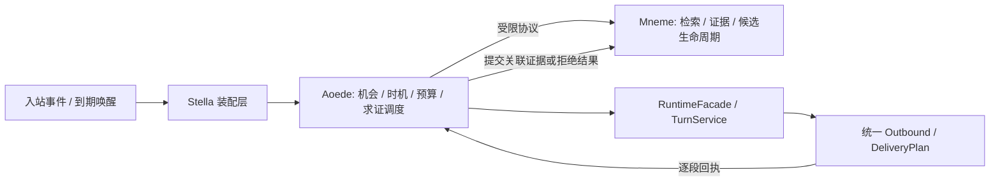

# GitNexus Engineering Plan — Aoede / Mneme 子系统拆分与主动参与改造

> 日期：2026-11-03；状态：PLAN READY / IMPLEMENTATION NOT READY。
> 源码锚点：`837a0892e4f33e9341e0ecd1ac33049afad82271`，分支 `codex/evidence-contract-expansion`。
> 证据以当前工作树为准；GitNexus 1.6.12 已通过 `analyze --index-only --pdg --workers 1` 刷新至本轮 HEAD（122051 nodes / 308804 edges / 1253 clusters / 805 flows）。实际 workspace runner 身份一致；初读遗留 meta 的身份不匹配判断已纠正。图有覆盖上限，新鲜度不代表完整性。
> Evidence provenance schema 2；完整全局 dirty digest 与排序路径清单见 §11，仅排除本计划路径。
> 本轮范围：计划与仓库要求的状态三文件。实施时按两个阶段逐工作包提交；不以规划完成声称代码或真实运行已修复。

## 1. Objective

按用户指定顺序完成两阶段工程工作：

1. 将主动发言从记忆包中分离，建立 **Aoede**（Python 包 `aoede`）和 **Mneme**（Python 包 `mneme`）。先完成行为等价、接口和兼容迁移。
2. 在边界稳定后，改造 Aoede：上下文优先、记忆可选、求证一次机会、统一频率、适时等待、发送前复核，并同步用户文档、架构文档、配置与验收记录。

需求来源：[分享讨论：优化主动发言机制](https://chatgpt.com/share/6ae6fa7a-9798-83e9-bdde-cd5e1a94b4a2)。本轮从页面 streamed JSON 提取了原始用户要求及两份建议；讨论中的旧源码判断已用当前 checkout 复核，外部论文数字和 PR #127 指标不作为本计划的验收事实。

**完成目标**：记忆为空或可选检索失败时仍有自然参与能力；没有接话机会时保持沉默；旧候选失败后不再反复求证；一个数值控制普通主动参与；被 @、明确回复或指令不受主动预算限制。

**范围外**：降低 Mneme 晋升/证据门槛、修改既有记忆 Benchmark 标签/历史结果、重新实现消息 transport、引入第三方主动发言插件、微服务化、改生产数据路径、顺带拆分整个 social/knowledge/runtime。

## 2. Current Behaviour

以下均为 `[verified]` 当前源码事实，行号绑定上述 HEAD 和 §11 工作树快照：

| 事实 | 当前源码锚点 | 工程含义 |
| --- | --- | --- |
| 定时任务先调用 `_proactive_at_user()`，命中即跳过其他发言；Participation 启用时普通插话由事件驱动 | `stella_project/plugins/bot_main/ai_gateway.py:5134–5201` | 当前存在两个决策入口，需要统一调度，不能新增第三条旁路 |
| `pick_target()` 只选可验证 OBSERVING 候选，无候选返回 None；仅排除上次问过的候选 | `memory/proactive_target.py:351–492` | 记忆求证路径不会自动成为无记忆自然接话路径；A/B 交替可能重新轮到 A |
| `_check_reply_later()` 等待 300 秒后比较内存 last_tome 时间戳，再更新退避计数 | `ai_gateway.py:3891–3919`；`memory/proactive_state.py:126–142`；`config/settings.py:899` | 没有候选终态、问题关联语义或跨重启的到期结算 |
| Participation 已有缓冲、话题、评分、四级状态机和模式 | `memory/participation/__init__.py:238–444`；`memory/participation/decision.py:30–62,97–130` | 复用现有实现；CANDIDATE 等待下一条消息不等于短暂静默窗口 |
| 话题版本在转题或显式取消时递增，普通同话题新消息不会必然递增；发送前已有 stale 检查 | `memory/participation/state.py:124–154`；`ai_gateway.py:4930–4978` | 保留现有机制，补充每条消息的上下文 revision 与有界 debounce |
| 记忆检索已有 `retrieval_query` 优先字段和 conversation_memories / behavior_constraints 分区 | `memory/pre_processors.py:1139–1218`；`memory/retrieval_v2.py:556–637` | 不能再造检索器；普通主动路径也应明确设置话题查询，避免回落整段任务指令 |
| 当前主动状态和 Participation 状态依赖整数 group/user，持久表也主要按 group/user 索引 | `memory/proactive.py:106–128`；`memory/proactive_state.py:39–99`；`memory/schema.py:543–576` | 新协议须带精确 connection/conversation/subject，不能用共享空间当配额或会话键 |
| 固定 15 条新消息仍是 `can_speak()` 硬门槛；普通路径与 @ 路径的概率规则不同 | `memory/proactive_gate.py:196–220`；`ai_gateway.py:4838–4849` | 单独加频率数值无法修复“安静群永不触发”；需明确淘汰旧概率与消息数前置 |
| 整合器只在 NEW/OBSERVING 中去重，新增来源可重置 NEW，插入路径支持按 id 覆写 status | `memory/consolidator.py:1843–1900,1943–1970` | 只拒绝 candidate_id 不够；写侧和晋升侧也必须检查旧证据终止记录 |
| 晋升必须含 accepted 来源证据；native 严格比较整库 schema；当前 schema23/API4 | `memory/memory_manager.py:1015–1059`；`memory_rust/backend.py:14–23`；`memory_rust/native/src/schema.rs:3–12` | 不能把确认结果直接当晋升许可；schema 改动必须同时交付 native 合同与 wheel 验证 |
| 数据根有纯路径解析器；默认数据库仍是用户目录的 memory/agent_memory.db | `stella_bootstrap/home.py:5–25`；`config/settings.py:354` | Python 包改名不能顺带搬库 |
| 发布 payload 使用顶层包白名单，当前包含 memory；setuptools 只自动发现 stella_project* | `scripts/build_release_package.py:40–67`；`pyproject.toml` 的 `[tool.setuptools.packages.find]` | 新包必须进入实际发布路径与对应 smoke，源码 import 成功不等于成品完整 |

## 3. Relevant Architecture

目标是同进程、明确依赖的子系统，不引入 RPC。下图为 `[inferred]` 目标边界：



- Aoede 管“是否、何时、对谁开口”和发送机会状态；不自行拼 SQL 读取/改写 Mneme 候选，不拥有记忆晋升规则。
- Mneme 管来源、归属、受众、检索、证据、候选终态与旧证据防复活。它不导入 Aoede 的调度器，不为完成记忆任务自行发送消息。
- Stella 装配层实现端口适配并调用既有 RuntimeFacade / TurnService / Outbound。`ai_gateway.py` 留 adapter matcher、可信身份与依赖装配；搬出主动编排，保留薄兼容委托直至调用方迁完。
- `stella_contracts/aoede.py`（拟新增）放不可变 DTO 与 Protocol：避免 Aoede→Mneme 内部包依赖及 Mneme→Aoede 反向依赖。只含合同，无启动、NoneBot、SQLite 和全局 singleton 副作用。
- **代码隔离与物理分库分开**：第一版沿用同一 SQLite 文件，以领域 owner、repository 和事务单元隔离；它使“发送结算 + 候选终结”可在单事务完成。另行分库属于后续课题。

### 3.1 目标代码布局与归属

| 当前来源 | 目标（拟新增或移动） | 处理原则 |
| --- | --- | --- |
| `memory/proactive.py` | `aoede/controller.py` | 活跃度、近期发言与临时 skip 状态 |
| `memory/proactive_gate.py` | `aoede/gate.py` | 主动硬门禁；scheduled 的现有合同单列回归 |
| `memory/proactive_state.py` | `aoede/storage/legacy_state.py` | 旧 quota/mute/announce 兼容；新状态逐步由 scoped repository 负责 |
| `memory/proactive_target.py` | `aoede/verification/target.py` | 编排选人；候选查询迁为注入 Mneme candidate port |
| `memory/proactive_prompt.py` | `aoede/prompts.py` | 主动表达、SKIP、服务端问题变体 |
| `memory/proactive_contract.py` | Aoede 问题编排 + `mneme/verification.py` 的来源/主体校验 | DTO 进中立合同；证据校验仍由 Mneme 持有 |
| `memory/participation/` | `aoede/participation/` | 保留评分表结构、模式与日志语义，第一阶段不调权重 |
| `memory/` 其余 Python 模块 | 对应 `mneme/` 路径 | 第一阶段机械迁移；transport/session/social helper 暂作为 Mneme 现有服务保留，后续另立边界清理 |
| `ai_gateway.py` 主动编排区 | `aoede/service.py`、`aoede/verification/service.py`、`aoede/host.py` | 核心不依赖 OneBot 类型，host 显式注入 bot/target/clock/model/send |
| `memory_rust/` | 保留发行名与扩展导入名，作为 Mneme native adapter | 本计划不重命名 wheel / `_native` ABI；Python 客户端 imports 指向 Mneme 正式包 |
| `memory/benchmark/`、`memory/SYSTEM.md` 与用户 data | 保持现有资源/数据路径 | 不是第二套业务实现；历史 hash、benchmark 与用户覆盖均保持来源可追溯 |

**兼容策略**：正式实现只有 `aoede` / `mneme` 一份；旧 `memory.*` 是显式、可枚举的别名/CLI 跳板。普通 `from ... import *` 会复制 module globals，不能作为持有 DB_PATH、缓存、singleton 的兼容方案。旧/新导入必须得到同一 module/class/singleton 身份，覆盖 monkeypatch、延迟导入、`python -m memory.schema` 与 `python -m mneme.schema`。为 CLI 跳板单独验证 `__spec__` 和退出码，不全量盲设 sys.modules。兼容层保留至少一个可回滚发布周期，删除须另设 gate。

## 4. GitNexus Findings

`[graph]` 最终使用CLI 1.6.12及同发行包LocalBackend，显式绑定 `Stella_project`。`analyze --index-only --pdg --workers 1` exit0，85.9秒；有效workspace registry指向本checkout、当前分支和HEAD `837a0892e4f33e9341e0ecd1ac33049afad82271`，2130 files / 122051 nodes / 308804 edges / 1253 clusters / 805 flows。未改源码/AGENTS，未重建analyzer。

最初的 `.gitnexus/meta.json` 是遗留记录；延迟返回的status与实际registry证明有效workspace index位于另一store，原runner与当前同为1.6.12。以下使用刷新后的证据，早先UNKNOWN/陈旧数据不再作为最终调用图结论。

### 4.1 核心upstream impact与全部非测试d=1消费者

调用形状：`impact <target> --direction upstream --depth 3 --repo Stella_project`；LocalBackend使用相同target/direction/maxDepth。

| target | 原始结果 | 全部直接消费者与实施处理 |
| --- | --- | --- |
| `pick_target` | LOW / impacted2 / direct1 / process1 | `_proactive_at_user`；两种flow_ctx形状均迁candidate port |
| `_proactive_at_user` | LOW / impacted1 / direct1 / process1 | `proactive_speak_job`；阶段二取消求证优先 |
| `_check_reply_later` | LOW / impacted2 / direct1 / process1 | `_proactive_at_user`；create_task改durable attempt与恢复 |
| `ParticipationManager` | LOW / impacted13 / direct2 / process0 | ai_gateway与core/evaluation/runner的imports；正式包和评测adapter同步 |
| **`retrieve_memories`** | **CRITICAL / impacted19 / direct8 / processes3 / modules5** | 以下8项全部迁移与回归；CRITICAL已告知，不用riskSharedAxes豁免 |

`context retrieve_memories`同时核对incoming calls。全部8个直接消费者：

1. `memory/benchmark.py:evaluate_case`：迁Mneme导入，保留隔离DB_PATH/RAG/cache patch恢复合同（源码509–526）。
2. `memory/pre_processors.py:_build_user_context_v2`：保留scope、素材/约束分区与topic query（1139–1218）。
3. `memory/retrieval_v2.py:_retrieve_with_optional_backend`：包内部迁移，native选择/fallback不变。
4. `memory/retrieval_v2.py:retrieve_memories_emb`：embedding分支与rule回退同步，不增加第二套检索。
5. `memory_eval/answer.py:answer_question`：模块名与运行期cache/config patch同步，Benchmark标签/指标冻结（128–138）。
6. `scripts/eval_memory_replay.py:_evaluate_metrics._run_qa`：明确临时库，保留query/trigger/mode（286–303）。
7. `core/planner.py:RestrictedPlanner._query_memory`：保持可信scope_for_chat_context，改写query不改权限（335–347）。
8. `memory_rust/python_backend.py:PythonMemoryBackend.retrieve`：保留 `_bypass_backend=True` 防递归及request→scope映射（44–58）。

上游影响流程聚合为 `memory_eval/runner.py:run`、`core/planner.py:maybe_plan`、`scripts/eval_memory_replay.py:main`；这是已解析路径，不是穷尽所有runtime的保证。context另列access/cache/sharing测试调用，补入§8回归。

### 4.2 文档、架构资源与覆盖局限

- 刷新后 `impact progress.md`：MEDIUM / 29 impacted / direct5 / processes0；直接引用是AGENTS、workflow、2026-10-10重构报告、2026-10-24适配中英文计划。保留路径/锚点，仅追加状态。刷新前HIGH/121/4/184保留为历史，不能代替当前尺度，也未豁免风险。
- 初查消歧 `File:feature_list.json` / `File:session-handoff.md` 各LOW/direct2，引用为AGENTS与workflow。JSON一致性与历史条目保留。
- 新计划初查UNKNOWN/未入图，属于新增路径；通过准确状态链接、docs检查及计划结构/manifest核验补足，不能把未映射当零风险。
- 已读取资源等价helper `queryClusters('Stella_project',8)` 与 `queryProcesses(...,8)`，含Memory cluster131符号及Observability/Scheduling/Cometa等。getContext accessor返回null，统计采用实际分析输出和registry，不冒充已读取未暴露的MCP资源。
- 分析跳过55个>512KB文件；流程候选3391/3591未进入排名、947 callee跳过、47 walk预算截断、25 trace深度截断。805条flow是已报告子集。另有365处跨语言字段未连边、callable候选cap32溢出。源码补证不可省略。
- `PROACTIVE_STATE_TABLE_DDL`初查UNKNOWN/0，但schema559–565直接执行DDL；零边不能证明未使用。旧DDL/schema迁移继续以源码合同核验。

执行前核对HEAD、dirty digest与索引，漂移时刷新；每次编辑仍跑目标impact，HIGH/CRITICAL先报告、UNKNOWN补查。计划不是当次门禁的替代品。

## 5. Statement-Level PDG Findings

`[graph]` 刷新后调用 `pdg_query(mode=controls,target=_proactive_at_user,limit=200)`：145条全部返回，truncated=false（首批50条截断后已扩大limit重跑）；`flows(target=_proactive_at_user,variable=target)`返回18条。`_check_reply_later` controls4条、replied flows1条。

| 有界切片 | 图观察与源码核验 | 实施约束 |
| --- | --- | --- |
| `ai_gateway.py:4198→4200/4205` | not allowed控制gate拒绝/return | Aoede提取保持硬门禁 |
| `4217/4222→4261` 与 `→4488` target flows | 两种pick_target分支都进入ChatContext及record_at/create_task | 同一scoped candidate/generation贯穿context与attempt，不能只迁一条flow_ctx路径 |
| `4434→4435` T / `4434→4445` F | not delivered控制失败分支；有确认片段才记送达 | reserve先于发送，ACK结算在后，UNKNOWN不能冒充ACK |
| `3908`基本块的replied def/use | sleep→last_tome→bool→record_reply_result在同块，无candidate/problem语义 | 替换为有候选/证据/问题关联的持久状态，不能只加长sleep |

`[verified; source-derived]` `_proactive_at_user`在发送后才record_at/create_task，存在外部发送/SQLite记账崩溃窗口；`_proactive_speak_impl`已有revision/SKIP/duplicate/DeliveryPlan；整合器的旧来源幂等判断只查活动候选。基本块PDG不能单独证明跨函数事务正确，源码优先。

实施须保留stale/SKIP/DeliveryPlan；reserve先于昂贵推理与发送，候选拒绝/attempt终态同事务CAS，native提交不覆盖并发REJECTED，旧attempt不误拒绝新generation。

## 6. Proposed Changes

本节均是 `[inferred]` 拟实施设计，非现有能力声明。现有符号见 §2/§4 的源码核验；新类型/文件均明确为拟新增。

### 6.1 阶段一：行为等价拆分，不混入新策略

1. 按 §3.1 移动正式实现到 Aoede/Mneme。导入、反射字符串、插件接线、CLI、评测脚本、tests monkeypatch、flow 源码锚点均迁移；符号重命名使用 GitNexus rename，包移动按工具能力逐项核验，禁止全仓文本替换模拟语义重命名。
2. 拆出拟新增 `AoedeService` 和 `MnemeMemoryPort` / `MnemeCandidatePort`。第一阶段的端口仍返回与旧代码等价的候选和状态，不提前变更资格、阈值、自然度模式、配额、概率或问题模板。
3. schema23 中旧 proactive/participation DDL 暂留 Mneme migration compatibility 区；Aoede 的 legacy repository 使用这些已有表。Mneme schema 不反向 import Aoede。新增状态表的真正领域归属在第二阶段完成。
4. `memory_rust` 发行名、Python/native API4/schema23 与 SQLite 文件名不因拆包变化；这不是 Mneme 改名未完成，正式 Python memory implementation 已转入 `mneme`，外部二进制包是有版本的依赖。
5. 发布 payload、zip/离线包、Docker import smoke、CI path filters 和真实安装入口加入两个新包；保持 `memory` 兼容层与 `memory/SYSTEM.md` 资源。先核对实际成品，再判断是否调整 pyproject 包发现；不借机打包整个仓库。
6. 本阶段完成 CN/EN 架构边界与命名文档，明确行为未改；输出拆分前后固定输入的决策/发送/状态差分证据。

### 6.2 阶段二：唯一的上下文参与流程

拟新增机会对象 `ParticipationOpportunity`：包含 opportunity_id、完整 BotRef/DeliveryTarget、conversation_key、trigger_message_key、context_revision、topic_revision、created_at、expires_at、action、reason codes。标识均为不透明字符串，不能把群号整数转型当身份。

统一流程：

1. **廉价硬预检**：PROACTIVE_ENABLED、R=0、mute、sleep、wakeup、精确平台主动 capability、目标是否可恢复、到期和持久 store 健康。用户明确请求走既有 passive 路径。
2. **上下文评分**：复用 Participation signals/scorer/decision；不要求有待晋升记忆。原 IGNORE/OBSERVE/CANDIDATE/ALLOW_LLM 保留为评分层诊断，不强行与时机状态一一对应。
3. **时机层 SPEAK / WAIT / DROP**：增加可取消的 debounce 唤醒；建议静默 3 秒、机会最长 15 秒（实验初值，内部参数）。每条有效人类消息推进 context_revision，重置静默计时并合并候选；同一 conversation 只保留一个在途机会。到 expiry 直接 DROP，禁止每分钟对空闲群凭空重启旧话题。
4. **可选记忆增强**：只有值得继续的机会才按当前话题查询 Mneme；保留 access_scope / audience / source availability / scope version。普通素材仅已允许的可靠记忆；敏感/边界记忆只作约束。查询失败返回 typed unavailable，允许 context-only；若硬隐私/禁止发言约束不能可靠获得则 fail closed，不能用“记忆可选”跳过边界。
5. **动作计划**：REACT / CONTRIBUTE / ASK / CONTINUE / SKIP；自然追问不默认等于候选验证。候选验证是 ASK 的受限变体，仅当前话题有承接且有有效服务端合同才可进入；与其他机会竞争，无定时优先权，不把 confidence 接近晋升线当参与价值。
6. **生成和发前检查**：走现有 RuntimeFacade/TurnService，设置 typed topic retrieval_query。复用已完成的检索结果，避免 preprocessor 重复查询；保留自然度 SKIP、去重、归属守护、DeliveryPlan、期限与 Gravitas。发前及逐段前核对 revision、target generation、mute、频率 revision、scope version、reservation 与 deadline；不确定则丢弃/有界重评，不能发送旧输出。
7. **结算**：按 Outbound 的逐段真实状态结算一个逻辑发言；不把模型已生成当成功发送。普通话题候选可以重建，持久 budget 和已拒绝证据不可因重启或人类新消息被清零。

**旧策略兼容**：第一阶段保留；第二阶段新控制器启用后，`PROACTIVE_PROB_*`、FAST/SLOW/GAMMA 和固定 `MIN_MESSAGES_SINCE_SPOKE=15` 不再前置阻断新路径。旧项作为 deprecated 迁移解释，不继续暗中与 R 相乘。600 秒最短间隔作为内部安全下限与 R≤6 相容。旧开关仍有定义：PROACTIVE_ENABLED 为总开关，PROACTIVE_AT_ENABLED 只控制验证 ASK，Participation 的旧开关映射到新控制器启用/观察模式；不得关闭 Participation 后自动回落随机主动路径。

### 6.3 拟新增端口合同

| 合同 | 输入 → 输出 | 不变量 |
| --- | --- | --- |
| MnemeMemoryPort.retrieve | 可信 scope + topic query + budget/deadline → 素材、约束、状态、scope epochs | 无素材是正常值；不可公开的信息不出端口 |
| MnemeCandidatePort.offer | 当前话题、目标主体、受众 → 合法 candidate snapshot 或 None | snapshot 包含 fact_key / evidence-set digest / generation / 合同，不返回任意 SQL 行 |
| MnemeCandidatePort.settle | attempt + 关联用户消息 + expected generation/digest → applied / conflict | Aoede 不能直接调 confidence 或晋升 accepted；仅 Mneme 校验/写证据 |
| AoedeBudgetPort | exact conversation/target + operation id → reserve / commit / release / unknown | 所有主动动作共用同一原子预算；同操作幂等 |
| HostGeneration/DeliveryPort | typed opportunity + context → Runtime turn / Outbound receipt | 复用 transport 的精确 Bot/scene，不重写发送器 |

### 6.4 一次性求证与可恢复状态

逻辑状态：准备并占用 → SENDING → PENDING_VERIFICATION（有 ACK）→ CONFIRMED / DENIED / UNANSWERED / UNCLEAR；另有 CANCELLED（确定未发）和 DELIVERY_UNKNOWN。候选只在有效 ACK 后进入等待确认；**预留记录必须在发送前写入**，解决“发出后才建记录”留下的崩溃窗口。这是对讨论建议的必要工程补充。

**Mneme 持有**：拟新增 verification attempts 与 rejection tombstones；Aoede 通过端口操作。采用当前 memory schema23→24 的版本迁移（执行前重新核对，若主线已升级用实际 next version），native MEMORY_SCHEMA_VERSION 同步。Aoede 自有 budget/outbox 表 DDL 由 Aoede 维护、同一升级协调器在同一 DB 中执行，记录版本且失败可回滚；不让两个子系统并发各自初始化表。

最小字段：attempt_id、opportunity_id、candidate_id、candidate_generation、owner_key、subject_key、audience、fact_key、canonical claim identity、evidence-set fingerprint、原始 source message identities/digests、BotRef/DeliveryTarget、connection_id、conversation_key、question message IDs（全部物理片段）、created/sent/deadline UTC、state、result/reason、lease owner/expiry、settlement operation id。禁止只存 user_id/group_id；不要把问题原文复制进公开日志。

规则：

- 用 SQLite `BEGIN IMMEDIATE`、唯一 active claim/attempt 约束、operation id 与条件更新，防止多任务/多进程同时问同一旧证据。跨子系统 repository 接受受控同一 transaction/UoW，不各自 conn.commit 破坏原子性。
- 发送 ACK 后原子记录 message IDs 和 sent_at，deadline=实际 ACK 时刻+300 秒；若记录 ACK 前崩溃，SENDING 恢复为 DELIVERY_UNKNOWN，保守占用机会，不重发，不伪装为用户沉默/拒绝。
- 只有同一 connection/conversation 中、正确目标主体、指向该问题或有唯一可靠语义关联的消息可裁决。单个“嗯/是的”只有绑定明确才算确认；其他人代答、无关 @、引用转发、提示注入和模型自行推断均不能确认。无法关联则继续等待到原 deadline；有明确关联但回避/含糊则 UNCLEAR，终结且不追问第二次。
- DENIED / UNANSWERED / UNCLEAR：同事务写终态与 tombstone，候选 CAS→REJECTED，保留原因及必要摘要审计。**不创建事实反面，不删除已晋升且无关的可靠记忆。** 到期与回应竞争按可信入站时间及持久顺序裁决，deadline 边界测试固定；晚到回应不复活旧 attempt。
- 拒绝绑定 owner/subject/audience/claim + 来源集合。candidate_id 重建、换 UUID、来源重排或同一旧证据子集重放不能复活；写侧 consolidator 和 Python/native 晋升事务都校验。仅新 UUID、新提取时间或 paraphrase 不是新证据。
- 用户以后主动给出新的、直接且通过现有合同的证据，可以创建新的 candidate generation；旧 attempt 的 CAS 不得拒绝或改写这个新 generation，也不得把旧 sources 合并进去制造复现次数。
- CONFIRMED 只提交绑定原问题与用户原文的确认关系，再走现有证据合同。如果合同不支持该确认句型，记录已回应但不强行 accepted/晋升。支持结构化确认关系需要有明确 verifier 合同版本、正反例与 native parity；不能暗改阈值。
- 旧用户级 consecutive_no_reply 与自然度 skip 是社交退避，不是候选拒绝记录。任意新消息、reset_no_reply 或清 skip 都不能删除 tombstone。
- 启动扫描 overdue PENDING，幂等到期；SENDING/UNKNOWN 不自动重投。用户明确停用 Aoede 后仍结算已发出的 verification，停止新机会；既有显式拒绝/取消保留语义。

### 6.5 一个数值、两类内部预算

唯一普通用户数值：`PROACTIVE_FREQUENCY`，默认建议 **1.0 次/小时**，有效范围 **0–6**，支持小数。含义为每个精确会话的**最高长期补充速率**，不是任何滚动一小时都不超过 R 条，也不保证一定发够。R=0 关闭普通主动参与和自发睡眠/苏醒播报，被动响应与用户预约任务仍按各自既有合同运行。

- token bucket 容量 1、补充 R/3600 token/秒，发一次逻辑主动消息扣 1。0.5 表示长期每两小时最多补充一次机会。新桶初始 0，不能靠重启/创建状态免费获得机会；持久化 tokens、refill timestamp、配置 revision 与 outstanding reservations。
- 发言归属使用可信opportunity/origin/action，不用 `ChatContext.trigger` 判断是否扣费（旧主动@为获取个人上下文而设置trigger=reply，仍须扣主动预算）。同一会话的 context-only、context+memory、verification ASK、主动睡眠/苏醒播报共用桶，避免播报成为 R=0 的旁路。被动回复可以更新 speech_share/novelty，但不扣主动 token。显式预约消息不纳入普通主动预算，继续独立 scheduled gate 与配额；文档明确这一边界。
- 预算 scope 使用 connection + BotRef + 完整 conversation/scene/thread target；同群不同 Bot、同共享空间不同群分桶。未知连接的 legacy 配额/静音不能猜归属；仅唯一可验证旧 QQ 路由可迁移，其他记录保留不可路由并给出诊断。
- 原子 reserve 先于 generation/send；ACK commit 一次，确定 FAILED 且无任何已发片段 release，UNKNOWN 或部分成功保守消耗一次，禁止自动重投。一次逻辑发言多段只扣一个 token，但 Outbound 物理 API 配额照常独立执行。
- 所有 timestamp 持久化 UTC，不持久化 monotonic 值。进程内等待用单调时钟；墙钟回退不得增加额度，前跳最多补到容量1。配置 R 调整不清空历史债务、不送免费 token；禁用清 pending opportunity、保留送达/UNKNOWN 负债，恢复时从保守基准继续。
- store 不可用则主动 fail closed；获取 bucket 数据失败不能仿照旧 get_state 返回“全零可发”默认值。
- **推理预算独立**：沿用 Gravitas/LLM admission，加内部每会话与全局 cost ledger，覆盖 embedding、judge、generation 的预留和实际消耗。被 DROP / SKIP 的推理仍消耗推理预算，发送失败不退模型成本。第一版每个 opportunity 最多一次生成、一次必要裁决，不为每条消息调用 judge；额外模型预算值在 S2-03 基于隔离成本基线固定，不暴露第二个用户频率旋钮。
- 动态门槛使用 speech_share、novelty、近期参与和令牌紧张程度做有限分数调节；硬 token/安全门禁不可被高分绕过。旧词表兴趣锚只作弱信号，不能成为无记忆参与的唯一资格。

配置渠道：复用 `config/settings.py` + `deploy.env_schema` + `webui/services/config.py` + `/api/v1/config` 和现有高级页数字输入，不新增第二套写配置 API。前后端拒绝 NaN/Inf/负值/超范围；启动非法值回退安全默认并诊断，不写回覆盖用户文件。当前 import-time 设置写回后需要按既有配置应用/重启合同生效；UI 明示 desired/applied 与生效范围，不能宣称即时生效。

## 7. Implementation Sequence

以下严格分两阶段；每个工作包完成本地门禁后单独提交，保留恢复点。先复用合适 checkout；需要新分支时用 `codex/aoede-mneme-proactive`。不能把现有未跟踪 bridge/debug/startup 文件混入提交。

| 工作包 / 建议提交 | 动作与目标文件 | 验收与退出条件 |
| --- | --- | --- |
| **S1-00 基线与合同冻结** `docs: freeze aoede mneme migration contracts` | 登记实施 feature；验证 runner identity / 索引，重新 impact 本计划主符号与真实 d=1 调用者；清点所有 Python/字符串/CLI/payload/CI consumers；生成确定性输入和决策差分基线 | 文档检查；当前定向测试结果、失败/跳过清单；临时 STELLA_HOME；不运行默认生产聊天回放。HIGH/CRITICAL 先报告；UNKNOWN 继续源码补证。长执行前提交本检查点 |
| **S1-01 中立接口与装配** `refactor: define aoede mneme subsystem ports` | 新 `stella_contracts/aoede.py`；Stella host adapters；为 candidate/retrieval/clock/send/UoW 建显式端口；旧实现委托，业务结果不变 | DTO/import 无副作用，依赖方向检查，无 Mneme→Aoede 编排依赖，Fake ports 能跑旧主动路径 |
| **S1-02 Aoede 提取** `refactor: extract aoede participation subsystem` | §3.1 proactive 与 participation 移动；ai_gateway 主动区提取成 service/host；legacy schema 创建权保持不变；兼容旧导入 | 已定位 proactive/participation/runtime/observability tests 通过或准确说明基线失败；singleton/module identity、注册一次、两种 flow_ctx、旧 scheduler 不双跑 |
| **S1-03 Mneme 正式改名** `refactor: rename memory implementation to mneme` | 其余 memory Python 迁 `mneme`；内部 imports、native Python adapter、CLI、评测 monkeypatch 和所有已清点 caller 更新；旧包仅兼容入口/资源 | schema23/API4 不变；新旧 CLI/旧库/导入身份回归；记忆/privacy/capture/retrieval/promotion regression；不调 Benchmark 数据或阈值 |
| **S1-04 发布与文档检查点** `build: ship aoede mneme packages with compatibility` | payload COMMON_DIRS、实际构建入口、Docker/CI import smoke 与 filter、双语架构命名；生成本阶段最终 immutable flow 一次 | 原固定输入差分一致，安装 payload 可 import aoede/mneme/legacy memory/native adapter，无用户数据；docs/flow/Python/Dashboard 适用门禁，提交后标记阶段一可独立验收与回滚 |
| **阶段一 Gate G1** | 冻结正式 API、兼容层和行为等价证据 | 未通过 G1 不执行第二阶段。缺 native/安装环境等证据按范围 NOT READY，不能以源码目录存在替代 |
| **S2-01 先修求证闭环** `fix: persist one-shot verification lifecycle` | `mneme/verification.py`、schema/migrations、consolidator、promotion/native；Aoede verification service/store；attempt/outbox/tombstone 与 CAS、启动恢复；memory schema23→24；Rust 常量与 verifier 一起更新 | A/B/A、改 UUID、相同/子集旧证据重放、超时、模糊/第三方/错误受众、重启/崩溃、晋升竞争全部验证；old schema→new→restore→remigrate，native fullchain。若 request 结构变化须同时提升 API 合同，不静默复用旧 wheel |
| **S2-02 统一参与与时机** `feat: unify context-first aoede opportunities` | `aoede/service.py`、participation、timing、host、Mneme retrieval adapter；timer 只负责恢复/有界唤醒，去除求证优先；context_revision/debounce 与 SPEAK/WAIT/DROP | 空记忆可参与，无机会保持沉默；新消息重评但不无限等待，转题/显式请求/静音撤销正确；无重复检索、无过期输出、被动优先 |
| **S2-03 统一持久预算与配置** `feat: add persistent proactive frequency control` | Aoede budget repository、事务结算、config/settings、env schema/WebUI numeric、内部 cost ledger/Gravitas 接口；旧参数迁移提示 | R=0/0.5/1/6、restart、clock drift、并发 reserve、UNKNOWN、partial ACK、运行中关闭、非法配置、同空间多群/多Bot；UI 保存与生效提示正确 |
| **S2-04 离线行为验收与双语文档** `test: validate aoede behaviour and document migration` | 确定性数据集/场景、evaluation adapter、指标；新增 Aoede/Mneme 正文、配置/调参/排查/合同/升级说明，更新状态；最终 immutable flow 在本阶段收口生成一次 | 非零样本、双遍确定性、硬负例零违规；Python 全矩阵、native parity、Dashboard 适用门禁；模型/live/Windows acceptance 分列未运行项 |
| **阶段二 Gate G2 / 灰度** | 影子决策→隔离模型→单群低频→观察→扩大；每步绑定配置/模型/commit | G2 离线绿后才能进入真实链路；真模型/QQ 未做时 overall NOT READY。真实平台操作在明确实施与验收范围内进行，规划本身不启动服务 |

**阶段收口生成物策略**：S1 与 S2 是可独立验收交付，各自只在本阶段最后一步生成最终 flow/受守卫摘要；中间源码提交记录 flow 暂时漂移，阶段最终 CI 才要求全量绿。不要修改旧 immutable flow 文件或旧证据 hash。

## 8. Test Strategy

### 8.1 已定位的现有测试与命令

以下测试文件已在当前仓库定位；不是本轮运行结果：

- 主动行为：`tests/test_proactive_rules.py`、`test_proactive_gate.py`、`test_proactive_target.py`、`test_proactive_state.py`、`test_proactive_prompt.py`、`test_proactive_at_flow.py`。
- 参与/时机：`tests/test_participation.py`、`tests/test_participation_timing.py`；后者已有 FrozenClock 与 stale/逐段停止场景。
- runtime/观测：`tests/runtime/test_proactive_native.py`、`tests/observability/test_proactive_flow_lifecycle.py`、`tests/observability/test_memory_flow_lifecycle.py`。
- Mneme / native：`tests/test_retrieval_v2_and_schema.py`、`test_memory_manager.py`、`test_memory_manager_v2.py`、`test_memory_rust_promotion.py`、`test_memory_rust_selector.py`、`test_memory_evidence_contract.py`、personal memory scope/sharing tests。
- 配置/UI：`tests/test_settings_helpers.py`、`tests/webui/test_conversation_settings.py` 与现有 WebUI suite；为 frequency 验证补充专用接口/组件场景，不依赖现有通用数值控件自动覆盖全部语义。

在独立 shell 中设置临时 home，测试及 worker 子进程必须继承该 home；不导入生产 config 后再改环境变量。PowerShell 示例：

```powershell
$aoedeTestHome = Join-Path ([IO.Path]::GetTempPath()) ('stella-aoede-' + [guid]::NewGuid())
New-Item -ItemType Directory -Path $aoedeTestHome | Out-Null
$env:STELLA_HOME = $aoedeTestHome
python -m pytest tests/test_proactive_rules.py tests/test_proactive_gate.py tests/test_proactive_target.py tests/test_proactive_state.py tests/test_proactive_prompt.py tests/test_proactive_at_flow.py tests/test_participation.py tests/test_participation_timing.py tests/runtime/test_proactive_native.py -q
python -m pytest tests -q
ruff check .
python scripts/check_docs.py
python scripts/generate_message_flow.py --check
pnpm --dir dashboard test
pnpm --dir dashboard build
```

执行器需先确认所选 python/venv 有依赖；缺依赖如 NoneBot adapter 导致 collection 失败应如实记录，不能宣称业务 test fail 或 pass。完整 Python 支持矩阵为 3.10/3.11/3.12；只改文档的规划交付不跑上述全套。

Native/schema 变更另跑（命令路径已核对仓库与门禁；工具可用性在执行时确认）：

```powershell
cargo fmt --manifest-path memory_rust/native/Cargo.toml --all --check
cargo clippy --manifest-path memory_rust/native/Cargo.toml --all-targets -- -D warnings
cargo test --manifest-path memory_rust/native/Cargo.toml
python scripts/validate_rust_fullchain.py
```

native 验收必须在隔离环境安装新构建 wheel，再核导出 API/schema、拒载旧 wheel、Python/native 决策与并发拒绝一致性；只运行源码 Rust tests 不替代 wheel acceptance。

### 8.2 拟新增场景与可检查结果

| 输入 / 故障 | 动作 | 必须结果 |
| --- | --- | --- |
| memory=[]，适合的社交承接 | advance fake clock 过静默窗 | context-only 正常生成并可送达，素材不含虚构记忆 |
| memory=[]，无承接；模型输出 SKIP | 评估 / 生成 | 不发送、不扣 send budget；已用推理成本保留 |
| 可靠相关 / 不相关 / 受限 / 已撤销共享记忆 | 生成中修改 scope epoch | 仅允许的素材可用；撤销在发送前阻断，不公开约束原文 |
| 同话题新消息、换题、连续高频消息 | WAIT / 再评估 | revision 更新、有界等待，expires 后 DROP，旧 generation 不发送 |
| 候选 A→超时、B→超时、再轮 A | tick / rebuild | A 永不基于旧证据再次 offer；新 UUID 和来源排序不绕过 |
| 同一事实重提取，旧 sources 子集 | consolidate / native promote | tombstone 阻止复活，不强化 confidence/occurrence |
| 用户新直接证据，旧 attempt 同时到期 | CAS 结算 | 新 generation 可重新评估；旧结算不拒绝新证据，不自动晋升 |
| “嗯”、别人说“是的”、无关 @、明确否认、正确引用肯定 | settle | 仅可靠关联本人的明确确认可提交证据；不把沉默写成反事实 |
| ACK 后重启、发送时崩溃、UNKNOWN、部分 ACK | restart/recover | ACK attempt 可恢复超时；未知不重投、不冒充 unanswered；预算不翻倍 |
| 两个 worker 抢同机会，native promotion 与 reject 竞争 | 并发事务 | 一次 claim、一份预算；commit 不覆盖终态，重复 settle 幂等 |
| R=0/0.5/1/6；重启、clock jump、R 降低/关闭 | reserve/refill | 满足容量1与长期速率语义，无免费启动 token；被动不受影响 |
| 同空间 A/B 群，同群多 Bot、topic/thread | 混合消息/配置 | topic/预算/attempt/message relation 无串号；旧未知绑定拒发 |
| store unavailable、旧库升级失败、旧 wheel | admit/migrate/load | 主动 fail closed；事务回滚可重跑；数据保留、旧 wheel 明确拒载 |
| 旧 memory 与新 mneme import、monkeypatch DB_PATH | 同进程与独立 subprocess | 一份全局状态，一次任务注册，旧/新 CLI 退出码一致 |
| 安装 payload、用户自定义 SYSTEM prompt | 升级、回滚 | 包齐全；用户覆盖保留并有来源说明，生产路径不被重命名 |

### 8.3 行为 Benchmark 和真实验收

复用 `core/evaluation/runner.py` 的 decision_recompute / isolated_pipeline / model_validation，另建 Aoede 场景 adapter；不创建一套隐藏旁路。`tests/benchmark/participation/runner.py` 现默认可读真实聊天库，**不可不带显式临时 `--db` 就运行**；优先使用合成或获准脱敏夹具。

运行形式：`python scripts/run_flow_evaluation.py --mode isolated_pipeline --dataset <新建的Aoede夹具目录> --workdir <独立临时目录> --json`。尖括号为待创建路径，非可直接照抄的现有 dataset；model_validation 只接受显式评测 endpoint，缺失记 SKIPPED。

- 确定性硬门禁：非零样本；重复求证、越权素材、过期发送、预算超支、UNKNOWN 重投均 **0**；相同输入/时钟双遍决策一致；被动路径回归通过。
- 行为指标：context-only 成功机会、无机会沉默、时机可接受率、生成自然度、过早/过晚率、问句占比、未回应后的再次追问数、judge/embedding/generation 调用与 tokens/主动送达。不要以“总发言更多”定义成功。
- S1-00 固定一套本地标注集及基线；S2-04 用同输入配对评估。自然度/时机通过阈值在看结果前由小样本标注协议冻结，不能事后挑阈值或挪动标签；若没有人工标注，语义维度 NOT READY。
- 分享中的外部实现可作为阅读线索，不能把其测试或论文指标直接当 Stella 的通过线；本计划不直接移植其代码/数据。
- G2 后：显式模型与实际 prompt 来源、小范围 QQ 群的端到端机会→模型→出站回执→回复关联→超时/终态追踪，重启恢复和频率0验证；Windows 成品升级/回滚与中文/英文 UI 单独记录。fixture、模型、真实平台、干净 VM 各自独立验收。

## 9. Risk and Impact Analysis

| 风险 | 防护 / 回滚 |
| --- | --- |
| 检索图CRITICAL，且全图仍有抽取覆盖上限 | S1-00 核对provenance/index后重做impact；retrieve_memories的8个d=1消费者全部回归；HIGH/CRITICAL必须提示，零边仍补源码 |
| 兼容层导致双模块、双单例或双 scheduler | 新旧模块 identity 与注册次数回归；旧入口只薄委托。拆包失败回滚本阶段代码，无数据改名 |
| Mneme/Aoede 循环依赖、SQL 领域互穿 | 中立 Protocol/DTO + host adapters；Mneme 不 import Aoede orchestration；Aoede 不访问 candidate 私有表 |
| code-package 改名误迁移用户数据/资源 | 保留 DB_PATH、memory/SYSTEM.md、config/participation 和历史 benchmark；显式核对用户覆盖来源 |
| schema24 与旧 native 或并发晋升不兼容 | 同步 native schema/必要 API 版本，新 wheel parity、旧 wheel reject；schema 升级前快照，必要回滚停写后恢复匹配快照+代码 |
| 发送与持久化不可能跨 QQ/SQLite 原子提交 | 先 durable intent/reservation，后发，ACK 后确认；崩溃未知保守记账、不重投。不能宣称跨平台 exactly-once |
| no response 被错误当事实否认，或模型判断绕过 gate | attempt result 与知识事实分离；只有显式证据可 accepted；原始关联+verifier+CAS，模型无晋升权限 |
| REJECTED 复活或合法新证据被永久封死 | claim+source tombstone + generation；新直接证据允许新候选，旧重放不许复活；Python/native 双侧检查 |
| 单数值表面简单，旧 gate 暗中叠加导致无效 | 新路径明确退役概率与15条门槛；R单位/初始token/小数/生效时机写入用户文档和配置测试 |
| 公共检索异常导致主动变哑或隐私约束失效 | 区分 optional material unavailable 与 mandatory safety unavailable；前者 context-only，后者禁止发送 |
| 大量 WAIT/embedding/judge 消耗资源 | 每会话单在途、bounded TTL、预留推理预算、复用 Gravitas，cheap gate先行；记录每次模型成本 |
| 行为改造污染记忆基准或历史报告 | 冻结历史和数据标签，另建 Aoede suite；记忆质量课题独立，PR/报告证据不混淆 |

**恢复顺序**：先停止新 Aoede admission → 等待/标记在途 UNKNOWN → 保存最新库 → 回滚代码/配置。仅纯代码拆包可直接退回 G1 前；schema 升级后退旧代码须恢复配套快照，不能强行修改版本号或让旧 wheel 读新库。新增 tombstone 在同版本禁用 Aoede 时仍生效，避免以功能开关解除用户已表达的拒绝。

## 10. Files Expected to Change

所有目标路径为拟实施，不表示文件已存在；实际当前文件清单在 S1-00 冻结。

| 文件/目录 | 符号或职责 | 阶段 |
| --- | --- | --- |
| `stella_contracts/aoede.py`（新） | DTO / port / scoped identity / settlement/UoW 合同 | S1 |
| `aoede/`（新） | controller、gate、participation、verification、service、host、budget/storage | S1+S2 |
| `mneme/`（新） | 记忆正式实现；verification、schema/migrations、检索与晋升拒绝 guard | S1+S2 |
| `memory/` 兼容 Python、既有资源 | legacy alias/CLI；保留 SYSTEM 与 benchmark 数据路径 | S1 |
| `stella_project/plugins/bot_main/ai_gateway.py` | `_proactive_at_user`、`_check_reply_later`、spawn/speak/timer → 薄 host 调用 | S1+S2 |
| `core/runtime/turn_service.py`、`core/planner.py`、装配点、preprocessor | 导入与已检索材料复用，不另建生成链 | S1+S2 |
| `memory_rust/backend.py`、Python adapter、`native/src/schema.rs` 及 promotion 提交路径 | Mneme imports、schema/API parity、终态竞争 guard | S1+S2 |
| `config/settings.py`、`.env.example`、`deploy/env_schema.py`、`webui/services/config.py` | frequency 配置、validation、旧项迁移、现有配置协议 | S2 |
| `dashboard/src/components/AdvancedConfigSettings.vue` 及对应 locale/测试（如需） | 复用数字控件并补充单位、帮助、生效状态 | S2 |
| `scripts/build_release_package.py`、实际发布工作流/镜像入口、`pyproject.toml` | payload allowlist、package smoke、CI路径与包装入口 | S1 |
| `memory_eval/answer.py`、`memory/benchmark.py`、`scripts/eval_memory_replay.py`、`memory_rust/python_backend.py` | 检索d=1消费者：导入/隔离patch与scope/cache/防递归合同同步，数据指标不变 | S1 |
| `scripts/generate_message_flow.py` 相关映射、observability源码、最终新 flow | 新源码锚点、机会/预算/求证状态 reason codes | 每阶段收口 |
| 现有 tests、`tests/aoede/`（新）、`tests/mneme/`（按需新）、`core/evaluation/` | 兼容/边界/确定性/并发/恢复/语义验收 | 两阶段 |
| `docs/architecture/aoede.md` / `.en.md`（新） | 主动系统权威正文、流程与状态 | S1骨架/S2正文 |
| `docs/architecture/mneme.md` / `.en.md`（新） | 记忆系统正式命名；旧 memory-system 正文按迁移规则处理 | S1 |
| 架构/文档导航、`memory-system.md/.en.md`、配置/调参/开发合同/数据库说明 | 旧公开路径和锚点保留导航；documentation-map登记，不维护双正文 | 两阶段 |
| `feature_list.json`、`progress.md`、`session-handoff.md`、日期验收报告 | 各阶段 status、commands/results、Files/Evidence/Blockers/Next | 两阶段 |

## 11. Reusable Implementation Context

下列 JSON 是可复用上下文，不含聊天原文、生产数据或凭据。`evidence_provenance` 来自技能 helper schema2 原样输出；调用图局限不是实施 impact gate 的豁免。

```json
{
  "implementation_context": {
    "task_summary": "Two-stage Aoede/Mneme subsystem isolation, then context-first proactive redesign; planning only.",
    "acceptance_criteria": [
      "G1: behaviour-equivalent extraction and naming with identity-safe legacy compatibility and release packaging",
      "G2: one context-first opportunity pipeline with optional scoped memory",
      "One-shot verification with persistent terminal states, replay suppression and legitimate new-evidence generation",
      "Single persistent frequency control and separate inference budget",
      "Independent fixture/model/live QQ/native/Windows acceptance with NOT READY for missing gates"
    ],
    "evidence_provenance": {
      "schema_version": 2,
      "head_commit": "837a0892e4f33e9341e0ecd1ac33049afad82271",
      "generated_plan_path": "docs/plans/2026-11-03-gitnexus-plan-aoede-mneme-proactive-redesign.md",
      "global_dirty_digest": {
        "algorithm": "sha256",
        "canonicalization": "gitnexus-evidence-provenance-v2 NUL-framed UTF-8 records",
        "value": "8124869836ac2e1580ca8effcfd0d6a62a92cd3ff29748cb7aab6345677846f8"
      },
      "cited_path_manifest": [
        {
          "path": "AGENTS.md",
          "object_kind": {
            "head": "regular",
            "index": "regular",
            "worktree": "regular",
            "untracked": "absent"
          },
          "state": "clean",
          "rename_from": null,
          "rename_to": null,
          "head_digest": "sha256:884400bc09e5f4bb4679ab1ecff289179ebd4ab7a7aabe0a6aefd282a627bfd1",
          "index_digest": "sha256:884400bc09e5f4bb4679ab1ecff289179ebd4ab7a7aabe0a6aefd282a627bfd1",
          "worktree_digest": "sha256:2ed3e9f60f8dc28144782a51d259691b00c024fadc1f201c22ba849fc34cfcdc",
          "untracked_digest": "absent"
        },
        {
          "path": "config/settings.py",
          "object_kind": {
            "head": "regular",
            "index": "regular",
            "worktree": "regular",
            "untracked": "absent"
          },
          "state": "clean",
          "rename_from": null,
          "rename_to": null,
          "head_digest": "sha256:5afe77a3dd31da065f14b45a439dbbda72cfec21134d721e271954819beb6579",
          "index_digest": "sha256:5afe77a3dd31da065f14b45a439dbbda72cfec21134d721e271954819beb6579",
          "worktree_digest": "sha256:5aaa93af9299c31afda7fe34cf8987a7ba33aece07f73c9f4100d0ba4ee5406a",
          "untracked_digest": "absent"
        },
        {
          "path": "core/evaluation/runner.py",
          "object_kind": {
            "head": "regular",
            "index": "regular",
            "worktree": "regular",
            "untracked": "absent"
          },
          "state": "clean",
          "rename_from": null,
          "rename_to": null,
          "head_digest": "sha256:ccdbb3ccf09bf3c4be0d8dc047a56489f950fe3c94a3d104b70dde64058fac44",
          "index_digest": "sha256:ccdbb3ccf09bf3c4be0d8dc047a56489f950fe3c94a3d104b70dde64058fac44",
          "worktree_digest": "sha256:0d36a2dd027d69595ba912898836354ad304915befe3b9bd8374ae9fa7bc7949",
          "untracked_digest": "absent"
        },
        {
          "path": "core/planner.py",
          "object_kind": {
            "head": "regular",
            "index": "regular",
            "worktree": "regular",
            "untracked": "absent"
          },
          "state": "clean",
          "rename_from": null,
          "rename_to": null,
          "head_digest": "sha256:34fbf5ff28a932c14fbaf2caf8013e2b918b93ac6038dd87914dd6623a1e65ca",
          "index_digest": "sha256:34fbf5ff28a932c14fbaf2caf8013e2b918b93ac6038dd87914dd6623a1e65ca",
          "worktree_digest": "sha256:02a128a67260c34c481ddecdf1552ca505ca6ea4d071ef61964e159702dd3cc2",
          "untracked_digest": "absent"
        },
        {
          "path": "core/runtime/turn_service.py",
          "object_kind": {
            "head": "regular",
            "index": "regular",
            "worktree": "regular",
            "untracked": "absent"
          },
          "state": "clean",
          "rename_from": null,
          "rename_to": null,
          "head_digest": "sha256:9c732fc3b83342c12955b74307010bcbf97349ba8f063788b9dbc5ca01b4f41d",
          "index_digest": "sha256:9c732fc3b83342c12955b74307010bcbf97349ba8f063788b9dbc5ca01b4f41d",
          "worktree_digest": "sha256:d891d98a79d42d9f8c2efb53619b6e362aaf0d89c6668a19029d94a833ba4e86",
          "untracked_digest": "absent"
        },
        {
          "path": "dashboard/package.json",
          "object_kind": {
            "head": "regular",
            "index": "regular",
            "worktree": "regular",
            "untracked": "absent"
          },
          "state": "clean",
          "rename_from": null,
          "rename_to": null,
          "head_digest": "sha256:128421dcac14c9126c08c30fee649ef3d1dd9216bc94fb4aad58fda8975afeae",
          "index_digest": "sha256:128421dcac14c9126c08c30fee649ef3d1dd9216bc94fb4aad58fda8975afeae",
          "worktree_digest": "sha256:7f8c6ff4bc5a324eb6b95b1b952551894f204efc18bff217753fc951b6b90398",
          "untracked_digest": "absent"
        },
        {
          "path": "deploy/manifest.py",
          "object_kind": {
            "head": "regular",
            "index": "regular",
            "worktree": "regular",
            "untracked": "absent"
          },
          "state": "clean",
          "rename_from": null,
          "rename_to": null,
          "head_digest": "sha256:670fd8e7f06d387eb9ea0b562518c7d687bc9544a9dec9d2b5911088bb928b24",
          "index_digest": "sha256:670fd8e7f06d387eb9ea0b562518c7d687bc9544a9dec9d2b5911088bb928b24",
          "worktree_digest": "sha256:670fd8e7f06d387eb9ea0b562518c7d687bc9544a9dec9d2b5911088bb928b24",
          "untracked_digest": "absent"
        },
        {
          "path": "docs/agent/verification.md",
          "object_kind": {
            "head": "regular",
            "index": "regular",
            "worktree": "regular",
            "untracked": "absent"
          },
          "state": "clean",
          "rename_from": null,
          "rename_to": null,
          "head_digest": "sha256:499f5479874902e4cd9b1b783644c4ac010cfa70c8357ad69dc80af11e83a707",
          "index_digest": "sha256:499f5479874902e4cd9b1b783644c4ac010cfa70c8357ad69dc80af11e83a707",
          "worktree_digest": "sha256:499f5479874902e4cd9b1b783644c4ac010cfa70c8357ad69dc80af11e83a707",
          "untracked_digest": "absent"
        },
        {
          "path": "feature_list.json",
          "object_kind": {
            "head": "regular",
            "index": "regular",
            "worktree": "regular",
            "untracked": "absent"
          },
          "state": "unstaged",
          "rename_from": null,
          "rename_to": null,
          "head_digest": "sha256:8832f1b4d920aea22a41f81474328a88e70c15cca2e1287675ffa1982e84f466",
          "index_digest": "sha256:8832f1b4d920aea22a41f81474328a88e70c15cca2e1287675ffa1982e84f466",
          "worktree_digest": "sha256:02987725ff91396f9305c1cec89196ece939b8d8d04e11cef46d15c89278b956",
          "untracked_digest": "absent"
        },
        {
          "path": "memory/benchmark.py",
          "object_kind": {
            "head": "regular",
            "index": "regular",
            "worktree": "regular",
            "untracked": "absent"
          },
          "state": "clean",
          "rename_from": null,
          "rename_to": null,
          "head_digest": "sha256:67da01208b82b839d1939ab403b2d0168591459dc13faf016e54e6c06e70f2a5",
          "index_digest": "sha256:67da01208b82b839d1939ab403b2d0168591459dc13faf016e54e6c06e70f2a5",
          "worktree_digest": "sha256:c94eda9bb2e9d61581a421387c010d1f8473e1689f6a4b9c3e26d8f1d9f14253",
          "untracked_digest": "absent"
        },
        {
          "path": "memory/consolidator.py",
          "object_kind": {
            "head": "regular",
            "index": "regular",
            "worktree": "regular",
            "untracked": "absent"
          },
          "state": "clean",
          "rename_from": null,
          "rename_to": null,
          "head_digest": "sha256:66f62f34c25a8ed55c08ea1177141c20b11ed836b42e63f1a87dc9d9b4cba689",
          "index_digest": "sha256:66f62f34c25a8ed55c08ea1177141c20b11ed836b42e63f1a87dc9d9b4cba689",
          "worktree_digest": "sha256:a40453a653b9c6a84cc94c5484d161a3935c3f55902802962fc398563c52a646",
          "untracked_digest": "absent"
        },
        {
          "path": "memory/memory_manager.py",
          "object_kind": {
            "head": "regular",
            "index": "regular",
            "worktree": "regular",
            "untracked": "absent"
          },
          "state": "clean",
          "rename_from": null,
          "rename_to": null,
          "head_digest": "sha256:500fbd74ce9afb9f18394c69cc6bc1024c96c51b08bacecdb51f2b5587bf3752",
          "index_digest": "sha256:500fbd74ce9afb9f18394c69cc6bc1024c96c51b08bacecdb51f2b5587bf3752",
          "worktree_digest": "sha256:6e249f0448350cc7987c74b22c6d4f8c9ccc942798f279106a2633ade6c265ac",
          "untracked_digest": "absent"
        },
        {
          "path": "memory/participation/__init__.py",
          "object_kind": {
            "head": "regular",
            "index": "regular",
            "worktree": "regular",
            "untracked": "absent"
          },
          "state": "clean",
          "rename_from": null,
          "rename_to": null,
          "head_digest": "sha256:20fb43056081478d8391943ffb71f6c7ddfd1e95dc6d1b0cadab7154a28fee3d",
          "index_digest": "sha256:20fb43056081478d8391943ffb71f6c7ddfd1e95dc6d1b0cadab7154a28fee3d",
          "worktree_digest": "sha256:20fb43056081478d8391943ffb71f6c7ddfd1e95dc6d1b0cadab7154a28fee3d",
          "untracked_digest": "absent"
        },
        {
          "path": "memory/participation/decision.py",
          "object_kind": {
            "head": "regular",
            "index": "regular",
            "worktree": "regular",
            "untracked": "absent"
          },
          "state": "clean",
          "rename_from": null,
          "rename_to": null,
          "head_digest": "sha256:ac280e470d8361572263e550ed02854d941dc3878c01d08fc840b793faee2d7e",
          "index_digest": "sha256:ac280e470d8361572263e550ed02854d941dc3878c01d08fc840b793faee2d7e",
          "worktree_digest": "sha256:4b5d59ec073c83dbb9934c9b02a06521beb031a2f7b4cd568a0ca6a8bcde4801",
          "untracked_digest": "absent"
        },
        {
          "path": "memory/participation/state.py",
          "object_kind": {
            "head": "regular",
            "index": "regular",
            "worktree": "regular",
            "untracked": "absent"
          },
          "state": "clean",
          "rename_from": null,
          "rename_to": null,
          "head_digest": "sha256:1a20efb370264dc086822f627b6784f5ad5c1ed65bb4122df78a5cede51b2f57",
          "index_digest": "sha256:1a20efb370264dc086822f627b6784f5ad5c1ed65bb4122df78a5cede51b2f57",
          "worktree_digest": "sha256:492742e7808fa4ae1b8508a5c3fd9a28a49e384f15cd3a5a586a733d1433257b",
          "untracked_digest": "absent"
        },
        {
          "path": "memory/pre_processors.py",
          "object_kind": {
            "head": "regular",
            "index": "regular",
            "worktree": "regular",
            "untracked": "absent"
          },
          "state": "clean",
          "rename_from": null,
          "rename_to": null,
          "head_digest": "sha256:573f055e11c640c28649e6b94fb0a6a7e6e8963c636196795a854dc7a6774b88",
          "index_digest": "sha256:573f055e11c640c28649e6b94fb0a6a7e6e8963c636196795a854dc7a6774b88",
          "worktree_digest": "sha256:17a3d7ed5919c29a785e8f718765d724fdb7394d146268e2f5b0b61a47739402",
          "untracked_digest": "absent"
        },
        {
          "path": "memory/proactive.py",
          "object_kind": {
            "head": "regular",
            "index": "regular",
            "worktree": "regular",
            "untracked": "absent"
          },
          "state": "clean",
          "rename_from": null,
          "rename_to": null,
          "head_digest": "sha256:cffe3998072a7c3c583b96211b392e81d31ddd9e9b570dfeee4e519efc3dfd7b",
          "index_digest": "sha256:cffe3998072a7c3c583b96211b392e81d31ddd9e9b570dfeee4e519efc3dfd7b",
          "worktree_digest": "sha256:0cc4f125dbf50be40b3589abd61198263ad823d5eca8397deb6965359fe75576",
          "untracked_digest": "absent"
        },
        {
          "path": "memory/proactive_contract.py",
          "object_kind": {
            "head": "regular",
            "index": "regular",
            "worktree": "regular",
            "untracked": "absent"
          },
          "state": "clean",
          "rename_from": null,
          "rename_to": null,
          "head_digest": "sha256:258215337ebf2fb1b41412f585a1ba13b1bd99ba439d5b9e19af8e272953dd65",
          "index_digest": "sha256:258215337ebf2fb1b41412f585a1ba13b1bd99ba439d5b9e19af8e272953dd65",
          "worktree_digest": "sha256:81345d347f4572faecd34713d8a77684e2b5a780372d960f8f5a7fb061404348",
          "untracked_digest": "absent"
        },
        {
          "path": "memory/proactive_gate.py",
          "object_kind": {
            "head": "regular",
            "index": "regular",
            "worktree": "regular",
            "untracked": "absent"
          },
          "state": "clean",
          "rename_from": null,
          "rename_to": null,
          "head_digest": "sha256:ce21e03e72cacd77bd4af790e59573cf87c23afdca7f3d8f570a7cdd377865dd",
          "index_digest": "sha256:ce21e03e72cacd77bd4af790e59573cf87c23afdca7f3d8f570a7cdd377865dd",
          "worktree_digest": "sha256:f4c6af4b9569adb1da986a2cf2cd7de7e27dd088a409d8a84c533e6ea16895f3",
          "untracked_digest": "absent"
        },
        {
          "path": "memory/proactive_state.py",
          "object_kind": {
            "head": "regular",
            "index": "regular",
            "worktree": "regular",
            "untracked": "absent"
          },
          "state": "clean",
          "rename_from": null,
          "rename_to": null,
          "head_digest": "sha256:540f94a6ae25359b37395a91211d0425b7dd1f6b9e23446c56f81b92f1022a8b",
          "index_digest": "sha256:540f94a6ae25359b37395a91211d0425b7dd1f6b9e23446c56f81b92f1022a8b",
          "worktree_digest": "sha256:08c1a9cf5342e12b908bbeb7781a162f0b4fbd5ef3be81ca25189a9783d80977",
          "untracked_digest": "absent"
        },
        {
          "path": "memory/proactive_target.py",
          "object_kind": {
            "head": "regular",
            "index": "regular",
            "worktree": "regular",
            "untracked": "absent"
          },
          "state": "clean",
          "rename_from": null,
          "rename_to": null,
          "head_digest": "sha256:4dd99551a0122c1af37a1aebc180e09ef14d31d204bb962f3ea5b2c9cfc482e0",
          "index_digest": "sha256:4dd99551a0122c1af37a1aebc180e09ef14d31d204bb962f3ea5b2c9cfc482e0",
          "worktree_digest": "sha256:4e807cacf5f903e237047705dea6af4196f23c3f831513bdcbe96c7d823ace28",
          "untracked_digest": "absent"
        },
        {
          "path": "memory/retrieval_v2.py",
          "object_kind": {
            "head": "regular",
            "index": "regular",
            "worktree": "regular",
            "untracked": "absent"
          },
          "state": "clean",
          "rename_from": null,
          "rename_to": null,
          "head_digest": "sha256:15c3ed4da5c9c242f0f23d4b061548f4b3efefc58537e2a722457af5d7f65931",
          "index_digest": "sha256:15c3ed4da5c9c242f0f23d4b061548f4b3efefc58537e2a722457af5d7f65931",
          "worktree_digest": "sha256:7102beb7734edd5fc407571284f6121b82214adfb73ac10f3c30c2b3b1024fa4",
          "untracked_digest": "absent"
        },
        {
          "path": "memory/schema.py",
          "object_kind": {
            "head": "regular",
            "index": "regular",
            "worktree": "regular",
            "untracked": "absent"
          },
          "state": "clean",
          "rename_from": null,
          "rename_to": null,
          "head_digest": "sha256:8def3a12e30fd42de70b84b056005a5ffc7e3c54824718a4873f611b48a19605",
          "index_digest": "sha256:8def3a12e30fd42de70b84b056005a5ffc7e3c54824718a4873f611b48a19605",
          "worktree_digest": "sha256:839ccde943067be6132461fbe20f087ee81892abdb253c2fd527edfecd662b0d",
          "untracked_digest": "absent"
        },
        {
          "path": "memory_eval/answer.py",
          "object_kind": {
            "head": "regular",
            "index": "regular",
            "worktree": "regular",
            "untracked": "absent"
          },
          "state": "clean",
          "rename_from": null,
          "rename_to": null,
          "head_digest": "sha256:390bd365ca4a2e8321bd2fdb13d3b1d9edc4dd162326cc42cd58d459defb99ef",
          "index_digest": "sha256:390bd365ca4a2e8321bd2fdb13d3b1d9edc4dd162326cc42cd58d459defb99ef",
          "worktree_digest": "sha256:08f5d33a35e5ca930443c1b6a0b8ecbeb5b650c1c24894dd63cb425f00e900a6",
          "untracked_digest": "absent"
        },
        {
          "path": "memory_rust/backend.py",
          "object_kind": {
            "head": "regular",
            "index": "regular",
            "worktree": "regular",
            "untracked": "absent"
          },
          "state": "clean",
          "rename_from": null,
          "rename_to": null,
          "head_digest": "sha256:93514f0c0f5daec33baf3389e3242d2e4f32885c1bf8e976ebd2c6be93a44302",
          "index_digest": "sha256:93514f0c0f5daec33baf3389e3242d2e4f32885c1bf8e976ebd2c6be93a44302",
          "worktree_digest": "sha256:4836570565e86ae64969ad9ea0f2df6979924c1eb2ab4b4147d1365c8570ede5",
          "untracked_digest": "absent"
        },
        {
          "path": "memory_rust/native/src/schema.rs",
          "object_kind": {
            "head": "regular",
            "index": "regular",
            "worktree": "regular",
            "untracked": "absent"
          },
          "state": "clean",
          "rename_from": null,
          "rename_to": null,
          "head_digest": "sha256:d533a9825bf2aeb1e2d65506977feaf6ea29f58f90dc1dc06690355f70247d2d",
          "index_digest": "sha256:d533a9825bf2aeb1e2d65506977feaf6ea29f58f90dc1dc06690355f70247d2d",
          "worktree_digest": "sha256:bfc891395508b5345cca3886475ca61eedef29a8631fbd5b382143ac62dab2b5",
          "untracked_digest": "absent"
        },
        {
          "path": "memory_rust/python_backend.py",
          "object_kind": {
            "head": "regular",
            "index": "regular",
            "worktree": "regular",
            "untracked": "absent"
          },
          "state": "clean",
          "rename_from": null,
          "rename_to": null,
          "head_digest": "sha256:bea0043068d94afc76ff984e788abde5fdfe696a5f0c3816308c3ea3646ed8b5",
          "index_digest": "sha256:bea0043068d94afc76ff984e788abde5fdfe696a5f0c3816308c3ea3646ed8b5",
          "worktree_digest": "sha256:d1d1a19f09c12c4ed933d22f80405cfba84038f0238478971d848d414fb452ba",
          "untracked_digest": "absent"
        },
        {
          "path": "progress.md",
          "object_kind": {
            "head": "regular",
            "index": "regular",
            "worktree": "regular",
            "untracked": "absent"
          },
          "state": "unstaged",
          "rename_from": null,
          "rename_to": null,
          "head_digest": "sha256:74093a88334572dd85d4adf3f77b78c6b63168594926e8768cad394b56810823",
          "index_digest": "sha256:74093a88334572dd85d4adf3f77b78c6b63168594926e8768cad394b56810823",
          "worktree_digest": "sha256:6d02c8f2dbc3a71fb2f1d89dd333b2d9e82fad349ef10893aa230a58fd62859b",
          "untracked_digest": "absent"
        },
        {
          "path": "pyproject.toml",
          "object_kind": {
            "head": "regular",
            "index": "regular",
            "worktree": "regular",
            "untracked": "absent"
          },
          "state": "clean",
          "rename_from": null,
          "rename_to": null,
          "head_digest": "sha256:564f4af262d7bd88f6504f183d1566e8ec525d452c970a962442e0ef0d555876",
          "index_digest": "sha256:564f4af262d7bd88f6504f183d1566e8ec525d452c970a962442e0ef0d555876",
          "worktree_digest": "sha256:fed80bb2d649a34f9c4372fb91fd26dfbaa0f6f19288b31d2ec255a5cba9fe71",
          "untracked_digest": "absent"
        },
        {
          "path": "scripts/build_release_package.py",
          "object_kind": {
            "head": "regular",
            "index": "regular",
            "worktree": "regular",
            "untracked": "absent"
          },
          "state": "clean",
          "rename_from": null,
          "rename_to": null,
          "head_digest": "sha256:36e80ed0eb5e023c329ad5d1dd20ced1efc3995f43b85d3d1a95df31cd537cd5",
          "index_digest": "sha256:36e80ed0eb5e023c329ad5d1dd20ced1efc3995f43b85d3d1a95df31cd537cd5",
          "worktree_digest": "sha256:fbb4e100aa155ffe0a95f62464b727f18f4f1b46696fe4f9dade086cd19ef41c",
          "untracked_digest": "absent"
        },
        {
          "path": "scripts/eval_memory_replay.py",
          "object_kind": {
            "head": "regular",
            "index": "regular",
            "worktree": "regular",
            "untracked": "absent"
          },
          "state": "clean",
          "rename_from": null,
          "rename_to": null,
          "head_digest": "sha256:c812c5a07de4ed317a6efc60db217d247149c656ea82478d4b05a511d9bb54fc",
          "index_digest": "sha256:c812c5a07de4ed317a6efc60db217d247149c656ea82478d4b05a511d9bb54fc",
          "worktree_digest": "sha256:7b4a44a6e0e4da9b12804abe9102e83e6ec71eefd62d4fc31d96a9c410ca3303",
          "untracked_digest": "absent"
        },
        {
          "path": "session-handoff.md",
          "object_kind": {
            "head": "regular",
            "index": "regular",
            "worktree": "regular",
            "untracked": "absent"
          },
          "state": "unstaged",
          "rename_from": null,
          "rename_to": null,
          "head_digest": "sha256:e43be126cb4db7d2aa1fd169d791ebd94204b5fd95698b5a6cb0b5718592ba3c",
          "index_digest": "sha256:e43be126cb4db7d2aa1fd169d791ebd94204b5fd95698b5a6cb0b5718592ba3c",
          "worktree_digest": "sha256:da02fe510548d628a965fb518530961ca874d30ff470947cbd0519d1ab23bece",
          "untracked_digest": "absent"
        },
        {
          "path": "stella_bootstrap/home.py",
          "object_kind": {
            "head": "regular",
            "index": "regular",
            "worktree": "regular",
            "untracked": "absent"
          },
          "state": "clean",
          "rename_from": null,
          "rename_to": null,
          "head_digest": "sha256:19962796bfa319ae99267b02ce5d365c2838a36f9ef3201e93d56003bea3d5be",
          "index_digest": "sha256:19962796bfa319ae99267b02ce5d365c2838a36f9ef3201e93d56003bea3d5be",
          "worktree_digest": "sha256:1ff8bda11af26edf8ad3b37d9d5e99b1b8e6ce98f18e5a0f57fa05a2540899b0",
          "untracked_digest": "absent"
        },
        {
          "path": "stella_project/plugins/bot_main/ai_gateway.py",
          "object_kind": {
            "head": "regular",
            "index": "regular",
            "worktree": "regular",
            "untracked": "absent"
          },
          "state": "clean",
          "rename_from": null,
          "rename_to": null,
          "head_digest": "sha256:fb0bf8b93367b0cffd787a39fa7c0f224d2fb5de06f80a36fa09d463ecd0a3ec",
          "index_digest": "sha256:fb0bf8b93367b0cffd787a39fa7c0f224d2fb5de06f80a36fa09d463ecd0a3ec",
          "worktree_digest": "sha256:dff75037d944c0473b273349305be8d31b3461e50070e7d5d08c2ecc6b227a3a",
          "untracked_digest": "absent"
        },
        {
          "path": "tests/benchmark/participation/runner.py",
          "object_kind": {
            "head": "regular",
            "index": "regular",
            "worktree": "regular",
            "untracked": "absent"
          },
          "state": "clean",
          "rename_from": null,
          "rename_to": null,
          "head_digest": "sha256:37ab739b3537048c6c9b4d645a8ba7098644ea6e8696bd49eec7fe4d94447577",
          "index_digest": "sha256:37ab739b3537048c6c9b4d645a8ba7098644ea6e8696bd49eec7fe4d94447577",
          "worktree_digest": "sha256:37ab739b3537048c6c9b4d645a8ba7098644ea6e8696bd49eec7fe4d94447577",
          "untracked_digest": "absent"
        },
        {
          "path": "tests/test_participation_timing.py",
          "object_kind": {
            "head": "regular",
            "index": "regular",
            "worktree": "regular",
            "untracked": "absent"
          },
          "state": "clean",
          "rename_from": null,
          "rename_to": null,
          "head_digest": "sha256:a8fbe9f6765f3e739796386b49b670113202ec35d5f495a71917cd5fce4ed307",
          "index_digest": "sha256:a8fbe9f6765f3e739796386b49b670113202ec35d5f495a71917cd5fce4ed307",
          "worktree_digest": "sha256:cf3e5a8d74c695beb4565d8316a888adf72b05fd97f032905f07f854def95b5d",
          "untracked_digest": "absent"
        },
        {
          "path": "tests/test_proactive_at_flow.py",
          "object_kind": {
            "head": "regular",
            "index": "regular",
            "worktree": "regular",
            "untracked": "absent"
          },
          "state": "clean",
          "rename_from": null,
          "rename_to": null,
          "head_digest": "sha256:30ed8117501caeff1a525e746ef2d011c45be078c8651ae835b13d2f65883817",
          "index_digest": "sha256:30ed8117501caeff1a525e746ef2d011c45be078c8651ae835b13d2f65883817",
          "worktree_digest": "sha256:6e9f168257e8b1ce786c60a3e37986ac0d1095eeac755aedd1c8923deda6710f",
          "untracked_digest": "absent"
        },
        {
          "path": "webui/routers/config.py",
          "object_kind": {
            "head": "regular",
            "index": "regular",
            "worktree": "regular",
            "untracked": "absent"
          },
          "state": "clean",
          "rename_from": null,
          "rename_to": null,
          "head_digest": "sha256:0ee75cee0d84f020b5c04dc1699a36238f7c33e90e9b58fdb40922d1c32d67e1",
          "index_digest": "sha256:0ee75cee0d84f020b5c04dc1699a36238f7c33e90e9b58fdb40922d1c32d67e1",
          "worktree_digest": "sha256:3a655523f280369a57e67cde53253bea1999457dd444a862a5d030d5fa2c2bd1",
          "untracked_digest": "absent"
        },
        {
          "path": "webui/services/config.py",
          "object_kind": {
            "head": "regular",
            "index": "regular",
            "worktree": "regular",
            "untracked": "absent"
          },
          "state": "clean",
          "rename_from": null,
          "rename_to": null,
          "head_digest": "sha256:e4c23ff1b73383e49303cb500b3403c214c51e0a861ef3a1b5bad79756756fc9",
          "index_digest": "sha256:e4c23ff1b73383e49303cb500b3403c214c51e0a861ef3a1b5bad79756756fc9",
          "worktree_digest": "sha256:4a5900278bd236c6c5a2d627f24f42b7da82543792c506b63a4f2c1ed4526022",
          "untracked_digest": "absent"
        }
      ]
    },
    "primary_symbols": [
      {
        "symbol": "_proactive_at_user",
        "file": "stella_project/plugins/bot_main/ai_gateway.py",
        "lines": "4155-4504",
        "role": "Existing verification orchestration, source-verified; fresh impact LOW"
      },
      {
        "symbol": "_check_reply_later",
        "file": "stella_project/plugins/bot_main/ai_gateway.py",
        "lines": "3891-3919",
        "role": "Replace in-memory bool response tracking with persistent semantic lifecycle"
      },
      {
        "symbol": "pick_target",
        "file": "memory/proactive_target.py",
        "lines": "351-492",
        "role": "Candidate-only current entry; move selection orchestration into Aoede with Mneme port"
      },
      {
        "symbol": "ParticipationManager.observe",
        "file": "memory/participation/__init__.py",
        "lines": "238-444",
        "role": "Reuse context scoring; Aoede canonical entry after extraction"
      },
      {
        "symbol": "retrieve_memories",
        "file": "memory/retrieval_v2.py",
        "lines": "556-637",
        "role": "Fresh impact CRITICAL/8 direct; keep scoped retrieval in Mneme, migrate/regress all consumers"
      }
    ],
    "related_symbols": [
      {
        "symbol": "record_reply_result",
        "relationship": "called-by _check_reply_later",
        "relevance": "User backoff is not candidate terminal state"
      },
      {
        "symbol": "ProactiveController.record_message",
        "relationship": "clears transient naturalness skips",
        "relevance": "Must not clear rejection tombstones"
      },
      {
        "symbol": "ConversationState.ingest",
        "relationship": "topic revision mutation",
        "relevance": "Supplement with per-message context revision"
      },
      {
        "symbol": "MemoryManager._decide_promotion",
        "relationship": "promotion gate",
        "relevance": "Keep accepted evidence requirement; add race-safe rejection checks"
      },
      {
        "symbol": "create_proactive_state_table",
        "relationship": "called-by legacy state connection and migration",
        "relevance": "Legacy table ownership/migration compatibility"
      },
      {
        "symbol": "proactive_speak_job",
        "relationship": "calls _proactive_at_user",
        "relevance": "Remove verification-first priority after G1"
      },
      {
        "symbol": "config_service.update",
        "relationship": "config route consumer",
        "relevance": "Reuse current authenticated configuration channel and restart-required semantics"
      },
      {
        "symbol": "evaluate_case",
        "relationship": "CALLS retrieve_memories: memory/benchmark.py",
        "relevance": "All fresh d=1 consumers migrate imports with scope/query/cache/native/benchmark semantics preserved"
      },
      {
        "symbol": "_retrieve_with_optional_backend",
        "relationship": "CALLS retrieve_memories: memory/retrieval_v2.py",
        "relevance": "All fresh d=1 consumers migrate imports with scope/query/cache/native/benchmark semantics preserved"
      },
      {
        "symbol": "retrieve_memories_emb",
        "relationship": "CALLS retrieve_memories: memory/retrieval_v2.py",
        "relevance": "All fresh d=1 consumers migrate imports with scope/query/cache/native/benchmark semantics preserved"
      },
      {
        "symbol": "answer_question",
        "relationship": "CALLS retrieve_memories: memory_eval/answer.py",
        "relevance": "All fresh d=1 consumers migrate imports with scope/query/cache/native/benchmark semantics preserved"
      },
      {
        "symbol": "_evaluate_metrics._run_qa",
        "relationship": "CALLS retrieve_memories: scripts/eval_memory_replay.py",
        "relevance": "All fresh d=1 consumers migrate imports with scope/query/cache/native/benchmark semantics preserved"
      },
      {
        "symbol": "RestrictedPlanner._query_memory",
        "relationship": "CALLS retrieve_memories: core/planner.py",
        "relevance": "All fresh d=1 consumers migrate imports with scope/query/cache/native/benchmark semantics preserved"
      },
      {
        "symbol": "PythonMemoryBackend.retrieve",
        "relationship": "CALLS retrieve_memories: memory_rust/python_backend.py",
        "relevance": "All fresh d=1 consumers migrate imports with scope/query/cache/native/benchmark semantics preserved"
      }
    ],
    "execution_path": [
      "trusted ingress/explicit timer wakeup -> hard admission -> context scoring",
      "bounded WAIT/SPEAK/DROP -> optional topic-scoped Mneme retrieval",
      "reserve inference/send opportunity -> existing RuntimeFacade/TurnService generation",
      "revalidate context/target/scope/config -> existing DeliveryPlan/Outbound",
      "ACK/FAILED/UNKNOWN settlement -> persistent verification deadline -> Mneme evidence or rejection CAS"
    ],
    "pdg_constraints": [
      {
        "description": "Hard gate controls rejection before execution",
        "affected_statements": [
          "stella_project/plugins/bot_main/ai_gateway.py:4198",
          "stella_project/plugins/bot_main/ai_gateway.py:4205"
        ],
        "implementation_consequence": "Preserve hard admission"
      },
      {
        "description": "Both target definitions flow into context and record_at",
        "affected_statements": [
          "stella_project/plugins/bot_main/ai_gateway.py:4217",
          "stella_project/plugins/bot_main/ai_gateway.py:4222",
          "stella_project/plugins/bot_main/ai_gateway.py:4261",
          "stella_project/plugins/bot_main/ai_gateway.py:4488"
        ],
        "implementation_consequence": "Maintain same scoped candidate/generation across both call shapes"
      },
      {
        "description": "No delivered segment controls failure versus acknowledged bookkeeping",
        "affected_statements": [
          "stella_project/plugins/bot_main/ai_gateway.py:4434",
          "stella_project/plugins/bot_main/ai_gateway.py:4445"
        ],
        "implementation_consequence": "Reserve before send; settle ACK/FAILED/UNKNOWN afterwards"
      }
    ],
    "pdg_limitation": "Fresh controls145/145, target flows18 and replied flows1; bounded slice in section5. Graph-wide coverage limits retained.",
    "architectural_patterns": [
      {
        "pattern": "host injection with neutral contracts",
        "example_location": "core/runtime/turn_service.py",
        "usage_guidance": "Reuse runtime pipeline; no new direct model/send bypass"
      },
      {
        "pattern": "typed topic retrieval query and scoped memory partition",
        "example_location": "memory/pre_processors.py:1139-1218",
        "usage_guidance": "Reuse retrieval_query, conversation_memories and behavior_constraints; avoid double retrieval"
      },
      {
        "pattern": "isolated evaluation subprocess with FakeSender and VirtualClock",
        "example_location": "core/evaluation/runner.py:4-25",
        "usage_guidance": "Extend existing modes with synthetic Aoede scenarios; no production DB/model fallback"
      }
    ],
    "files_to_modify": [
      {
        "file": "stella_contracts/aoede.py (new)",
        "symbols": [
          "proposed DTOs and Protocols"
        ],
        "intended_change": "Stable ports with explicit identity, generation, deadline and UoW"
      },
      {
        "file": "aoede/ (new)",
        "symbols": [
          "proposed AoedeService",
          "migrated ParticipationManager",
          "verification and budget repositories"
        ],
        "intended_change": "Canonical proactive subsystem, then single opportunity pipeline"
      },
      {
        "file": "mneme/ (new)",
        "symbols": [
          "migrated memory implementation",
          "proposed verification service"
        ],
        "intended_change": "Canonical memory subsystem; own evidence/tombstone decisions"
      },
      {
        "file": "memory/",
        "symbols": [
          "compatibility aliases and CLI trampolines"
        ],
        "intended_change": "Keep a single canonical implementation; retain data/resources"
      },
      {
        "file": "stella_project/plugins/bot_main/ai_gateway.py",
        "symbols": [
          "_proactive_at_user",
          "_check_reply_later",
          "_spawn_participation_speak",
          "proactive_speak_job"
        ],
        "intended_change": "Thin host delegation; unify decisions after G1"
      },
      {
        "file": "memory_rust/backend.py and native/src/schema.rs plus native promotion transaction",
        "symbols": [
          "MEMORY_SCHEMA_VERSION",
          "BACKEND_API_VERSION (if request contract changes)"
        ],
        "intended_change": "Mneme imports, native schema24 and concurrent terminal-state parity"
      },
      {
        "file": "config/settings.py and webui/services/config.py",
        "symbols": [
          "new PROACTIVE_FREQUENCY",
          "existing schema/update pipeline"
        ],
        "intended_change": "Finite range0-6, default1.0, documented desired/applied behavior"
      },
      {
        "file": "scripts/build_release_package.py",
        "symbols": [
          "COMMON_DIRS"
        ],
        "intended_change": "Include new packages and compatibility resources in real payload"
      },
      {
        "file": "docs/architecture/aoede.md and mneme.md with English pairs (new)",
        "symbols": [],
        "intended_change": "Canonical subsystem docs, old navigation/anchors and config/development updates"
      },
      {
        "file": "core/planner.py, memory_eval/answer.py, scripts/eval_memory_replay.py, memory/benchmark.py, memory_rust/python_backend.py",
        "symbols": [
          "all additional retrieval d=1 consumers"
        ],
        "intended_change": "Migrate imports and monkeypatch targets during G1; preserve scope/query/cache/native recursion guards and benchmark comparability"
      }
    ],
    "tests": [
      {
        "file": "tests/test_proactive_at_flow.py",
        "scenarios": [
          "Both caller flow_ctx forms",
          "SKIP/no delivery no bookkeeping",
          "Unknown delivery durable intent and no resend"
        ]
      },
      {
        "file": "tests/test_participation_timing.py",
        "scenarios": [
          "Frozen clock debounce and bounded WAIT",
          "New message context revision",
          "Topic change/mute/direct-request cancel generation"
        ]
      },
      {
        "file": "tests/aoede/test_verification_lifecycle.py (new)",
        "scenarios": [
          "A/B/A and new UUID old-source suppression",
          "ACK restart pending expiry",
          "sending crash -> UNKNOWN not unanswered",
          "linked explicit confirmation only",
          "reject versus new generation/native promotion CAS"
        ]
      },
      {
        "file": "tests/aoede/test_frequency_budget.py (new)",
        "scenarios": [
          "R0/0.5/1/6 and initial0",
          "persistent refill/restart/clock changes",
          "concurrent reservations/config changes",
          "all autonomous kinds same bucket; passive/scheduled separate"
        ]
      },
      {
        "file": "tests/mneme/test_import_compatibility.py (new)",
        "scenarios": [
          "old/new same module class singleton",
          "monkeypatch DB_PATH reaches one implementation",
          "CLI fresh subprocess",
          "no duplicate tasks or import startup side effects"
        ]
      },
      {
        "file": "tests/test_memory_rust_promotion.py",
        "scenarios": [
          "rejection terminal state wins under concurrent native commit",
          "old wheel refused",
          "accepted proof remains mandatory"
        ]
      },
      {
        "file": "core/evaluation/ Aoede scenarios (new)",
        "scenarios": [
          "context-only positive and silent negative",
          "forbidden materials and revoked scope",
          "nonzero sample deterministic double replay",
          "separate fixture/model/live results"
        ]
      },
      {
        "file": "tests/test_access_semantics.py and tests/test_retrieval_cache_topic.py",
        "scenarios": [
          "accessed_at touches allowed returned memories only",
          "topic cache invalidation and proactive/reply separation after migration"
        ]
      }
    ],
    "verification_commands": [
      "python scripts/check_docs.py",
      "git diff --check",
      "python -m pytest tests/test_proactive_rules.py tests/test_proactive_gate.py tests/test_proactive_target.py tests/test_proactive_state.py tests/test_proactive_prompt.py tests/test_proactive_at_flow.py tests/test_participation.py tests/test_participation_timing.py tests/runtime/test_proactive_native.py -q",
      "python -m pytest tests -q",
      "ruff check .",
      "python scripts/generate_message_flow.py --check",
      "pnpm --dir dashboard test",
      "pnpm --dir dashboard build",
      "cargo fmt --manifest-path memory_rust/native/Cargo.toml --all --check",
      "cargo clippy --manifest-path memory_rust/native/Cargo.toml --all-targets -- -D warnings",
      "cargo test --manifest-path memory_rust/native/Cargo.toml",
      "python scripts/validate_rust_fullchain.py",
      "node .gitnexus/run.cjs detect-changes --scope all --repo Stella_project",
      "node .gitnexus/run.cjs detect-changes --scope compare --base-ref main --repo Stella_project"
    ],
    "risks": [
      "retrieve_memories CRITICAL/8 direct; graph current at HEAD with documented extraction limits",
      "Legacy module identity and duplicate scheduler",
      "Delivery/SQLite cross-system atomicity cannot guarantee exactly-once",
      "Old-source resurrection and new-evidence false rejection",
      "Native schema equality and promotion race",
      "Hidden old probability/message-count gates",
      "Package allowlist and retained user resources"
    ],
    "assumptions": [
      "Re-anchor current HEAD and full dirty digest before implementation; source may drift",
      "Expected next memory schema24 must be recalculated against then-current main",
      "Decide and freeze native API version before modifying request fields; parity test installed wheel",
      "Verify deploy env schema finite float/range support and real config application behavior",
      "S1-00 enumerates dynamic imports/CLI/payload/test consumers; fresh graph has extraction limits",
      "Debounce3s/TTL15s/inference quota require fixed local calibration protocol before acceptance",
      "Check current Python adapters/native toolchain/model availability; no historical result substitution"
    ],
    "open_questions": [
      "Human timing/naturalness rubric and acceptance threshold must be frozen before final evaluation",
      "Live QQ/model and Windows installation/rollback remain external acceptance gaps"
    ],
    "avoid": [
      "Do not implement while planning",
      "Do not lower memory evidence/promotion thresholds to increase speech",
      "Do not move user DB, custom prompts or benchmark data on package rename",
      "Do not read production chats or run default production benchmark",
      "Do not use wildcard reexports to duplicate DB_PATH/cache/singleton state",
      "Do not send directly outside existing outbound pipeline",
      "Do not turn silence into a negative factual memory",
      "Do not retry UNKNOWN sends",
      "Do not clear tombstones on skip reset/new message/restart",
      "Do not include unrelated existing untracked files",
      "Do not treat UNKNOWN/zero graph results as safety clearance",
      "Do not overwrite historical reports/immutable flow hashes"
    ],
    "graph_verification": {
      "command": "node .gitnexus/run.cjs analyze --index-only --pdg --workers 1",
      "exit_code": 0,
      "head_commit": "837a0892e4f33e9341e0ecd1ac33049afad82271",
      "nodes": 122051,
      "edges": 308804,
      "clusters": 1253,
      "flows": 805,
      "large_files_skipped": 55,
      "process_candidates_dropped": 3391,
      "process_candidate_total": 3591,
      "callees_dropped": 947,
      "walks_cut": 47,
      "traces_depth_capped": 25,
      "runner_provenance": "effective workspace/current runner match; legacy meta was not authoritative"
    }
  }
}
```

## 12. Assumptions and Open Questions

**已作出的可执行设计决定**：先行为等价拆包，再行为改造；同进程同 DB、协议隔离；正式包名 aoede/mneme；用户数据/资源路径不改；native wheel 名保留；频率默认1.0、范围0–6、容量1、初始0；静默3秒/TTL15秒和原确认窗口300秒为首版实验初值；显式预约与被动回复独立于普通主动预算。对这些默认值的调整必须在执行前写入合同与场景，不能悄悄改指标含义。

**待执行前核对**：

1. `[assumed]` 当前主线合并/分支状态可能漂移。以 HEAD、dirty digest、cited manifest 重新锚定；本计划不依据分享中的 PR 状态决定可合并。
2. `[assumed]` memory schema 下一版为24；以执行时实际 latest+1为准，冲突必须重排迁移，不能复用已经发布的版本。
3. `[assumed]` 新 candidate/verification request 可能需要 native API5；S2-01 首先冻结是否新增 request 字段与事务检查，决定后同步 Python/Rust/wheel，禁止只改数字。
4. `[assumed]` 现有 config env schema 需支持浮点范围/finite metadata；S2-03 检查当前 AST 提取及验证器，不以注释存在推断服务端已校验。
5. `[assumed]` 全量重命名消费者（特别 plugins、scripts、packaging、动态字符串）尚未完成清单；S1-00 使用新鲜图+文字/AST 补证生成明确所有权清单，不盲搬数据目录。
6. `[assumed]` 静默/机会TTL、内部推理额度与动态门槛幅度需按隔离数据校准。先固定评测协议/成本基线再选择，不扩大用户配置面。
7. `[assumed]` Windows/WSL、native 构建工具、适配器与真实模型当前是否可用尚未验证；各工作包按缺口记录 NOT RUN，禁止借用旧会话“曾成功”当当前证据。

**外部验收待办**：自然度标注协议、真模型、小范围 QQ、Windows 成品安装升级/回滚；这些不阻塞规划交付，但阻塞实现整体验收。

**明确延后**：物理分库、native 发行名重命名、social/trace/session 基础设施再次拆包、全面降低记忆晋升门槛、外部论文数据导入和专用分类器训练。不得在 Aoede 改造中顺带实施。

## 13. Definition of Done

### 规划交付

- [x] 已读取分享讨论并用当前源码核实决定性的现状。
- [x] 两阶段包含文件归属、端口、兼容、迁移、回滚、工作包与提交检查点。
- [x] 已刷新索引并完成核心impact/PDG；覆盖上限与初查修正有说明，source-derived证据未冒充完整图。
- [x] 计划与任务状态登记；不修改生产代码/测试/配置/数据，不触发服务或平台。
- [x] 最终 docs/diff/图变更检查在发布后执行，实际结果由交付回复报告；不在计划中预填通过。

### 阶段一 Gate G1

- [ ] 正式 aoede/mneme 包及兼容层可加载，状态身份一致，无双调度；依赖方向可验证。
- [ ] 固定输入行为等价；既有隐私/证据/被动响应合同未改变。
- [ ] CLI、native adapter、payload、Docker/安装入口与中英文命名文档同步。
- [ ] 必要 docs/flow/test/build 和全量 impact 检查有目标提交证据；缺口分类说明。

### 阶段二 Gate G2

- [ ] context-only / context+memory 是同一决策流程；无机会沉默，memory缺失不成为开口前提。
- [ ] 相关确认才生效；300秒到期/模糊/否认终结旧候选，同旧证据再提取不复活，合法新证据可新 generation。
- [ ] 重启恢复、CAS/native竞争、delivery unknown、逐段回执和原子预算场景通过；无 exactly-once 虚假承诺。
- [ ] R=0/小数/上限的意义、初始化、重启、跨会话和配置生效均与文档一致；被动/预约合同独立正确。
- [ ] 全部实现代码/测试/配置/双语正文/旧锚点/immutable flow/报告/状态同步；全量 docs、Python支持矩阵、适用Dashboard、native wheel/parity/migration门禁完成。
- [ ] 模型自然度、真实QQ与Windows安装/回滚分别有验收证据；未完成则 overall NOT READY。

每次提交前执行 `node .gitnexus/run.cjs detect-changes --scope all --repo Stella_project`；回归审查执行 `--scope compare --base-ref main`。若 partial/truncated，扩大 limit/分页重跑直到覆盖完整；零符号但文件未覆盖不算通过。报告原始 HIGH/CRITICAL 风险与实际 scope，保留未解析边；只 stage 本工作包文件，不把既有用户修改带入提交。
